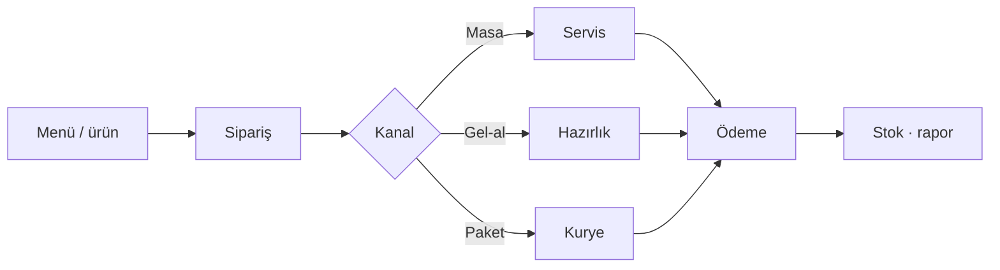
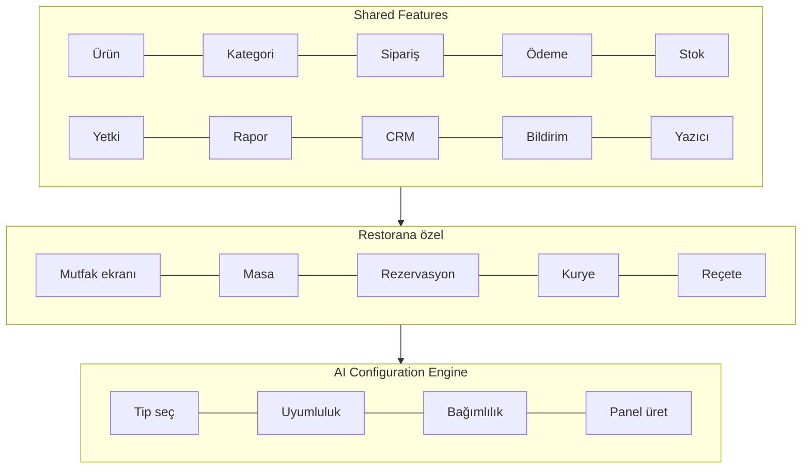

# 01 Restoran

## Özet
- 5 işletme tipi: Fast Food, Fine Dining, Cafe & Bistro, Buffet, Delivery.
- Ortak çekirdek hipotezi: ürün, kategori, sipariş, ödeme, stok, yetki, rapor her tipte zorunlu.
- AI, Feature Registry’den işletme tipine göre C/R/O özelliklerini seçer; Configuration Engine doğrular; admin paneli deterministik üretilir.
- Bağımlılık: Kurye → Sipariş + Adres + Teslimat bölgesi. Mutfak ekranı → Sipariş. Önerilen özellik bağımlılığı otomatik açmaz.
- Klasik restoran otomasyonu değil: Industry → Business Type → Feature → Module → Dependency → Configuration → Workflow → AI Orchestration.

<!-- dallar:start -->
## Dallar (ağaç)
> **Sektör → Dal → Alt dal → Fonksiyon.** Fonksiyon havuzu: `07 Fonksiyonlar/` · Ortak araçlar: `04 Modüller/`

| Dal | Alt dal | Fonksiyon | Durum |
|---|---|---|---|
| [[Fast Food]] | 1 | 16 | açık |
| [[Fine Dining]] | 1 | 16 | açık |
| [[Cafe & Bistro]] | 1 | 16 | açık |
| [[Buffet]] | 1 | 16 | açık |
| [[Delivery]] | 1 | 18 | açık |
<!-- dallar:end -->

## Alt işletme türleri (onay listesi)
> İşaretli = kullanıcı restoran mimarisi notundan onaylı tipler.

- [x] [[Fast Food|Fast Food / Hızlı Servis]]
- [x] [[Fine Dining|Fine Dining / Premium]]
- [x] [[Cafe & Bistro|Cafe & Bistro]]
- [x] [[Buffet|Buffet / Açık Büfe]]
- [x] [[Delivery|Paket Servis / Delivery]]

**Sınırlar**
- Dark kitchen Delivery’dedir; masa rezervasyonu Core değildir.
- Drive-thru yalnız Fast Food’ta Optional.
- Otel oda hesabı yalnız Buffet’te Optional.
- Platform entegrasyonu (Yemeksepeti / Trendyol) Delivery’de Optional; Recommended satırı genel “platform entegrasyonu”dur.

## Ortak iş akışı


## Araç mimarisi
> İlke: her araç bir kez yapılır. Bir işletme tipi = Shared Features + tip özel paket. AI kod yazmaz; Feature Registry’den yapılandırır.



## Araç matrisi (hangi araç kaç alt türe hizmet ediyor)
> ● = Core/zorunlu veya Recommended kullanım. C/R/O ayrıntısı alt bölümde. genel = tüm sektörler, ozel = yalnız restoran.

| Araç | Tür | Fast Food | Fine Dining | Cafe | Buffet | Delivery | Toplam |
| --- | --- | --- | --- | --- | --- | --- | --- |
| [[Ürün Yönetimi]] | ozel | ● | ● | ● | ● | ● | **5** |
| [[Kategori Yönetimi]] | ozel | ● | ● | ● | ● | ● | **5** |
| [[Sipariş Yönetimi]] | ozel | ● | ● | ● | ● | ● | **5** |
| [[Ödeme Yönetimi]] | ozel | ● | ● | ● | ● | ● | **5** |
| [[Stok Yönetimi]] | ozel | ● | ● | ● | ● | ● | **5** |
| [[Kullanıcı ve Yetki]] | ozel | ● | ● | ● | ● | ● | **5** |
| [[Raporlama]] | ozel | ● | ● | ● | ● | ● | **5** |
| [[Yazıcı Yönlendirme]] | ozel | ● | ● | ● | ● | ● | **5** |
| [[Mutfak Ekranı]] | ozel | ● | ● | ● | ● | ● | **5** |
| [[Masa Yönetimi]] | ozel |  | ● | ● | ● |  | **3** |
| [[Rezervasyon]] | ozel |  | ● |  |  |  | **1** |
| [[QR Menü]] | ozel |  | ● | ● |  |  | **2** |
| [[Kurye Yönetimi]] | ozel |  |  |  |  | ● | **1** |
| [[Müşteri CRM]] | ozel | ● | ● | ● | ● | ● | **5** |
| [[Sadakat]] | ozel | ● | ● | ● |  | ● | **4** |
| [[Reçete]] | ozel | ● | ● | ● | ● | ● | **5** |
| [[Çoklu Şube]] | ozel |  |  |  |  |  | **0** |
| [[Muhasebe ve Gelir-Gider]] | genel | ● | ● | ● | ● | ● | **5** |
| [[e-Fatura ve e-Arşiv]] | genel | ● | ● | ● | ● | ● | **5** |
| [[AI Asistan]] | genel | ● | ● | ● | ● | ● | **5** |
| [[Ayarlar]] | genel | ● | ● | ● | ● | ● | **5** |

## Ortak ihtiyaçlar (5 tipte sıklık)
| İhtiyaç | Kategori | Sıklık |
|---|---|---|
| [[Ürün ve menü yönetimi]] | operasyon | 5/5 |
| [[Sipariş yönetimi]] | operasyon | 5/5 |
| [[Ödeme ve kasa]] | finans | 5/5 |
| [[Stok]] | operasyon | 5/5 |
| [[Yetki]] | yasal | 5/5 |
| [[Raporlama]] | finans | 5/5 |
| [[Mutfak ekranı]] | operasyon | 5/5 |
| [[Müşteri CRM]] | musteri | 5/5 |
| [[Reçete]] | operasyon | 5/5 |
| [[Yazıcı]] | operasyon | 5/5 |
| [[Sadakat]] | musteri | 4/5 |
| [[Masa yönetimi]] | operasyon | 3/5 |
| [[QR menü]] | musteri | 2/5 |
| [[Rezervasyon]] | musteri | 1/5 |
| [[Kurye yönetimi]] | operasyon | 1/5 |
| [[Çoklu şube]] | operasyon | 0/5 |

## Feature durumu (C / R / O)
> C = Core zorunlu · R = Recommended · O = Optional

| Feature | Fast Food | Fine Dining | Cafe | Buffet | Delivery |
| --- | --- | --- | --- | --- | --- |
| Product Management | C | C | C | C | C |
| Category Management | C | C | C | C | C |
| Order Management | C | C | C | C | C |
| Payment Management | C | C | C | C | C |
| Inventory Management | C | C | C | C | C |
| User & Role Management | C | C | C | C | C |
| Reporting & Analytics | C | C | C | C | C |
| Kitchen Display System | C | R | R | R | R |
| Table Management | O | C | C | R | O |
| Reservation System | O | C | O | O | O |
| QR Menu | O | R | R | O | O |
| Courier Management | O | O | O | O | C |
| Customer CRM | R | R | R | R | C |
| Loyalty System | R | R | R | O | R |
| Multi-Branch | O | O | O | O | O |
| Printer Routing | C | C | C | R | R |
| Food Recipe Management | R | R | R | C | R |

## Zorunlu bağımlılık
| Feature | required |
| --- | --- |
| [[Kurye Yönetimi]] | Sipariş, Adres, Teslimat bölgesi |
| [[Mutfak Ekranı]] | Sipariş |

> Bağımlılık türleri: required · conditional · recommended. Recommended otomatik açılmaz.

## Tip ağaçları

### Fast Food
- C: POS, ürün/varyant, menü kombinasyonu, ekstra, KDS, sipariş no, hızlı kasa
- R: paket/gel-al, otomatik yönlendirme, hazırlık süresi, kampanya, toplu sipariş
- O: QR menü, kiosk, çoklu şube, drive-thru

### Fine Dining
- C: masa, rezervasyon, garson atama, adisyon böl/birleştir, masa transferi
- R: host, kurs sırası, özel/VIP profil, servis zamanlama, depozito, geri bildirim
- O: şarap eşleştirme, şef menüsü, özel etkinlik, kişiselleştirilmiş menü

### Cafe & Bistro
- C: masa, hızlı kasa, sıcak/soğuk varyant, boyut/ekstra, masa bazlı sipariş
- R: kahve reçetesi, paket, QR, sadakat, üyelik, kahve istasyonu, gel-al
- O: pastane vitrin, günlük özel, kahve kartı, happy hour

### Buffet
- C: büfe istasyonu, kategori, kişi başı ücret, kapasite, günlük menü, self-servis
- R: yenileme, giriş-çıkış, fire, üretim planı, alerjen, doluluk, gramaj, israf
- O: oda hesabı, grup rezervasyonu

### Delivery
- C: online sipariş, takip, kurye, bölge, adres, durum bildirimi, online ödeme, hazırlık süresi
- R: mesafe ücreti, kapıda ödeme, platform, kurye performans, otomatik atama, gel-al, minimum tutar, analiz
- O: Yemeksepeti/Trendyol, canlı konum

## AI Feature Registry örneği
```json
{
  "id": "restaurant.delivery.courier_management",
  "industry": "restaurant",
  "category": "logistics",
  "name": "Courier Management",
  "business_types": ["fast_food", "delivery"],
  "dependencies": [
    {"id": "restaurant.orders", "kind": "required"},
    {"id": "restaurant.addresses", "kind": "required"},
    {"id": "restaurant.delivery.zones", "kind": "required"}
  ],
  "features": ["automatic_assignment", "manual_assignment", "live_tracking"]
}
```

## Kaynaklar
- Kullanıcı restoran mimari notu (Fast Food / Fine Dining / Cafe / Buffet / Delivery C-R-O listeleri)
- `04 Modüller/00 Ortak Çekirdek.md`
