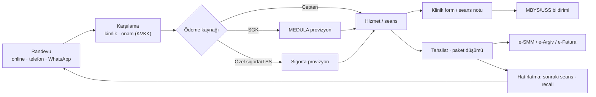
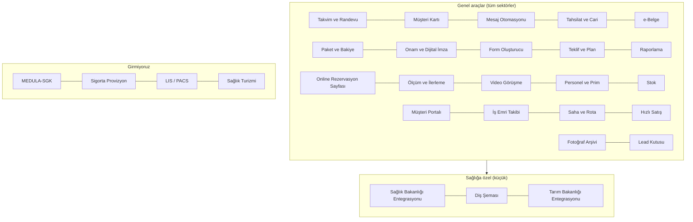
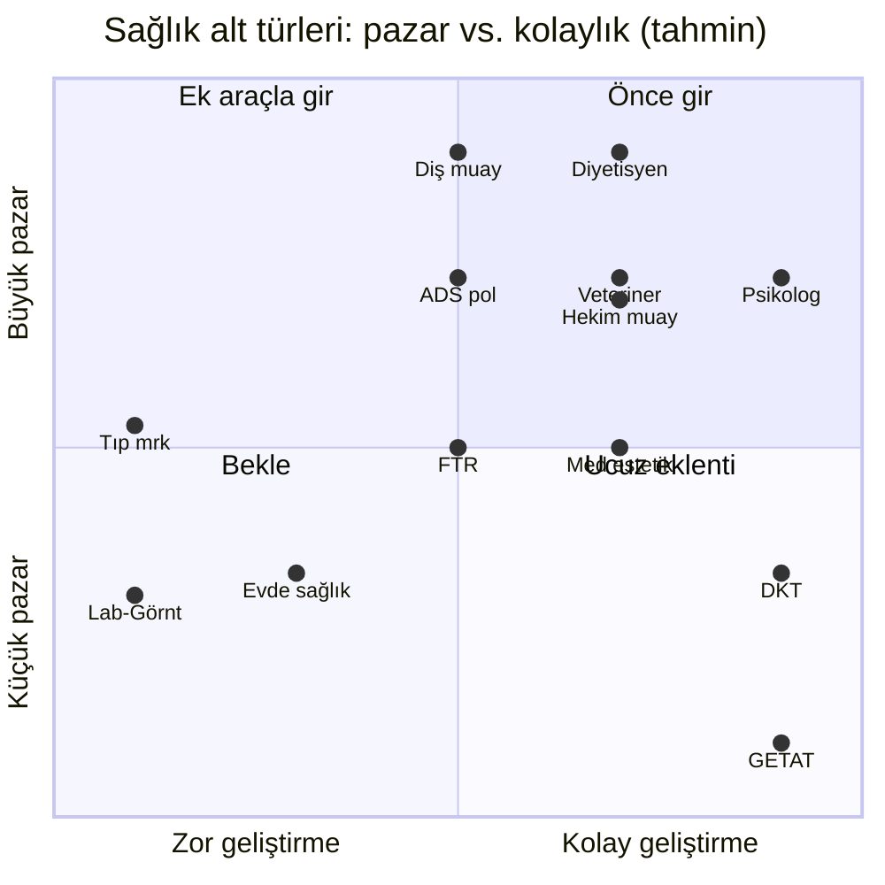

# 03 Sağlık

## Özet
- 13 alt tür araştırıldı (2026-11-21; Veteriner ve Medikal estetik ⚠️ listesinden kullanıcı onayıyla eklendi). Hepsi randevu + hasta kartı + tahsilat + e-belge + KVKK üzerinde çalışıyor → **ortak çekirdek hipotezi doğrulandı.**
- Sağlığa özgü üç zorunluluk çekirdeğin üstüne biniyor: **Sağlık Bakanlığı veri bildirimi (MBYS/USS)**, **e-SMM** (serbest meslek) ve **özel nitelikli veri (KVKK Md. 6)**.
- Ayrışma ödeme kaynağına göre: **cepten ödeyenler** (diş, psikolog, diyetisyen, DKT, GETAT, muayenehane) çekirdekle kolay; **SGK/MEDULA isteyenler** (tıp merkezi, lab, SGK'lı FTR) HBYS seviyesi ister.
- En büyük sayılabilir pazar diş: TDB'ye göre ~23.700 özel diş tesisi. Rekabet yoğun ama fiyat şeffaf → kıyaslanabilir.
- Rekabet boşluğu: FTR, psikolog, DKT, evde sağlık, GETAT. Pazar yerleri (Doktortakvimi, Doktorsitesi) pahalı ve taahhüt/iptal şikayetiyle dolu.

<!-- dallar:start -->
## Dallar (ağaç)
> **Sektör → Dal → Alt dal → Fonksiyon.** Görsel: [[Ağaç – 03 Sağlık.canvas]] · Fonksiyon havuzu: `07 Fonksiyonlar/`

| Dal | Alt dal | Fonksiyon | Durum |
|---|---|---|---|
| [[Ağız ve Diş Sağlığı]] | 9 | 65 | açık |
| [[Hekim Muayenehaneleri]] | 12 | 43 | açık |
| [[Poliklinik ve Tıp Merkezleri]] | 3 | 34 | ⛔ girmiyoruz (öneri) |
| [[Fizik Tedavi ve Rehabilitasyon]] | 5 | 40 | açık |
| [[Ruh Sağlığı]] | 5 | 33 | açık |
| [[Beslenme ve Diyet]] | 3 | 29 | açık |
| [[Dil, Konuşma ve İşitme Terapisi]] | 2 | 28 | açık |
| [[Laboratuvar ve Görüntüleme]] | 2 | 18 | ⛔ girmiyoruz (öneri) |
| [[Evde Sağlık ve Bakım]] | 2 | 31 | açık |
| [[Geleneksel ve Tamamlayıcı Tıp (GETAT)]] | 2 | 23 | açık |
| [[Medikal Estetik ve Saç Ekimi]] | 4 | 39 | açık |
| [[Veteriner Hekimlik]] | 5 | 44 | açık |
| [[Diğer Sağlık Meslek Birimleri]] | 3 | 31 | açık |
| [[Eczane]] | 6 | 50 | açık |
<!-- dallar:end -->

## Alt işletme türleri (onay listesi)
> İşaretli = onaylandı (2026-11-21). Ana liste kullanıcı "devamı sende" deyince; Veteriner ve Medikal estetik ayrıca onaylandı.

- [x] [[Diş Muayenehanesi|Diş kliniği/muayenehane]]
- [x] [[Ağız ve Diş Sağlığı Polikliniği|Ağız-diş sağlığı polikliniği]]
- [x] [[Özel Hekim Muayenehanesi|Özel hekim muayenehanesi]]
- [x] [[Tıp Merkezi - Poliklinik|Tıp merkezi/poliklinik]]
- [x] [[Özel Fizik Tedavi Kliniği|Fizik tedavi ve rehabilitasyon]]
- [x] [[Psikolog - Psikolojik Danışman|Psikolog/psikolojik danışman]]
- [x] [[Diyetisyen|Diyetisyen]]
- [x] [[Dil ve Konuşma Terapisti|Dil ve konuşma terapisti]]
- [x] [[Laboratuvar - Görüntüleme Merkezi|Laboratuvar/görüntüleme merkezi]]
- [x] [[Evde Sağlık - Hemşirelik|Evde sağlık/hemşirelik]]
- [x] [[GETAT Uygulama Ünitesi|GETAT (akupunktur vb.)]]
- [x] [[Veteriner Kliniği|Veteriner]]
- [x] [[Medikal Estetik|Medikal estetik]]

**⚠️ Sınırda — eklenmedi (2026-11-21 kullanıcı kararı; Veteriner ve Medikal estetik eklendi; Eczane sonradan dal olarak eklendi):**
- [ ] ~~Optik~~ — eklenmedi
- [ ] ~~İşitme cihazı merkezi~~ — eklenmedi
- [ ] ~~Hastane~~ — eklenmedi

## Ortak iş akışı


## Araç mimarisi
> İlke: her araç bir kez yapılır, tüm sektörlere verilir. Bir işletme türü = araçların birleşimi. Tek türe özel büyük geliştirme yok.



## Araç matrisi (hangi araç kaç alt türe hizmet ediyor)
> ● = kullanıyor. genel = tüm sektörler, ozel = yalnız sağlık, girmiyoruz = yapılmayacak.

| Araç | Tür | Diş muay. | ADS pol. | Hekim muay. | Tıp mrk. | FTR | Psikolog | Diyetisyen | DKT | Lab/Görnt. | Evde sağlık | GETAT | Veteriner | Med. estetik | Toplam |
| --- | --- | --- | --- | --- | --- | --- | --- | --- | --- | --- | --- | --- | --- | --- | --- |
| [[Takvim ve Randevu]] | genel | ● | ● | ● | ● | ● | ● | ● | ● | ● | ● | ● | ● | ● | **13** |
| [[Tahsilat ve Cari]] | genel | ● | ● | ● | ● | ● | ● | ● | ● | ● | ● | ● | ● | ● | **13** |
| [[e-Belge]] | genel | ● | ● | ● | ● | ● | ● | ● | ● | ● | ● | ● | ● | ● | **13** |
| [[Onam ve Dijital İmza]] | genel | ● | ● | ● | ● | ● | ● | ● | ● | ● | ● | ● | ● | ● | **13** |
| [[Müşteri Kartı]] | genel | ● | ● | ● | ● | ● | ● | ● | ● |  | ● | ● | ● | ● | **12** |
| [[Mesaj Otomasyonu]] | genel | ● | ● | ● | ● | ● | ● | ● | ● |  | ● | ● | ● | ● | **12** |
| [[Raporlama]] | genel | ● | ● | ● | ● | ● | ● | ● | ● |  | ● | ● | ● | ● | **12** |
| [[Online Rezervasyon Sayfası]] | genel | ● | ● | ● | ● | ● | ● | ● | ● |  | ● | ● | ● | ● | **12** |
| [[Form Oluşturucu]] | genel | ● | ● | ● | ● | ● | ● | ● | ● |  |  | ● | ● | ● | **11** |
| [[Paket ve Bakiye]] | genel |  |  |  |  | ● | ● | ● | ● |  | ● | ● | ● | ● | **8** |
| [[Stok]] | genel | ● | ● |  |  |  |  |  |  |  | ● |  | ● | ● | **5** |
| [[Personel ve Prim]] | genel |  | ● |  | ● | ● |  |  |  |  |  |  |  | ● | **4** |
| [[Teklif ve Plan]] | genel | ● | ● |  |  |  |  |  |  |  |  |  |  | ● | **3** |
| [[Video Görüşme]] | genel |  |  |  |  |  | ● | ● | ● |  |  |  |  |  | **3** |
| [[Ölçüm ve İlerleme]] | genel |  |  |  |  | ● |  | ● | ● |  |  |  |  |  | **3** |
| [[Müşteri Portalı]] | genel |  |  |  |  |  |  | ● | ● |  | ● |  |  |  | **3** |
| [[İş Emri Takibi]] | genel | ● | ● |  |  |  |  |  |  |  |  |  |  |  | **2** |
| [[Lead Kutusu]] | genel |  | ● |  |  |  |  |  |  |  |  |  |  | ● | **2** |
| [[Hızlı Satış]] | genel |  |  |  |  |  |  |  |  |  |  |  | ● |  | **1** |
| [[Fotoğraf Arşivi]] | genel |  |  |  |  |  |  |  |  |  |  |  |  | ● | **1** |
| [[Saha ve Rota]] | genel |  |  |  |  |  |  |  |  |  | ● |  |  |  | **1** |
| [[Sağlık Bakanlığı Entegrasyonu]] | ozel | ● | ● | ● | ● | ● | ● |  |  | ● | ● | ● |  | ● | **10** |
| [[Diş Şeması]] | ozel | ● | ● |  |  |  |  |  |  |  |  |  |  |  | **2** |
| [[Tarım Bakanlığı Entegrasyonu]] | ozel |  |  |  |  |  |  |  |  |  |  |  | ● |  | **1** |
| [[MEDULA-SGK]] | girmiyoruz |  |  |  | ● |  |  |  |  | ● |  |  |  |  | **2** |
| [[Sigorta Provizyon]] | girmiyoruz |  |  |  | ● |  |  |  |  | ● |  |  |  |  | **2** |
| [[Sağlık Turizmi]] | girmiyoruz |  |  |  |  |  |  |  |  |  |  |  |  |  | **0** |
| [[Topluluk ve Eşleştirme]] | girmiyoruz |  |  |  |  |  |  |  |  |  |  |  |  |  | **0** |
| [[MEBBİS ve BKDS Entegrasyonu]] | girmiyoruz |  |  |  |  |  |  |  |  |  |  |  |  |  | **0** |
| [[UYAP Entegrasyonu]] | girmiyoruz |  |  |  |  |  |  |  |  |  |  |  |  |  | **0** |
| [[GİB Beyanname ve e-Defter]] | girmiyoruz |  |  |  |  |  |  |  |  |  |  |  |  |  | **0** |
| [[SBM ve Sigorta Şirketi Entegrasyonu]] | girmiyoruz |  |  |  |  |  |  |  |  |  |  |  |  |  | **0** |
| [[Belediye ve YDS Entegrasyonu]] | girmiyoruz |  |  |  |  |  |  |  |  |  |  |  |  |  | **0** |
| [[Bordro ve SGK]] | girmiyoruz |  |  |  |  |  |  |  |  |  |  |  |  |  | **0** |

## Ortak ihtiyaçlar (13 alt türde sıklık)
| İhtiyaç | Kategori | Sıklık |
|---|---|---|
| [[Randevu ve takvim yönetimi]] | operasyon | 13/13 |
| [[Tahsilat ve açık hesap takibi]] | finans | 13/13 |
| [[e-Belge (e-SMM, e-Fatura, e-Arşiv)]] | yasal | 13/13 |
| [[KVKK, onam ve gizlilik]] | yasal | 13/13 |
| [[Hatırlatma ve gelmeme azaltma]] | musteri | 12/13 |
| [[Müşteri kartı ve geçmiş]] | operasyon | 12/13 |
| [[Sağlık Bakanlığı veri bildirimi (MBYS-USS)]] | yasal | 10/13 |
| [[Paket ve seans bakiyesi takibi]] | finans | 8/13 |
| [[Yapılandırılmış form ve notlar]] | operasyon | 5/13 |
| [[Stok ve sarf takibi]] | operasyon | 5/13 |
| [[Özel sigorta ve TSS provizyonu]] | finans | 4/13 |
| [[Personel hakediş ve prim]] | personel | 4/13 |
| [[Tekrarlayan seans planı]] | operasyon | 3/13 |
| [[Teklif, plan ve taksit]] | finans | 3/13 |
| [[SGK MEDULA provizyon ve faturalama]] | yasal | 3/13 |
| [[Kaynak planlama (oda, cihaz, ekipman)]] | operasyon | 3/13 |
| [[Müşteri portalı ve iletişim]] | musteri | 3/13 |
| [[Ölçüm ve ilerleme takibi]] | operasyon | 3/13 |
| [[Online randevu ve görünürlük]] | pazarlama | 3/13 |
| [[Ücret tarifesi uyumu]] | yasal | 3/13 |
| [[Online seans]] | musteri | 2/13 |
| [[Dış iş ve tedarikçi takibi]] | operasyon | 2/13 |
| [[Saha ziyareti ve rota planı]] | operasyon | 2/13 |
| [[Lead ve teklif takibi]] | pazarlama | 2/13 |
| [[Şube ve yönetim raporu]] | finans | 2/13 |
| [[Hızlı ürün satışı (perakende)]] | finans | 1/13 |
| [[Veteriner resmi kayıt (PETVET, e-Reçete)]] | yasal | 1/13 |
| [[Öncesi-sonrası fotoğraf arşivi]] | operasyon | 1/13 |
| [[Yabancı hasta ve sağlık turizmi]] | finans | 1/13 |
| [[Kapora, ön ödeme ve iptal kuralı]] | finans | 0/13 |
| [[Walk-in sıra yönetimi]] | operasyon | 0/13 |
| [[Hediye çeki, kupon ve sadakat]] | pazarlama | 0/13 |
| [[Cihaz uyumu ve bakım kaydı]] | yasal | 0/13 |
| [[Acenta ve partner komisyonu]] | finans | 0/13 |
| [[Giriş kontrolü ve doluluk]] | operasyon | 0/13 |
| [[Grup ders programı ve kontenjan]] | operasyon | 0/13 |
| [[Otomatik tahsilat ve abonelik yenileme]] | finans | 0/13 |
| [[Üyelik dondurma, fesih ve cayma]] | yasal | 0/13 |
| [[Antrenman programı hazırlama]] | musteri | 0/13 |
| [[Seviye, kuşak ve terfi takibi]] | operasyon | 0/13 |
| [[Lisans, sağlık raporu ve belge süresi]] | yasal | 0/13 |
| [[Veli iletişimi ve yoklama]] | musteri | 0/13 |
| [[Saha ve kort doluluğu]] | operasyon | 0/13 |
| [[Havuz suyu kalite kaydı]] | yasal | 0/13 |
| [[Takım, maç ve turnuva yönetimi]] | operasyon | 0/13 |
| [[Öğrenci servis takibi]] | operasyon | 0/13 |
| [[Kurumsal üyelik ve aggregator mutabakatı]] | finans | 0/13 |
| [[Yoklama ve devam takibi]] | operasyon | 0/13 |
| [[Ders programı ve sınıf planı]] | operasyon | 0/13 |
| [[Sınav sonuç analizi ve veli raporu]] | musteri | 0/13 |
| [[Veli iletişimi ve duyuru]] | musteri | 0/13 |
| [[MEB kayıt ve bildirim uyumu]] | yasal | 0/13 |
| [[Devlet destek eğitimi faturalama]] | finans | 0/13 |
| [[Öğrenci servisi ve güvenli teslim]] | operasyon | 0/13 |
| [[Ücret iadesi, indirim ve burs kuralları]] | finans | 0/13 |
| [[Direksiyon dersi ve araç planı]] | operasyon | 0/13 |
| [[Resmî sınav randevusu ve hak takibi]] | operasyon | 0/13 |
| [[Sertifika ve kurs belgesi]] | yasal | 0/13 |
| [[Telafi dersi yönetimi]] | operasyon | 0/13 |
| [[Kayıtlı içerik satışı]] | finans | 0/13 |
| [[Çocuk günlük bakım raporu]] | musteri | 0/13 |
| [[Dosya, dava ve duruşma takibi]] | operasyon | 0/13 |
| [[Hak düşürücü süre ve yasal takvim]] | yasal | 0/13 |
| [[Müşteri evrak toplama]] | operasyon | 0/13 |
| [[Proje, görev ve teslim yönetimi]] | operasyon | 0/13 |
| [[Saat takibi ve faturalanabilir zaman]] | finans | 0/13 |
| [[Retainer ve aylık sabit hizmet ücreti]] | finans | 0/13 |
| [[Aşama bazlı faturalama ve hakediş]] | finans | 0/13 |
| [[Masraf avansı ve müşteri adına gider]] | finans | 0/13 |
| [[Poliçe yenileme ve komisyon takibi]] | operasyon | 0/13 |
| [[Hizmet ihracı ve döviz faturası]] | finans | 0/13 |
| [[Belge şablonu ve evrak üretimi]] | operasyon | 0/13 |
| [[Vekâlet, sözleşme ve yetki arşivi]] | yasal | 0/13 |
| [[Müşteri onayı ve revizyon turu]] | musteri | 0/13 |
| [[Teslim galerisi ve dosya teslimi]] | musteri | 0/13 |
| [[Resmî kurum sistemleri entegrasyonu (UYAP, GİB, SBM)]] | yasal | 0/13 |
| [[Emanet ürün kabul ve teslim takibi]] | operasyon | 0/13 |
| [[Servis fişi, garanti ve tamir süresi]] | yasal | 0/13 |
| [[Keşif, metraj ve iş teklifi]] | operasyon | 0/13 |
| [[Teknisyen atama ve canlı takip]] | operasyon | 0/13 |
| [[Ev adresi ve anahtar güvenliği]] | yasal | 0/13 |
| [[Hasar ve tazmin anlaşmazlığı]] | musteri | 0/13 |
| [[Nakliyat ekspertizi ve taşıma sözleşmesi]] | yasal | 0/13 |
| [[Biyosidal uygulama kaydı]] | yasal | 0/13 |
| [[Periyodik bakım sözleşmesi]] | finans | 0/13 |
| [[Bakıcı eşleştirme ve yerleştirme]] | operasyon | 0/13 |
| [[Platform bağımlılığı ve lead maliyeti]] | pazarlama | 0/13 |
| [[Tadilat iş takvimi ve hakediş]] | finans | 0/13 |

## Öncelik tablosu
> Puanlar tahmindir (1–5, 5 = bizim için en iyi). Öncelik = 5 puanın ortalaması.

| # | Alt tür | Pazar | Ödeme | Rekabet | Kolaylık | Aciliyet | Öncelik |
| --- | --- | --- | --- | --- | --- | --- | --- |
| 1 | [[Medikal Estetik]] | 3 | 5 | 4 | 4 | 4 | **4.0** |
| 2 | [[Özel Hekim Muayenehanesi]] | 4 | 3 | 3 | 4 | 5 | **3.8** |
| 3 | [[Psikolog - Psikolojik Danışman]] | 4 | 3 | 4 | 5 | 3 | **3.8** |
| 4 | [[Diş Muayenehanesi]] | 5 | 4 | 2 | 3 | 4 | **3.6** |
| 5 | [[Ağız ve Diş Sağlığı Polikliniği]] | 4 | 5 | 2 | 3 | 4 | **3.6** |
| 6 | [[Özel Fizik Tedavi Kliniği]] | 3 | 4 | 4 | 3 | 4 | **3.6** |
| 7 | [[Diyetisyen]] | 5 | 2 | 4 | 4 | 3 | **3.6** |
| 8 | [[Dil ve Konuşma Terapisti]] | 2 | 3 | 5 | 5 | 3 | **3.6** |
| 9 | [[Veteriner Kliniği]] | 4 | 3 | 2 | 4 | 4 | **3.4** |
| 10 | [[GETAT Uygulama Ünitesi]] | 1 | 3 | 4 | 5 | 3 | **3.2** |
| 11 | [[Evde Sağlık - Hemşirelik]] | 2 | 3 | 5 | 2 | 3 | **3.0** |
| 12 | [[Tıp Merkezi - Poliklinik]] | 3 | 4 | 2 | 1 | 4 | **2.8** |
| 13 | [[Laboratuvar - Görüntüleme Merkezi]] | 2 | 4 | 2 | 1 | 4 | **2.6** |



## Yasal çerçeve
| Konu | Kural | Yazılım etkisi | Kaynak |
|---|---|---|---|
| Muayenehane/poliklinik/tıp merkezi/FTR | Ayakta Teşhis ve Tedavi Yönetmeliği (RG 19.04.2025). Md. 24: tescilli bilgi sistemi + merkezi veri aktarımı; Md. 16/9 ayrıntılı fatura | Tescil + MBYS/USS zorunlu | https://www.alomaliye.com/2025/04/19/ayakta-teshis-ve-tedavi-yapilan-ozel-saglik-kuruluslari-hakkinda-yonetmelik/ |
| Diş | ADS Kuruluşları Yönetmeliği (RG 06.10.2022, değ. 15.12.2024); poliklinik en az 2 hekim | Çok hekim/ünit | https://www.alomaliye.com/2024/12/15/agiz-ve-dis-sagligi-hizmeti-sunulan-ozel-saglik-kuruluslari-15-12-2024/ |
| Psikolog, diyetisyen, DKT, fizyoterapist | Sağlık Meslek Mensuplarının Serbest Meslek İcrası Yönetmeliği (RG 29.03.2025): yalnız gerçek kişi, şube yok, hekim tanısı/plan şartı, merkezi veri | Sevk belgesi alanı, veri aktarımı | https://www.alomaliye.com/2025/03/29/saglik-meslek-mensuplarinin-serbest-meslek-icrasi-hakkinda-yonetmelik/ |
| GETAT | Yönetmelik RG 28.04.2026: yalnız tesis bünyesi, rıza, 24 saatte yan etki bildirimi, taban/tavan ücret | Rıza, ücret ön bildirimi | https://www.alomaliye.com/2026/04/28/geleneksel-ve-tamamlayici-tip-uygulamalari-yonetmeligi-2026/ |
| Evde sağlık | Yönetmelik RG 23.06.2026; özel kuruluşları da kapsar, Md. 26 veri gönderimi | Saha + veri | https://www.alomaliye.com/2026/06/23/evde-saglik-ve-palyatif-bakim-hizmetlerine-iliskin-yeni-yonetmelik-yayimlandi/ |
| MBYS cezası | Bildirim yapmayana 2 uyarı sonra önceki ay brüt gelirin %1'i; tekrarında faaliyet durdurma. Hukuki zemin tartışmalı (7538 s. Kanun, Danıştay) | Satış argümanı (ölçülü) | https://www.diken.com.tr/?p=1255514 |
| e-SMM | Serbest meslek hekimi dahil zorunlu; POS fişi e-SMM yerine geçmez. Serbest meslekte e-Fatura zorunlu değil | e-Belge modülü gerekir | https://www.muhasebenews.com/?p=158037 |
| e-Fatura (şirket) | 2024/2025 brüt satışı 3 milyon ₺+ olanlar 01.07.2026'dan zorunlu (firma blogları; GİB'den teyit) | e-Fatura/e-Arşiv | https://faturaport.com/blog/e-fatura/2026-e-fatura-gecis-limitleri-kimler-dijital-faturaya-gecmek-zorunda |
| KVKK/VERBİS | Sağlık verisi özel nitelikli. 2025/1572: >10 çalışan veya >10 milyon ₺ bilanço VERBİS'e kayıt; küçüklerin çoğu muaf ama aydınlatma/rıza/güvenlik sürer | Onam, log, şifreleme | https://www.alomaliye.com/2026/01/13/kisisel-verileri-koruma-kurulunun-2025-1572-sayili-kararinin-uygulama-esaslari/ |
| Veteriner | Muayenehane ve Poliklinik Yönetmeliği (RG 15.10.2011); 7527 s. Kanun: kedi-köpek kimliklendirme zorunlu (son tarih 31.12.2025), ceza 10.423₺/hayvan (2026); e-Reçete 2018'den beri zorunlu | Aşı/çip kaydı; hizmete e-SMM, ürüne e-Arşiv | https://www.alomaliye.com/2024/08/02/7527-sayili-hayvanlari-koruma-kanununda-degisiklik/ |
| Medikal estetik | 07.01.2025: sertifikalı eğitim alan tüm hekimler yapabilir (TDD itirazı yargıda). Saç ekimi ayrı yönetmelik (RG 06.05.2023), yalnız tıp merkezi/poliklinik/hastane | Hekim yetkisi alanı, onam | https://www.hukukihaber.net/saglik-hukuku-yazilari-ii-estetik-mudahalelerde-son-durum |
| Öncesi-sonrası fotoğraf | Tanıtım Yönetmeliği: Ek-1 rızası, aynı açı/ışık, tarih, filtre yasak, rıza geri alınınca kaldırma; ihlalde aylık brüt gelirin %2'sine kadar ceza | Fotoğraf Arşivi + rıza bağlantısı | https://www.hukukihaber.net/hekimler-sosyal-medyada-neleri-paylasabilir |
| Reklam | Tanıtım Yönetmeliği (RG 12.11.2025): talep yaratıcı tanıtım yasak. Hatırlatma SMS'i hakkında açık hüküm yok (tahmin: serbest) | Hatırlatma ≠ pazarlama; kampanya SMS'i kapalı varsayılan | https://www.alomaliye.com/2025/11/12/saglik-hizmetlerinde-tanitim-ve-bilgilendirme-faaliyetleri-hakkinda-yonetmelik-2025/ |
| FTR-SGK | Günde 1 seans, aynı bölge yılda 30 (iki bölge 60); rapordan sonra 15 gün içinde başla, 5 iş günü ara verme | Kural motoru | https://www.muhasebenews.com/bir-yil-icerisinde-30-seansa-kadar-yapilacak-fizik-tedavi-ve-rehabilitasyon-uygulamalarinin-sgk-tarafindan-karsilanir/ |
| Ücret tarifeleri | TTB HUV katsayısı yılda 2 kez artar (2026/2: %20,18); TDB asgari tarife | Fiyat = kalem kodu × katsayı | https://www.sabah.com.tr/ekonomi/saglik-enflasyonunda-10-puanlik-itiraz-7617552 |

## Pazar büyüklüğü
| Alt tür | Sayı | NACE |
|---|---|---|
| [[Diş Muayenehanesi]] | 14.458 muayenehane + 1.728 müşterek muayenehane (TDB, 2025) | 86.23 |
| [[Ağız ve Diş Sağlığı Polikliniği]] | 7.178 poliklinik + 321 ADSM (TDB, 2025); 2024'te 6.467 → hızlı büyüme | 86.23 |
| [[Özel Hekim Muayenehanesi]] | Ulusal sayı bulunamadı; ~7 bin serbest hekim (Diken, 2023); İstanbul'da 4.162 muayenehane (İPA, 2022 verisi) | 86.21 / 86.22 |
| [[Tıp Merkezi - Poliklinik]] | Bulunamadı; 2026 planlama ilanında yeni kapasite açılan türler (SB, 2026) | 86.22 |
| [[Özel Fizik Tedavi Kliniği]] | Ruhsatlı merkez sayısı bulunamadı; '5 binden fazla ruhsatsız merkez' iddiası (Cumhuriyet, tarih belirsiz) | 86.90 (Rev.2.1: 86.95) |
| [[Psikolog - Psikolojik Danışman]] | ~150 bin psikolog (TPD beyanı, tarih belirsiz); birim açabilen klinik psikolog sayısı bulunamadı | 86.90 (Rev.2.1: 86.93) |
| [[Diyetisyen]] | ~55.538 diyetisyen (akademik hesaplama, 2025); kamuda 3.832 kadro | 86.90 (Rev.2.1: 86.99 — tahmin) |
| [[Dil ve Konuşma Terapisti]] | Bulunamadı; 2025'te kamuya yalnız 44 kadro (TBMM önergesi) | 86.90 (Rev.2.1: 86.99 — tahmin) |
| [[Laboratuvar - Görüntüleme Merkezi]] | Bulunamadı | 86.90 (Rev.2.1: 86.91) |
| [[Evde Sağlık - Hemşirelik]] | Güncel sayı bulunamadı (2011'de ~20 ruhsatlı kurum, eski) | 86.90 (Rev.2.1: 86.94 — tahmin) |
| [[GETAT Uygulama Ünitesi]] | 84 uygulama merkezi, 2.160 ünite, 26 bin+ sertifikalı (Bakan beyanı, tarih belirsiz) | 86.90 (Rev.2.1: 86.96) |
| [[Veteriner Kliniği]] | 9.637 klinik: 9.387 muayenehane, 134 poliklinik, 116 hayvan hastanesi (Ekim 2025, doktora çalışması kaynaklı); 10 yılda ~2 kat | 75.00 |
| [[Medikal Estetik]] | Resmî sayı bulunamadı; doktorsitesi'nde ~555 'sertifikalı medikal estetik' profili (2026, yalnız dizin). Tahmin: birkaç bin muayenehane/poliklinik bu hizmeti veriyor | 86.22 (hastane bünyesi 86.10) |

- NACE: Türkiye 2026'da "NACE Rev.2.1-Altılı"ya geçti; 6 haneli kodlar GİB listesinden çekilecek (https://www.alomaliye.com/2026/04/21/turkiyede-nace-faaliyet-siniflamalari/).
- Sağlık İstatistikleri Yıllığı 2024 özel kuruluş tablolarına ulaşılamadı → poliklinik, FTR, lab sayıları **eksik**; sonraki turda PDF'ten doğrulanacak.

## Rakip fiyat haritası
| Segment | Aralık | Rakipler |
|---|---|---|
| Pazar yeri (hasta getirir) | 5.399–7.499₺/ay +KDV, yıllık taahhüt | [[Doktortakvimi]], [[Doktorsitesi]] |
| Diş yazılımı | ~675–1.775/ay; ek hekim 240–320₺ | [[DentalBulut]], [[DentSoft]], [[Medicasimple]], [[Dr.DENTES]] |
| Genel klinik | 12.600–25.000₺/yıl | [[Bulut Klinik]] |
| Yatay randevu | 1.083–2.490₺/ay (3–10 kişi) | [[Piyzi]] |
| Yabancı SaaS | $0 / $31 / $39 kullanıcı/ay | [[Carepatron]] |
| e-Belge | 150–940₺/ay + kontör | [[Paraşüt]] |
| Kurumsal HBYS/LIS | Teklif | [[Probel]] |
| Veteriner yazılımı | 0₺ (DoldurKabı) · 749–1.990₺/ay | [[Kolayvet]], [[Vetiva]], [[DoldurKabı]], [[BulutVet]], [[E-vet Smart]] |
| Salon yazılımı / CRM | 0₺ (Salonrandevu) · Kommo 15–45 $/kullanıcı | [[Salonrandevu]], [[Kommo]], [[Planports]] |

**Rakiplerde en sık şikayet edilenler → satış argümanımız**
| Şikayet |
| --- |
| Yıllık taahhüt, iptal edilememe, 15–67 bin ₺ cayma bedeli |
| Onaysız yenileme ve kart çekimi |
| Abonelik bitince veri için ücret (veri rehinesi) |
| Destek ulaşılamaz |
| İzinsiz hekim profili (KVKK) |
| Mobil uygulama kararsız |

## Bu sektördeki işletme türleri
```base
filters:
  and:
    - 'tip == "isletme"'
    - file.hasLink(this.file)
formulas:
  oncelik: '((pazar_puani + odeme_puani + rekabet_puani + kolaylik_puani + aciliyet_puani) / 5).toFixed(1)'
properties:
  file.name:
    displayName: İşletme türü
  note.durum:
    displayName: Durum
  formula.oncelik:
    displayName: Öncelik
  note.fiyat_araligi:
    displayName: Fiyat aralığı
  note.is_modeli:
    displayName: İş modeli
views:
  - type: table
    name: İşletme türleri
    order:
      - file.name
      - formula.oncelik
      - note.fiyat_araligi
      - note.is_modeli
      - note.durum
    sort:
      - property: formula.oncelik
        direction: DESC
```

## Kaynaklar
- Ayrıntılı liste: [[03 Sağlık – Kaynaklar]]
- Araştırma: 2026-11-21, 3 paralel kol (pazar/mevzuat, rakip, iş akışı).
