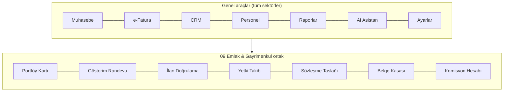

# 09 Emlak & Gayrimenkul

## Özet
- KOBİ çekirdeği, başkasına ait taşınmazın alım, satım ve kirasına aracılık eden yetki belgeli işletmelerdir. Taşınmaz Ticareti Hakkında Yönetmelik faaliyeti tacir veya esnaf işletmesine bağlar: yetki belgesi, oda kaydı, vergi mükellefiyeti, en az bir Seviye 5 sorumlu danışman ve satış personelinde Seviye 4 yeterlilik. İstanbul Ticaret Odası Gayrimenkul Hizmetleri dökümünde aracılık (68.31.01) 14.828 kayıtla en kalabalık satırdır. Ardından kendi taşınmazını kiralayanlar (68.20.02, 5.013), kendi hesabına alım satım (68.11.00, 1.243), değerleme (68.32.01, 1.174) ve apartman yöneticiliği hariç ücretli yönetim (68.32.02, 795) gelir. Bu sayılar İstanbul oda kaydıdır; Türkiye geneli ve 1–50 çalışan kırılımı yoktur.
- Gün, işlemin bitip bitmemesine göre ayrılır. Aracılık ofisinde yetkilendirme, EİDS izinli ilan, talep, yer gösterme ve teklif vardır. Uzun kira işletmesinde tahsilat, sözleşme, abonelik ve bakım vardır. Site yönetiminde 634 sayılı Kanun çerçevesinde aidat, işletme projesi, banka hesabı ve genel kurul vardır. Değerlemede saha ve imzalı rapor vardır. Kısa kiralamada 7464 sayılı Kanun çerçevesinde izin belgesi, plaket ve misafir devri vardır.
- Aracılıkta portföy CRM’de, ilan portallarda, yazışma WhatsApp’tadır. RE-OS dağınık liste ve her portala ayrı girişi mevcut biçim olarak anlatır. Sahibinden API’si her panele açık değildir. Site tarafında selfSite, Dijiyon, Konsiyon ve NOKTApp aidatı Excel’in yerine koyar. WebTapu ve e-Kira e-Devlet hizmetidir; KOBİ paneline açık TAKBİS veya e-Kira API bu taramada görülmedi.
- Karar: 09.04 en az on tam zamanlı uzman şartıyla 1–50 bandının üst sınırına yakındır. 09.05’te seyahat acentesi dışarıdadır.
- Modül: sektör ortak 7; alt sektör 5; toplam 33; MVP 20.
- Ortak çekirdek (tüm sektörler) bu dosyada yoktur → `04 Modüller/` çekirdek araçlar.

<!-- dallar:start -->
## Dallar (ağaç)
> **Sektör → Dal → Alt dal → Fonksiyon.** Görsel: [[Ağaç – 09 Emlak & Gayrimenkul]] · Fonksiyon havuzu: `07 Fonksiyonlar/`

| Dal | Alt dal | Fonksiyon | Durum |
|---|---|---|---|
| [[Emlak aracılık ofisi]] | 1 | 14 | açık |
| [[Uzun süreli kira ve mülk işletmeciliği]] | 1 | 14 | açık |
| [[Site, apartman ve toplu yapı yönetimi]] | 1 | 14 | açık |
| [[Gayrimenkul değerleme kuruluşu]] | 1 | 14 | açık |
| [[Turizm amaçlı kısa süreli konut işletmeciliği]] | 1 | 16 | açık |
<!-- dallar:end -->

## Alt işletme türleri (onay listesi)
> İşaretli = Adım 1 onay listesi.

- [x] [[Emlak aracılık ofisi|Emlak aracılık ofisi]]
- [x] [[Uzun süreli kira ve mülk işletmeciliği|Uzun süreli kira ve mülk işletmeciliği]]
- [x] [[Site, apartman ve toplu yapı yönetimi|Site, apartman ve toplu yapı yönetimi]]
- [x] [[Gayrimenkul değerleme kuruluşu|Gayrimenkul değerleme kuruluşu]]
- [x] [[Turizm amaçlı kısa süreli konut işletmeciliği|Turizm amaçlı kısa süreli konut işletmeciliği]]

## Sınırlar ve doğrulanamayan
- Sektör arşiv notundaki sınır ve doğrulanamayan maddeler geçerlidir (`08 Arşiv/eski-docs-sektorel-arastirma/ai-kaynak/09-emlak-gayrimenkul.md`).
- Açık API bulunamayan kurum portalları: panel kayıt + kullanıcı girişi.

## Ortak iş akışı


## Araç mimarisi
> İlke: her araç bir kez yapılır. Bir işletme türü = araçların birleşimi. Tek türe özel ağır resmi entegrasyon yok (API yoksa panel kaydı).



## Araç matrisi (hangi araç kaç alt türe hizmet ediyor)
> ● = kullanıyor. genel = tüm sektörler, ozel = yalnız bu sektör.

| Araç | Tür | 09.01 | Uzun | Site | Değerleme | Kısa | Toplam |
| --- | --- | --- | --- | --- | --- | --- | --- |
| [[Muhasebe ve Gelir-Gider]] | genel | ● | ● | ● | ● | ● | **5** |
| [[e-Fatura ve e-Arşiv]] | genel | ● | ● | ● | ● | ● | **5** |
| [[CRM]] | genel | ● | ● | ● | ● | ● | **5** |
| [[Personel ve Vardiya]] | genel | ● | ● | ● | ● | ● | **5** |
| [[Raporlar]] | genel | ● | ● | ● | ● | ● | **5** |
| [[AI Asistan]] | genel | ● | ● | ● | ● | ● | **5** |
| [[Ayarlar]] | genel | ● | ● | ● | ● | ● | **5** |
| [[Portföy Kartı]] | ozel | ● | ● | ● | ● | ● | **5** |
| [[Gösterim Randevu]] | ozel | ● | ● | ● | ● | ● | **5** |
| [[İlan Doğrulama]] | ozel | ● | ● | ● | ● | ● | **5** |
| [[Yetki Takibi]] | ozel | ● | ● | ● | ● | ● | **5** |
| [[Sözleşme Taslağı]] | ozel | ● | ● | ● | ● | ● | **5** |
| [[Belge Kasası]] | ozel | ● | ● | ● | ● | ● | **5** |
| [[Komisyon Hesabı]] | ozel | ● | ● | ● | ● | ● | **5** |
| [[Alıcı Eşleştirme]] | ozel | ● |  |  |  |  | **1** |
| [[Malik Yetkilendirme]] | ozel | ● |  |  |  |  | **1** |
| [[Teklif Takibi]] | ozel | ● |  |  |  |  | **1** |
| [[Ofis Portföy Payı]] | ozel | ● |  |  |  |  | **1** |
| [[Piyasa Bandı]] | ozel | ● |  |  |  |  | **1** |
| [[Kira Dosyası]] | ozel |  | ● |  |  |  | **1** |
| [[Kira Tahsilat]] | ozel |  | ● |  |  |  | **1** |
| [[Bakım İş Emri]] | ozel |  | ● |  |  |  | **1** |
| [[Tahliye Takvimi]] | ozel |  | ● |  |  |  | **1** |
| [[Depozito Defteri]] | ozel |  | ● |  |  |  | **1** |
| [[İşletme Projesi]] | ozel |  |  | ● |  |  | **1** |
| [[Genel Kurul]] | ozel |  |  | ● |  |  | **1** |
| [[Arıza Talep]] | ozel |  |  | ● |  |  | **1** |
| [[Ortak Alan]] | ozel |  |  | ● |  |  | **1** |
| [[Aidat İcra]] | ozel |  |  | ● |  |  | **1** |
| [[Rapor İş Akışı]] | ozel |  |  |  | ● |  | **1** |
| [[Lisans Sicil]] | ozel |  |  |  | ● |  | **1** |
| [[Saha Envanter]] | ozel |  |  |  | ● |  | **1** |
| [[Emsal Analizi]] | ozel |  |  |  | ● |  | **1** |
| [[WebTapu Bağlantı]] | ozel |  |  |  | ● |  | **1** |
| [[Rezervasyon Takvim]] | ozel |  |  |  |  | ● | **1** |
| [[İzin Belgesi]] | ozel |  |  |  |  | ● | **1** |
| [[Misafir Checkin]] | ozel |  |  |  |  | ● | **1** |
| [[Temizlik Planı]] | ozel |  |  |  |  | ● | **1** |
| [[Kanal Yönetimi]] | ozel |  |  |  |  | ● | **1** |
| [[Dinamik Fiyat]] | ozel |  |  |  |  | ● | **1** |

## Ortak ihtiyaçlar (5 alt türde sıklık)
| İhtiyaç | Kategori | Sıklık |
|---|---|---|
| [[Yetki belgesi ve sorumlu danışman takibi]] | yasal | 5/5 |
| [[Portföy kartı ve medya]] | operasyon | 5/5 |
| [[Gösterim randevusu]] | operasyon | 5/5 |
| [[Tahsilat / aidat / komisyon kaydı]] | finans | 5/5 |
| [[e-Belge]] | yasal | 5/5 |
| [[Sözleşme taslağı]] | yasal | 5/5 |
| [[İlan doğrulama / EİDS checklist]] | yasal | 3/5 |
| [[Kira tahsilat ve dekont]] | finans | 2/5 |
| [[Aidat ve genel kurul]] | operasyon | 1/5 |
| [[Değerleme rapor iş emri]] | operasyon | 1/5 |
| [[Kısa kiralama doluluk]] | operasyon | 1/5 |
| [[Portal ilan aktarımı]] | pazarlama | 2/5 |

## Öncelik tablosu
> Puanlar tahmindir (1–5). Öncelik = beş puanın ortalaması. Pazar büyüklüğü yalnızca kaynaklı satırlarda nettir.

| # | Alt tür | Pazar | Ödeme | Rekabet | Kolaylık | Aciliyet | Öncelik |
| --- | --- | --- | --- | --- | --- | --- | --- |
| 1 | [[Emlak aracılık ofisi]] | 5 | 4 | 2 | 3 | 5 | **3.8** |
| 2 | [[Uzun süreli kira ve mülk işletmeciliği]] | 3 | 4 | 3 | 4 | 4 | **3.6** |
| 3 | [[Site, apartman ve toplu yapı yönetimi]] | 3 | 3 | 3 | 3 | 4 | **3.2** |
| 4 | [[Turizm amaçlı kısa süreli konut işletmeciliği]] | 2 | 4 | 3 | 3 | 4 | **3.2** |
| 5 | [[Gayrimenkul değerleme kuruluşu]] | 2 | 3 | 2 | 2 | 3 | **2.4** |

## Yasal çerçeve
| Konu | Kural | Yazılım etkisi | Kaynak |
|---|---|---|---|
| Taşınmaz ticareti | Taşınmaz Ticareti Hakkında Yönetmelik; TTBS yetki belgesi | Yetki vade alanı | https://mevzuat.adalet.gov.tr/mevzuat/105916 |
| EİDS | Elektronik ilan doğrulama | İlan checklist; ofis API yok | https://eids.ticaret.gov.tr/ |
| Kat mülkiyeti | 634 sayılı Kanun; aidat, işletme projesi, gecikme | Aidat kaydı; icra onaya kalır | https://www.mevzuat.gov.tr/MevzuatMetin/1.5.634.pdf |
| Kısa kiralama | 7464 sayılı Kanun; yüz gün, izin belgesi | İzin tarihi ve doluluk | https://www.mevzuat.gov.tr/MevzuatMetin/1.5.7464.htm |
| Değerleme | SPK III-62.3; en az on tam zamanlı uzman | Lisans sicil kaydı | https://resmigazete.gov.tr/eskiler/2019/08/20190831-12.htm |

## Pazar büyüklüğü
| Alt tür / küme | Sayı | NACE / not |
|---|---|---|
| [[Emlak aracılık]] | İTO NACE 68.31.01: 14.828 kayıt (İstanbul oda; TR geneli yok) | 68.31 |
| [[Kendi taşınmazını kiralama]] | İTO 68.20.02: 5.013 | 68.20 |
| [[Değerleme]] | İTO 68.32.01: 1.174 | 68.32 |
| [[Ücretli yönetim]] | İTO 68.32.02: 795 | 68.32 |
| [[Türkiye geneli 1–50 kırılımı]] | bulunamadı | — |

## Rakip fiyat haritası
| Segment | Aralık | Rakipler |
|---|---|---|
| Portföy / CRM | bulunamadı | RE-OS (dağınık liste anlatımı) |
| Site aidat | bulunamadı | selfSite, Dijiyon, Konsiyon, NOKTApp |
| İlan portalı | sözleşmeli API | sahibinden kurumsal aktarım |

## Bu sektördeki işletme türleri
```base
filters:
  and:
    - 'tip == "isletme"'
    - file.hasLink(this.file)
formulas:
  oncelik: '((pazar_puani + odeme_puani + rekabet_puani + kolaylik_puani + aciliyet_puani) / 5).toFixed(1)'
properties:
  file.name:
    displayName: İşletme türü
  note.durum:
    displayName: Durum
  formula.oncelik:
    displayName: Öncelik
  note.fiyat_araligi:
    displayName: Fiyat aralığı
  note.is_modeli:
    displayName: İş modeli
views:
  - type: table
    name: İşletme türleri
    order:
      - file.name
      - formula.oncelik
      - note.fiyat_araligi
      - note.is_modeli
      - note.durum
    sort:
      - property: formula.oncelik
        direction: DESC
```

## Kaynaklar
- Ayrıntılı liste: [[09 Emlak & Gayrimenkul – Kaynaklar]]
- Araştırma arşivi: `08 Arşiv/eski-docs-sektorel-arastirma/ai-kaynak/09-emlak-gayrimenkul.md`
