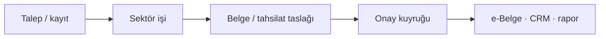
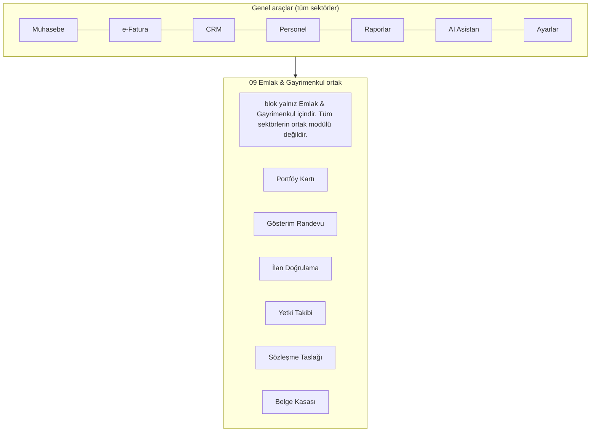

# 09 Emlak & Gayrimenkul

## Özet
- KOBİ çekirdeği, başkasına ait taşınmazın alım, satım ve kirasına aracılık eden yetki belgeli işletmelerdir.
- Gün, işlemin bitip bitmemesine göre ayrılır.
- Aracılıkta portföy CRM’de, ilan portallarda, yazışma WhatsApp’tadır.
- Karar: 09.04 en az on tam zamanlı uzman şartıyla 1–50 bandının üst sınırına yakındır. 09.05’te seyahat acentesi dışarıdadır.
- Modül sayısı: sektör ortak 8; alt sektör 5; toplam 39; MVP 20.
- Ortak çekirdek (tüm sektörler): Muhasebe, e-Fatura/e-Arşiv, CRM, Personel, Raporlar, AI Asistan, Ayarlar → `04 Modüller/00 Ortak Çekirdek.md`.

<!-- dallar:start -->
## Dallar (ağaç)
> **Sektör → Dal → Alt dal → Fonksiyon.** Fonksiyon havuzu: `07 Fonksiyonlar/` · Ortak araçlar: `04 Modüller/`

| Dal | Alt dal | Fonksiyon | Durum |
|---|---|---|---|
| [[Emlak aracılık ofisi]] | 1 | 6 | açık |
| [[Uzun süreli kira ve mülk işletmeciliği]] | 1 | 6 | açık |
| [[Site, apartman ve toplu yapı yönetimi]] | 1 | 6 | açık |
| [[Gayrimenkul değerleme kuruluşu]] | 1 | 6 | açık |
| [[Turizm amaçlı kısa süreli konut işletmeciliği]] | 1 | 7 | açık |
<!-- dallar:end -->

## Alt işletme türleri (onay listesi)
> İşaretli = Adım 1 onay listesi.

- [x] [[Emlak aracılık ofisi|Emlak aracılık ofisi]]
- [x] [[Uzun süreli kira ve mülk işletmeciliği|Uzun süreli kira ve mülk işletmeciliği]]
- [x] [[Site, apartman ve toplu yapı yönetimi|Site, apartman ve toplu yapı yönetimi]]
- [x] [[Gayrimenkul değerleme kuruluşu|Gayrimenkul değerleme kuruluşu]]
- [x] [[Turizm amaçlı kısa süreli konut işletmeciliği|Turizm amaçlı kısa süreli konut işletmeciliği]]

**Sınırlar**
- Konut, işyeri, arsa, devre mülk, franchise ve sözleşmeli ofis 09.01’de birleşti. Birkaç kira takibi, baskın iş aracılıksa 09.01’de kalır.
- Ücretli kira toplama, başkası adına uzun kira yönetimi ve kendi taşınmazını uzun süre kiraya veren işletme 09.02’dedir. AVM’nin kendi merkezindeki işyerlerini kiralaması yetki belgesi dışındadır; döngüsü 09.02’ye bağlandı.
- 09.02 kiracı sözleşmesi ve malik hesabıdır. 09.03 kat maliklerinin aidatı, işletme projesi ve genel kuruludur.
- Emlak ofisinin rayiç araştırması 09.01’dedir. Listeye alınmış değerleme kuruluşu 09.04’tür. SPK listesi ile BDDK banka listesi aynı akışın iki yetkisidir.
- 09.05 yüz güne kadar turizm amaçlı kiralamadır. Seyahat acentesi bu sektöre yazılmadı. Kendi hesabına al-sat ayrı alt sektör olmadı. İlan portalları 09.01’in kanalıdır. İnşaat müteahhitliği 10’dadır.

**Doğrulanamayan**
- Türkiye geneli emlak işletmesi ve 1–50 çalışan kırılımı.
- Emlakçının e-Kira ekranının açıldığı HMB metninde yazmıyor.
- Site yönetim yetki belgesi taslağı haberi var; yürürlükte yönetmelik bu taramada yok.
- TAKBİS, WebTapu, e-Kira, banka, Emlakjet ve kısa kiralama platformu için KOBİ paneline açık API yok.
- EİDS ilan platformu entegrasyonu doğrulandı; ofis panelinin herkese açık EİDS API’si doğrulanmadı.

## Ortak iş akışı

## Araç mimarisi
> İlke: her araç bir kez yapılır. Bir işletme türü = araçların birleşimi. Tek türe özel büyük geliştirme yok.

## Araç matrisi (hangi araç kaç alt türe hizmet ediyor)
> ● = kullanıyor. genel = tüm sektörler, ozel = yalnız bu sektör.

| Araç | Tür | Emlak | Uzun | Site, | Gayrimenkul | Turizm | Toplam |
| --- | --- | --- | --- | --- | --- | --- | --- |
| [[blok yalnız Emlak & Gayrimenkul içindir. Tüm sektörlerin ortak modülü değildir.]] | ozel | ● | ● | ● | ● | ● | **5** |
| [[Portföy Kartı]] | ozel | ● | ● | ● | ● | ● | **5** |
| [[Gösterim Randevu]] | ozel | ● | ● | ● | ● | ● | **5** |
| [[İlan Doğrulama]] | ozel | ● | ● | ● | ● | ● | **5** |
| [[Yetki Takibi]] | ozel | ● | ● | ● | ● | ● | **5** |
| [[Sözleşme Taslağı]] | ozel | ● | ● | ● | ● | ● | **5** |
| [[Belge Kasası]] | ozel | ● | ● | ● | ● | ● | **5** |
| [[Komisyon Hesabı]] | ozel | ● | ● | ● | ● | ● | **5** |
| [[belgeli işletmelerde taşınmaz alım-satım/kira aracılığı, portföy ve ilan yönetimi.]] | ozel | ● |  |  |  |  | **1** |
| [[Alıcı Eşleştirme]] | ozel | ● |  |  |  |  | **1** |
| [[Malik Yetkilendirme]] | ozel | ● |  |  |  |  | **1** |
| [[Teklif Takibi]] | ozel | ● |  |  |  |  | **1** |
| [[Ofis Portföy Payı]] | ozel | ● |  |  |  |  | **1** |
| [[Piyasa Bandı]] | ozel | ● |  |  |  |  | **1** |
| [[işyeri uzun dönem kiralama, tahsilat ve bakım işletmeciliği.]] | ozel |  | ● |  |  |  | **1** |
| [[Kira Dosyası]] | ozel |  | ● |  |  |  | **1** |
| [[Kira Tahsilat]] | ozel |  | ● |  |  |  | **1** |
| [[Bakım İş Emri]] | ozel |  | ● |  |  |  | **1** |
| [[Tahliye Takvimi]] | ozel |  | ● |  |  |  | **1** |
| [[Depozito Defteri]] | ozel |  | ● |  |  |  | **1** |
| [[mülkiyeti kapsamında aidat, işletme projesi, genel kurul ve ortak alan yönetimi.]] | ozel |  |  | ● |  |  | **1** |
| [[İşletme Projesi]] | ozel |  |  | ● |  |  | **1** |
| [[Genel Kurul]] | ozel |  |  | ● |  |  | **1** |
| [[Arıza Talep]] | ozel |  |  | ● |  |  | **1** |
| [[Ortak Alan]] | ozel |  |  | ● |  |  | **1** |
| [[Aidat İcra]] | ozel |  |  | ● |  |  | **1** |
| [[yetkili kuruluşlarda lisanslı uzmanlarla değerleme raporu üretimi.]] | ozel |  |  |  | ● |  | **1** |
| [[Rapor İş Akışı]] | ozel |  |  |  | ● |  | **1** |
| [[Lisans Sicil]] | ozel |  |  |  | ● |  | **1** |
| [[Saha Envanter]] | ozel |  |  |  | ● |  | **1** |
| [[Emsal Analizi]] | ozel |  |  |  | ● |  | **1** |
| [[WebTapu Bağlantı]] | ozel |  |  |  | ● |  | **1** |
| [[seferde 100 gün veya daha kısa turizm amaçlı konut kiralaması ve izin belgeli işletme.]] | ozel |  |  |  |  | ● | **1** |
| [[Rezervasyon Takvim]] | ozel |  |  |  |  | ● | **1** |
| [[İzin Belgesi]] | ozel |  |  |  |  | ● | **1** |
| [[Misafir Checkin]] | ozel |  |  |  |  | ● | **1** |
| [[Temizlik Planı]] | ozel |  |  |  |  | ● | **1** |
| [[Kanal Yönetimi]] | ozel |  |  |  |  | ● | **1** |
| [[Dinamik Fiyat]] | ozel |  |  |  |  | ● | **1** |
| [[Muhasebe ve Gelir-Gider]] | genel | ● | ● | ● | ● | ● | **5** |
| [[e-Fatura ve e-Arşiv]] | genel | ● | ● | ● | ● | ● | **5** |
| [[CRM]] | genel | ● | ● | ● | ● | ● | **5** |
| [[Personel ve Vardiya]] | genel | ● | ● | ● | ● | ● | **5** |
| [[Raporlar]] | genel | ● | ● | ● | ● | ● | **5** |
| [[AI Asistan]] | genel | ● | ● | ● | ● | ● | **5** |
| [[Ayarlar]] | genel | ● | ● | ● | ● | ● | **5** |

## Sektör ortak modüller

### Bu blok yalnız Emlak & Gayrimenkul içindir. Tüm sektörlerin ortak modülü değildir.

- oncelik: 
- durum: 
- aciklama: 
- entegrasyonlar: yok
- ai_komutlari:

### 09.00.01 Portföy Kartı

- oncelik: MVP
- durum: zorunlu
- aciklama: Satış/kira/işletme için taşınmaz kimliği, özellikler, durum ve medya yönetimi.
- entegrasyonlar: yok
- ai_komutlari:
  - Boşta satılık daireleri listele
  - Kadıköy 3+1 portföyleri getir
- ai_otomasyonu: Tetikleyici: yeni kart kaydı → İşlem: eksik alan/foto kontrolü → Çıktı: tamamlanacak alan checklist'i (yayın yok)

### 09.00.02 Gösterim Randevu

- oncelik: MVP
- durum: zorunlu
- aciklama: Mülk gösterimi randevu, çakışma kontrolü ve danışman ataması.
- entegrasyonlar: Google Calendar API
- ai_komutlari:
  - Yarın 14:00 için gösterim aç
  - Bu hafta müsait slotları göster
- ai_otomasyonu: Tetikleyici: randevu ±2 sa → İşlem: hatırlatma taslağı → Çıktı: danışmana onaylı bildirim (müşteriye otomatik SMS yok)
- mevzuat_notu: Google Calendar API REST dokümanı 2026-09-11 tarihli genel bakışta açık. OAuth ve kullanıcı takvim izni gerekir; randevu müşteriye onaysız SMS gitmez.

### 09.00.03 İlan Doğrulama

- oncelik: MVP
- durum: zorunlu
- aciklama: İlan öncesi kimlik/yetki doğrulama durumu ve yayın checklist'i; EİDS uyumu.
- entegrasyonlar: EİDS Taşınmaz API
- ai_komutlari:
  - Bu ilanın EİDS durumunu kontrol et
  - Yetkisiz ilanları işaretle
- ai_otomasyonu: Tetikleyici: yayın talebi → İşlem: yetki/doğrulama bayrağı kontrolü → Çıktı: yayına uygun/uygunsuz özeti (otomatik yayın yok)
- mevzuat_notu: Taşınmaz Ticareti Hakkında Yönetmelik kapsamında EİDS ile ilan kimlik/yetki doğrulama.

### 09.00.04 Yetki Takibi

- oncelik: MVP
- durum: zorunlu
- aciklama: İşletme yetki belgesi, sorumlu emlak danışmanı ve belge vade takibi (TTBS).
- entegrasyonlar: TTBS sorgu ekranı
- ai_komutlari:
  - Yetki belgesi vadesi yaklaşanları göster
  - Seviye 5 sorumlu listesi
- ai_otomasyonu: Tetikleyici: vade −60/−30 gün → İşlem: yenileme hatırlatması → Çıktı: yönetici görev kartı
- mevzuat_notu: Taşınmaz Ticareti Hakkında Yönetmelik; yetki belgesi TTBS üzerinden verilir/yenilenir. Doğrulama kapanışı: https://ttbs.gtb.gov.tr/ açıldı. Giriş ve yetki belgesi sorgusu var. Üçüncü parti API yok. Panel belge tarihini tutar, sorguyu kullanıcı yapar.

### 09.00.05 Sözleşme Taslağı

- oncelik: MVP
- durum: opsiyonel
- aciklama: Satış/kira/yetkilendirme taslak üretimi; imza ve gönderim insan onayına bağlı.
- entegrasyonlar: yok
- ai_komutlari:
  - Satış yetki sözleşmesi taslağı üret
  - Kira sözleşmesi madde özetini çıkar
- ai_otomasyonu: Tetikleyici: taslak isteği → İşlem: şablondan madde taslağı → Çıktı: inceleme kuyruğu (imza/gönderim yok)
- mevzuat_notu: TBK ve taşınmaz aracılık sözleşmesi hükümlerine uygun şablon ihtiyacı.

### 09.00.06 Belge Kasası

- oncelik: V2
- durum: opsiyonel
- aciklama: Tapu, kimlik, yetki ve ekspertiz belgelerinin versiyonlu arşivi.
- entegrasyonlar: Web Tapu emlakçı portalı
- ai_komutlari:
  - Bu portföyün tapu belgelerini listele
  - Süresi dolan belgeleri bul
- ai_otomasyonu: Tetikleyici: belge yükleme → İşlem: tip/tarih etiketleme → Çıktı: eksik belge uyarısı
- mevzuat_notu: TKGM WebTapu süreçleri; POS için açık API doğrulanmadı. Doğrulama kapanışı: https://webtapu.tkgm.gov.tr/ açıldı. Emlakçı portalı e-Devlet şifresi ve TTBS yetkisi ister. Kurum portalı TKGM protokolü ister. KOBİ yazılımına açık REST yok. Belge kasası dosya yükler.

### 09.00.07 Komisyon Hesabı

- oncelik: V2
- durum: opsiyonel
- aciklama: Muhasebe & Gelir-Gider genişlemesi: işlem komisyonu ve ofis/danışman payı önerisi.
- entegrasyonlar: yok
- ai_komutlari:
  - Bu satışta komisyon tutarını hesapla
  - Danışman payını göster
- ai_otomasyonu: Tetikleyici: işlem kapandı → İşlem: komisyon satırı önerisi → Çıktı: muhasebe onay kuyruğu (otomatik tahsilat yok)
- mevzuat_notu: Aracılık ücreti sözleşmeye bağlı; faaliyet yetki belgesi şartına tabi işletmeler.

## Alt sektör modülleri

## 09.01 Emlak aracılık ofisi

- aciklama: Yetki belgeli işletme, başkasına ait konut, işyeri, arsa veya devre mülke komisyonla aracılık eder.
- gunluk_is: Yetkilendirme dosyası, EİDS izinli ilan, talep eşleme, yer gösterme, yazılı teklif ve aracılık sözleşmesi.
- ai: Dosyadan ilan metni ve talep listesi kurar; yetki bitişi ile ilanı üç gün içinde kaldırma süresini hatırlatır.

### Yetki belgeli işletmelerde taşınmaz alım-satım/kira aracılığı, portföy ve ilan yönetimi.

- oncelik: 
- durum: 
- aciklama: 
- entegrasyonlar: yok
- ai_komutlari:

### 09.01.01 Alıcı Eşleştirme

- oncelik: MVP
- durum: zorunlu
- aciklama: CRM genişlemesi: bütçe/lokasyon/özellik ile portföy adayı skorlama.
- entegrasyonlar: yok
- ai_komutlari:
  - Bu alıcıya 5 aday öner
  - Bütçe 8–10M eşleşmeleri getir
- ai_otomasyonu: Tetikleyici: yeni alıcı ihtiyacı → İşlem: skorlu aday listesi → Çıktı: danışman onayına aday kartları

### 09.01.02 Malik Yetkilendirme

- oncelik: MVP
- durum: zorunlu
- aciklama: Malikin e-Devlet üzerinden emlak işletmesine verdiği ilan yetkisinin takip kaydı.
- entegrasyonlar: EİDS ilan doğrulama
- ai_komutlari:
  - Yetki bekleyen portföyleri göster
  - Yetki kodu süresi dolanları listele
- ai_otomasyonu: Tetikleyici: yetki süresi yaklaşımı → İşlem: yenileme uyarısı → Çıktı: danışman görev kartı
- mevzuat_notu: EİDS: ilan için malik yetkilendirmesi; e-Devlet oturum/yetki akışı. Doğrulama kapanışı: https://eids.ticaret.gov.tr/ açıldı. Doğrulama ilan platformuna ait. Ofis paneline açık API sitede yok. Panel yetki dosyasını tutar.

### 09.01.03 Teklif Takibi

- oncelik: MVP
- durum: zorunlu
- aciklama: Alıcı teklifleri, karşı teklif ve durum pipeline'ı.
- entegrasyonlar: yok
- ai_komutlari:
  - Açık teklifleri sırala
  - Bu portföyün son teklifini özetle
- ai_otomasyonu: Tetikleyici: yeni teklif → İşlem: karşılaştırma özeti → Çıktı: danışman bildirim taslağı (taraflara otomatik iletim yok)

### 09.01.04 Ofis Portföy Payı

- oncelik: V2
- durum: opsiyonel
- aciklama: Şube/franchise arası portföy görünürlük ve komisyon paylaşım kuralları.
- entegrasyonlar: yok
- ai_komutlari:
  - Ortak portföyleri listele
  - Paylaşım kuralını özetle
- ai_otomasyonu: Tetikleyici: paylaşıma açma → İşlem: kural uygunluk kontrolü → Çıktı: onay bekleyen paylaşım kaydı
- mevzuat_notu: Sözleşmeli işletme ilişkisi Taşınmaz Ticareti Yönetmeliği çerçevesinde.

### 09.01.05 Piyasa Bandı

- oncelik: V2
- durum: opsiyonel
- aciklama: Benzer ilanlardan bilgilendirme amaçlı fiyat bandı önerisi.
- entegrasyonlar: sahibinden kurumsal aktarım (sözleşmeli)
- ai_komutlari:
  - Bu daire için fiyat bandı öner
  - Son 30 gün benzer satılıkları özetle
- ai_otomasyonu: Tetikleyici: fiyat güncelleme talebi → İşlem: band hesaplama → Çıktı: öneri + kaynak özeti (otomatik fiyat yazma yok)
- mevzuat_notu: İlan platformu API erişimi kamuya açık doğrulanmadı. Doğrulama kapanışı: sahibinden.com API yardım yazısı açıldı. Aktarım, EİDS’e entegre ilancılık firmasına sözleşme ile verilir. Hepsiemlak için açık uç bu turda yok. Piyasa bandı elle girilir.

## 09.02 Uzun süreli kira ve mülk işletmeciliği

- aciklama: Kendi veya sözleşmeyle başkasının taşınmazını uzun süreli kiracı ilişkisiyle işler.
- gunluk_is: Kira sözleşmesi, tahsilat, boşalma, abonelik, bakım ve malike hesap.
- ai: Vadesi gelen kirayı, bitecek sözleşmeyi ve bakım talebini malik bazında tutup dönem özetini taslaklar.

### Konut/çatılı işyeri uzun dönem kiralama, tahsilat ve bakım işletmeciliği.

- oncelik: 
- durum: 
- aciklama: 
- entegrasyonlar: yok
- ai_komutlari:

### 09.02.01 Kira Dosyası

- oncelik: MVP
- durum: zorunlu
- aciklama: Kira sözleşmesi, süre, artış ve eklerin dosya bazlı yönetimi.
- entegrasyonlar: yok
- ai_komutlari:
  - Bitimine 60 gün kalan kiraları listele
  - Bu sözleşmenin artış maddesini özetle
- ai_otomasyonu: Tetikleyici: bitiş −60/−30 gün → İşlem: yenileme/uyarı taslağı → Çıktı: yönetici onay kuyruğu
- mevzuat_notu: TBK 6098 konut ve çatılı işyeri kirası hükümleri.

### 09.02.02 Kira Tahsilat

- oncelik: MVP
- durum: zorunlu
- aciklama: Muhasebe & Gelir-Gider genişlemesi: kira vade, gecikme ve dekont eşlemesi.
- entegrasyonlar: Dekont ile mutabakat
- ai_komutlari:
  - Bu ay ödenmeyen kiraları getir
  - Gecikme tutarını hesapla
- ai_otomasyonu: Tetikleyici: vade +1 gün → İşlem: gecikme listesi → Çıktı: ihtar taslağı (gönderim onaysız yapılmaz)
- mevzuat_notu: TBK m.352 iki haklı ihtar; otomatik ihtar/ödeme yok. Doğrulama kapanışı: ohvps.bkm.com.tr bu turda 500 döndü. Tek banka seçilmedi. Tahsilat kaydı panelde kalır, mutabakat dekontla yapılır.

### 09.02.03 Bakım İş Emri

- oncelik: MVP
- durum: zorunlu
- aciklama: Kiracı/malik arıza kaydı, tedarikçi atama ve kapanış.
- entegrasyonlar: yok
- ai_komutlari:
  - Açık arızaları önceliklendir
  - Bu ay bakım maliyetini özetle
- ai_otomasyonu: Tetikleyici: yeni arıza → İşlem: kategori/öncelik önerisi → Çıktı: atama önerisi kartı

### 09.02.04 Tahliye Takvimi

- oncelik: V2
- durum: opsiyonel
- aciklama: Tahliye taahhüdü tarihleri ve yasal süre hatırlatmaları.
- entegrasyonlar: yok
- ai_komutlari:
  - Tahliye tarihi yaklaşanları göster
  - TBK 352 sürelerini kontrol et
- ai_otomasyonu: Tetikleyici: taahhüt tarihi −15 gün → İşlem: süre checklist'i → Çıktı: hukuk/yönetici notu (icra başlatma yok)
- mevzuat_notu: TBK m.352: teslimden sonra yazılı tahliye taahhüdü; 1 ay içinde takip/dava.

### 09.02.05 Depozito Defteri

- oncelik: V2
- durum: opsiyonel
- aciklama: Depozito alma, iade, mahsup ve belgelendirme.
- entegrasyonlar: yok
- ai_komutlari:
  - İade bekleyen depozitoları listele
  - Mahsup kalemlerini özetle
- ai_otomasyonu: Tetikleyici: sözleşme bitişi → İşlem: iade/mahsup önerisi → Çıktı: onaylı ödeme talimatı taslağı
- mevzuat_notu: Teminat/depozito uygulamaları sözleşmeye bağlı.

## 09.03 Site, apartman ve toplu yapı yönetimi

- aciklama: Profesyonel yönetici, kat mülkiyetli yapının ortak giderini, personelini ve kurullarını yürütür.
- gunluk_is: Aidat, banka tahsilatı, işletme projesi, arıza ve genel kurul.
- ai: Dekontu bağımsız bölüme önerir, gecikme tazminatını kanundaki aylık yüzde beşle hesaplar; ihtar ve icra onaya kalır.

### Kat mülkiyeti kapsamında aidat, işletme projesi, genel kurul ve ortak alan yönetimi.

- oncelik: 
- durum: 
- aciklama: 
- entegrasyonlar: yok
- ai_komutlari:

### 09.03.01 İşletme Projesi

- oncelik: MVP
- durum: zorunlu
- aciklama: Yıllık gelir-gider, avans/aidat dağılımı; geçici proje ve genel kurul onayı.
- entegrasyonlar: yok
- ai_komutlari:
  - Geçici işletme projesi taslağı oluştur
  - Yeniden değerleme üst sınırını uygula
- ai_otomasyonu: Tetikleyici: yılbaşı veya onaylı proje yok → İşlem: geçici proje taslağı + artış tavanı → Çıktı: kurul onayına sunum paketi
- mevzuat_notu: KMK m.37; 7579 ile genel kurul onayı ve geçici projede yeniden değerleme tavanı.

### 09.03.02 Genel Kurul

- oncelik: MVP
- durum: zorunlu
- aciklama: Toplantı çağrısı, gündem, karar ve tutanak arşivi.
- entegrasyonlar: yok
- ai_komutlari:
  - Son kurul kararlarını özetle
  - Yönetim planı değişiklik gündemi hazırla
- ai_otomasyonu: Tetikleyici: toplantı tarihi −14 gün → İşlem: çağrı/gündem taslağı → Çıktı: yönetici onaylı gönderim kuyruğu
- mevzuat_notu: KMK m.27–34; toplu yapı yönetim planı oy oranı 7579 ile güncellendi.

### 09.03.03 Arıza Talep

- oncelik: MVP
- durum: zorunlu
- aciklama: Kat maliki/kiracı talep, teknisyen atama ve SLA.
- entegrasyonlar: yok
- ai_komutlari:
  - Acil arızaları listele
  - Ortalama çözüm süresini göster
- ai_otomasyonu: Tetikleyici: yeni talep → İşlem: öncelik skoru → Çıktı: atama önerisi
- mevzuat_notu: KMK m.35 yönetici görevleri çerçevesinde operasyon.

### 09.03.04 Ortak Alan

- oncelik: V2
- durum: opsiyonel
- aciklama: Ortak alan (salon, misafir otopark vb.) rezervasyon yönetimi.
- entegrasyonlar: yok
- ai_komutlari:
  - Cumartesi salon müsaitliğini göster
  - Çakışan rezervasyonları bul
- ai_otomasyonu: Tetikleyici: rezervasyon talebi → İşlem: çakışma kontrolü → Çıktı: onay bekleyen kayıt
- mevzuat_notu: Yönetim planı hükümlerine bağlı.

### 09.03.05 Aidat İcra

- oncelik: V2
- durum: opsiyonel
- aciklama: Gecikme tazminatı hesabı ve icra dosya hazırlığı; takip başlatma insan onaylı.
- entegrasyonlar: UYAP vatandaş ve avukat portalı
- ai_komutlari:
  - 3+ ay gecikenleri listele
  - Gecikme tazminatı hesapla
- ai_otomasyonu: Tetikleyici: gecikme eşiği → İşlem: KMK gecikme hesabı → Çıktı: icra hazırlık dosyası (takip başlatılmaz)
- mevzuat_notu: KMK m.20 gecikme tazminatı; kesinleşmiş işletme projesi İİK m.68 belgesi niteliğinde. Doğrulama kapanışı: https://www.uyap.gov.tr/ açıldı. Vatandaş, avukat ve kurum portalları var. Site yönetimi için icra API’si yok. İhtar taslağı panelde kalır, başvuru onayla gider.

## 09.04 Gayrimenkul değerleme kuruluşu

- aciklama: SPK III-62.3 listesindeki anonim şirket rapor üretir; banka raporu için ayrıca BDDK listesi gerekir.
- gunluk_is: İş emri, yerinde inceleme, emsal ve sorumlu uzman kontrolü.
- ai: Kimlik, konum ve standart başlıkları taslaklar; değer kanaati ve imza lisanslı uzmanda kalır.

### SPK yetkili kuruluşlarda lisanslı uzmanlarla değerleme raporu üretimi.

- oncelik: 
- durum: 
- aciklama: 
- entegrasyonlar: yok
- ai_komutlari:

### 09.04.01 Rapor İş Akışı

- oncelik: MVP
- durum: zorunlu
- aciklama: Sipariş → saha → taslak → sorumlu imza → teslim pipeline'ı.
- entegrasyonlar: yok
- ai_komutlari:
  - İmzada bekleyen raporları getir
  - Bu banka için SLA ihlallerini göster
- ai_otomasyonu: Tetikleyici: aşama gecikmesi → İşlem: bottleneck uyarısı → Çıktı: sorumlu/uzman görev kartı
- mevzuat_notu: SPK III-62.3; sorumlu değerleme uzmanı kontrol ve imza.

### 09.04.02 Lisans Sicil

- oncelik: MVP
- durum: zorunlu
- aciklama: Uzman/yardımcı SPL lisans durumu ve yenileme eğitim takibi.
- entegrasyonlar: SPL sicil kaydı
- ai_komutlari:
  - Askı riski olan lisansları listele
  - Yenileme eğitimi yaklaşanları göster
- ai_otomasyonu: Tetikleyici: yenileme −45 gün veya askı → İşlem: uyarı → Çıktı: uyum görev kartı (rapor ataması engel önerisi)
- mevzuat_notu: SPL Gayrimenkul/Konut Değerleme Lisansı; yenileme eğitimi yoksa lisans askıya alınabilir. Doğrulama kapanışı: https://www.spl.com.tr/ açıldı. Lisans ve sicil kurumu. Sayfada üçüncü parti sicil API’si yok. Lisans tarihi elle tutulur.

### 09.04.03 Saha Envanter

- oncelik: MVP
- durum: zorunlu
- aciklama: Yerinde tespit formu, foto, ölçü ve karşılaştırılabilir örnek kayıtları.
- entegrasyonlar: yok
- ai_komutlari:
  - Bu raporun saha eksiklerini listele
  - Foto setini kontrol et
- ai_otomasyonu: Tetikleyici: saha yükleme → İşlem: zorunlu alan/foto kontrolü → Çıktı: eksik checklist
- mevzuat_notu: TDUB/SPK rapor kalite ve bağımsızlık çerçevesi.

### 09.04.04 Emsal Analizi

- oncelik: V2
- durum: opsiyonel
- aciklama: Karşılaştırılabilir satış/kira emsal tablosu ve düzeltme önerileri.
- entegrasyonlar: yok
- ai_komutlari:
  - 3 emsal öner
  - Düzeltme katsayılarını özetle
- ai_otomasyonu: Tetikleyici: taslak aşaması → İşlem: emsal öneri tablosu → Çıktı: uzman inceleme paneli (rapora otomatik yazılmaz)
- mevzuat_notu: Nihai değer ve rapor içeriği lisanslı uzman sorumluluğunda.

### 09.04.05 WebTapu Bağlantı

- oncelik: V2
- durum: opsiyonel
- aciklama: Değerleme uzmanı WebTapu başvuru/belge durumunun dosya bazlı takibi.
- entegrasyonlar: Web Tapu değerleme portalı
- ai_komutlari:
  - WebTapu başvuru durumunu kaydet
  - Eksik evrakları listele
- ai_otomasyonu: Tetikleyici: manuel durum güncelleme → İşlem: gecikme uyarısı → Çıktı: dosya notu
- mevzuat_notu: TKGM WebTapu değerleme uzmanı portalı; açık POS API doğrulanmadı. Doğrulama kapanışı: https://webtapu.tkgm.gov.tr/ açıldı. Değerleme portalı e-Devlet ve güncel TDUB kaydı ister. Açık REST yok. Başvuru paketi panelde hazırlanır.

## 09.05 Turizm amaçlı kısa süreli konut işletmeciliği

- aciklama: İzin belgeli konutu yüz güne kadar kiraya veren malik işletme veya yüksek nitelikli konutta yönetim işletmesi.
- gunluk_is: İzin belgesi, plaket, doluluk, giriş-çıkış ve temizlik sırası.
- ai: Giriş, çıkış ve temizliği takvime yazar; yüz gün ve izin belgesi süresini hatırlatır.

### Tek seferde 100 gün veya daha kısa turizm amaçlı konut kiralaması ve izin belgeli işletme.

- oncelik: 
- durum: 
- aciklama: 
- entegrasyonlar: yok
- ai_komutlari:

### 09.05.01 Rezervasyon Takvim

- oncelik: MVP
- durum: zorunlu
- aciklama: Kısa süreli konaklama takvimi, çakışma ve kapalı gün yönetimi.
- entegrasyonlar: yok
- ai_komutlari:
  - Bu hafta doluluk göster
  - Çakışan rezervasyonları bul
- ai_otomasyonu: Tetikleyici: yeni rezervasyon → İşlem: çakışma ve izin belgesi bayrağı kontrolü → Çıktı: onay/red önerisi
- mevzuat_notu: 7464 sayılı Kanun; tek seferde ≤100 gün turizm amaçlı kiralama.

### 09.05.02 İzin Belgesi

- oncelik: MVP
- durum: zorunlu
- aciklama: e-Devlet izin belgesi numarası, yenileme ve iptal risk takibi.
- entegrasyonlar: e-Devlet izin belgesi
- ai_komutlari:
  - İzin belgesi olmayan üniteleri listele
  - Denetim hatırlatmalarını göster
- ai_otomasyonu: Tetikleyici: belge yok veya vade → İşlem: uyum uyarısı → Çıktı: yönetici checklist (başvuru otomatik yapılmaz)
- mevzuat_notu: Konutların Turizm Amaçlı Kiralanması Yönetmeliği: başvurular yalnızca e-Devlet. Doğrulama kapanışı: 7464 kapsamı e-Devlet izin hizmetidir. Bu turda hizmete ait açık API dokümanı yok. Panel izin belgesi tarihini tutar.

### 09.05.03 Misafir Checkin

- oncelik: MVP
- durum: zorunlu
- aciklama: Kimlik/pasaport kaydı, giriş-çıkış ve ev kuralları onayı.
- entegrasyonlar: Panel kaydı
- ai_komutlari:
  - Bugün check-in listesini getir
  - Eksik kimlik kaydı olanları göster
- ai_otomasyonu: Tetikleyici: check-in −24 sa → İşlem: eksik belge uyarısı → Çıktı: host görev kartı
- mevzuat_notu: İzin belgesi sahibi yükümlülükleri; kolluk/bildirim entegrasyonu ayrıca doğrulanmalı. Doğrulama kapanışı: Harici API bağlanmadı. Kimlik ve giriş kaydı panelde durur. Kolluk bildirimi tesisin kendi ekranında, onayla kalır.

### 09.05.04 Temizlik Planı

- oncelik: V2
- durum: opsiyonel
- aciklama: Personel & Vardiya genişlemesi: çıkış sonrası temizlik ve turnover planı.
- entegrasyonlar: yok
- ai_komutlari:
  - Bugünkü temizlik turunu planla
  - Turnover gecikenleri göster
- ai_otomasyonu: Tetikleyici: check-out → İşlem: temizlik iş emri oluştur → Çıktı: personel atama önerisi

### 09.05.05 Kanal Yönetimi

- oncelik: V2
- durum: opsiyonel
- aciklama: OTA/ilan kanallarında takvim/fiyat senkron uyumsuzluk takibi.
- entegrasyonlar: Kanal durumu (elle)
- ai_komutlari:
  - Kanallardaki fiyat farklarını göster
  - Overbooking riskini tara
- ai_otomasyonu: Tetikleyici: takvim değişimi → İşlem: kanal uyumsuzluk tespiti → Çıktı: senkron uyarı kartı
- mevzuat_notu: Platform API erişimi hesap/ortaklık bazlı; kamuya açık doğrulanmadı. Doğrulama kapanışı: Airbnb ve Booking.com için herkese açık uç bu turda açılmadı. Kanal durumu elle işlenir.

### 09.05.06 Dinamik Fiyat

- oncelik: V2
- durum: opsiyonel
- aciklama: Sezon ve doluluk bazlı fiyat bandı önerisi; yazma insan onaylı.
- entegrasyonlar: yok
- ai_komutlari:
  - Yarın için fiyat öner
  - Düşük doluluk günlerini işaretle
- ai_otomasyonu: Tetikleyici: doluluk eşiği altı → İşlem: fiyat bandı önerisi → Çıktı: onay kuyruğu (otomatik fiyat yazılmaz)
- mevzuat_notu: Yanıltıcı tanıtım yaptırımları Yönetmelik değişiklikleriyle güçlendirildi.

## Sayım

- sektor_ortak: 7
- alt_sektor: 5
- modul: 33
- mvp: 20

## Kaynaklar

- Taşınmaz Ticareti Yönetmeliği: https://mevzuat.adalet.gov.tr/mevzuat/105916
- EİDS: https://eids.ticaret.gov.tr/
- TTBS sorgu: https://ttbs.gtb.gov.tr/Home/BelgeSorgula
- 634 sayılı Kat Mülkiyeti Kanunu: https://www.mevzuat.gov.tr/MevzuatMetin/1.5.634.pdf
- 7464 sayılı Kanun: https://www.mevzuat.gov.tr/MevzuatMetin/1.5.7464.htm
- SPK III-62.3: https://resmigazete.gov.tr/eskiler/2019/08/20190831-12.htm
- İTO Gayrimenkul NACE: https://www.ito.org.tr/tr/meslek-komiteleri/nace-kodu/gayrimenkul-hizmetleri
- sahibinden API koşulları: https://yardim.sahibinden.com/hc/tr/articles/19780244786460-API-Kullan%C4%B1m%C4%B1-ile-Veri-Transferi
