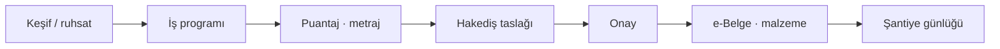
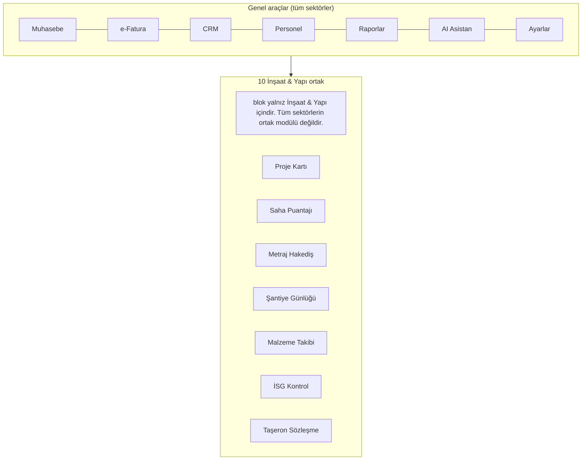

# 10 İnşaat & Yapı

## Özet
- İnşaat NACE F (41–43) olarak ayrıdır. KOSGEB 2024 iş kayıtlarında bu kolda 354.194 girişim vardır; 281.616’sı 1–9, 31.732’si 10–49 çalışandır. KOBİ tanımına giren inşaat girişimleri 306.162’dir. KOBİ’ler inşaat cirosunun %53,1’ini ve üretim değerinin %55,9’unu oluşturur. İki tablo aynı küme değildir. TMB ve İNTES profili büyük taahhüttür; 1–50 çalışanlı firmanın günü bu birliklerin işi değildir.
- Küçük müteahhit yetki belgesi, şantiye şefi, taşeron, malzeme, yapı denetim evrakı ve SGK dosyasıyla günü geçirir. İhtisas ekipleri metraj veya yevmiye ile hakediş keser. Tesisat, proje, malzeme, montaj ve test ile yürür. Taşıyıcıya dokunmayan basit tamir ruhsata tabi değildir. Yapı malzemesi satışı 2026 sınıflamasında 46.83 toptan ticarettir. Mimarlık 71.1’dedir. Yapı denetim 4708 sayılı kanunla ayrı tüzel kişidir.
- SantiyePro, Hakedra ve ESSantiye puantaj, metraj, hakediş ve şantiye günlüğünü toplar. ŞANTİYE-M ve Ulusal Yapı Denetim Sistemi kamu portalıdır; üçüncü parti için açık API bulunamadı.
- Karar: 10.05 toptan ticaret kodundadır ama şantiye carisi nedeniyle burada tutuldu. 10.06 ve 10.07 NACE 71’dedir; ruhsat zinciri nedeniyle burada bırakıldı.
- Modül: sektör ortak 8; alt sektör 7; toplam 50; MVP 26.
- Ortak çekirdek (tüm sektörler) bu dosyada yoktur → `04 Modüller/00 Ortak Çekirdek.md`.

<!-- dallar:start -->
## Dallar (ağaç)
> **Sektör → Dal → Alt dal → Fonksiyon.** Ortak araçlar: `04 Modüller/`

| Dal | Alt dal | Fonksiyon | Durum |
|---|---|---|---|
| [[Küçük ölçekli bina müteahhidi]] | 1 | 6 | açık |
| [[Şantiye ihtisas taşeronu]] | 1 | 6 | açık |
| [[Mekanik ve elektrik tesisat taşeronu]] | 1 | 6 | açık |
| [[Tadilat ve basit onarım]] | 1 | 6 | açık |
| [[Yapı malzemesi bayii]] | 1 | 6 | açık |
| [[Bina proje ofisi]] | 1 | 6 | açık |
| [[Yapı denetim kuruluşu]] | 1 | 6 | açık |
<!-- dallar:end -->

## Alt işletme türleri (onay listesi)
> İşaretli = Adım 1 onay listesi.

- [x] [[10.01 Küçük ölçekli bina müteahhidi|10.01 Küçük ölçekli bina müteahhidi]]
- [x] [[Şantiye ihtisas taşeronu|Şantiye ihtisas taşeronu]]
- [x] [[Mekanik ve elektrik tesisat taşeronu|Mekanik ve elektrik tesisat taşeronu]]
- [x] [[Tadilat ve basit onarım|Tadilat ve basit onarım]]
- [x] [[Yapı malzemesi bayii|Yapı malzemesi bayii]]
- [x] [[Bina proje ofisi|Bina proje ofisi]]
- [x] [[Yapı denetim kuruluşu|Yapı denetim kuruluşu]]

**Sınırlar**
- Duvar, kalıp, sıva, boya, kaplama, çatı ve yalıtım 10.02’dedir. Elektrik, sıhhi tesisat, iklimlendirme ve asansör montajı 10.03’tedir.
- Mimarlık ve mühendislik ofisi 10.06’dadır çünkü günü çizim ve ruhsat dosyasıdır, şantiye hakedişi değildir. Büro tescilsiz görsel stüdyo 15’tedir. Yenilemeyi kendi ekibiyle yapan iç mimarlıkta baskın iş 10.04’tür.
- Esaslı tadilat yüklenicisi 10.01, basit tamir 10.04’tür. Yap-satın kendi dairesini satması 10.01’de kalır. Başkasının portföyünü satan ofis 09’dadır.
- Hafriyat baskınsa 12’dir. Atölyede doğrama veya tuğla üretimi 13’tür. NACE 42 altyapı için ayrı alt sektör açılmadı. Yapı market zinciri 10.05 tanımının dışındadır.

**Doğrulanamayan**
- Alt sektör bazında firma sayısı ve ciro.
- Excel, WhatsApp, Logo veya Nebim kullanım oranı.
- ŞANTİYE-M, YDS ve e-Devlet müteahhit sorgusu için ticari API.
- Nebim’de yapı malzemesine özel şantiye modülü.

## Ortak iş akışı

## Araç mimarisi
> İlke: her araç bir kez yapılır. Bir işletme türü = araçların birleşimi.

## Araç matrisi (hangi araç kaç alt türe hizmet ediyor)
> ● = kullanıyor. genel = tüm sektörler, ozel = yalnız bu sektör.

| Araç | Tür | 10.01 | Şantiye | Mekanik | Tadilat | Yapı | Bina proje ofisi | Yapı | Toplam |
| --- | --- | --- | --- | --- | --- | --- | --- | --- | --- |
| [[Muhasebe ve Gelir-Gider]] | genel | ● | ● | ● | ● | ● | ● | ● | **7** |
| [[e-Fatura ve e-Arşiv]] | genel | ● | ● | ● | ● | ● | ● | ● | **7** |
| [[CRM]] | genel | ● | ● | ● | ● | ● | ● | ● | **7** |
| [[Personel ve Vardiya]] | genel | ● | ● | ● | ● | ● | ● | ● | **7** |
| [[Raporlar]] | genel | ● | ● | ● | ● | ● | ● | ● | **7** |
| [[AI Asistan]] | genel | ● | ● | ● | ● | ● | ● | ● | **7** |
| [[Ayarlar]] | genel | ● | ● | ● | ● | ● | ● | ● | **7** |
| [[blok yalnız İnşaat & Yapı içindir. Tüm sektörlerin ortak modülü değildir.]] | ozel | ● | ● | ● | ● | ● | ● | ● | **7** |
| [[Proje Kartı]] | ozel | ● | ● | ● | ● | ● | ● | ● | **7** |
| [[Saha Puantajı]] | ozel | ● | ● | ● | ● | ● | ● | ● | **7** |
| [[Metraj Hakediş]] | ozel | ● | ● | ● | ● | ● | ● | ● | **7** |
| [[Şantiye Günlüğü]] | ozel | ● | ● | ● | ● | ● | ● | ● | **7** |
| [[Malzeme Takibi]] | ozel | ● | ● | ● | ● | ● | ● | ● | **7** |
| [[İSG Kontrol]] | ozel | ● | ● | ● | ● | ● | ● | ● | **7** |
| [[Taşeron Sözleşme]] | ozel | ● | ● | ● | ● | ● | ● | ● | **7** |
| [[iş modeli: proje.]] | ozel |  |  |  |  |  |  |  | **0** |
| [[Ruhsat Takibi]] | ozel |  |  |  |  |  |  |  | **0** |
| [[İş Programı]] | ozel |  |  |  |  |  |  |  | **0** |
| [[Maliyet Bütçe]] | ozel |  |  |  |  |  |  |  | **0** |
| [[Şef Atama]] | ozel |  |  |  |  |  |  |  | **0** |
| [[Keşif Teklif]] | ozel |  |  |  |  |  |  |  | **0** |
| [[iş modeli: proje.]] | ozel |  | ● |  |  |  |  |  | **1** |
| [[İş Emri]] | ozel |  | ● |  |  |  |  |  | **1** |
| [[Yevmiye Hakediş]] | ozel |  | ● |  |  |  |  |  | **1** |
| [[Ekip Dağılımı]] | ozel |  | ● |  |  |  |  |  | **1** |
| [[Ek İş Kaydı]] | ozel |  | ● |  |  |  |  |  | **1** |
| [[Fotoğraf Delil]] | ozel |  | ● |  |  |  |  |  | **1** |
| [[iş modeli: proje.]] | ozel |  |  | ● |  |  |  |  | **1** |
| [[Keşif Metraj]] | ozel |  |  | ● |  |  |  |  | **1** |
| [[Test Devreye]] | ozel |  |  | ● |  |  |  |  | **1** |
| [[Malzeme Poz]] | ozel |  |  | ● |  |  |  |  | **1** |
| [[As-Built Proje]] | ozel |  |  | ● |  |  |  |  | **1** |
| [[Revizyon Talep]] | ozel |  |  | ● |  |  |  |  | **1** |
| [[iş modeli: karma.]] | ozel |  |  |  | ● |  |  |  | **1** |
| [[Keşif Randevu]] | ozel |  |  |  | ● |  |  |  | **1** |
| [[Teklif Onay]] | ozel |  |  |  | ● |  |  |  | **1** |
| [[İş Takvimi]] | ozel |  |  |  | ● |  |  |  | **1** |
| [[Önce Sonra]] | ozel |  |  |  | ● |  |  |  | **1** |
| [[Garanti Servis]] | ozel |  |  |  | ● |  |  |  | **1** |
| [[iş modeli: siparis_stok.]] | ozel |  |  |  |  | ● |  |  | **1** |
| [[Sipariş Stok]] | ozel |  |  |  |  | ● |  |  | **1** |
| [[Sevkiyat İrsaliye]] | ozel |  |  |  |  | ● |  |  | **1** |
| [[Şantiye Teslim]] | ozel |  |  |  |  | ● |  |  | **1** |
| [[Fiyat Liste]] | ozel |  |  |  |  | ● |  |  | **1** |
| [[Cari Limit]] | ozel |  |  |  |  | ● |  |  | **1** |
| [[iş modeli: proje.]] | ozel |  |  |  |  |  | ● |  | **1** |
| [[Proje Dosya]] | ozel |  |  |  |  |  | ● |  | **1** |
| [[Revizyon Sürüm]] | ozel |  |  |  |  |  | ● |  | **1** |
| [[Müellif Teslim]] | ozel |  |  |  |  |  | ● |  | **1** |
| [[Oda Tescil]] | ozel |  |  |  |  |  | ● |  | **1** |
| [[Ruhsat Evrak]] | ozel |  |  |  |  |  | ● |  | **1** |
| [[iş modeli: proje.]] | ozel |  |  |  |  |  |  | ● | **1** |
| [[YİBF Takip]] | ozel |  |  |  |  |  |  | ● | **1** |
| [[Denetim Tutanak]] | ozel |  |  |  |  |  |  | ● | **1** |
| [[Seviye Hakediş]] | ozel |  |  |  |  |  |  | ● | **1** |
| [[Laboratuvar Numune]] | ozel |  |  |  |  |  |  | ● | **1** |
| [[UYDS Hazırlık]] | ozel |  |  |  |  |  |  | ● | **1** |

## Ortak ihtiyaçlar (7 alt türde sıklık)
| İhtiyaç | Kategori | Sıklık |
|---|---|---|
| [[Proje / iş kartı]] | operasyon | 7/7 |
| [[Puantaj / yoklama]] | personel | 7/7 |
| [[Metraj ve hakediş]] | finans | 7/7 |
| [[Malzeme / stok]] | operasyon | 7/7 |
| [[e-Belge]] | yasal | 7/7 |
| [[Şantiye günlüğü]] | operasyon | 5/7 |
| [[Ruhsat / evrak paketi]] | yasal | 4/7 |
| [[İSG checklist]] | yasal | 3/7 |
| [[Keşif teklifi]] | finans | 3/7 |
| [[UYDS / ŞANTİYE-M paketi]] | yasal | 3/7 |
| [[Bayi sevkiyat]] | operasyon | 1/7 |
| [[Denetim tutanağı]] | yasal | 1/7 |

## Öncelik tablosu
> Puanlar tahmindir (1–5). Öncelik = beş puanın ortalaması. Pazar büyüklüğü yalnızca kaynaklı satırlarda nettir.

| # | Alt tür | Pazar | Ödeme | Rekabet | Kolaylık | Aciliyet | Öncelik |
| --- | --- | --- | --- | --- | --- | --- | --- |
| 1 | [[Küçük ölçekli bina müteahhidi]] | 5 | 4 | 2 | 3 | 5 | **3.8** |
| 2 | [[Tadilat ve basit onarım]] | 4 | 4 | 3 | 4 | 4 | **3.8** |
| 3 | [[Şantiye ihtisas taşeronu]] | 4 | 3 | 3 | 4 | 4 | **3.6** |
| 4 | [[Mekanik ve elektrik tesisat taşeronu]] | 3 | 3 | 3 | 3 | 4 | **3.2** |
| 5 | [[Yapı malzemesi bayii]] | 3 | 4 | 2 | 3 | 3 | **3.0** |
| 6 | [[Bina proje ofisi]] | 3 | 3 | 2 | 3 | 3 | **2.8** |
| 7 | [[Yapı denetim kuruluşu]] | 2 | 3 | 2 | 2 | 3 | **2.4** |

## Yasal çerçeve
| Konu | Kural | Yazılım etkisi | Kaynak |
|---|---|---|---|
| KOBİ ölçeği | KOSGEB 2024: inşaatta 1–9: 281.616; 10–49: 31.732 | 1–50 bandı | https://webdosya.kosgeb.gov.tr/Content/Upload/Dosya/Kurumsal/2026/Tu%CC%88rkiye'deki_KOBI%CC%87'lere_I%CC%87lis%CC%A7kin_Baz%C4%B1_I%CC%87statistiki_Go%CC%88stergeler.pdf |
| Yapı denetim | 4708 sayılı Kanun | Tutanak ve seviye; UYDS girişi kullanıcıda | https://www.mevzuat.gov.tr/mevzuatmetin/1.5.4708.pdf |
| ŞANTİYE-M | ÇŞB e-Devlet hizmeti; üçüncü parti API yok | Paket panelde | https://cbs.csb.gov.tr/santiye-m-yazilimi-113510 |
| İmar | Planlı Alanlar İmar Yönetmeliği; basit tamir / esaslı tadilat | Ruhsat checklist | https://mevzuat.gov.tr/File/GeneratePdf?mevzuatNo=23722&mevzuatTertip=5&mevzuatTur=KurumVeKurulusYonetmeligi |

## Pazar büyüklüğü
| Alt tür / küme | Sayı | NACE / not |
|---|---|---|
| [[İnşaat KOBİ]] | KOSGEB: 306.162 KOBİ tanımına giren inşaat girişimi | NACE F |
| [[1–9 çalışan]] | 281.616 | F |
| [[10–49 çalışan]] | 31.732 | F |
| [[Alt sektör firma sayısı]] | bulunamadı | — |

## Rakip fiyat haritası
| Segment | Aralık | Rakipler |
|---|---|---|
| Şantiye / hakediş | bulunamadı | SantiyePro, Hakedra, ESSantiye |
| ERP | Mikro API açık; Logo/Nebim bu turda yok | Mikro |

## Sektör ortak modüller

Bu blok yalnız 10 İnşaat & Yapı içindir. Tüm sektörlerin ortak modülü değildir.

### Bu blok yalnız İnşaat & Yapı içindir. Tüm sektörlerin ortak modülü değildir.

- ai_komutlari:

### 10.00.01 Proje Kartı

- oncelik: MVP
- durum: zorunlu
- aciklama: Şantiye/iş kartı; CRM genişlemesi.
- entegrasyonlar: yok
- ai_komutlari:
  - Aktif şantiyeleri listele
  - C blok projesini askıya al
- ai_otomasyonu: Ruhsat/bitiş ve eksik şef-usta uyarısı
- mevzuat_notu: 3194; ŞANTİYE-M tanımlı yönetmelikler

### 10.00.02 Saha Puantajı

- oncelik: MVP
- durum: zorunlu
- aciklama: Firma-ekip-blok puantaj; Personel genişlemesi. Çekirdek genişleme: Personel & Vardiya.
- entegrasyonlar: Mobil yoklama
- ai_komutlari:
  - Bugün B blokta kaç kişi var?
  - Elektrik ekibi puantajını özetle
- ai_otomasyonu: Eksik çıkış ve beyan-kayıt fark uyarısı
- mevzuat_notu: 4857 çalışma süreleri kaydı Doğrulama kapanışı: Seçili PDKS markası yok. MVP yoklaması panelden girilir.

### 10.00.03 Metraj Hakediş

- oncelik: MVP
- durum: zorunlu
- aciklama: Poz/metraj hakediş ve kesintiler; Muhasebe genişlemesi.
- entegrasyonlar: e-Fatura
- ai_komutlari:
  - Mart hakediş taslağını hazırla
  - Kalıp m² farkını göster
- ai_otomasyonu: Dönem taslağı + metraj-puantaj tutarsızlık uyarısı
- mevzuat_notu: Sözleşme + YDK hakediş usulü (Uygulama Yön.)

### 10.00.04 Şantiye Günlüğü

- oncelik: MVP
- durum: zorunlu
- aciklama: Operasyonel günlük; Şantiye-M hazırlık (otomatik API yok).
- entegrasyonlar: ŞANTİYE-M
- ai_komutlari:
  - Bugünkü günlük raporu hazırla
  - Son 7 gün çalışılmayan günleri göster
- ai_otomasyonu: Akşam hatırlatma; foto-konum eksik uyarısı
- mevzuat_notu: Şantiye şefi defter; Şantiyem mobil zorunlu alanlar Doğrulama kapanışı: https://cbs.csb.gov.tr/santiye-m-yazilimi-113510 açıldı. ŞANTİYE-M e-Devlet hizmeti; müteahhit ve şantiye şefi modülü anlatılıyor. Üçüncü parti API yok. Günlük panelde, bakanlık girişi kullanıcıda.

### 10.00.05 Malzeme Takibi

- oncelik: MVP
- durum: zorunlu
- aciklama: İrsaliye kabul ve şantiye sarfiyatı. Çekirdek genişleme: e-Fatura.
- entegrasyonlar: GİB e-İrsaliye
- ai_komutlari:
  - Bugün gelen demiri kaydet
  - Beton sarfiyatı metrajı aşıyor mu?
- ai_otomasyonu: İrsaliye-metraj sapma ve stok eşiği
- mevzuat_notu: VUK 509 e-İrsaliye

### 10.00.06 İSG Kontrol

- oncelik: V2
- durum: opsiyonel
- aciklama: SGP, KKD, ramak kala, belge süresi. Çekirdek genişleme: Personel & Vardiya.
- entegrasyonlar: İSG-KATİP ekranı
- ai_komutlari:
  - Süresi dolan İSG belgelerini listele
  - Ramak kala aç
- ai_otomasyonu: Belge bitişinde yetki önerisi
- mevzuat_notu: 6331; Yapı İşlerinde İSG Yönetmeliği Doğrulama kapanışı: https://isgkatip.csgb.gov.tr/ bu turda 504 verdi. Açık API okunamadı. Kontrol listesi panelde, sözleşme bildirimi kullanıcıda kalır.

### 10.00.07 Taşeron Sözleşme

- oncelik: V2
- durum: opsiyonel
- aciklama: Kapsam, birim fiyat, ölçüm, teminat, ek iş. Çekirdek genişleme: CRM.
- entegrasyonlar: yok
- ai_komutlari:
  - Yeni sıva taşeron sözleşmesi oluştur
  - Ek iş protokollerini göster
- ai_otomasyonu: Sözleşmesiz başlangıç ve teminat vade uyarısı
- mevzuat_notu: TBK / alt yüklenici sözleşmeleri

## Alt sektör modülleri

## 10.01 Küçük ölçekli bina müteahhidi

### Baskın iş modeli: proje.

- ai_komutlari:

### 10.01.01 Ruhsat Takibi

- oncelik: MVP
- durum: zorunlu
- aciklama: Ruhsat-iskan evrak ve adım takibi.
- entegrasyonlar: İdare ekranı
- ai_komutlari:
  - Ruhsat bekleyen projeleri göster
  - İskan evrak listesini çıkar
- ai_otomasyonu: Eksik evrak hatırlatması
- mevzuat_notu: 3194 İmar Doğrulama kapanışı: Tek ulusal belediye e-başvuru API’si yok. Ruhsat evrakı panelde toplanır, başvuru ilgili idarenin ekranında kalır.

### 10.01.02 İş Programı

- oncelik: MVP
- durum: zorunlu
- aciklama: Kilometre taşı ve gecikme.
- entegrasyonlar: yok
- ai_komutlari:
  - Kaba inşaat bitişini kaydır
  - Kritik gecikmeleri özetle
- ai_otomasyonu: Gecikme bildirimi

### 10.01.03 Maliyet Bütçe

- oncelik: MVP
- durum: zorunlu
- aciklama: Keşif vs gerçekleşen. Çekirdek genişleme: Muhasebe.
- entegrasyonlar: yok
- ai_komutlari:
  - Bu ay bütçe sapmasını göster
  - Demir kalemini artır
- ai_otomasyonu: Sapma eşiği uyarısı

### 10.01.04 Şef Atama

- oncelik: V2
- durum: opsiyonel
- aciklama: Şantiye şefi atama ve limit.
- entegrasyonlar: ŞANTİYE-M
- ai_komutlari:
  - Bu işe şef ata
  - Şefin aktif m² toplamını göster
- ai_otomasyonu: Limit aşımı uyarısı
- mevzuat_notu: Şantiye Şefliği Yönetmeliği Doğrulama kapanışı: ŞANTİYE-M sayfası açıldı. Şantiye şefliği modülü e-Devlet hizmeti. Atama kaydı panelde, sistem girişi kullanıcıda.

### 10.01.05 Keşif Teklif

- oncelik: V2
- durum: opsiyonel
- aciklama: Birim fiyatlı teklif.
- entegrasyonlar: yok
- ai_komutlari:
  - Villaya teklif hazırla
  - Teklifi sözleşmeye çevir
- ai_otomasyonu: Onaydan proje kartı

## 10.02 Şantiye ihtisas taşeronu

- aciklama: Başka müteahhidin şantiyesinde duvar, kalıp, sıva, boya, kaplama, çatı veya yalıtım yapan ekip.
- gunluk_is: Yoklama, metraj veya yevmiye ve ana yükleniciye hakediş.
- ai: Günlük yoklama ve ölçülen imalattan birim fiyatlı hakediş kalemini doldurur.

### Baskın iş modeli: proje.

- ai_komutlari:

### 10.02.01 İş Emri

- oncelik: MVP
- durum: zorunlu
- aciklama: Mahal/poz iş emri.
- entegrasyonlar: yok
- ai_komutlari:
  - Bugünkü iş emirlerini aç
  - C blok sıva emrini tamamla
- ai_otomasyonu: Bitişte metraj/puantaj taslağı

### 10.02.02 Yevmiye Hakediş

- oncelik: MVP
- durum: zorunlu
- aciklama: Taşeron hakediş paketi.
- entegrasyonlar: e-Fatura
- ai_komutlari:
  - Bu ay hakedişimi hazırla
  - Kesinti sonrası neti hesapla
- ai_otomasyonu: Dönem paketi + eksik tutanak
- mevzuat_notu: Sözleşme kesintileri

### 10.02.03 Ekip Dağılımı

- oncelik: MVP
- durum: zorunlu
- aciklama: Ekip-şantiye ataması. Çekirdek genişleme: Personel & Vardiya.
- entegrasyonlar: Panel kaydı
- ai_komutlari:
  - Yarın 4 ustayı D şantiyesine kaydır
  - Boşta kalan ekibi bul
- ai_otomasyonu: Çakışma engeli
- mevzuat_notu: Yetki belgeli usta / Şantiye-M Doğrulama kapanışı: Harici sistem yok. Ekip listesi panelin içinde.

### 10.02.04 Ek İş Kaydı

- oncelik: V2
- durum: opsiyonel
- aciklama: Yazılı ek iş/revizyon.
- entegrasyonlar: yok
- ai_komutlari:
  - Ek iş kaydı aç
  - Onaysız ek işleri listele
- ai_otomasyonu: Sözlü talimat risk uyarısı
- mevzuat_notu: TBK ek protokol

### 10.02.05 Fotoğraf Delil

- oncelik: V2
- durum: opsiyonel
- aciklama: İmalat foto+konum.
- entegrasyonlar: yok
- ai_komutlari:
  - Bugünkü imalat fotoğraflarını ekle
  - Fotosuz metraj kalemleri
- ai_otomasyonu: Hakediş öncesi foto kontrolü

## 10.03 Mekanik ve elektrik tesisat taşeronu

- aciklama: Bina içi elektrik, sıhhi tesisat, ısıtma-iklimlendirme ve asansör montajını proje ve malzeme ile yürüten firma.
- gunluk_is: Projeden malzeme çıkarma, tedarik, montaj, test ve hakediş.
- ai: Tesisat kalemlerinden malzeme listesi ve hakediş taslağı üretir.

### Baskın iş modeli: proje.

- ai_komutlari:

### 10.03.01 Keşif Metraj

- oncelik: MVP
- durum: zorunlu
- aciklama: MEP poz/mahal metrajı.
- entegrasyonlar: yok
- ai_komutlari:
  - Kollektör hattı metrajını güncelle
  - Elektrik poz farkını göster
- ai_otomasyonu: Revizyon fark listesi

### 10.03.02 Test Devreye

- oncelik: MVP
- durum: zorunlu
- aciklama: Test ve devreye alma checklist.
- entegrasyonlar: yok
- ai_komutlari:
  - Isıtma basınç testini kaydet
  - Açık testleri listele
- ai_otomasyonu: Eksik testte bitirme kilidi önerisi
- mevzuat_notu: Şartname/standart

### 10.03.03 Malzeme Poz

- oncelik: MVP
- durum: zorunlu
- aciklama: Tesisat malzeme-poz eşlemesi.
- entegrasyonlar: e-İrsaliye
- ai_komutlari:
  - Yangın pompalarını teslim al
  - Eksik vana listesi
- ai_otomasyonu: İrsaliye-poz uyumsuzluk uyarısı
- mevzuat_notu: VUK 509

### 10.03.04 As-Built Proje

- oncelik: V2
- durum: opsiyonel
- aciklama: Uygulama sonrası çizim teslimi.
- entegrasyonlar: yok
- ai_komutlari:
  - As-built’i müellife gönder
  - Bekleyen as-built’ler
- ai_otomasyonu: Bitirme öncesi checklist

### 10.03.05 Revizyon Talep

- oncelik: V2
- durum: opsiyonel
- aciklama: Sahadan RFI.
- entegrasyonlar: yok
- ai_komutlari:
  - RFI aç
  - Cevapsız RFI’ları göster
- ai_otomasyonu: SLA aşım uyarısı

## 10.04 Tadilat ve basit onarım

- aciklama: Taşıyıcıya dokunmayan boya, tesisat tamiri ve iç yenilemeyi doğrudan müşteriye yapan ekip.
- gunluk_is: Keşif, teklif, malzeme, kısa ekip ve iş bitince fatura.
- ai: Müşteri mesajındaki iş tarifinden kalemli teklif ve malzeme listesi taslağı çıkarır.

### Baskın iş modeli: karma.

- ai_komutlari:

### 10.04.01 Keşif Randevu

- oncelik: MVP
- durum: zorunlu
- aciklama: Keşif randevusu; CRM genişlemesi.
- entegrasyonlar: Takvim
- ai_komutlari:
  - Yarın keşif randevusu koy
  - Bu hafta keşifleri listele
- ai_otomasyonu: No-show yeniden plan
- mevzuat_notu: Ruhsat ihtiyacı işe göre 3194

### 10.04.02 Teklif Onay

- oncelik: MVP
- durum: zorunlu
- aciklama: Teklif, kapora, onay.
- entegrasyonlar: yok
- ai_komutlari:
  - Banyo tadilat teklifi gönder
  - Onaylanan teklifleri göster
- ai_otomasyonu: Onayda iş kartı + kapora hatırlatması

### 10.04.03 İş Takvimi

- oncelik: MVP
- durum: zorunlu
- aciklama: Usta ve malzeme günleri.
- entegrasyonlar: yok
- ai_komutlari:
  - Mutfak işini perşembeye al
  - Çakışan işleri bul
- ai_otomasyonu: Çakışma uyarısı

### 10.04.04 Önce Sonra

- oncelik: V2
- durum: opsiyonel
- aciklama: Mahal foto arşivi.
- entegrasyonlar: yok
- ai_komutlari:
  - Önce-sonra albümü oluştur
  - Eksik foto mahalleri
- ai_otomasyonu: Teslim foto tamamlık

### 10.04.05 Garanti Servis

- oncelik: V2
- durum: opsiyonel
- aciklama: Teslim sonrası servis.
- entegrasyonlar: yok
- ai_komutlari:
  - Garanti kaydı aç
  - Bu ay servis çağrıları
- ai_otomasyonu: Garanti bitiş uyarısı

## 10.05 Yapı malzemesi bayii

- aciklama: Çimento, tuğla, seramik, doğrama veya sıhhi malzeme stoklayıp şantiyeye vadeli satan toptancı.
- gunluk_is: Stok, fiyat, sipariş, şantiye teslimatı, cari risk ve irsaliye.
- ai: Mesajla gelen siparişi şantiye adresi ve cari limit ile irsaliye taslağına çevirir.

### Baskın iş modeli: siparis_stok.

- ai_komutlari:

### 10.05.01 Sipariş Stok

- oncelik: MVP
- durum: zorunlu
- aciklama: Sipariş, depo, rezervasyon.
- entegrasyonlar: yok
- ai_komutlari:
  - Çimento stoğunu söyle
  - X şantiyesi için 20 ton ayır
- ai_otomasyonu: Min stok sipariş önerisi

### 10.05.02 Sevkiyat İrsaliye

- oncelik: MVP
- durum: zorunlu
- aciklama: Sevk + e-İrsaliye. Çekirdek genişleme: e-Fatura.
- entegrasyonlar: GİB e-İrsaliye
- ai_komutlari:
  - Yarınki sevkiyatları listele
  - e-İrsaliye kes
- ai_otomasyonu: Sevk öncesi belge kontrolü
- mevzuat_notu: VUK 509

### 10.05.03 Şantiye Teslim

- oncelik: MVP
- durum: zorunlu
- aciklama: Kabul/red ve yanıt.
- entegrasyonlar: GİB e-İrsaliye Yanıtı
- ai_komutlari:
  - Reddedilen sevkiyatları göster
  - Kısmi kabul kaydet
- ai_otomasyonu: Kısmi redde iade irsaliyesi hatırlatması
- mevzuat_notu: Fiili sevk sonrası ret geçersiz

### 10.05.04 Fiyat Liste

- oncelik: V2
- durum: opsiyonel
- aciklama: Cari/şantiye fiyat.
- entegrasyonlar: yok
- ai_komutlari:
  - Demir fiyatını güncelle
  - A carisine özel liste
- ai_otomasyonu: Liste geçerlilik uyarısı

### 10.05.05 Cari Limit

- oncelik: V2
- durum: opsiyonel
- aciklama: Risk limiti/vade. Çekirdek genişleme: Muhasebe.
- entegrasyonlar: yok
- ai_komutlari:
  - Limit aşan carileri göster
  - B carisine limit koy
- ai_otomasyonu: Siparişte limit engeli

## 10.06 Bina proje ofisi

- aciklama: Ruhsat eki mimari, statik, mekanik veya elektrik projesini büro tesciliyle üreten ofis.
- gunluk_is: Çizim, revizyon, idare kaydı ve aşamalı hizmet bedeli.
- ai: Revizyon turlarını ve eksik evrakı izleyip teslim yaklaşınca hatırlatma taslağı verir.

### Baskın iş modeli: proje.

- ai_komutlari:

### 10.06.01 Proje Dosya

- oncelik: MVP
- durum: zorunlu
- aciklama: Disiplin dosya ağacı.
- entegrasyonlar: Bulut depolama
- ai_komutlari:
  - Statik son sürümü aç
  - Paylaşılan linki kapat
- ai_otomasyonu: Eksik disiplin uyarısı
- mevzuat_notu: Müellif sorumluluğu

### 10.06.02 Revizyon Sürüm

- oncelik: MVP
- durum: zorunlu
- aciklama: Sürüm ve pafta farkı.
- entegrasyonlar: yok
- ai_komutlari:
  - R3 farklarını özetle
  - Yeni revizyon bas
- ai_otomasyonu: Onaysız sürüm kilidi

### 10.06.03 Müellif Teslim

- oncelik: MVP
- durum: zorunlu
- aciklama: YDK/idare teslim tutanağı.
- entegrasyonlar: UYDS
- ai_komutlari:
  - YDK’ye proje teslim et
  - Bekleyen teslimler
- ai_otomasyonu: Teslim checklist
- mevzuat_notu: 4708 proje uygunluk Doğrulama kapanışı: https://uyds.csb.gov.tr/ bu turda 500 verdi. API dokümanı alınamadı. Teslim paketi panelde hazırlanır.

### 10.06.04 Oda Tescil

- oncelik: V2
- durum: opsiyonel
- aciklama: Büro tescil / UYDS hesap.
- entegrasyonlar: UYDS ve oda kaydı
- ai_komutlari:
  - Büro tescil bitişini hatırlat
  - Müellif hesap durumu
- ai_otomasyonu: Vize takvimi
- mevzuat_notu: UYDS müellif başvurusu Doğrulama kapanışı: UYDS adresi 500 verdi. Meslek odası için tek açık API yok. Tescil tarihi elle tutulur.

### 10.06.05 Ruhsat Evrak

- oncelik: V2
- durum: opsiyonel
- aciklama: İdare evrak paketi.
- entegrasyonlar: İdare ekranı
- ai_komutlari:
  - Ruhsat evrak paketini hazırla
  - Eksik paftalar
- ai_otomasyonu: Eksikte gönderim engeli önerisi
- mevzuat_notu: Yerel imar Doğrulama kapanışı: Tek ulusal ruhsat API’si yok. Evrak listesi panelde, başvuru idare ekranında.

## 10.07 Yapı denetim kuruluşu

- aciklama: 4708 kapsamında yalnızca denetim yapan, tutanak ve seviye tespiti yürüten kuruluş.
- gunluk_is: Aynı günde birden fazla yapı, beton döküm tutanağı, laboratuvar ve süreli bildirim.
- ai: Saha notundan tutanak taslağı üretir ve bildirim sürelerini onay kuyruğuna düşürür.

### Baskın iş modeli: proje.

- ai_komutlari:

### 10.07.01 YİBF Takip

- oncelik: MVP
- durum: zorunlu
- aciklama: YİBF ve atama takibi.
- entegrasyonlar: UYDS
- ai_komutlari:
  - Aktif YİBF listesi
  - Şefi istifa eden işler
- ai_otomasyonu: Personel değişiklik hatırlatması
- mevzuat_notu: 4708; UYDS işlemleri Doğrulama kapanışı: UYDS adresi 500 verdi. YİBF paketi panelde tutulur, sistem girişi kullanıcıda.

### 10.07.02 Denetim Tutanak

- oncelik: MVP
- durum: zorunlu
- aciklama: Saha denetim ve uygunsuzluk.
- entegrasyonlar: UYDS
- ai_komutlari:
  - Bugünkü denetim tutanağını yaz
  - Açık uygunsuzluklar
- ai_otomasyonu: Tekrar ziyaret planı
- mevzuat_notu: 4708 md.2 Doğrulama kapanışı: UYDS adresi 500 verdi. Tutanak taslağı panelde, bildirim onayla kalır.

### 10.07.03 Seviye Hakediş

- oncelik: MVP
- durum: zorunlu
- aciklama: Form-22 seviye hakedişi.
- entegrasyonlar: UYDS
- ai_komutlari:
  - Seviye hakedişini hazırla
  - Ödeme bekleyenler
- ai_otomasyonu: 1 ay içinde hakediş hatırlatması
- mevzuat_notu: Yapı Denetimi Uygulama Yön. md.28 Doğrulama kapanışı: UYDS adresi 500 verdi. e-Fatura çekirdek modüldedir. Seviye tutarı panelde hesaplanır, resmi giriş kullanıcıda.

### 10.07.04 Laboratuvar Numune

- oncelik: V2
- durum: opsiyonel
- aciklama: Numune ve sonuç.
- entegrasyonlar: Laboratuvar kaydı
- ai_komutlari:
  - Beton numune sonuçlarını getir
  - Ret edilen numuneler
- ai_otomasyonu: Sonuç gecikme uyarısı
- mevzuat_notu: YDS online sonuç hedefi Doğrulama kapanışı: Seçili laboratuvar API’si yok. Numune kaydı panelde.

### 10.07.05 UYDS Hazırlık

- oncelik: V2
- durum: opsiyonel
- aciklama: Resmî giriş için veri paketleme; API iddiasız.
- entegrasyonlar: UYDS
- ai_komutlari:
  - Aylık seviye paketini hazırla
  - Eksik UYDS alanları
- ai_otomasyonu: Eksik alan checklist
- mevzuat_notu: Kamuya açık API doğrulanmadı Doğrulama kapanışı: UYDS adresi 500 verdi. Hazırlık paketi panelde, gönderim yok.

## Sayım

- sektor_ortak: 7
- alt_sektor: 7
- modul: 42
- mvp: 26

## Kaynaklar

- KOSGEB 2024 KOBİ göstergeleri: https://webdosya.kosgeb.gov.tr/Content/Upload/Dosya/Kurumsal/2026/Tu%CC%88rkiye'deki_KOBI%CC%87'lere_I%CC%87lis%CC%A7kin_Baz%C4%B1_I%CC%87statistiki_Go%CC%88stergeler.pdf
- 4708 sayılı Kanun: https://www.mevzuat.gov.tr/mevzuatmetin/1.5.4708.pdf
- ŞANTİYE-M: https://cbs.csb.gov.tr/santiye-m-yazilimi-113510
- Yapı Denetimi Uygulama Yönetmeliği: https://www.mevzuat.gov.tr/MevzuatMetin/yonetmelik/7.5.11951.pdf
- Planlı Alanlar İmar Yönetmeliği: https://mevzuat.gov.tr/File/GeneratePdf?mevzuatNo=23722&mevzuatTertip=5&mevzuatTur=KurumVeKurulusYonetmeligi
