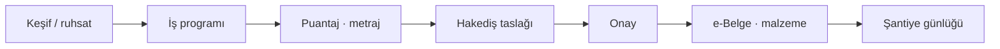
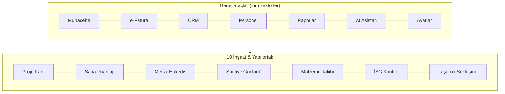

# 10 İnşaat & Yapı

## Özet
- İnşaat NACE F (41–43) olarak ayrıdır. KOSGEB 2024 iş kayıtlarında bu kolda 354.194 girişim vardır; 281.616’sı 1–9, 31.732’si 10–49 çalışandır. KOBİ tanımına giren inşaat girişimleri 306.162’dir. KOBİ’ler inşaat cirosunun %53,1’ini ve üretim değerinin %55,9’unu oluşturur. İki tablo aynı küme değildir. TMB ve İNTES profili büyük taahhüttür; 1–50 çalışanlı firmanın günü bu birliklerin işi değildir.
- Küçük müteahhit yetki belgesi, şantiye şefi, taşeron, malzeme, yapı denetim evrakı ve SGK dosyasıyla günü geçirir. İhtisas ekipleri metraj veya yevmiye ile hakediş keser. Tesisat, proje, malzeme, montaj ve test ile yürür. Taşıyıcıya dokunmayan basit tamir ruhsata tabi değildir. Yapı malzemesi satışı 2026 sınıflamasında 46.83 toptan ticarettir. Mimarlık 71.1’dedir. Yapı denetim 4708 sayılı kanunla ayrı tüzel kişidir.
- SantiyePro, Hakedra ve ESSantiye puantaj, metraj, hakediş ve şantiye günlüğünü toplar. ŞANTİYE-M ve Ulusal Yapı Denetim Sistemi kamu portalıdır; üçüncü parti için açık API bulunamadı.
- Karar: 10.05 toptan ticaret kodundadır ama şantiye carisi nedeniyle burada tutuldu. 10.06 ve 10.07 NACE 71’dedir; ruhsat zinciri nedeniyle burada bırakıldı.
- Modül: sektör ortak 7; alt sektör 7; toplam 42; MVP 26.
- Ortak çekirdek (tüm sektörler) bu dosyada yoktur → `04 Modüller/` çekirdek araçlar.

<!-- dallar:start -->
## Dallar (ağaç)
> **Sektör → Dal → Alt dal → Fonksiyon.** Görsel: [[Ağaç – 10 İnşaat & Yapı]] · Fonksiyon havuzu: `07 Fonksiyonlar/`

| Dal | Alt dal | Fonksiyon | Durum |
|---|---|---|---|
| [[Küçük ölçekli bina müteahhidi]] | 1 | 14 | açık |
| [[Şantiye ihtisas taşeronu]] | 1 | 14 | açık |
| [[Mekanik ve elektrik tesisat taşeronu]] | 1 | 14 | açık |
| [[Tadilat ve basit onarım]] | 1 | 14 | açık |
| [[Yapı malzemesi bayii]] | 1 | 14 | açık |
| [[Bina proje ofisi]] | 1 | 14 | açık |
| [[Yapı denetim kuruluşu]] | 1 | 14 | açık |
<!-- dallar:end -->

## Alt işletme türleri (onay listesi)
> İşaretli = Adım 1 onay listesi.

- [x] [[Küçük ölçekli bina müteahhidi|Küçük ölçekli bina müteahhidi]]
- [x] [[Şantiye ihtisas taşeronu|Şantiye ihtisas taşeronu]]
- [x] [[Mekanik ve elektrik tesisat taşeronu|Mekanik ve elektrik tesisat taşeronu]]
- [x] [[Tadilat ve basit onarım|Tadilat ve basit onarım]]
- [x] [[Yapı malzemesi bayii|Yapı malzemesi bayii]]
- [x] [[Bina proje ofisi|Bina proje ofisi]]
- [x] [[Yapı denetim kuruluşu|Yapı denetim kuruluşu]]

## Sınırlar ve doğrulanamayan
- Sektör arşiv notundaki sınır ve doğrulanamayan maddeler geçerlidir (`08 Arşiv/eski-docs-sektorel-arastirma/ai-kaynak/10-insaat-yapi.md`).
- Açık API bulunamayan kurum portalları: panel kayıt + kullanıcı girişi.

## Ortak iş akışı


## Araç mimarisi
> İlke: her araç bir kez yapılır. Bir işletme türü = araçların birleşimi. Tek türe özel ağır resmi entegrasyon yok (API yoksa panel kaydı).



## Araç matrisi (hangi araç kaç alt türe hizmet ediyor)
> ● = kullanıyor. genel = tüm sektörler, ozel = yalnız bu sektör.

| Araç | Tür | 10.01 | Taşeron | MEP | Tadilat | Bayi | Proje | Denetim | Toplam |
| --- | --- | --- | --- | --- | --- | --- | --- | --- | --- |
| [[Muhasebe ve Gelir-Gider]] | genel | ● | ● | ● | ● | ● | ● | ● | **7** |
| [[e-Fatura ve e-Arşiv]] | genel | ● | ● | ● | ● | ● | ● | ● | **7** |
| [[CRM]] | genel | ● | ● | ● | ● | ● | ● | ● | **7** |
| [[Personel ve Vardiya]] | genel | ● | ● | ● | ● | ● | ● | ● | **7** |
| [[Raporlar]] | genel | ● | ● | ● | ● | ● | ● | ● | **7** |
| [[AI Asistan]] | genel | ● | ● | ● | ● | ● | ● | ● | **7** |
| [[Ayarlar]] | genel | ● | ● | ● | ● | ● | ● | ● | **7** |
| [[Proje Kartı]] | ozel | ● | ● | ● | ● | ● | ● | ● | **7** |
| [[Saha Puantajı]] | ozel | ● | ● | ● | ● | ● | ● | ● | **7** |
| [[Metraj Hakediş]] | ozel | ● | ● | ● | ● | ● | ● | ● | **7** |
| [[Şantiye Günlüğü]] | ozel | ● | ● | ● | ● | ● | ● | ● | **7** |
| [[Malzeme Takibi]] | ozel | ● | ● | ● | ● | ● | ● | ● | **7** |
| [[İSG Kontrol]] | ozel | ● | ● | ● | ● | ● | ● | ● | **7** |
| [[Taşeron Sözleşme]] | ozel | ● | ● | ● | ● | ● | ● | ● | **7** |
| [[Ruhsat Takibi]] | ozel | ● |  |  |  |  |  |  | **1** |
| [[İş Programı]] | ozel | ● |  |  |  |  |  |  | **1** |
| [[Maliyet Bütçe]] | ozel | ● |  |  |  |  |  |  | **1** |
| [[Şef Atama]] | ozel | ● |  |  |  |  |  |  | **1** |
| [[Keşif Teklif]] | ozel | ● |  |  |  |  |  |  | **1** |
| [[İş Emri]] | ozel |  | ● |  |  |  |  |  | **1** |
| [[Yevmiye Hakediş]] | ozel |  | ● |  |  |  |  |  | **1** |
| [[Ekip Dağılımı]] | ozel |  | ● |  |  |  |  |  | **1** |
| [[Ek İş Kaydı]] | ozel |  | ● |  |  |  |  |  | **1** |
| [[Fotoğraf Delil]] | ozel |  | ● |  |  |  |  |  | **1** |
| [[Keşif Metraj]] | ozel |  |  | ● |  |  |  |  | **1** |
| [[Test Devreye]] | ozel |  |  | ● |  |  |  |  | **1** |
| [[Malzeme Poz]] | ozel |  |  | ● |  |  |  |  | **1** |
| [[As-Built Proje]] | ozel |  |  | ● |  |  |  |  | **1** |
| [[Revizyon Talep]] | ozel |  |  | ● |  |  |  |  | **1** |
| [[Keşif Randevu]] | ozel |  |  |  | ● |  |  |  | **1** |
| [[Teklif Onay]] | ozel |  |  |  | ● |  |  |  | **1** |
| [[İş Takvimi]] | ozel |  |  |  | ● |  |  |  | **1** |
| [[Önce Sonra]] | ozel |  |  |  | ● |  |  |  | **1** |
| [[Garanti Servis]] | ozel |  |  |  | ● |  |  |  | **1** |
| [[Sipariş Stok]] | ozel |  |  |  |  | ● |  |  | **1** |
| [[Sevkiyat İrsaliye]] | ozel |  |  |  |  | ● |  |  | **1** |
| [[Şantiye Teslim]] | ozel |  |  |  |  | ● |  |  | **1** |
| [[Fiyat Liste]] | ozel |  |  |  |  | ● |  |  | **1** |
| [[Cari Limit]] | ozel |  |  |  |  | ● |  |  | **1** |
| [[Proje Dosya]] | ozel |  |  |  |  |  | ● |  | **1** |
| [[Revizyon Sürüm]] | ozel |  |  |  |  |  | ● |  | **1** |
| [[Müellif Teslim]] | ozel |  |  |  |  |  | ● |  | **1** |
| [[Oda Tescil]] | ozel |  |  |  |  |  | ● |  | **1** |
| [[Ruhsat Evrak]] | ozel |  |  |  |  |  | ● |  | **1** |
| [[YİBF Takip]] | ozel |  |  |  |  |  |  | ● | **1** |
| [[Denetim Tutanak]] | ozel |  |  |  |  |  |  | ● | **1** |
| [[Seviye Hakediş]] | ozel |  |  |  |  |  |  | ● | **1** |
| [[Laboratuvar Numune]] | ozel |  |  |  |  |  |  | ● | **1** |
| [[UYDS Hazırlık]] | ozel |  |  |  |  |  |  | ● | **1** |

## Ortak ihtiyaçlar (7 alt türde sıklık)
| İhtiyaç | Kategori | Sıklık |
|---|---|---|
| [[Proje / iş kartı]] | operasyon | 7/7 |
| [[Puantaj / yoklama]] | personel | 7/7 |
| [[Metraj ve hakediş]] | finans | 7/7 |
| [[Malzeme / stok]] | operasyon | 7/7 |
| [[e-Belge]] | yasal | 7/7 |
| [[Şantiye günlüğü]] | operasyon | 5/7 |
| [[Ruhsat / evrak paketi]] | yasal | 4/7 |
| [[İSG checklist]] | yasal | 3/7 |
| [[Keşif teklifi]] | finans | 3/7 |
| [[UYDS / ŞANTİYE-M paketi]] | yasal | 3/7 |
| [[Bayi sevkiyat]] | operasyon | 1/7 |
| [[Denetim tutanağı]] | yasal | 1/7 |

## Öncelik tablosu
> Puanlar tahmindir (1–5). Öncelik = beş puanın ortalaması. Pazar büyüklüğü yalnızca kaynaklı satırlarda nettir.

| # | Alt tür | Pazar | Ödeme | Rekabet | Kolaylık | Aciliyet | Öncelik |
| --- | --- | --- | --- | --- | --- | --- | --- |
| 1 | [[Küçük ölçekli bina müteahhidi]] | 5 | 4 | 2 | 3 | 5 | **3.8** |
| 2 | [[Tadilat ve basit onarım]] | 4 | 4 | 3 | 4 | 4 | **3.8** |
| 3 | [[Şantiye ihtisas taşeronu]] | 4 | 3 | 3 | 4 | 4 | **3.6** |
| 4 | [[Mekanik ve elektrik tesisat taşeronu]] | 3 | 3 | 3 | 3 | 4 | **3.2** |
| 5 | [[Yapı malzemesi bayii]] | 3 | 4 | 2 | 3 | 3 | **3.0** |
| 6 | [[Bina proje ofisi]] | 3 | 3 | 2 | 3 | 3 | **2.8** |
| 7 | [[Yapı denetim kuruluşu]] | 2 | 3 | 2 | 2 | 3 | **2.4** |

## Yasal çerçeve
| Konu | Kural | Yazılım etkisi | Kaynak |
|---|---|---|---|
| KOBİ ölçeği | KOSGEB 2024: inşaatta 1–9: 281.616; 10–49: 31.732 | 1–50 bandı | https://webdosya.kosgeb.gov.tr/Content/Upload/Dosya/Kurumsal/2026/Tu%CC%88rkiye'deki_KOBI%CC%87'lere_I%CC%87lis%CC%A7kin_Baz%C4%B1_I%CC%87statistiki_Go%CC%88stergeler.pdf |
| Yapı denetim | 4708 sayılı Kanun | Tutanak ve seviye; UYDS girişi kullanıcıda | https://www.mevzuat.gov.tr/mevzuatmetin/1.5.4708.pdf |
| ŞANTİYE-M | ÇŞB e-Devlet hizmeti; üçüncü parti API yok | Paket panelde | https://cbs.csb.gov.tr/santiye-m-yazilimi-113510 |
| İmar | Planlı Alanlar İmar Yönetmeliği; basit tamir / esaslı tadilat | Ruhsat checklist | https://mevzuat.gov.tr/File/GeneratePdf?mevzuatNo=23722&mevzuatTertip=5&mevzuatTur=KurumVeKurulusYonetmeligi |

## Pazar büyüklüğü
| Alt tür / küme | Sayı | NACE / not |
|---|---|---|
| [[İnşaat KOBİ]] | KOSGEB: 306.162 KOBİ tanımına giren inşaat girişimi | NACE F |
| [[1–9 çalışan]] | 281.616 | F |
| [[10–49 çalışan]] | 31.732 | F |
| [[Alt sektör firma sayısı]] | bulunamadı | — |

## Rakip fiyat haritası
| Segment | Aralık | Rakipler |
|---|---|---|
| Şantiye / hakediş | bulunamadı | SantiyePro, Hakedra, ESSantiye |
| ERP | Mikro API açık; Logo/Nebim bu turda yok | Mikro |

## Bu sektördeki işletme türleri
```base
filters:
  and:
    - 'tip == "isletme"'
    - file.hasLink(this.file)
formulas:
  oncelik: '((pazar_puani + odeme_puani + rekabet_puani + kolaylik_puani + aciliyet_puani) / 5).toFixed(1)'
properties:
  file.name:
    displayName: İşletme türü
  note.durum:
    displayName: Durum
  formula.oncelik:
    displayName: Öncelik
  note.fiyat_araligi:
    displayName: Fiyat aralığı
  note.is_modeli:
    displayName: İş modeli
views:
  - type: table
    name: İşletme türleri
    order:
      - file.name
      - formula.oncelik
      - note.fiyat_araligi
      - note.is_modeli
      - note.durum
    sort:
      - property: formula.oncelik
        direction: DESC
```

## Kaynaklar
- Ayrıntılı liste: [[10 İnşaat & Yapı – Kaynaklar]]
- Araştırma arşivi: `08 Arşiv/eski-docs-sektorel-arastirma/ai-kaynak/10-insaat-yapi.md`
