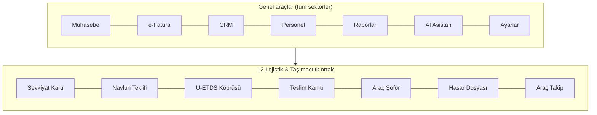

# 12 Lojistik & Taşımacılık

## Özet
- 1–50 çalışanlı yük lojistiği, işin nereye oturduğuna göre ayrılır: sefer, ambar hattı, şehir içi çok durak, ev taşıma, filosuz organizasyon ve başkasının malını depoda hazırlama. Karayolu Taşıma Yönetmeliği bunları ayrı yetki belgelerine bağlar; ürün kümesi belge kodu değildir. 14 Ocak 2023 değişikliğiyle mevcut C2 belgeleri L2’ye çevrilmiş ve yeni C2 düzenlenmemiştir.
- Günün döngüsü yükü kabul etmek, aracı ve sürücüyü bağlamak, taşıma belgesini çıkarmak ve navlunu kapatmaktır. C3, K1, K3, L1, L2, N1 ve N2 sahipleri sefer bilgisini taşıma başlayıncaya kadar U-ETDS’ye işler. Bakanlık bildirimin e-Devlet, web servisi ve UETDS uygulamasıyla yapılabildiğini duyurmuştur.
- UTİKAD raporu ulaştırma ve depolamanın 2024 GSYH payını TÜİK’e dayanarak %8,2 verir. Bu, 1–50 çalışanlı firma sayısı değildir. Güncel yetki belgesi envanteri açık tablo olarak bulunamadı.
- Karar: Uluslararası karayolu ayrı durur çünkü sefer fiilen sürer; ikinci bir lojistik işletmeciliği kopyası açılmaz.
- Modül: sektör ortak 7; alt sektör 7; toplam 42; MVP 26.
- Ortak çekirdek (tüm sektörler) bu dosyada yoktur → `04 Modüller/` çekirdek araçlar.

<!-- dallar:start -->
## Dallar (ağaç)
> **Sektör → Dal → Alt dal → Fonksiyon.** Fonksiyon havuzu: `07 Fonksiyonlar/`

| Dal | Alt dal | Fonksiyon | Durum |
|---|---|---|---|
| [[Yurt içi karayolu yük taşımacılığı]] | 1 | 14 | açık |
| [[Uluslararası karayolu yük taşımacılığı]] | 1 | 14 | açık |
| [[Nakliyat ambarı]] | 1 | 14 | açık |
| [[Şehir içi kurye ve dağıtım]] | 1 | 14 | açık |
| [[Ev ve büro taşımacılığı]] | 1 | 14 | açık |
| [[Taşıma organizatörlüğü ve acentelik]] | 1 | 14 | açık |
| [[Depolama ve sipariş karşılama]] | 1 | 14 | açık |
<!-- dallar:end -->

## Alt işletme türleri (onay listesi)
> İşaretli = Adım 1 onay listesi.

- [x] [[Yurt içi karayolu yük taşımacılığı|Yurt içi karayolu yük taşımacılığı]]
- [x] [[Uluslararası karayolu yük taşımacılığı|Uluslararası karayolu yük taşımacılığı]]
- [x] [[Nakliyat ambarı|Nakliyat ambarı]]
- [x] [[Şehir içi kurye ve dağıtım|Şehir içi kurye ve dağıtım]]
- [x] [[Ev ve büro taşımacılığı|Ev ve büro taşımacılığı]]
- [x] [[Taşıma organizatörlüğü ve acentelik|Taşıma organizatörlüğü ve acentelik]]
- [x] [[Depolama ve sipariş karşılama|Depolama ve sipariş karşılama]]

## Sınırlar ve doğrulanamayan
- Sektör arşiv notundaki sınır ve doğrulanamayan maddeler geçerlidir (`08 Arşiv/eski-docs-sektorel-arastirma/ai-kaynak/12-lojistik-tasimacilik.md`).
- Açık API bulunamayan kurum portalları: panel kayıt + kullanıcı girişi.

## Ortak iş akışı


## Araç mimarisi
> İlke: her araç bir kez yapılır. Bir işletme türü = araçların birleşimi. Tek türe özel ağır resmi entegrasyon yok (API yoksa panel kaydı).



## Araç matrisi (hangi araç kaç alt türe hizmet ediyor)
> ● = kullanıyor. genel = tüm sektörler, ozel = yalnız bu sektör.

| Araç | Tür | 12.01 | Uluslr. | Ambar | Kurye | Nakliyat | Acente | Depo | Toplam |
| --- | --- | --- | --- | --- | --- | --- | --- | --- | --- |
| [[Muhasebe ve Gelir-Gider]] | genel | ● | ● | ● | ● | ● | ● | ● | **7** |
| [[e-Fatura ve e-Arşiv]] | genel | ● | ● | ● | ● | ● | ● | ● | **7** |
| [[CRM]] | genel | ● | ● | ● | ● | ● | ● | ● | **7** |
| [[Personel ve Vardiya]] | genel | ● | ● | ● | ● | ● | ● | ● | **7** |
| [[Raporlar]] | genel | ● | ● | ● | ● | ● | ● | ● | **7** |
| [[AI Asistan]] | genel | ● | ● | ● | ● | ● | ● | ● | **7** |
| [[Ayarlar]] | genel | ● | ● | ● | ● | ● | ● | ● | **7** |
| [[Sevkiyat Kartı]] | ozel | ● | ● | ● | ● | ● | ● | ● | **7** |
| [[Navlun Teklifi]] | ozel | ● | ● | ● | ● | ● | ● | ● | **7** |
| [[U-ETDS Köprüsü]] | ozel | ● | ● | ● | ● | ● | ● | ● | **7** |
| [[Teslim Kanıtı]] | ozel | ● | ● | ● | ● | ● | ● | ● | **7** |
| [[Araç Şoför]] | ozel | ● | ● | ● | ● | ● | ● | ● | **7** |
| [[Hasar Dosyası]] | ozel | ● | ● | ● | ● | ● | ● | ● | **7** |
| [[Araç Takip]] | ozel | ● | ● | ● | ● | ● | ● | ● | **7** |
| [[Sefer Planı]] | ozel | ● |  |  |  |  |  |  | **1** |
| [[K1 Belge]] | ozel | ● |  |  |  |  |  |  | **1** |
| [[Yol Masrafı]] | ozel | ● |  |  |  |  |  |  | **1** |
| [[Takograf Uyarı]] | ozel | ● |  |  |  |  |  |  | **1** |
| [[Taşıma İrsaliye]] | ozel | ● |  |  |  |  |  |  | **1** |
| [[CMR Belgesi]] | ozel |  | ● |  |  |  |  |  | **1** |
| [[L2 Belge]] | ozel |  | ● |  |  |  |  |  | **1** |
| [[Transit Dosya]] | ozel |  | ● |  |  |  |  |  | **1** |
| [[Ro-Ro Slot]] | ozel |  | ● |  |  |  |  |  | **1** |
| [[Geçiş İzni]] | ozel |  | ● |  |  |  |  |  | **1** |
| [[Parsiyel Toplama]] | ozel |  |  | ● |  |  |  |  | **1** |
| [[Hat Seferi]] | ozel |  |  | ● |  |  |  |  | **1** |
| [[Ambar Stok]] | ozel |  |  | ● |  |  |  |  | **1** |
| [[G1 Acente]] | ozel |  |  | ● |  |  |  |  | **1** |
| [[N Belge]] | ozel |  |  | ● |  |  |  |  | **1** |
| [[Durak Rotası]] | ozel |  |  |  | ● |  |  |  | **1** |
| [[Kurye Atama]] | ozel |  |  |  | ● |  |  |  | **1** |
| [[Canlı Teslim]] | ozel |  |  |  | ● |  |  |  | **1** |
| [[P Belge]] | ozel |  |  |  | ● |  |  |  | **1** |
| [[Yoğunluk Paneli]] | ozel |  |  |  | ● |  |  |  | **1** |
| [[Keşif Randevu (Lojistik)]] | ozel |  |  |  |  | ● |  |  | **1** |
| [[Eşya Envanter]] | ozel |  |  |  |  | ● |  |  | **1** |
| [[Ekip Atama]] | ozel |  |  |  |  | ● |  |  | **1** |
| [[K3 C3 Belge]] | ozel |  |  |  |  | ● |  |  | **1** |
| [[Sigorta Teklif]] | ozel |  |  |  |  | ● |  |  | **1** |
| [[Taşıyıcı Havuz]] | ozel |  |  |  |  |  | ● |  | **1** |
| [[Booking Emri]] | ozel |  |  |  |  |  | ● |  | **1** |
| [[TİO Belge]] | ozel |  |  |  |  |  | ● |  | **1** |
| [[Multimodal Plan]] | ozel |  |  |  |  |  | ● |  | **1** |
| [[Marj Paneli]] | ozel |  |  |  |  |  | ● |  | **1** |
| [[Lokasyon Stok]] | ozel |  |  |  |  |  |  | ● | **1** |
| [[Pick Pack]] | ozel |  |  |  |  |  |  | ● | **1** |
| [[Mal Sahibi Hesap]] | ozel |  |  |  |  |  |  | ● | **1** |
| [[Sevk İrsaliye]] | ozel |  |  |  |  |  |  | ● | **1** |
| [[L Belge Notu]] | ozel |  |  |  |  |  |  | ● | **1** |

## Ortak ihtiyaçlar (7 alt türde sıklık)
| İhtiyaç | Kategori | Sıklık |
|---|---|---|
| [[Sevkiyat kartı]] | operasyon | 7/7 |
| [[Navlun teklifi]] | finans | 7/7 |
| [[Araç / şoför]] | operasyon | 7/7 |
| [[Teslim kanıtı]] | operasyon | 7/7 |
| [[e-Belge]] | yasal | 7/7 |
| [[U-ETDS köprüsü]] | yasal | 5/7 |
| [[Belge / yetki takibi]] | yasal | 5/7 |
| [[Kurye / durak rotası]] | operasyon | 2/7 |
| [[Depo / pick-pack]] | operasyon | 1/7 |
| [[CMR / transit]] | yasal | 1/7 |
| [[Filo konum]] | operasyon | 3/7 |
| [[Pazaryeri / ERP stok]] | operasyon | 1/7 |

## Öncelik tablosu
> Puanlar tahmindir (1–5). Öncelik = beş puanın ortalaması. Pazar büyüklüğü yalnızca kaynaklı satırlarda nettir.

| # | Alt tür | Pazar | Ödeme | Rekabet | Kolaylık | Aciliyet | Öncelik |
| --- | --- | --- | --- | --- | --- | --- | --- |
| 1 | [[Yurt içi karayolu yük taşımacılığı]] | 5 | 4 | 2 | 3 | 5 | **3.8** |
| 2 | [[Şehir içi kurye ve dağıtım]] | 4 | 4 | 3 | 4 | 4 | **3.8** |
| 3 | [[Nakliyat ambarı]] | 3 | 3 | 3 | 3 | 4 | **3.2** |
| 4 | [[Depolama ve sipariş karşılama]] | 3 | 4 | 2 | 3 | 4 | **3.2** |
| 5 | [[Ev ve büro taşımacılığı]] | 3 | 3 | 3 | 4 | 3 | **3.2** |
| 6 | [[Taşıma organizatörlüğü ve acentelik]] | 3 | 3 | 2 | 3 | 3 | **2.8** |
| 7 | [[Uluslararası karayolu yük taşımacılığı]] | 3 | 3 | 2 | 2 | 3 | **2.6** |

## Yasal çerçeve
| Konu | Kural | Yazılım etkisi | Kaynak |
|---|---|---|---|
| Karayolu taşıma | Karayolu Taşıma Yönetmeliği; yetki belgeleri | Belge alanı | https://www.mevzuat.gov.tr/MevzuatMetin/yonetmelik/7.5.24299.pdf |
| U-ETDS | Eşya bildirimi; SOAP V3.6 | Taslak + onaylı gönderim | https://uetds.uab.gov.tr/esya |
| TİO | Taşıma İşleri Organizatörlüğü Yönetmeliği | TİO belge alanı | https://www.mevzuat.gov.tr/MevzuatMetin/yonetmelik/7.5.39686.pdf |
| e-İrsaliye | VUK 509; taşıyıcıda taşıma irsaliyesi ayrıdır | Mikro e-İrsaliye onayla | https://cdn.gib.gov.tr/api/gibportal-file/file/getFile?objectKey=MEVZUAT_TEBLIGLER%2FUNIVERSAL%2F2026%2FMEVZUAT_TEBLIGLER_2026_VukTeb509_Guncel.pdf |

## Pazar büyüklüğü
| Alt tür / küme | Sayı | NACE / not |
|---|---|---|
| [[Ulaştırma-depolama GSYH payı]] | UTİKAD 2024: %8,2 (TÜİK’e dayanarak; 1–50 firma sayısı değil) | H |
| [[Yetki belgesi envanteri]] | güncel açık tablo bulunamadı | — |

## Rakip fiyat haritası
| Segment | Aralık | Rakipler |
|---|---|---|
| U-ETDS | resmi SOAP | UAB U-ETDS |
| Rota | Google Routes API | Google |
| Mesaj | WhatsApp Cloud API | Meta |

## Bu sektördeki işletme türleri
```base
filters:
  and:
    - 'tip == "isletme"'
    - file.hasLink(this.file)
formulas:
  oncelik: '((pazar_puani + odeme_puani + rekabet_puani + kolaylik_puani + aciliyet_puani) / 5).toFixed(1)'
properties:
  file.name:
    displayName: İşletme türü
  note.durum:
    displayName: Durum
  formula.oncelik:
    displayName: Öncelik
  note.fiyat_araligi:
    displayName: Fiyat aralığı
  note.is_modeli:
    displayName: İş modeli
views:
  - type: table
    name: İşletme türleri
    order:
      - file.name
      - formula.oncelik
      - note.fiyat_araligi
      - note.is_modeli
      - note.durum
    sort:
      - property: formula.oncelik
        direction: DESC
```

## Kaynaklar
- Ayrıntılı liste: [[12 Lojistik & Taşımacılık – Kaynaklar]]
- Araştırma arşivi: `08 Arşiv/eski-docs-sektorel-arastirma/ai-kaynak/12-lojistik-tasimacilik.md`
