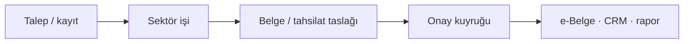
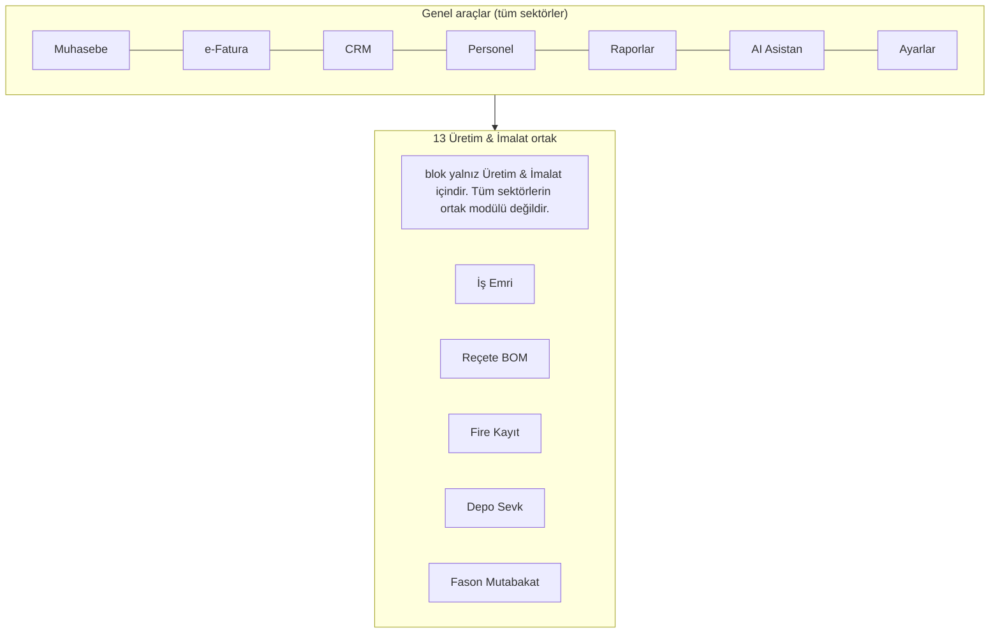

# 13 Üretim & İmalat

## Özet
- TÜİK’in 24 Aralık 2025 tarihli 2024 KOBİ bülteninde KOBİ, 250’den az çalışan ve 500 milyon TL eşiğini aşmayan girişimdir.
- TÜİK sipariş, parti, fason veya proje payı yayımlamaz.
- Sanayi sicili devamlı ve seri imalata ilişir.
- Karar: Ayrım hammaddeye göre değil iş emrinin nasıl açıldığına göredir.
- Modül sayısı: sektör ortak 6; alt sektör 6; toplam 42; MVP 23.
- Ortak çekirdek (tüm sektörler): Muhasebe, e-Fatura/e-Arşiv, CRM, Personel, Raporlar, AI Asistan, Ayarlar → `04 Modüller/00 Ortak Çekirdek.md`.

<!-- dallar:start -->
## Dallar (ağaç)
> **Sektör → Dal → Alt dal → Fonksiyon.** Fonksiyon havuzu: `07 Fonksiyonlar/` · Ortak araçlar: `04 Modüller/`

| Dal | Alt dal | Fonksiyon | Durum |
|---|---|---|---|
| [[Siparişe göre kısa çevrim atölye]] | 1 | 6 | açık |
| [[Tekrarlayan parti ve stok üretimi]] | 1 | 6 | açık |
| [[Fason işleyen atölye]] | 1 | 6 | açık |
| [[Proje tipi makine ve ekipman imalatı]] | 1 | 6 | açık |
| [[Gıda işleme]] | 1 | 6 | açık |
| [[Üretimi dışarı veren imalatçı]] | 1 | 6 | açık |
<!-- dallar:end -->

## Alt işletme türleri (onay listesi)
> İşaretli = Adım 1 onay listesi.

- [x] [[Siparişe göre kısa çevrim atölye|Siparişe göre kısa çevrim atölye]]
- [x] [[Tekrarlayan parti ve stok üretimi|Tekrarlayan parti ve stok üretimi]]
- [x] [[Fason işleyen atölye|Fason işleyen atölye]]
- [x] [[Proje tipi makine ve ekipman imalatı|Proje tipi makine ve ekipman imalatı]]
- [x] [[Gıda işleme|Gıda işleme]]
- [x] [[Üretimi dışarı veren imalatçı|Üretimi dışarı veren imalatçı]]

**Sınırlar**
- Alt sektör, haftanın koordinasyonunu hangi akışın tuttuğuna göredir. Kendi tezgâhında parti basıp nakışı dışarı veren 13.02’de kalır. Yalnızca dışarıdaki dönüşümü yöneten 13.06’dadır. Mal müşterinin ve bedel işçilikse 13.03’tedir.
- Metal, ahşap, plastik ve kâğıt aynı akıştaysa bölünmez. Renk ve beden varyanttır; ayrı giyim alt sektörü yoktur. Gıda 13.05’tedir çünkü parti, tarih ve Tarım ve Orman kaydı günlük kaydın parçasıdır.
- Yapı malzemesini üreten imalathane burada kalır. Şantiyede uygulama 10’dadır. Lokanta ve küçük tamirhane dışarıdadır. Yazılım üretimi bu görevde 15’tedir.

**Doğrulanamayan**
- data.tuik.gov.tr bülten sayfası bu oturumda boş döndü; rakamlar AA ve KOSGEB derlemesinden.
- İmalatın kendi ERP oranı ve fire/termin istatistiği yok.
- Logo ve Nebim için bu akışları açan kamuya açık API doğrulanamadı. Mikro API doğrulandı.

## Ortak iş akışı

## Araç mimarisi
> İlke: her araç bir kez yapılır. Bir işletme türü = araçların birleşimi. Tek türe özel büyük geliştirme yok.

## Araç matrisi (hangi araç kaç alt türe hizmet ediyor)
> ● = kullanıyor. genel = tüm sektörler, ozel = yalnız bu sektör.

| Araç | Tür | Siparişe | Tekrarlayan | Fason | Proje | Gıda işleme | Üretimi | Toplam |
| --- | --- | --- | --- | --- | --- | --- | --- | --- |
| [[blok yalnız Üretim & İmalat içindir. Tüm sektörlerin ortak modülü değildir.]] | ozel | ● | ● | ● | ● | ● | ● | **6** |
| [[İş Emri]] | ozel | ● | ● | ● | ● | ● | ● | **6** |
| [[Reçete BOM]] | ozel | ● | ● | ● | ● | ● | ● | **6** |
| [[Fire Kayıt]] | ozel | ● | ● | ● | ● | ● | ● | **6** |
| [[Depo Sevk]] | ozel | ● | ● | ● | ● | ● | ● | **6** |
| [[Fason Mutabakat]] | ozel | ● | ● | ● | ● | ● | ● | **6** |
| [[modeli: karma.]] | ozel | ● |  |  |  |  |  | **1** |
| [[Sipariş Emri]] | ozel | ● |  |  |  |  |  | **1** |
| [[Atölye Kuyruk]] | ozel | ● |  |  |  |  |  | **1** |
| [[Termin Alarm]] | ozel | ● |  |  |  |  |  | **1** |
| [[Tezgah Yük]] | ozel | ● |  |  |  |  |  | **1** |
| [[Revize Sipariş]] | ozel | ● |  |  |  |  |  | **1** |
| [[modeli: uretim.]] | ozel |  | ● |  |  |  |  | **1** |
| [[Parti Plan]] | ozel |  | ● |  |  |  |  | **1** |
| [[Lot Barkod]] | ozel |  | ● |  |  |  |  | **1** |
| [[Min Max]] | ozel |  | ● |  |  |  |  | **1** |
| [[Verim Rapor]] | ozel |  | ● |  |  |  |  | **1** |
| [[Alternatif Reçete]] | ozel |  | ● |  |  |  |  | **1** |
| [[modeli: uretim.]] | ozel |  |  | ● |  |  |  | **1** |
| [[Müşteri Malzeme]] | ozel |  |  | ● |  |  |  | **1** |
| [[İşçilik Hakediş]] | ozel |  |  | ● |  |  |  | **1** |
| [[Dönüş İrsaliye]] | ozel |  |  | ● |  |  |  | **1** |
| [[Fire Bildirim]] | ozel |  |  | ● |  |  |  | **1** |
| [[Kapasite Slot]] | ozel |  |  | ● |  |  |  | **1** |
| [[modeli: karma.]] | ozel |  |  |  | ● |  |  | **1** |
| [[Proje BOM]] | ozel |  |  |  | ● |  |  | **1** |
| [[Montaj Aşama]] | ozel |  |  |  | ● |  |  | **1** |
| [[Milestone Ödeme]] | ozel |  |  |  | ● |  |  | **1** |
| [[Teknik Revizyon]] | ozel |  |  |  | ● |  |  | **1** |
| [[Saha Sevk]] | ozel |  |  |  | ● |  |  | **1** |
| [[modeli: uretim.]] | ozel |  |  |  |  | ● |  | **1** |
| [[Lot İzle]] | ozel |  |  |  |  | ● |  | **1** |
| [[SKT Parti]] | ozel |  |  |  |  | ● |  | **1** |
| [[Kayıt Onay]] | ozel |  |  |  |  | ● |  | **1** |
| [[Soğuk Kayıt]] | ozel |  |  |  |  | ● |  | **1** |
| [[Geri Çağır]] | ozel |  |  |  |  | ● |  | **1** |
| [[modeli: karma.]] | ozel |  |  |  |  |  | ● | **1** |
| [[Fasoncu Sevk]] | ozel |  |  |  |  |  | ● | **1** |
| [[Dönüş Kabul]] | ozel |  |  |  |  |  | ● | **1** |
| [[Hakediş Kesinti]] | ozel |  |  |  |  |  | ● | **1** |
| [[Fasoncu Bakiye]] | ozel |  |  |  |  |  | ● | **1** |
| [[Çok Fasoncu]] | ozel |  |  |  |  |  | ● | **1** |
| [[Muhasebe ve Gelir-Gider]] | genel | ● | ● | ● | ● | ● | ● | **6** |
| [[e-Fatura ve e-Arşiv]] | genel | ● | ● | ● | ● | ● | ● | **6** |
| [[CRM]] | genel | ● | ● | ● | ● | ● | ● | **6** |
| [[Personel ve Vardiya]] | genel | ● | ● | ● | ● | ● | ● | **6** |
| [[Raporlar]] | genel | ● | ● | ● | ● | ● | ● | **6** |
| [[AI Asistan]] | genel | ● | ● | ● | ● | ● | ● | **6** |
| [[Ayarlar]] | genel | ● | ● | ● | ● | ● | ● | **6** |

## Sektör ortak modüller

### Bu blok yalnız Üretim & İmalat içindir. Tüm sektörlerin ortak modülü değildir.

- oncelik: 
- durum: 
- aciklama: 
- entegrasyonlar: yok
- ai_komutlari:

### 13.00.01 İş Emri

- oncelik: MVP
- durum: zorunlu
- aciklama: Sipariş veya stok ihtiyacından iş emri; durum akışı; tam MES değil
- entegrasyonlar: Mikro API (doğrulandı), Logo/Nebim (dogrulanmali)
- ai_komutlari:
  - Sipariş 452 için iş emri aç
  - Geciken iş emirlerini listele
- ai_otomasyonu: Termin aşımına 24 saat kala uyarı; kapanışta reçete tüketim önerisi

### 13.00.02 Reçete BOM

- oncelik: MVP
- durum: zorunlu
- aciklama: Hammadde, birim, beklenen fire oranı; iş emrine bağlanır
- entegrasyonlar: Mikro API
- ai_komutlari:
  - Gömlek reçetesini göster
  - Fire oranını yüzde 5 yap
- ai_otomasyonu: İş emri açılışında malzeme ihtiyacı ve stok yetersizliği uyarısı
- mevzuat_notu: Doğrulama kapanışı: Mikro API açıldı: UrunReceteKaydetV2 ve StokKaydetV2. Logo ve Nebim için kamuya açık reçete ucu bu turda yok, listeden çıktı.

### 13.00.03 Fire Kayıt

- oncelik: MVP
- durum: zorunlu
- aciklama: İş emri bazlı fire; reçete toleransı ile gerçekleşen karşılaştırma
- entegrasyonlar: yok
- ai_komutlari:
  - İş emri 88 fire kaydet 12 adet
  - Bu hafta fire aşımı
- ai_otomasyonu: Aşımı hesaplar ve onay kuyruğuna düşürür

### 13.00.04 Depo Sevk

- oncelik: MVP
- durum: zorunlu
- aciklama: İş emrine bağlı malzeme çıkış/iade ve fason depo bakiyesi. Çekirdek genişleme: e-Fatura/e-Arşiv (e-irsaliye köprüsü).
- entegrasyonlar: Mikro e-İrsaliye API
- ai_komutlari:
  - İş emri 90 için sac çıkar
  - Fasoncuda kalan bakiyeyi göster
- ai_otomasyonu: Sevk sonrası bakiye güncelleme; e-irsaliye zorunluluk bayrağı önerisi
- mevzuat_notu: VUK 509: ciro 10M vs GTİP 72/73 ayrı eşikler Doğrulama kapanışı: Mikro API açıldı: IrsaliyeKaydetV2 ve EIrsaliyeGonderV2. Gönderim onayla.

### 13.00.05 Fason Mutabakat

- oncelik: MVP
- durum: zorunlu
- aciklama: Sevk, dönüş, kalite, fire, hakediş ve fatura eşleştirme zinciri. Çekirdek genişleme: Muhasebe & Gelir-Gider.
- entegrasyonlar: e-Fatura, Mikro cari
- ai_komutlari:
  - ABC Fason mutabakatını çıkar
  - Fire aşımını hakedişten kes
- ai_otomasyonu: Dönem sonu hakediş taslağı; fatura farkını satır satır listeler
- mevzuat_notu: Fason sevk belge/mülkiyet ayrımı mali müşavir yönlendirmesiyle

## Alt sektör modülleri

## 13.01 Siparişe göre kısa çevrim atölye

- aciklama: Müşterinin ölçüsüne göre saatler veya birkaç gün süren ayrı iş çıkaran atölye.
- gunluk_is: Teklif, eksik ölçü, iş emri, tezgâh sırası, fire ve sevk.
- ai: Serbest siparişten eksik ölçü ve termin listesi çıkarır; durum cümlesi taslaklar.

### İş modeli: karma.

- oncelik: 
- durum: 
- aciklama: 
- entegrasyonlar: yok
- ai_komutlari:

### 13.01.01 Sipariş Emri

- oncelik: MVP
- durum: zorunlu
- aciklama: Satış siparişinden iş emri ve termin kilidi. Çekirdek genişleme: CRM.
- entegrasyonlar: CRM
- ai_komutlari:
  - Sipariş 120'yi iş emrine çevir
  - Bugün teslimler
- ai_otomasyonu: Onaylı siparişte WO önerisi

### 13.01.02 Atölye Kuyruk

- oncelik: MVP
- durum: zorunlu
- aciklama: Termin öncelikli basit iş sırası
- entegrasyonlar: yok
- ai_komutlari:
  - Torna kuyruğunu sırala
  - Acil işi öne al
- ai_otomasyonu: Gecikme riskine göre öncelik skoru

### 13.01.03 Termin Alarm

- oncelik: MVP
- durum: zorunlu
- aciklama: Teslim riski ve dar boğaz uyarısı. Çekirdek genişleme: CRM.
- entegrasyonlar: CRM
- ai_komutlari:
  - Geç kalacak işleri söyle
  - Müşteri X gecikmeleri
- ai_otomasyonu: SLA aşımında CRM notu önerisi

### 13.01.04 Tezgah Yük

- oncelik: V2
- durum: opsiyonel
- aciklama: Basit yük görünümü; MES kapasite planı değil
- entegrasyonlar: yok
- ai_komutlari:
  - Bu hafta freze doluluk
- ai_otomasyonu: Aşırı yükte yeni WO uyarısı

### 13.01.05 Revize Sipariş

- oncelik: V2
- durum: opsiyonel
- aciklama: Üretimde miktar/ölçü değişikliği onayı
- entegrasyonlar: yok
- ai_komutlari:
  - Sipariş 55 miktarı 80 yap
- ai_otomasyonu: Açık WO'da değişiklik onayı ister

## 13.02 Tekrarlayan parti ve stok üretimi

- aciklama: Kendi stok kodunu aynı reçeteyle partiler halinde yenileyen işletme.
- gunluk_is: Sabit reçete, parti miktarı, fire payı, ambar eşiği ve sevkiyat.
- ai: Parti adedinden fireli malzeme ihtiyacını çıkarır; stok yetmezse eksiği listeler.

### İş modeli: uretim.

- oncelik: 
- durum: 
- aciklama: 
- entegrasyonlar: yok
- ai_komutlari:

### 13.02.01 Parti Plan

- oncelik: MVP
- durum: zorunlu
- aciklama: Stok/talep ile parti ve iş emri
- entegrasyonlar: Mikro stok
- ai_komutlari:
  - SKU-A için 500'lük parti aç
  - Bu ay planı
- ai_otomasyonu: Min stok altında parti önerisi

### 13.02.02 Lot Barkod

- oncelik: MVP
- durum: zorunlu
- aciklama: Parti/lot kodu üretimi ve sevk bağlama
- entegrasyonlar: Barkod yazıcı
- ai_komutlari:
  - Lot L-2411 oluştur
  - Lot L-2411 nereye gitti
- ai_otomasyonu: WO kapanışında lot üretimi
- mevzuat_notu: GTİP 72/73 sevklerinde lot satırı faydalı

### 13.02.03 Min Max

- oncelik: MVP
- durum: zorunlu
- aciklama: Yeniden üretim tetik noktası
- entegrasyonlar: yok
- ai_komutlari:
  - Min altına düşenleri listele
  - Min 200 yap
- ai_otomasyonu: Eşik aşımında WO taslağı

### 13.02.04 Verim Rapor

- oncelik: V2
- durum: opsiyonel
- aciklama: Plan vs üretilen vs fire. Çekirdek genişleme: Raporlar.
- entegrasyonlar: Raporlar
- ai_komutlari:
  - SKU-B verim raporu
- ai_otomasyonu: Haftalık fire/verim özeti

### 13.02.05 Alternatif Reçete

- oncelik: V2
- durum: opsiyonel
- aciklama: Malzeme yokluğunda alternatif BOM
- entegrasyonlar: yok
- ai_komutlari:
  - Alternatif reçeteyi uygula
- ai_otomasyonu: Kritik stokta alternatif önerisi

## 13.03 Fason işleyen atölye

- aciklama: Başkasının malını işleyip işçilik bedeli kesen atölye.
- gunluk_is: Gelen mal, işlem, fire mutabakatı, iade sevk ve hizmet faturası.
- ai: Gelen irsaliyeyi açık işe bağlar; iade ve fire farkını mutabakat metnine döker.

### İş modeli: uretim.

- oncelik: 
- durum: 
- aciklama: 
- entegrasyonlar: yok
- ai_komutlari:

### 13.03.01 Müşteri Malzeme

- oncelik: MVP
- durum: zorunlu
- aciklama: Müşteri emanet hammadde bakiyesi
- entegrasyonlar: 13.00.04
- ai_komutlari:
  - Müşteri Y kumaş bakiyesi
  - Gelen malzeme kaydet
- ai_otomasyonu: Emanet ile kendi stoğu ayırır
- mevzuat_notu: Emanet stok muhasebe politikası

### 13.03.02 İşçilik Hakediş

- oncelik: MVP
- durum: zorunlu
- aciklama: Kabul adedi üzerinden işçilik faturalama. Çekirdek genişleme: e-Fatura/e-Arşiv.
- entegrasyonlar: e-Fatura
- ai_komutlari:
  - Müşteri Y bu ay hakediş
  - Birim fiyat 4,5 TL
- ai_otomasyonu: Dönem sonu hakedişten e-Fatura önerisi

### 13.03.03 Dönüş İrsaliye

- oncelik: MVP
- durum: zorunlu
- aciklama: Mamulün müşteriye sevki. Çekirdek genişleme: e-Fatura/e-Arşiv.
- entegrasyonlar: Mikro e-İrsaliye API
- ai_komutlari:
  - Mamulü müşteriye sevk et
  - İrsaliye hazırla
- ai_otomasyonu: Kabul sonrası e-irsaliye bayrağı
- mevzuat_notu: Ciro 10M vs GTİP 72/73 ayrımı Doğrulama kapanışı: Mikro e-İrsaliye uçları açıldı. Dönüş irsaliyesi taslaktır, GİB gönderimi onayla.

### 13.03.04 Fire Bildirim

- oncelik: V2
- durum: opsiyonel
- aciklama: Müşteri malzemesinde fire raporu
- entegrasyonlar: yok
- ai_komutlari:
  - Fireyi müşteriye bildir
- ai_otomasyonu: Aşımda bildirim taslağı

### 13.03.05 Kapasite Slot

- oncelik: V2
- durum: opsiyonel
- aciklama: Haftalık iş kabul slotları
- entegrasyonlar: yok
- ai_komutlari:
  - Perşembe boş slot
- ai_otomasyonu: Aşırı dolulukta yeni iş reddi önerisi

## 13.04 Proje tipi makine ve ekipman imalatı

- aciklama: Tek teslimi olan makine veya ekipmanı tasarlayıp toplayan 1–50 kişilik imalatçı.
- gunluk_is: Çok seviyeli ürün ağacı, revizyon, uzun temin, montaj, test ve hakediş.
- ai: Son revizyon ile takılmış parçaları karşılaştırıp eksik parça listesini açar.

### İş modeli: karma.

- oncelik: 
- durum: 
- aciklama: 
- entegrasyonlar: yok
- ai_komutlari:

### 13.04.01 Proje BOM

- oncelik: MVP
- durum: zorunlu
- aciklama: Projeye özel reçete revizyonları
- entegrasyonlar: 13.00.02
- ai_komutlari:
  - Proje P-12 BOM v3
  - Revizyon farkını göster
- ai_otomasyonu: Revizyonda açık WO kilidi/onayı

### 13.04.02 Montaj Aşama

- oncelik: MVP
- durum: zorunlu
- aciklama: Kesim-kaynak-montaj-test kapıları
- entegrasyonlar: 13.00.01
- ai_komutlari:
  - P-12 hangi aşamada
  - Test aşamasına geç
- ai_otomasyonu: Önceki aşama olmadan ilerlemeyi engeller

### 13.04.03 Milestone Ödeme

- oncelik: MVP
- durum: zorunlu
- aciklama: Proje hakediş basamakları. Çekirdek genişleme: Muhasebe & Gelir-Gider.
- entegrasyonlar: e-Fatura, Muhasebe
- ai_komutlari:
  - P-12 yüzde 40 faturasını hazırla
- ai_otomasyonu: Aşama onayında fatura taslağı

### 13.04.04 Teknik Revizyon

- oncelik: V2
- durum: opsiyonel
- aciklama: Müşteri çizim değişikliği kaydı. Çekirdek genişleme: CRM.
- entegrasyonlar: CRM
- ai_komutlari:
  - Revizyon R2 ekle
- ai_otomasyonu: Maliyet/termin etkisini işaretler

### 13.04.05 Saha Sevk

- oncelik: V2
- durum: opsiyonel
- aciklama: Makine sevkiyat checklist
- entegrasyonlar: Mikro e-İrsaliye API
- ai_komutlari:
  - Sevkiyat checklist
- ai_otomasyonu: Eksik kalemde sevki bloklar
- mevzuat_notu: GTİP 72/73 kapsamı kontrol edilmeli Doğrulama kapanışı: Mikro e-İrsaliye uçları açıldı. Saha sevki taslaktır, gönderim onayla.

## 13.05 Gıda işleme

- aciklama: Bozulabilir girdiyi reçete ve parti ile işleyip piyasaya gıda arz eden işletme. Lokanta burada değildir.
- gunluk_is: Reçete, lot, son tüketim tarihi, verim ve kayıt veya onay dosyası.
- ai: Günün partisinden lot ve tüketim dökümünü taslaklar; tarihi yaklaşmış girdiyi işaretler.

### İş modeli: uretim.

- oncelik: 
- durum: 
- aciklama: 
- entegrasyonlar: yok
- ai_komutlari:

### 13.05.01 Lot İzle

- oncelik: MVP
- durum: zorunlu
- aciklama: Girdi-üretim-satış one-up/one-down izlenebilirlik
- entegrasyonlar: 13.02.02
- ai_komutlari:
  - Lot G-90 nereye gitti
  - Bu satışın hammaddesi
- ai_otomasyonu: Satışta lot zorunluluğu; geri çağırma listesi
- mevzuat_notu: 5996 m.24; Gıda ve Yemin Resmi Kontrollerine Dair Yönetmelik m.39

### 13.05.02 SKT Parti

- oncelik: MVP
- durum: zorunlu
- aciklama: SKT/TETT ve FEFO sevk
- entegrasyonlar: 13.00.04
- ai_komutlari:
  - SKT'si 7 gün kalanlar
  - FEFO ile sevk
- ai_otomasyonu: SKT yaklaşınca uyarı; eski lot önceliği
- mevzuat_notu: Parti tanımlama/etiketleme (m.39)

### 13.05.03 Kayıt Onay

- oncelik: MVP
- durum: zorunlu
- aciklama: İşletme kayıt/onay belgesi hatırlatıcı; tam HACCP suite değil
- entegrasyonlar: yok
- ai_komutlari:
  - Kayıt belgesi bitiş tarihi
  - Onay kapsamım ne
- ai_otomasyonu: Belge süresine 30 gün kala uyarı
- mevzuat_notu: Gıda İşletmelerinin Kayıt ve Onay İşlemlerine Dair Yönetmelik

### 13.05.04 Soğuk Kayıt

- oncelik: V2
- durum: opsiyonel
- aciklama: Basit sıcaklık/ölçüm günlüğü
- entegrasyonlar: Elle sıcaklık
- ai_komutlari:
  - Soğuk oda bugün kaydı
- ai_otomasyonu: Eksik günlük kayıt hatırlatması
- mevzuat_notu: Resmi kontrol cihaz ölçüm kayıtları Doğrulama kapanışı: Seçili sensör markası yok. Sıcaklık elle girilir.

### 13.05.05 Geri Çağır

- oncelik: V2
- durum: opsiyonel
- aciklama: Lot bazlı geri çağırma ve müşteri listesi. Çekirdek genişleme: CRM.
- entegrasyonlar: CRM, e-İrsaliye
- ai_komutlari:
  - Lot G-90 geri çağır
- ai_otomasyonu: Etkilenen fatura/irsaliye listesi
- mevzuat_notu: 5996 izlenebilirlik

## 13.06 Üretimi dışarı veren imalatçı

- aciklama: Kendi modelinin dönüşümünü başka atölyede yaptıran, kendi tezgâhı merkez olmayan imalatçı.
- gunluk_is: Malzeme çıkışı, fason emri, dışarıdaki stok, geri kabul ve işçilik faturası.
- ai: Gönderilen malzeme ile geri gelen mamulü karşılaştırıp geciken fason için takip metni yazar.

### İş modeli: karma.

- oncelik: 
- durum: 
- aciklama: 
- entegrasyonlar: yok
- ai_komutlari:

### 13.06.01 Fasoncu Sevk

- oncelik: MVP
- durum: zorunlu
- aciklama: Fasoncuya malzeme sevk ve iş emri bağlama
- entegrasyonlar: Mikro e-İrsaliye API
- ai_komutlari:
  - ABC'ye 405 kg kumaş sevk et
  - Açık sevkler
- ai_otomasyonu: Reçeteden gönderilecek miktar hesabı
- mevzuat_notu: Sevk irsaliyesi; e-irsaliye ciro/GTİP bayrağı Doğrulama kapanışı: Mikro e-İrsaliye uçları açıldı. Fasonda malzeme çıkışı taslaktır, gönderim onayla.

### 13.06.02 Dönüş Kabul

- oncelik: MVP
- durum: zorunlu
- aciklama: Mamul kabul/ret ve reçete tüketim düşümü
- entegrasyonlar: 13.00.03, 13.00.05
- ai_komutlari:
  - ABC dönüşünü kaydet 960 adet
  - Ret 40
- ai_otomasyonu: Bakiye = sevk − (kabul×reçete) − fire

### 13.06.03 Hakediş Kesinti

- oncelik: MVP
- durum: zorunlu
- aciklama: Fire/eksik/ret kesintili fasoncu ödemesi. Çekirdek genişleme: Muhasebe & Gelir-Gider.
- entegrasyonlar: e-Fatura, Muhasebe
- ai_komutlari:
  - ABC hakedişini kesintili hesapla
- ai_otomasyonu: Aşım bedelini hakedişten düşer; fatura eşleştirir

### 13.06.04 Fasoncu Bakiye

- oncelik: V2
- durum: opsiyonel
- aciklama: Fasoncuda kalan malzeme görünümü
- entegrasyonlar: yok
- ai_komutlari:
  - Kimde ne malzeme var
- ai_otomasyonu: Pozitif bakiyeli açık WO listesi
- mevzuat_notu: Yıl sonu sayım riski

### 13.06.05 Çok Fasoncu

- oncelik: V2
- durum: opsiyonel
- aciklama: Operasyon bazlı farklı fasoncular
- entegrasyonlar: yok
- ai_komutlari:
  - Kesim ABC, dikim DEF
- ai_otomasyonu: Önceki operasyon bitmeden sonraki sevki açmaz

## Sayım

- sektor_ortak: 5
- alt_sektor: 6
- modul: 35
- mvp: 23

## Kaynaklar

- KOSGEB KOBİ göstergeleri: https://webdosya.kosgeb.gov.tr/Content/Upload/Dosya/Kurumsal/2026/Tu%CC%88rkiye'deki_KOBI%CC%87'lere_I%CC%87lis%CC%A7kin_Baz%C4%B1_I%CC%87statistiki_Go%CC%88stergeler.pdf
- 6948 sayılı Sanayi Sicili Kanunu: https://www.mevzuat.gov.tr/MevzuatMetin/1.3.6948.pdf
- VUK 509 e-İrsaliye: https://cdn.gib.gov.tr/api/gibportal-file/file/getFile?objectKey=MEVZUAT_TEBLIGLER%2FUNIVERSAL%2F2026%2FMEVZUAT_TEBLIGLER_2026_VukTeb509_Guncel.pdf
- Mikro API: https://apidocs.mikro.com.tr/apis
- Gıda kayıt yönetmeliği: https://www.mevzuat.gov.tr/MevzuatMetin/yonetmelik/7.5.15594.htm
