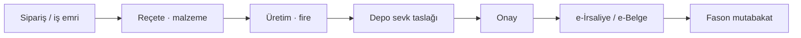

# 13 Üretim & İmalat

## Özet
- TÜİK’in 24 Aralık 2025 tarihli 2024 KOBİ bülteninde KOBİ, 250’den az çalışan ve 500 milyon TL eşiğini aşmayan girişimdir. KOBİ’ler girişimlerin %99,6’sıdır; bunların %12,1’i imalattadır. İmalat KOBİ’leri KOBİ istihdamının %25,4’ünü ve üretim değerinin %41,2’sini oluşturur. KOSGEB derlemesinde mali ölçütlü imalat 473.142 girişimdir. İş kayıtlarında 1–9 çalışan 437.372, 10–49 çalışan 45.314’tür. İki sayım aynı evren değildir.
- TÜİK sipariş, parti, fason veya proje payı yayımlamaz. Ayrım MEB’in üretim organizasyonu modülünden ve TOBB kapasite hesabından gelir. Logo hızlı üretim fişi tek seviyeli reçete ve fireyi kapatır. Tiger 3’te üretim emri, rota ve fason emri ayrıdır. Mikro API’sinde iş emri, reçete, fire, rota ve parti-lot vardır. TÜİK 2023 bilişim araştırmasında ERP kullanan girişim oranı %29,7’dir; bu oran 10 ve daha fazla çalışan içindir ve imalata özel değildir.
- Sanayi sicili devamlı ve seri imalata ilişir. e-İrsaliye bütün imalatçılara otomatik değildir: demir-çelik GTİP 72 ve 73 ciro şartı olmadan kapsamdadır; ayrıca e-Fatura kayıtlı olup 2021 sonrası 10 milyon TL ve üzeri hasılatı olanlar kapsamdadır. Gıda kaydı yalnızca gıda işletmesindedir. CE yalnızca ilgili teknik düzenlemenin aradığı üründedir.
- Karar: Ayrım hammaddeye göre değil iş emrinin nasıl açıldığına göredir.
- Alt işletme: 8. Modül kartları `04 Modüller/`.
- Ortak çekirdek (tüm sektörler) bu dosyada yoktur → `04 Modüller/` çekirdek araçlar.

<!-- dallar:start -->
## Dallar (ağaç)
> **Sektör → Dal → Alt dal → Fonksiyon.** Görsel: [[Ağaç – 13 Üretim & İmalat]] · Fonksiyon havuzu: `07 Fonksiyonlar/`

| Dal | Alt dal | Fonksiyon | Durum |
|---|---|---|---|
| [[Fason işleyen atölye]] | 1 | 35 | açık |
| [[Gıda işleme]] | 2 | 70 | açık |
| [[Proje tipi makine ve ekipman imalatı]] | 1 | 34 | açık |
| [[Siparişe göre kısa çevrim atölye]] | 2 | 70 | açık |
| [[Tekrarlayan parti ve stok üretimi]] | 1 | 35 | açık |
| [[Üretimi dışarı veren imalatçı]] | 1 | 34 | açık |
<!-- dallar:end -->

## Alt işletme türleri (onay listesi)
> İşaretli = Adım 1 onay listesi.

- [x] [[Fason işleyen atölye|Fason işleyen atölye]]
- [x] [[Gıda paketleme ve etiketleme hattı|Gıda paketleme ve etiketleme hattı]]
- [x] [[Parti gıda işleme|Parti gıda işleme]]
- [x] [[Proje tipi makine ve ekipman imalatı|Proje tipi makine ve ekipman imalatı]]
- [x] [[Sipariş atölyesi (tek seferlik iş)|Sipariş atölyesi (tek seferlik iş)]]
- [x] [[Tamir ve revizyon atölyesi|Tamir ve revizyon atölyesi]]
- [x] [[Tekrarlayan parti ve stok üretimi|Tekrarlayan parti ve stok üretimi]]
- [x] [[Üretimi dışarı veren imalatçı|Üretimi dışarı veren imalatçı]]

## Sınırlar ve doğrulanamayan
- Sektör arşiv notundaki sınır ve doğrulanamayan maddeler geçerlidir (`08 Arşiv/eski-docs-sektorel-arastirma/ai-kaynak/13-uretim-imalat.md`).
- Açık API bulunamayan kurum portalları: panel kayıt + kullanıcı girişi.

## Ortak iş akışı


## Araç mimarisi
> İlke: her araç bir kez yapılır. Bir işletme türü = araçların birleşimi. Tek türe özel ağır resmi entegrasyon yok (API yoksa panel kaydı).

```mermaid
flowchart TB
  subgraph GEN["Genel araçlar (tüm sektörler)"]
    G1[Muhasebe] --- G2[e-Fatura] --- G3[CRM] --- G4[Personel] --- G5[Raporlar] --- G6[AI Asistan] --- G7[Ayarlar]
  end
  subgraph OZEL["13 Üretim & İmalat ortak"]
    O1[İş Emri (Üretim)] --- O2[Reçete BOM] --- O3[Fire Kayıt] --- O4[Depo Sevk] --- O5[Fason Mutabakat]
  end
  GEN --> OZEL
```

## Araç matrisi (hangi araç kaç alt türe hizmet ediyor)
> ● = kullanıyor. genel = tüm sektörler, ozel = yalnız bu sektör.

| Araç | Tür | 13.01 | Parti | Fason | Proje | Gıda | Dışarı | Toplam |
| --- | --- | --- | --- | --- | --- | --- | --- | --- |
| [[Muhasebe ve Gelir-Gider]] | genel | ● | ● | ● | ● | ● | ● | **6** |
| [[e-Fatura ve e-Arşiv]] | genel | ● | ● | ● | ● | ● | ● | **6** |
| [[CRM]] | genel | ● | ● | ● | ● | ● | ● | **6** |
| [[Personel ve Vardiya]] | genel | ● | ● | ● | ● | ● | ● | **6** |
| [[Raporlar]] | genel | ● | ● | ● | ● | ● | ● | **6** |
| [[AI Asistan]] | genel | ● | ● | ● | ● | ● | ● | **6** |
| [[Ayarlar]] | genel | ● | ● | ● | ● | ● | ● | **6** |
| [[İş Emri (Üretim)]] | ozel | ● | ● | ● | ● | ● | ● | **6** |
| [[Reçete BOM]] | ozel | ● | ● | ● | ● | ● | ● | **6** |
| [[Fire Kayıt]] | ozel | ● | ● | ● | ● | ● | ● | **6** |
| [[Depo Sevk]] | ozel | ● | ● | ● | ● | ● | ● | **6** |
| [[Fason Mutabakat]] | ozel | ● | ● | ● | ● | ● | ● | **6** |
| [[Sipariş Emri]] | ozel | ● |  |  |  |  |  | **1** |
| [[Atölye Kuyruk]] | ozel | ● |  |  |  |  |  | **1** |
| [[Termin Alarm]] | ozel | ● |  |  |  |  |  | **1** |
| [[Tezgah Yük]] | ozel | ● |  |  |  |  |  | **1** |
| [[Revize Sipariş]] | ozel | ● |  |  |  |  |  | **1** |
| [[Parti Plan]] | ozel |  | ● |  |  |  |  | **1** |
| [[Lot Barkod]] | ozel |  | ● |  |  |  |  | **1** |
| [[Min Max]] | ozel |  | ● |  |  |  |  | **1** |
| [[Verim Rapor]] | ozel |  | ● |  |  |  |  | **1** |
| [[Alternatif Reçete]] | ozel |  | ● |  |  |  |  | **1** |
| [[Müşteri Malzeme]] | ozel |  |  | ● |  |  |  | **1** |
| [[İşçilik Hakediş]] | ozel |  |  | ● |  |  |  | **1** |
| [[Dönüş İrsaliye]] | ozel |  |  | ● |  |  |  | **1** |
| [[Fire Bildirim]] | ozel |  |  | ● |  |  |  | **1** |
| [[Kapasite Slot]] | ozel |  |  | ● |  |  |  | **1** |
| [[Proje BOM]] | ozel |  |  |  | ● |  |  | **1** |
| [[Montaj Aşama]] | ozel |  |  |  | ● |  |  | **1** |
| [[Milestone Ödeme]] | ozel |  |  |  | ● |  |  | **1** |
| [[Teknik Revizyon]] | ozel |  |  |  | ● |  |  | **1** |
| [[Saha Sevk]] | ozel |  |  |  | ● |  |  | **1** |
| [[Lot İzle]] | ozel |  |  |  |  | ● |  | **1** |
| [[SKT Parti]] | ozel |  |  |  |  | ● |  | **1** |
| [[Kayıt Onay]] | ozel |  |  |  |  | ● |  | **1** |
| [[Soğuk Kayıt]] | ozel |  |  |  |  | ● |  | **1** |
| [[Geri Çağır]] | ozel |  |  |  |  | ● |  | **1** |
| [[Fasoncu Sevk]] | ozel |  |  |  |  |  | ● | **1** |
| [[Dönüş Kabul]] | ozel |  |  |  |  |  | ● | **1** |
| [[Hakediş Kesinti]] | ozel |  |  |  |  |  | ● | **1** |
| [[Fasoncu Bakiye]] | ozel |  |  |  |  |  | ● | **1** |
| [[Çok Fasoncu]] | ozel |  |  |  |  |  | ● | **1** |

## Ortak ihtiyaçlar (6 alt türde sıklık)
| İhtiyaç | Kategori | Sıklık |
|---|---|---|
| [[İş emri]] | operasyon | 6/6 |
| [[Reçete / BOM]] | operasyon | 6/6 |
| [[Fire kaydı]] | operasyon | 6/6 |
| [[Depo sevk]] | operasyon | 6/6 |
| [[e-Belge / e-İrsaliye]] | yasal | 6/6 |
| [[Fason mutabakat]] | finans | 4/6 |
| [[Lot / SKT]] | yasal | 1/6 |
| [[Gıda kayıt]] | yasal | 1/6 |
| [[Proje milestone]] | finans | 1/6 |
| [[Termin alarm]] | operasyon | 3/6 |

## Öncelik tablosu
> Puanlar tahmindir (1–5). Öncelik = beş puanın ortalaması. Pazar büyüklüğü yalnızca kaynaklı satırlarda nettir.

| # | Alt tür | Pazar | Ödeme | Rekabet | Kolaylık | Aciliyet | Öncelik |
| --- | --- | --- | --- | --- | --- | --- | --- |
| 1 | [[Sipariş atölyesi (tek seferlik iş)]] | 5 | 4 | 3 | 4 | 4 | **4.0** |
| 2 | [[Fason işleyen atölye]] | 4 | 3 | 3 | 4 | 4 | **3.6** |
| 3 | [[Tekrarlayan parti ve stok üretimi]] | 4 | 4 | 2 | 3 | 4 | **3.4** |
| 4 | [[Tamir ve revizyon atölyesi]] | 3 | 3 | 3 | 4 | 3 | **3.2** |
| 5 | [[Üretimi dışarı veren imalatçı]] | 3 | 3 | 3 | 3 | 3 | **3.0** |
| 6 | [[Gıda paketleme ve etiketleme hattı]] | 2 | 3 | 3 | 2 | 4 | **2.8** |
| 7 | [[Parti gıda işleme]] | 3 | 3 | 2 | 2 | 4 | **2.8** |
| 8 | [[Proje tipi makine ve ekipman imalatı]] | 3 | 3 | 2 | 2 | 3 | **2.6** |

## Yasal çerçeve
| Konu | Kural | Yazılım etkisi | Kaynak |
|---|---|---|---|
| KOBİ imalat | TÜİK/KOSGEB: imalat KOBİ payı; 1–9: 437.372; 10–49: 45.314 (iş kayıtları) | 1–50 bandı | https://webdosya.kosgeb.gov.tr/Content/Upload/Dosya/Kurumsal/2026/Tu%CC%88rkiye'deki_KOBI%CC%87'lere_I%CC%87lis%CC%A7kin_Baz%C4%B1_I%CC%87statistiki_Go%CC%88stergeler.pdf |
| Sanayi sicili | 6948 sayılı Kanun | Sicil notu | https://www.mevzuat.gov.tr/MevzuatMetin/1.3.6948.pdf |
| e-İrsaliye | VUK 509; GTİP 72/73 veya e-Fatura + hasılat eşiği | Mikro gönderim onayla | https://cdn.gib.gov.tr/api/gibportal-file/file/getFile?objectKey=MEVZUAT_TEBLIGLER%2FUNIVERSAL%2F2026%2FMEVZUAT_TEBLIGLER_2026_VukTeb509_Guncel.pdf |
| Gıda | Gıda işletme kayıt yönetmeliği | Kayıt belgesi tarihi | https://www.mevzuat.gov.tr/MevzuatMetin/yonetmelik/7.5.15594.htm |

## Pazar büyüklüğü
| Alt tür / küme | Sayı | NACE / not |
|---|---|---|
| [[İmalat 1–9]] | 437.372 (KOSGEB iş kayıtları) | C |
| [[İmalat 10–49]] | 45.314 | C |
| [[ERP oranı]] | TÜİK 2023: %29,7 (10+ çalışan; imalata özel değil) | — |
| [[Sipariş/parti/fason payı]] | bulunamadı | — |

## Rakip fiyat haritası
| Segment | Aralık | Rakipler |
|---|---|---|
| ERP API | Mikro açık | Mikro |
| Logo / Nebim | bu turda kamuya açık reçete ucu yok | — |

## Bu sektördeki işletme türleri
```base
filters:
  and:
    - 'tip == "isletme"'
    - file.hasLink(this.file)
formulas:
  oncelik: '((pazar_puani + odeme_puani + rekabet_puani + kolaylik_puani + aciliyet_puani) / 5).toFixed(1)'
properties:
  file.name:
    displayName: İşletme türü
  note.durum:
    displayName: Durum
  formula.oncelik:
    displayName: Öncelik
  note.fiyat_araligi:
    displayName: Fiyat aralığı
  note.is_modeli:
    displayName: İş modeli
views:
  - type: table
    name: İşletme türleri
    order:
      - file.name
      - formula.oncelik
      - note.fiyat_araligi
      - note.is_modeli
      - note.durum
    sort:
      - property: formula.oncelik
        direction: DESC
```

## Kaynaklar
- Ayrıntılı liste: [[13 Üretim & İmalat – Kaynaklar]]
- Araştırma arşivi: `08 Arşiv/eski-docs-sektorel-arastirma/ai-kaynak/13-uretim-imalat.md`
