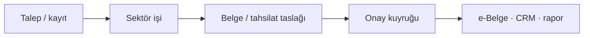
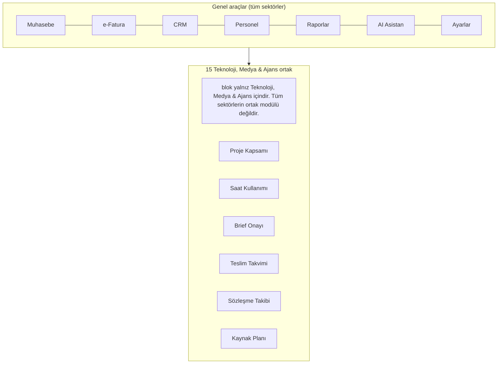

# 15 Teknoloji, Medya & Ajans

## Özet
- Bu başlık tek iş değildir.
- Kayıp, saat, onay ve faturanın ayrı yerlerde kalmasından ve reklam hesabında yanlış erişim ile harcama tavanından gelir.
- Büyük TV, telekom ve kurumsal entegratör dışarıdadır.
- Karar: Sekiz alt sektör aralığın üst sınırıdır. 15.05’i 15.02 ile birleştirmek ve 15.06’yı dışarıda bırakmak açık karardır. Barındırma 15.07 içinde tutuldu.
- Modül sayısı: sektör ortak 8; alt sektör 8; toplam 54; MVP 29.
- Ortak çekirdek (tüm sektörler): Muhasebe, e-Fatura/e-Arşiv, CRM, Personel, Raporlar, AI Asistan, Ayarlar → `04 Modüller/00 Ortak Çekirdek.md`.

<!-- dallar:start -->
## Dallar (ağaç)
> **Sektör → Dal → Alt dal → Fonksiyon.** Fonksiyon havuzu: `07 Fonksiyonlar/` · Ortak araçlar: `04 Modüller/`

| Dal | Alt dal | Fonksiyon | Durum |
|---|---|---|---|
| [[Özel yazılım proje ofisi]] | 1 | 6 | açık |
| [[Performans ve reklam hesabı ajansı]] | 1 | 6 | açık |
| [[Müşteri adına içerik ofisi]] | 1 | 6 | açık |
| [[Marka, tasarım ve görüntü stüdyosu]] | 1 | 6 | açık |
| [[Mecra planlama ve satın alma ofisi]] | 1 | 5 | açık |
| [[Kendi mecrasını işleten yayıncı]] | 1 | 5 | açık |
| [[BT bakım ve paket yazılım destek ofisi]] | 1 | 6 | açık |
| [[Abonelikli yazılım ürünü işletmesi]] | 1 | 6 | açık |
<!-- dallar:end -->

## Alt işletme türleri (onay listesi)
> İşaretli = Adım 1 onay listesi.

- [x] [[Özel yazılım proje ofisi|Özel yazılım proje ofisi]]
- [x] [[Performans ve reklam hesabı ajansı|Performans ve reklam hesabı ajansı]]
- [x] [[Müşteri adına içerik ofisi|Müşteri adına içerik ofisi]]
- [x] [[Marka, tasarım ve görüntü stüdyosu|Marka, tasarım ve görüntü stüdyosu]]
- [x] [[Mecra planlama ve satın alma ofisi|Mecra planlama ve satın alma ofisi]]
- [x] [[Kendi mecrasını işleten yayıncı|Kendi mecrasını işleten yayıncı]]
- [x] [[BT bakım ve paket yazılım destek ofisi|BT bakım ve paket yazılım destek ofisi]]
- [x] [[Abonelikli yazılım ürünü işletmesi|Abonelikli yazılım ürünü işletmesi]]

**Sınırlar**
- 15.01 sözleşme ile kişiselleştirilmiş yazılım, 15.08 kendi hesabına yayımlanan abonelikli üründür. NACE 62.10 bulut yazılımı yayımlamayı 58.2’ye bırakır.
- 15.07 kurulum, eğitim ve talep kuyruğudur. Ticari barındırma aynı kuyruksa 15.07’nin içindedir. Bilgisayar tamiri (95.10) ayrıdır.
- 15.02’nin nesnesi reklam hesabı, 15.03’ün nesnesi takvim ve onay, 15.05’in nesnesi sipariş ve mecra faturası, 15.06’nın nesnesi kendi yayın envanteridir.
- 15.04 grafik ve reklam filmini birleştirir çünkü ikisi de brief, sürüm ve teslimdir. İç mimarlık ve endüstriyel tasarım burada değildir. Halkla ilişkiler ve piyasa araştırması ayrı satır açılmadı.

**Doğrulanamayan**
- Alt sektör firma sayısı ve ciro payı.
- Notion, Asana ve ClickUp penetrasyonu.
- Meta ve Google Ads üretim erişimi: doküman açıldı, App Review ve access level kapısı duruyor.
- Ajansa özel KVKK Kurul kararı bu turda yok.

## Ortak iş akışı

## Araç mimarisi
> İlke: her araç bir kez yapılır. Bir işletme türü = araçların birleşimi. Tek türe özel büyük geliştirme yok.

## Araç matrisi (hangi araç kaç alt türe hizmet ediyor)
> ● = kullanıyor. genel = tüm sektörler, ozel = yalnız bu sektör.

| Araç | Tür | Özel | Performans | Müşteri | Marka, | Mecra | Kendi | BT | Abonelikli | Toplam |
| --- | --- | --- | --- | --- | --- | --- | --- | --- | --- | --- |
| [[blok yalnız Teknoloji, Medya & Ajans içindir. Tüm sektörlerin ortak modülü değildir.]] | ozel | ● | ● | ● | ● | ● | ● | ● | ● | **8** |
| [[Proje Kapsamı]] | ozel | ● | ● | ● | ● | ● | ● | ● | ● | **8** |
| [[Saat Kullanımı]] | ozel | ● | ● | ● | ● | ● | ● | ● | ● | **8** |
| [[Brief Onayı]] | ozel | ● | ● | ● | ● | ● | ● | ● | ● | **8** |
| [[Teslim Takvimi]] | ozel | ● | ● | ● | ● | ● | ● | ● | ● | **8** |
| [[Sözleşme Takibi]] | ozel | ● | ● | ● | ● | ● | ● | ● | ● | **8** |
| [[Kaynak Planı]] | ozel | ● | ● | ● | ● | ● | ● | ● | ● | **8** |
| [[Teklif Paketi]] | ozel | ● | ● | ● | ● | ● | ● | ● | ● | **8** |
| [[sözleşmesiyle yazılım yazan veya uyarlayan ekip; nesne sprint, kabul ve kapsamdır.]] | ozel | ● |  |  |  |  |  |  |  | **1** |
| [[Sprint Tahtası]] | ozel | ● |  |  |  |  |  |  |  | **1** |
| [[Kabul Kontrolü]] | ozel | ● |  |  |  |  |  |  |  | **1** |
| [[Teknik Kapsam]] | ozel | ● |  |  |  |  |  |  |  | **1** |
| [[Ortam Envanteri]] | ozel | ● |  |  |  |  |  |  |  | **1** |
| [[Depo Bağlantısı]] | ozel | ● |  |  |  |  |  |  |  | **1** |
| [[reklam hesabında kampanya süren ofis; nesne erişim, harcama tavanı ve dönem raporudur.]] | ozel |  | ● |  |  |  |  |  |  | **1** |
| [[Hesap Erişimi]] | ozel |  | ● |  |  |  |  |  |  | **1** |
| [[Harcama Tavanı]] | ozel |  | ● |  |  |  |  |  |  | **1** |
| [[Dönem Raporu]] | ozel |  | ● |  |  |  |  |  |  | **1** |
| [[Kampanya Özeti]] | ozel |  | ● |  |  |  |  |  |  | **1** |
| [[Dönüşüm İzleme]] | ozel |  | ● |  |  |  |  |  |  | **1** |
| [[kanalında takvimle yayın yapan retainer ofis; nesne takvim, onay ve yayındır.]] | ozel |  |  | ● |  |  |  |  |  | **1** |
| [[Yayın Takvimi]] | ozel |  |  | ● |  |  |  |  |  | **1** |
| [[İçerik Onayı]] | ozel |  |  | ● |  |  |  |  |  | **1** |
| [[Kanal Listesi]] | ozel |  |  | ● |  |  |  |  |  | **1** |
| [[SEO İşleri]] | ozel |  |  | ● |  |  |  |  |  | **1** |
| [[Etkileşim Özeti]] | ozel |  |  | ● |  |  |  |  |  | **1** |
| [[ile marka, grafik veya görüntü teslim eden stüdyo; nesne sürüm, revizyon ve hak kapsamıdır.]] | ozel |  |  |  | ● |  |  |  |  | **1** |
| [[Varlık Sürümü]] | ozel |  |  |  | ● |  |  |  |  | **1** |
| [[Revizyon Turu]] | ozel |  |  |  | ● |  |  |  |  | **1** |
| [[Hak Listesi]] | ozel |  |  |  | ● |  |  |  |  | **1** |
| [[Çekim Planı]] | ozel |  |  |  | ● |  |  |  |  | **1** |
| [[Arşiv Dolabı]] | ozel |  |  |  | ● |  |  |  |  | **1** |
| [[bütçesini mecralara yerleştiren ofis; nesne plan, sipariş, teyit ve mecra faturasıdır.]] | ozel |  |  |  |  | ● |  |  |  | **1** |
| [[Mecra Planı]] | ozel |  |  |  |  | ● |  |  |  | **1** |
| [[Sipariş Teyidi]] | ozel |  |  |  |  | ● |  |  |  | **1** |
| [[Mecra Faturası]] | ozel |  |  |  |  | ● |  |  |  | **1** |
| [[Plan Karşılaştırma]] | ozel |  |  |  |  | ● |  |  |  | **1** |
| [[yayın takvimini yürüten ve kendi alan veya zamanını satan küçük dijital yayın.]] | ozel |  |  |  |  |  | ● |  |  | **1** |
| [[Yayın Masası]] | ozel |  |  |  |  |  | ● |  |  | **1** |
| [[İlan Envanteri]] | ozel |  |  |  |  |  | ● |  |  | **1** |
| [[Yasal Bilgi]] | ozel |  |  |  |  |  | ● |  |  | **1** |
| [[Yayın İlan Eşleme]] | ozel |  |  |  |  |  | ● |  |  | **1** |
| [[yazılım kurulum, eğitim ve arıza kuyruğu; nesne SLA ticket ve sözleşme süresidir.]] | ozel |  |  |  |  |  |  | ● |  | **1** |
| [[SLA Ticket]] | ozel |  |  |  |  |  |  | ● |  | **1** |
| [[Kurulum Kaydı]] | ozel |  |  |  |  |  |  | ● |  | **1** |
| [[Destek Sözleşmesi]] | ozel |  |  |  |  |  |  | ● |  | **1** |
| [[Lisans Takibi]] | ozel |  |  |  |  |  |  | ● |  | **1** |
| [[Uzaktan Bağlantı]] | ozel |  |  |  |  |  |  | ● |  | **1** |
| [[yazılımını yayımlayıp abonelik, sürüm ve destek yürüten şirket.]] | ozel |  |  |  |  |  |  |  | ● | **1** |
| [[Abonelik Yenileme]] | ozel |  |  |  |  |  |  |  | ● | **1** |
| [[Ürün Birikimi]] | ozel |  |  |  |  |  |  |  | ● | **1** |
| [[Destek Kuyruğu]] | ozel |  |  |  |  |  |  |  | ● | **1** |
| [[Sürüm Notu]] | ozel |  |  |  |  |  |  |  | ● | **1** |
| [[Kullanım Ölçümü]] | ozel |  |  |  |  |  |  |  | ● | **1** |
| [[Muhasebe ve Gelir-Gider]] | genel | ● | ● | ● | ● | ● | ● | ● | ● | **8** |
| [[e-Fatura ve e-Arşiv]] | genel | ● | ● | ● | ● | ● | ● | ● | ● | **8** |
| [[CRM]] | genel | ● | ● | ● | ● | ● | ● | ● | ● | **8** |
| [[Personel ve Vardiya]] | genel | ● | ● | ● | ● | ● | ● | ● | ● | **8** |
| [[Raporlar]] | genel | ● | ● | ● | ● | ● | ● | ● | ● | **8** |
| [[AI Asistan]] | genel | ● | ● | ● | ● | ● | ● | ● | ● | **8** |
| [[Ayarlar]] | genel | ● | ● | ● | ● | ● | ● | ● | ● | **8** |

## Sektör ortak modüller

### Bu blok yalnız Teknoloji, Medya & Ajans içindir. Tüm sektörlerin ortak modülü değildir.

- oncelik: 
- durum: 
- aciklama: 
- entegrasyonlar: yok
- ai_komutlari:

### 15.00.01 Proje Kapsamı

- oncelik: MVP
- durum: zorunlu
- aciklama: Sözleşme ve teklif maddeleri, kabul kriteri, kapsam dışı iş talebi kaydı; kapsam sapmasını görünür kılar.
- entegrasyonlar: yok
- ai_komutlari:
  - Bu yazışmayı kapsam maddesine çevir
  - Kapsam dışı satırları listele
- ai_otomasyonu: Tetik: yeni müşteri notu veya e-posta. İşlem: maddeleri mevcut teklifle karşılaştır. Çıktı: sapma listesi ve onay bekleyen değişiklik taslağı; onaysız sözleşme oluşturulmaz.

### 15.00.02 Saat Kullanımı

- oncelik: MVP
- durum: zorunlu
- aciklama: Faturalanabilir ve faturalanamayan saat kaydı; proje veya retainer ile eşleme.
- entegrasyonlar: yok
- ai_komutlari:
  - Bu haftanın faturalanamayan saatini özetle
  - Müşteri X için faturalanabilir saati göster
- ai_otomasyonu: Tetik: gün sonu. İşlem: zaman kayıtlarını proje ve müşteriye bağla. Çıktı: faturalanamayan saat özeti ve fatura taslağı önerisi; onaysız tahsilat yok.

### 15.00.03 Brief Onayı

- oncelik: MVP
- durum: zorunlu
- aciklama: Brief, sürüm ve revizyon turu; müşteri onayı kuyruğu.
- entegrasyonlar: yok
- ai_komutlari:
  - Brief'ten iş listesi çıkar
  - Açık revizyon turlarını say
- ai_otomasyonu: Tetik: brief veya revizyon yüklendi. İşlem: eksik alan ve açık turları tara. Çıktı: onay bekleyen iş listesi.

### 15.00.04 Teslim Takvimi

- oncelik: MVP
- durum: zorunlu
- aciklama: Teslim tarihleri, bağımlılıklar ve gecikme riski.
- entegrasyonlar: yok
- ai_komutlari:
  - Bu hafta gecikecek teslimleri listele
  - Müşteri Y için teslim takvimini özetle
- ai_otomasyonu: Tetik: sabah. İşlem: bitiş tarihi ile ilerlemeyi karşılaştır. Çıktı: riskli teslim listesi.

### 15.00.05 Sözleşme Takibi

- oncelik: MVP
- durum: zorunlu
- aciklama: Proje ve retainer bitiş tarihleri; yenileme hatırlatması (ürün aboneliği 15.08'de).
- entegrasyonlar: yok
- ai_komutlari:
  - 30 gün içinde biten retainer'ları göster
  - Sözleşme yenileme taslağı hazırla
- ai_otomasyonu: Tetik: sözleşme bitişinden 14 gün önce. İşlem: sözleşme kartını oku. Çıktı: yenileme hatırlatması; onaysız müşteri iletişimi yok.

### 15.00.06 Kaynak Planı

- oncelik: V2
- durum: opsiyonel
- aciklama: Kişi-hafta kapasite ve aşırı yük görünümü.
- entegrasyonlar: yok
- ai_komutlari:
  - Kim aşırı yüklü?
  - Sprint için boş kapasiteyi bul
- ai_otomasyonu: Tetik: yeni iş atandı. İşlem: kapasiteyi güncelle. Çıktı: aşırı yük uyarısı.

### 15.00.07 Teklif Paketi

- oncelik: V2
- durum: opsiyonel
- aciklama: Teklif şablonu, kalem ve süre varsayımları.
- entegrasyonlar: yok
- ai_komutlari:
  - Benzer tekliften taslak üret
  - Kapsam maddelerini numaralandır
- ai_otomasyonu: Tetik: yeni fırsat. İşlem: geçmiş tekliflerden taslak kur. Çıktı: teklif taslağı; onaysız gönderim yok.

## Alt sektör modülleri

## 15.01 Özel yazılım proje ofisi

- aciklama: Müşteri sözleşmesiyle yazılım yazan veya mevcut uygulamayı uyarlayan ekip. Kendi ürününü abonelikle yayımlamaz.
- gunluk_is: Teklif kapsamı, sprint, kabul ve saat kaydı.
- ai: Toplantı ve yazışmadan kapsam maddesi çıkarır; teklifte olmayan işi işaretler.

### Müşteri sözleşmesiyle yazılım yazan veya uyarlayan ekip; nesne sprint, kabul ve kapsamdır.

- oncelik: 
- durum: 
- aciklama: 
- entegrasyonlar: yok
- ai_komutlari:

### 15.01.01 Sprint Tahtası

- oncelik: MVP
- durum: zorunlu
- aciklama: Sprint işleri, durum ve engeller.
- entegrasyonlar: yok
- ai_komutlari:
  - Engelli işleri listele
  - Sprint bitiş özeti yaz
- ai_otomasyonu: Tetik: sprint sonu. İşlem: tamamlanan ve kalan işleri özetle. Çıktı: sprint özeti.

### 15.01.02 Kabul Kontrolü

- oncelik: MVP
- durum: zorunlu
- aciklama: Kabul kriteri, UAT ve imza öncesi eksikler.
- entegrasyonlar: yok
- ai_komutlari:
  - Kabul için eksikleri çıkar
  - UAT notlarını maddele
- ai_otomasyonu: Tetik: iş kabulde. İşlem: kriter ile kanıtı karşılaştır. Çıktı: eksik kabul listesi.

### 15.01.03 Teknik Kapsam

- oncelik: MVP
- durum: zorunlu
- aciklama: Teknik madde takibi ve kapsam dışı geliştirme işareti.
- entegrasyonlar: yok
- ai_komutlari:
  - Bu talep teklifte var mı?
  - Kapsam dışı PR'ları işaretle
- ai_otomasyonu: Tetik: yeni talep. İşlem: teklif maddeleriyle eşle. Çıktı: kapsam dışı uyarı.

### 15.01.04 Ortam Envanteri

- oncelik: V2
- durum: opsiyonel
- aciklama: Müşteri ortamı, erişim ve sürüm kaydı.
- entegrasyonlar: yok
- ai_komutlari:
  - Müşteri ortam kartını özetle
  - Eksik erişimleri listele
- ai_otomasyonu: Tetik: kurulum veya erişim değişti. İşlem: kartı güncelle. Çıktı: eksik erişim listesi.

### 15.01.05 Depo Bağlantısı

- oncelik: V2
- durum: opsiyonel
- aciklama: Commit/PR kaydını iş kartına bağlama.
- entegrasyonlar: GitHub REST API, GitLab REST API v4
- ai_komutlari:
  - Bu PR hangi işe ait?
  - Açık PR'ları işlere eşle
- ai_otomasyonu: Tetik: PR açıldı. İşlem: iş kimliği eşlemesi dene. Çıktı: eşleşmeyen PR listesi.
- mevzuat_notu: GitHub REST ve GitLab /api/v4 kamuya açık. Kişisel veya uygulama tokenı gerekir; depo izni müşteri verir.

## 15.02 Performans ve reklam hesabı ajansı

- aciklama: Müşterinin reklam hesabında kampanya süren ofis. Nesne harcama ve erişimdir.
- gunluk_is: Hesap erişimi, bütçe, günlük harcama ve dönem raporu.
- ai: Hesap dışa aktarımından rapor taslağı üretir; tavan sapması ve yanlış hesabı uyarır.

### Müşteri reklam hesabında kampanya süren ofis; nesne erişim, harcama tavanı ve dönem raporudur.

- oncelik: 
- durum: 
- aciklama: 
- entegrasyonlar: yok
- ai_komutlari:

### 15.02.01 Hesap Erişimi

- oncelik: MVP
- durum: zorunlu
- aciklama: Müşteri reklam hesabı ve MCC/BM erişim durumu.
- entegrasyonlar: Meta Marketing API, Google Ads API
- ai_komutlari:
  - Erişimi eksik hesapları göster
  - Müşteri Z hesaplarını listele
- ai_otomasyonu: Tetik: haftalık. İşlem: kayıtlı hesap ile erişim durumunu karşılaştır. Çıktı: eksik veya yanlış hesap listesi.
- mevzuat_notu: Ticari Reklam ve Haksız Ticari Uygulamalar Yönetmeliği: reklam ajansı tanımı. Doğrulama kapanışı: Meta Marketing API genel bakışı ve Google Ads erişim seviyeleri (2026-11-19) açıldı. Seviyeler Test, Explorer, Basic ve Standard. Üretim hesabına yazmak başvuru ister. Doküman doğrulandı. Canlı kampanya yazması başvuru ve insan onayı olmadan gitmez.

### 15.02.02 Harcama Tavanı

- oncelik: MVP
- durum: zorunlu
- aciklama: Bütçe ve spend cap / paylaşılan kredi hattı tavanı izleme.
- entegrasyonlar: Meta Marketing API, Google Ads API
- ai_komutlari:
  - Tavana yaklaşan hesapları göster
  - Dün tavanı aşanları listele
- ai_otomasyonu: Tetik: günlük harcama çekimi. İşlem: tanımlı tavanla karşılaştır. Çıktı: sapma uyarısı; onaysız bütçe değişikliği yok.
- mevzuat_notu: Meta Business Help: paylaşılan aylık fatura kredi hattında spend cap tanımlanabilir. Doğrulama kapanışı: Meta Marketing API genel bakışı ve Google Ads erişim seviyeleri (2026-11-19) açıldı. Seviyeler Test, Explorer, Basic ve Standard. Üretim hesabına yazmak başvuru ister. Doküman doğrulandı. Canlı kampanya yazması başvuru ve insan onayı olmadan gitmez.

### 15.02.03 Dönem Raporu

- oncelik: MVP
- durum: zorunlu
- aciklama: Dönem harcama, tıklama ve dönüşüm özeti.
- entegrasyonlar: Meta Marketing API, Google Ads API
- ai_komutlari:
  - Müşteri A için aylık rapor taslağı
  - Hesaplar arası harcamayı karşılaştır
- ai_otomasyonu: Tetik: dönem sonu. İşlem: metrikleri topla. Çıktı: müşteri rapor taslağı.
- mevzuat_notu: Ticari Reklam Yönetmeliği kapsamında reklam ajansı. Doğrulama kapanışı: Meta Marketing API genel bakışı ve Google Ads erişim seviyeleri (2026-11-19) açıldı. Seviyeler Test, Explorer, Basic ve Standard. Üretim hesabına yazmak başvuru ister. Doküman doğrulandı. Canlı kampanya yazması başvuru ve insan onayı olmadan gitmez.

### 15.02.04 Kampanya Özeti

- oncelik: V2
- durum: opsiyonel
- aciklama: Kampanya ve ad set durum özeti.
- entegrasyonlar: Meta Marketing API, Google Ads API
- ai_komutlari:
  - Duraklayan kampanyaları listele
  - En pahalı kampanyayı bul
- ai_otomasyonu: Tetik: günlük. İşlem: durum ve harcamaya göre sırala. Çıktı: dikkat listesi.
- mevzuat_notu: Doğrulama kapanışı: Meta Marketing API genel bakışı ve Google Ads erişim seviyeleri (2026-11-19) açıldı. Seviyeler Test, Explorer, Basic ve Standard. Üretim hesabına yazmak başvuru ister. Doküman doğrulandı. Canlı kampanya yazması başvuru ve insan onayı olmadan gitmez.

### 15.02.05 Dönüşüm İzleme

- oncelik: V2
- durum: opsiyonel
- aciklama: Dönüşüm ve etiket eşleme kontrolü.
- entegrasyonlar: Meta Marketing API, Google Ads API
- ai_komutlari:
  - Eksik dönüşüm etiketlerini bul
  - Son 7 gün dönüşüm düşüşünü özetle
- ai_otomasyonu: Tetik: haftalık. İşlem: beklenen ile gelen dönüşümü karşılaştır. Çıktı: eksik izleme listesi.
- mevzuat_notu: Doğrulama kapanışı: Meta Marketing API genel bakışı ve Google Ads erişim seviyeleri (2026-11-19) açıldı. Seviyeler Test, Explorer, Basic ve Standard. Üretim hesabına yazmak başvuru ister. Doküman doğrulandı. Canlı kampanya yazması başvuru ve insan onayı olmadan gitmez.

## 15.03 Müşteri adına içerik ofisi

- aciklama: Müşterinin kanalında takvimle yayın yapan retainer ofis. Reklam hesabı asıl işi değildir.
- gunluk_is: Takvim, onay, yayın ve aylık iş listesi.
- ai: Onayı bekleyen ve takvimi boş işleri özetler; brief’ten yayın taslağı üretir.

### Müşteri kanalında takvimle yayın yapan retainer ofis; nesne takvim, onay ve yayındır.

- oncelik: 
- durum: 
- aciklama: 
- entegrasyonlar: yok
- ai_komutlari:

### 15.03.01 Yayın Takvimi

- oncelik: MVP
- durum: zorunlu
- aciklama: Kanal bazlı içerik takvimi ve boş slot.
- entegrasyonlar: yok
- ai_komutlari:
  - Bu hafta boş kalan günleri göster
  - Onaysız içerikleri listele
- ai_otomasyonu: Tetik: sabah. İşlem: takvim boşluklarını tara. Çıktı: boş ve onaysız slot listesi.
- mevzuat_notu: Örtülü reklam riski için Ticari Reklam Yönetmeliği ilgili olabilir.

### 15.03.02 İçerik Onayı

- oncelik: MVP
- durum: zorunlu
- aciklama: Brief'ten taslağa ve müşteri onayına giden kuyruk.
- entegrasyonlar: yok
- ai_komutlari:
  - Onayı bekleyen içerikleri sırala
  - Brief'ten taslak üret
- ai_otomasyonu: Tetik: taslak hazır. İşlem: onay kuyruğuna al. Çıktı: onay bekleyen liste; onaysız yayın yok.
- mevzuat_notu: Reklam veya tanıtım içeriği üretiliyorsa Ticari Reklam Yönetmeliği.

### 15.03.03 Kanal Listesi

- oncelik: MVP
- durum: zorunlu
- aciklama: Müşteri kanal ve hesap envanteri.
- entegrasyonlar: yok
- ai_komutlari:
  - Müşteri kanallarını listele
  - Erişimi belirsiz kanalları bul
- ai_otomasyonu: Tetik: retainer açılışı. İşlem: kanal kartı eksiklerini tara. Çıktı: eksik kanal listesi.

### 15.03.04 SEO İşleri

- oncelik: V2
- durum: opsiyonel
- aciklama: SEO iş listesi ve sayfa/anahtar kelime takibi.
- entegrasyonlar: yok
- ai_komutlari:
  - Bu ayın SEO işlerini özetle
  - Yarım kalan sayfa işlerini listele
- ai_otomasyonu: Tetik: haftalık. İşlem: açık SEO kartlarını özetle. Çıktı: iş özeti.

### 15.03.05 Etkileşim Özeti

- oncelik: V2
- durum: opsiyonel
- aciklama: Dönem etkileşim ve müşteri rapor taslağı.
- entegrasyonlar: Panel kaydı
- ai_komutlari:
  - Müşteri B için etkileşim özeti yaz
  - Düşen kanalları işaretle
- ai_otomasyonu: Tetik: ay sonu. İşlem: dışa aktarım veya manuel metrik girdisinden özet. Çıktı: rapor taslağı.
- mevzuat_notu: Doğrulama kapanışı: Harici API yok. Etkileşim sayıları elle veya dışa aktarımla girilir.

## 15.04 Marka, tasarım ve görüntü stüdyosu

- aciklama: Brief ile marka dili, grafik veya reklam filmi teslim eden stüdyo.
- gunluk_is: Brief, sürüm, revizyon, teslim ve hak kapsamı.
- ai: Revizyon notunu maddeler; teslimde hak listesinin eksik satırını işaretler.

### Brief ile marka, grafik veya görüntü teslim eden stüdyo; nesne sürüm, revizyon ve hak kapsamıdır.

- oncelik: 
- durum: 
- aciklama: 
- entegrasyonlar: yok
- ai_komutlari:

### 15.04.01 Varlık Sürümü

- oncelik: MVP
- durum: zorunlu
- aciklama: Dosya sürümü, final ve müşteri klasörü.
- entegrasyonlar: yok
- ai_komutlari:
  - Final sürümü bul
  - Eski sürümleri arşiv öner
- ai_otomasyonu: Tetik: yeni dosya. İşlem: sürüm etiketle. Çıktı: güncel final listesi.

### 15.04.02 Revizyon Turu

- oncelik: MVP
- durum: zorunlu
- aciklama: Revizyon sayısı, not ve ek tur talebi.
- entegrasyonlar: yok
- ai_komutlari:
  - Revizyon notlarını maddele
  - Sözleşmedeki tur aşıldı mı?
- ai_otomasyonu: Tetik: revizyon notu. İşlem: tur sayacı ile sözleşme limitini karşılaştır. Çıktı: aşım uyarısı.

### 15.04.03 Hak Listesi

- oncelik: MVP
- durum: zorunlu
- aciklama: Teslimde mali hakların ayrı ayrı gösterildiği kontrol listesi.
- entegrasyonlar: yok
- ai_komutlari:
  - Hak listesi eksik mi?
  - 5846 hak maddelerini doldur
- ai_otomasyonu: Tetik: teslim veya onay. İşlem: hak satırlarını kontrol et. Çıktı: eksik hak listesi; onaysız hak devri yok.
- mevzuat_notu: 5846 sayılı Kanun m.48 mali hakların devri/ruhsat; m.52 yazılı şekil ve hakların ayrı ayrı gösterilmesi.

### 15.04.04 Çekim Planı

- oncelik: V2
- durum: opsiyonel
- aciklama: Çekim günü, ekip ve lokasyon checklist'i.
- entegrasyonlar: yok
- ai_komutlari:
  - Yarınki çekim checklist'i
  - Eksik ekipmanı listele
- ai_otomasyonu: Tetik: çekimden 1 gün önce. İşlem: checklist çalıştır. Çıktı: eksik madde listesi.

### 15.04.05 Arşiv Dolabı

- oncelik: V2
- durum: opsiyonel
- aciklama: Teslim arşivi ve lisanslı stok ayrımı.
- entegrasyonlar: yok
- ai_komutlari:
  - Lisansı belirsiz stokları bul
  - Proje arşivini özetle
- ai_otomasyonu: Tetik: proje kapanışı. İşlem: arşiv eksiklerini tara. Çıktı: eksik arşiv listesi.
- mevzuat_notu: Reklam filmi veya görsel üretiliyorsa Ticari Reklam Yönetmeliği.

## 15.05 Mecra planlama ve satın alma ofisi

- aciklama: Müşteri bütçesini mecralara yerleştiren küçük ofis. Günü Ads Manager içinde geçmez.
- gunluk_is: Plan, sipariş, yayın teyidi ve mecra faturası.
- ai: Sipariş, teyit ve fatura satırını eşleyip eksiği listeler.

### Müşteri bütçesini mecralara yerleştiren ofis; nesne plan, sipariş, teyit ve mecra faturasıdır.

- oncelik: 
- durum: 
- aciklama: 
- entegrasyonlar: yok
- ai_komutlari:

### 15.05.01 Mecra Planı

- oncelik: MVP
- durum: zorunlu
- aciklama: Mecra, tarih ve bütçe kalemi planı.
- entegrasyonlar: yok
- ai_komutlari:
  - Plan ile siparişi karşılaştır
  - Bu ayın mecra planını özetle
- ai_otomasyonu: Tetik: plan kaydı. İşlem: kalemleri doğrula. Çıktı: eksik plan kalemi.
- mevzuat_notu: Ticari Reklam Yönetmeliği: reklam ajansı / yayına aracılık.

### 15.05.02 Sipariş Teyidi

- oncelik: MVP
- durum: zorunlu
- aciklama: Sipariş ve yayın teyidi eşlemesi.
- entegrasyonlar: yok
- ai_komutlari:
  - Teyidi gelmeyen siparişleri listele
  - Yayın teyidini eşle
- ai_otomasyonu: Tetik: yayın günü. İşlem: sipariş ile teyidi eşle. Çıktı: eşleşmeyen satırlar.

### 15.05.03 Mecra Faturası

- oncelik: MVP
- durum: zorunlu
- aciklama: Mecra faturası ile plan/sipariş satırı eşlemesi.
- entegrasyonlar: yok
- ai_komutlari:
  - Faturası gelmeyen siparişleri bul
  - Fatura farklarını listele
- ai_otomasyonu: Tetik: fatura girildi. İşlem: plan satırıyla eşle. Çıktı: fark listesi.

### 15.05.04 Plan Karşılaştırma

- oncelik: V2
- durum: opsiyonel
- aciklama: Plan ile gerçekleşen maliyet/yerleşim sapması.
- entegrasyonlar: Panel kaydı
- ai_komutlari:
  - Sapma olan mecraları göster
  - Bütçe aşımını özetle
- ai_otomasyonu: Tetik: dönem sonu. İşlem: plan ile gerçekleşeni karşılaştır. Çıktı: sapma tablosu.
- mevzuat_notu: Küçük ofis TİAK aboneliği varsayılmadı. Doğrulama kapanışı: TİAK veya mecra ölçüm API’si varsayılmadı. Plan karşılaştırması paneldeki sipariş ve fatura satırından yapılır.

## 15.06 Kendi mecrasını işleten yayıncı

- aciklama: Kendi yayın takvimini yürüten ve kendi alan veya zamanını satan küçük dijital yayın.
- gunluk_is: Yayın planı, içerik ve kendi reklam envanteri.
- ai: Plan boşluğu ile satılmış ilanın yayına denk gelip gelmediğini özetler.

### Kendi yayın takvimini yürüten ve kendi alan veya zamanını satan küçük dijital yayın.

- oncelik: 
- durum: 
- aciklama: 
- entegrasyonlar: yok
- ai_komutlari:

### 15.06.01 Yayın Masası

- oncelik: MVP
- durum: zorunlu
- aciklama: Kendi yayın planı ve boş slot.
- entegrasyonlar: yok
- ai_komutlari:
  - Yarınki yayın sırasını göster
  - Boş yayın slotlarını listele
- ai_otomasyonu: Tetik: sabah. İşlem: plan boşluklarını tara. Çıktı: boş slot listesi.
- mevzuat_notu: 5651 m.4: içerik sağlayıcı, kullanıma sunduğu içerikten sorumludur.

### 15.06.02 İlan Envanteri

- oncelik: MVP
- durum: zorunlu
- aciklama: Kendi alan/zaman envanteri ve satış kaydı.
- entegrasyonlar: yok
- ai_komutlari:
  - Satılmamış envanteri göster
  - Bu hafta satılan ilanları özetle
- ai_otomasyonu: Tetik: satış veya rezervasyon. İşlem: envanteri güncelle. Çıktı: müsait envanter.
- mevzuat_notu: Ticari Reklam Yönetmeliği: mecra kuruluşu.

### 15.06.03 Yasal Bilgi

- oncelik: MVP
- durum: zorunlu
- aciklama: 5651 bilgilendirme ve iletişim bilgisi kontrolü.
- entegrasyonlar: yok
- ai_komutlari:
  - 5651 bilgilendirme eksik mi?
  - İletişim bilgisi güncelliğini kontrol et
- ai_otomasyonu: Tetik: aylık. İşlem: zorunlu bilgi alanlarını kontrol et. Çıktı: eksik bilgi listesi.
- mevzuat_notu: 5651 m.3 bilgilendirme yükümlülüğü; m.4 içerik sağlayıcı sorumluluğu. Yalnız 15.06.

### 15.06.04 Yayın İlan Eşleme

- oncelik: V2
- durum: opsiyonel
- aciklama: Satılmış ilanın yayın slotuna denk gelmesi.
- entegrasyonlar: yok
- ai_komutlari:
  - Yayına denk gelmeyen ilanları bul
  - Çakışan slotları listele
- ai_otomasyonu: Tetik: yayın öncesi. İşlem: ilan ile slotu eşle. Çıktı: çakışma veya eksik listesi.

## 15.07 BT bakım ve paket yazılım destek ofisi

- aciklama: Başkasının paket yazılımını kuran, eğiten ve arıza kuyruğu yürüten ofis. Ticari barındırma aynı kuyruksa buradadır.
- gunluk_is: Kurulum, eğitim, talep ve sözleşme süresi.
- ai: Talep metninden eksik bilgiyi ve süre riskini not eder.

### Paket yazılım kurulum, eğitim ve arıza kuyruğu; nesne SLA ticket ve sözleşme süresidir.

- oncelik: 
- durum: 
- aciklama: 
- entegrasyonlar: yok
- ai_komutlari:

### 15.07.01 SLA Ticket

- oncelik: MVP
- durum: zorunlu
- aciklama: Talep kuyruğu, SLA süre ve öncelik.
- entegrasyonlar: yok
- ai_komutlari:
  - SLA'sı dolmak üzere ticket'ları göster
  - Eksik bilgili talepleri ayıkla
- ai_otomasyonu: Tetik: yeni ticket. İşlem: eksik alan ve SLA riskini işaretle. Çıktı: risk ve eksik listesi.

### 15.07.02 Kurulum Kaydı

- oncelik: MVP
- durum: zorunlu
- aciklama: Kurulum, eğitim ve müşteri ortam kaydı.
- entegrasyonlar: yok
- ai_komutlari:
  - Kurulum checklist'i çıkar
  - Eğitimi tamamlanmayanları listele
- ai_otomasyonu: Tetik: kurulum kapandı. İşlem: checklist çalıştır. Çıktı: eksik adım listesi.

### 15.07.03 Destek Sözleşmesi

- oncelik: MVP
- durum: zorunlu
- aciklama: Bakım sözleşmesi süresi ve yenileme.
- entegrasyonlar: yok
- ai_komutlari:
  - Biten destek sözleşmelerini göster
  - Yenileme hatırlatması hazırla
- ai_otomasyonu: Tetik: bitişten 30 gün önce. İşlem: sözleşme kartını oku. Çıktı: yenileme listesi; onaysız fatura yok.

### 15.07.04 Lisans Takibi

- oncelik: V2
- durum: opsiyonel
- aciklama: Paket yazılım lisans ve iş ortaklığı kaydı.
- entegrasyonlar: Elle lisans tarihi
- ai_komutlari:
  - Lisansı biten müşterileri listele
  - Lisans durumunu özetle
- ai_otomasyonu: Tetik: aylık. İşlem: lisans bitişlerini tara. Çıktı: yenilenecek lisans listesi.
- mevzuat_notu: Logo/iş ortağı API entegrasyonu bu turda doğrulanmadı. Doğrulama kapanışı: Logo iş ortağı lisans API’si bu turda açılmadı. Lisans bitişi elle tutulur.

### 15.07.05 Uzaktan Bağlantı

- oncelik: V2
- durum: opsiyonel
- aciklama: Uzaktan erişim kaydı ve oturum notu.
- entegrasyonlar: yok
- ai_komutlari:
  - Açık uzaktan erişimleri listele
  - Oturum notunu özetle
- ai_otomasyonu: Tetik: oturum kapandı. İşlem: not taslağı üret. Çıktı: oturum özeti.

## 15.08 Abonelikli yazılım ürünü işletmesi

- aciklama: Kendi yazılımını yayımlayıp çok sayıda müşteriye abonelik, sürüm ve destek yürüten şirket.
- gunluk_is: Ürün birikimi, abonelik, sürüm ve destek.
- ai: Destek yazışmasını ürün işi taslağına çevirir; yenilemesi yaklaşan hesapları özetler.

### Kendi yazılımını yayımlayıp abonelik, sürüm ve destek yürüten şirket.

- oncelik: 
- durum: 
- aciklama: 
- entegrasyonlar: yok
- ai_komutlari:

### 15.08.01 Abonelik Yenileme

- oncelik: MVP
- durum: zorunlu
- aciklama: Abonelik dönemi, yenileme ve churn riski.
- entegrasyonlar: yok
- ai_komutlari:
  - 14 gün içinde yenilenecekleri göster
  - Ödemesi geciken abonelikleri listele
- ai_otomasyonu: Tetik: yenilemeden 14 gün önce. İşlem: abonelik kartını oku. Çıktı: yenileme ve churn listesi; onaysız tahsilat yok.

### 15.08.02 Ürün Birikimi

- oncelik: MVP
- durum: zorunlu
- aciklama: Ürün backlog ve sürüm hedefi.
- entegrasyonlar: yok
- ai_komutlari:
  - Bir sonraki sürüme aday işleri seç
  - Destekten ürüne çevrilecekleri bul
- ai_otomasyonu: Tetik: destek kapandı. İşlem: tekrarlayan talepleri kümele. Çıktı: backlog aday listesi.

### 15.08.03 Destek Kuyruğu

- oncelik: MVP
- durum: zorunlu
- aciklama: Ürün destek ticket'ı; proje kabul döngüsü değildir.
- entegrasyonlar: yok
- ai_komutlari:
  - Açık destekleri önceliklendir
  - Tekrarlayan hataları grupla
- ai_otomasyonu: Tetik: yeni destek. İşlem: benzer ticket ara. Çıktı: benzer ve öncelik önerisi.

### 15.08.04 Sürüm Notu

- oncelik: V2
- durum: opsiyonel
- aciklama: Sürüm notu taslağı.
- entegrasyonlar: yok
- ai_komutlari:
  - Bu sürümün notunu yaz
  - Kırıcı değişiklikleri işaretle
- ai_otomasyonu: Tetik: sürüm etiketi. İşlem: birleşen işlerden not üret. Çıktı: sürüm notu taslağı.

### 15.08.05 Kullanım Ölçümü

- oncelik: V2
- durum: opsiyonel
- aciklama: Ürün kullanım ve aktif hesap özeti.
- entegrasyonlar: Panel kaydı
- ai_komutlari:
  - Pasif hesapları listele
  - Kullanım düşen planları göster
- ai_otomasyonu: Tetik: haftalık. İşlem: kullanım eşiğini uygula. Çıktı: riskli hesap listesi.
- mevzuat_notu: Ölçüm API'si ürüne özel; bu turda doğrulanmadı. Doğrulama kapanışı: Seçili ürün ölçüm API’si yok. Kullanım elle veya dışa aktarımla girilir.

## Sayım

- sektor_ortak: 7
- alt_sektor: 8
- modul: 45
- mvp: 29

## Kaynaklar

- NACE Rev.2.1: https://www3.tcmb.gov.tr/sektor/dosyalar/menu/sectors_tr.pdf
- Reklamcılar Derneği üyeler: http://rd.org.tr/uyeler
- Ticari Reklam Yönetmeliği: https://www.mevzuat.gov.tr/MevzuatMetin/yonetmelik/7.5.20435.pdf
- 5651 sayılı Kanun: https://www.mevzuat.gov.tr/MevzuatMetin/1.5.5651.htm
- 5846 sayılı Kanun: https://www.mevzuat.gov.tr/MevzuatMetin/1.3.5846.pdf
- Google Ads API: https://developers.google.com/google-ads/api/docs/start
- Meta Marketing API: https://developers.facebook.com/docs/marketing-api/overview/
