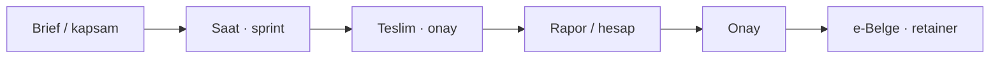
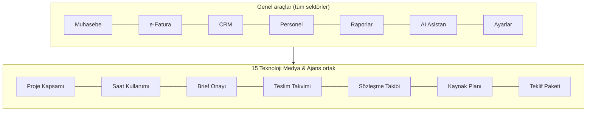

# 15 Teknoloji Medya & Ajans

## Özet
- Bu başlık tek iş değildir. NACE, kendi yazılımını yayımlayan firmayı (58.29), müşteriye özel kod yazanı (62.10), sistemi kurup destekleyeni (62.20) ve barındırmayı (63.10) ayırır. Reklamda ajans (73.11), başkasının alanını satan temsilcilik (73.12), grafik (74.12) ve reklam filmi (59.11) aynı sınıf değildir. Reklamcılar Derneği üye listesinde yaratıcı, dijital, medya ve danışmanlık ayrı tür olarak durur.
- Kayıp, saat, onay ve faturanın ayrı yerlerde kalmasından ve reklam hesabında yanlış erişim ile harcama tavanından gelir. Ölçülmüş bir sektör oranı bulunmadı. Google Ads yönetici hesabı çoklu müşteri hesabını izler. Meta, başka işletmenin reklam hesabına erişimi ajans paylaşımına bağlar.
- Büyük TV, telekom ve kurumsal entegratör dışarıdadır. Fuar organizatörlüğü 16’dadır. Emlak veya imalat firmasının içindeki pazarlama ekibi bu sektöre yazılmaz.
- Karar: Sekiz alt sektör aralığın üst sınırıdır. 15.05’i 15.02 ile birleştirmek ve 15.06’yı dışarıda bırakmak açık karardır. Barındırma 15.07 içinde tutuldu.
- Alt işletme: 10. Modül kartları `04 Modüller/`.
- Ortak çekirdek (tüm sektörler) bu dosyada yoktur → `04 Modüller/` çekirdek araçlar.

<!-- dallar:start -->
## Dallar (ağaç)
> **Sektör → Dal → Alt dal → Fonksiyon.** Görsel: [[Ağaç – 15 Teknoloji Medya & Ajans]] · Fonksiyon havuzu: `07 Fonksiyonlar/`

| Dal | Alt dal | Fonksiyon | Durum |
|---|---|---|---|
| [[Abonelikli yazılım ürünü işletmesi]] | 1 | 43 | açık |
| [[BT bakım ve paket yazılım destek ofisi]] | 1 | 43 | açık |
| [[Kendi mecrasını işleten yayıncı]] | 1 | 40 | açık |
| [[Marka, tasarım ve görüntü stüdyosu]] | 1 | 43 | açık |
| [[Mecra planlama ve satın alma ofisi]] | 1 | 40 | açık |
| [[Müşteri adına içerik ofisi]] | 2 | 86 | açık |
| [[Performans ve reklam hesabı ajansı]] | 1 | 43 | açık |
| [[Özel yazılım proje ofisi]] | 2 | 86 | açık |
<!-- dallar:end -->

## Alt işletme türleri (onay listesi)
> İşaretli = Adım 1 onay listesi.

- [x] [[Abonelikli yazılım ürünü işletmesi|Abonelikli yazılım ürünü işletmesi]]
- [x] [[BT bakım ve paket yazılım destek ofisi|BT bakım ve paket yazılım destek ofisi]]
- [x] [[Kendi mecrasını işleten yayıncı|Kendi mecrasını işleten yayıncı]]
- [x] [[Marka, tasarım ve görüntü stüdyosu|Marka, tasarım ve görüntü stüdyosu]]
- [x] [[Mecra planlama ve satın alma ofisi|Mecra planlama ve satın alma ofisi]]
- [x] [[Kurumsal içerik ve blog ofisi|Kurumsal içerik ve blog ofisi]]
- [x] [[Sosyal medya içerik ofisi|Sosyal medya içerik ofisi]]
- [x] [[Performans ve reklam hesabı ajansı|Performans ve reklam hesabı ajansı]]
- [x] [[Sabit fiyatlı yazılım proje ofisi|Sabit fiyatlı yazılım proje ofisi]]
- [x] [[Zaman-malzeme yazılım ofisi|Zaman-malzeme yazılım ofisi]]

## Sınırlar ve doğrulanamayan
- Sektör arşiv notundaki sınır ve doğrulanamayan maddeler geçerlidir (`08 Arşiv/eski-docs-sektorel-arastirma/ai-kaynak/15-teknoloji-medya-ajans.md`).
- Açık API bulunamayan kurum portalları: panel kayıt + kullanıcı girişi.

## Ortak iş akışı


## Araç mimarisi
> İlke: her araç bir kez yapılır. Bir işletme türü = araçların birleşimi. Tek türe özel ağır resmi entegrasyon yok (API yoksa panel kaydı).



## Araç matrisi (hangi araç kaç alt türe hizmet ediyor)
> ● = kullanıyor. genel = tüm sektörler, ozel = yalnız bu sektör.

| Araç | Tür | Yazılım | Ads | İçerik | Tasarım | Mecra | Yayın | BT | SaaS | Toplam |
| --- | --- | --- | --- | --- | --- | --- | --- | --- | --- | --- |
| [[Muhasebe ve Gelir-Gider]] | genel | ● | ● | ● | ● | ● | ● | ● | ● | **8** |
| [[e-Fatura ve e-Arşiv]] | genel | ● | ● | ● | ● | ● | ● | ● | ● | **8** |
| [[CRM]] | genel | ● | ● | ● | ● | ● | ● | ● | ● | **8** |
| [[Personel ve Vardiya]] | genel | ● | ● | ● | ● | ● | ● | ● | ● | **8** |
| [[Raporlar]] | genel | ● | ● | ● | ● | ● | ● | ● | ● | **8** |
| [[AI Asistan]] | genel | ● | ● | ● | ● | ● | ● | ● | ● | **8** |
| [[Ayarlar]] | genel | ● | ● | ● | ● | ● | ● | ● | ● | **8** |
| [[Proje Kapsamı]] | ozel | ● | ● | ● | ● | ● | ● | ● | ● | **8** |
| [[Saat Kullanımı]] | ozel | ● | ● | ● | ● | ● | ● | ● | ● | **8** |
| [[Brief Onayı]] | ozel | ● | ● | ● | ● | ● | ● | ● | ● | **8** |
| [[Teslim Takvimi]] | ozel | ● | ● | ● | ● | ● | ● | ● | ● | **8** |
| [[Sözleşme Takibi]] | ozel | ● | ● | ● | ● | ● | ● | ● | ● | **8** |
| [[Kaynak Planı]] | ozel | ● | ● | ● | ● | ● | ● | ● | ● | **8** |
| [[Teklif Paketi]] | ozel | ● | ● | ● | ● | ● | ● | ● | ● | **8** |
| [[Sprint Tahtası]] | ozel | ● |  |  |  |  |  |  |  | **1** |
| [[Kabul Kontrolü]] | ozel | ● |  |  |  |  |  |  |  | **1** |
| [[Teknik Kapsam]] | ozel | ● |  |  |  |  |  |  |  | **1** |
| [[Ortam Envanteri]] | ozel | ● |  |  |  |  |  |  |  | **1** |
| [[Depo Bağlantısı]] | ozel | ● |  |  |  |  |  |  |  | **1** |
| [[Hesap Erişimi]] | ozel |  | ● |  |  |  |  |  |  | **1** |
| [[Harcama Tavanı]] | ozel |  | ● |  |  |  |  |  |  | **1** |
| [[Dönem Raporu]] | ozel |  | ● |  |  |  |  |  |  | **1** |
| [[Kampanya Özeti]] | ozel |  | ● |  |  |  |  |  |  | **1** |
| [[Dönüşüm İzleme]] | ozel |  | ● |  |  |  |  |  |  | **1** |
| [[Yayın Takvimi]] | ozel |  |  | ● |  |  |  |  |  | **1** |
| [[İçerik Onayı]] | ozel |  |  | ● |  |  |  |  |  | **1** |
| [[Kanal Listesi]] | ozel |  |  | ● |  |  |  |  |  | **1** |
| [[SEO İşleri]] | ozel |  |  | ● |  |  |  |  |  | **1** |
| [[Etkileşim Özeti]] | ozel |  |  | ● |  |  |  |  |  | **1** |
| [[Varlık Sürümü]] | ozel |  |  |  | ● |  |  |  |  | **1** |
| [[Revizyon Turu]] | ozel |  |  |  | ● |  |  |  |  | **1** |
| [[Hak Listesi]] | ozel |  |  |  | ● |  |  |  |  | **1** |
| [[Çekim Planı]] | ozel |  |  |  | ● |  |  |  |  | **1** |
| [[Arşiv Dolabı]] | ozel |  |  |  | ● |  |  |  |  | **1** |
| [[Mecra Planı]] | ozel |  |  |  |  | ● |  |  |  | **1** |
| [[Sipariş Teyidi]] | ozel |  |  |  |  | ● |  |  |  | **1** |
| [[Mecra Faturası]] | ozel |  |  |  |  | ● |  |  |  | **1** |
| [[Plan Karşılaştırma]] | ozel |  |  |  |  | ● |  |  |  | **1** |
| [[Yayın Masası]] | ozel |  |  |  |  |  | ● |  |  | **1** |
| [[İlan Envanteri]] | ozel |  |  |  |  |  | ● |  |  | **1** |
| [[Yasal Bilgi]] | ozel |  |  |  |  |  | ● |  |  | **1** |
| [[Yayın İlan Eşleme]] | ozel |  |  |  |  |  | ● |  |  | **1** |
| [[SLA Ticket]] | ozel |  |  |  |  |  |  | ● |  | **1** |
| [[Kurulum Kaydı]] | ozel |  |  |  |  |  |  | ● |  | **1** |
| [[Destek Sözleşmesi]] | ozel |  |  |  |  |  |  | ● |  | **1** |
| [[Lisans Takibi]] | ozel |  |  |  |  |  |  | ● |  | **1** |
| [[Uzaktan Bağlantı]] | ozel |  |  |  |  |  |  | ● |  | **1** |
| [[Abonelik Yenileme]] | ozel |  |  |  |  |  |  |  | ● | **1** |
| [[Ürün Birikimi]] | ozel |  |  |  |  |  |  |  | ● | **1** |
| [[Destek Kuyruğu]] | ozel |  |  |  |  |  |  |  | ● | **1** |
| [[Sürüm Notu]] | ozel |  |  |  |  |  |  |  | ● | **1** |
| [[Kullanım Ölçümü]] | ozel |  |  |  |  |  |  |  | ● | **1** |

## Ortak ihtiyaçlar (8 alt türde sıklık)
| İhtiyaç | Kategori | Sıklık |
|---|---|---|
| [[Proje kapsamı]] | operasyon | 8/8 |
| [[Saat kullanımı]] | finans | 8/8 |
| [[Brief / onay]] | musteri | 8/8 |
| [[Teslim takvimi]] | operasyon | 8/8 |
| [[Sözleşme / retainer]] | yasal | 8/8 |
| [[e-Belge]] | yasal | 8/8 |
| [[Reklam hesabı erişimi]] | operasyon | 1/8 |
| [[Yayın takvimi]] | operasyon | 2/8 |
| [[Varlık sürümü]] | operasyon | 1/8 |
| [[SLA ticket]] | operasyon | 1/8 |
| [[Abonelik yenileme]] | finans | 1/8 |
| [[5651 / yasal bilgi]] | yasal | 1/8 |

## Öncelik tablosu
> Puanlar tahmindir (1–5). Öncelik = beş puanın ortalaması. Pazar büyüklüğü yalnızca kaynaklı satırlarda nettir.

| # | Alt tür | Pazar | Ödeme | Rekabet | Kolaylık | Aciliyet | Öncelik |
| --- | --- | --- | --- | --- | --- | --- | --- |
| 1 | [[Sosyal medya içerik ofisi]] | 4 | 3 | 3 | 4 | 4 | **3.6** |
| 2 | [[Performans ve reklam hesabı ajansı]] | 4 | 4 | 2 | 3 | 5 | **3.6** |
| 3 | [[Zaman-malzeme yazılım ofisi]] | 5 | 4 | 2 | 3 | 4 | **3.6** |
| 4 | [[BT bakım ve paket yazılım destek ofisi]] | 3 | 4 | 3 | 4 | 3 | **3.4** |
| 5 | [[Marka, tasarım ve görüntü stüdyosu]] | 4 | 3 | 3 | 4 | 3 | **3.4** |
| 6 | [[Sabit fiyatlı yazılım proje ofisi]] | 4 | 4 | 2 | 3 | 4 | **3.4** |
| 7 | [[Abonelikli yazılım ürünü işletmesi]] | 3 | 4 | 2 | 3 | 4 | **3.2** |
| 8 | [[Kurumsal içerik ve blog ofisi]] | 3 | 3 | 3 | 4 | 3 | **3.2** |
| 9 | [[Kendi mecrasını işleten yayıncı]] | 2 | 3 | 2 | 2 | 3 | **2.4** |
| 10 | [[Mecra planlama ve satın alma ofisi]] | 2 | 3 | 2 | 2 | 3 | **2.4** |

## Yasal çerçeve
| Konu | Kural | Yazılım etkisi | Kaynak |
|---|---|---|---|
| Ticari reklam | Ticari Reklam ve Haksız Ticari Uygulamalar Yönetmeliği | Reklam işi 15.02; örtülü reklam varsayılan kapalı | https://www.mevzuat.gov.tr/MevzuatMetin/yonetmelik/7.5.20435.pdf |
| 5651 | İnternet ortamında yapılan yayınlar | Yayıncı 15.06; barındırma notu 15.07 | https://www.mevzuat.gov.tr/MevzuatMetin/1.5.5651.htm |
| 5846 | Fikir ve Sanat Eserleri | Hak listesi | https://www.mevzuat.gov.tr/MevzuatMetin/1.3.5846.pdf |
| Ads API | Google Ads access levels; Meta Marketing API App Review | Doküman açık; üretim başvuru ister | https://developers.google.com/google-ads/api/docs/access-levels |

## Pazar büyüklüğü
| Alt tür / küme | Sayı | NACE / not |
|---|---|---|
| [[Alt sektör firma/ciro]] | bulunamadı | NACE 58/62/63/73 |
| [[Reklamcılar Derneği]] | üye listesi tür ayrımı var; sayı bu turda çekilmedi | 73 |

## Rakip fiyat haritası
| Segment | Aralık | Rakipler |
|---|---|---|
| Proje / saat | bulunamadı | Notion, Asana, ClickUp (penetrasyon yok) |
| Ads | API dokümanı açık | Meta, Google Ads |
| Kod depo | REST açık | GitHub, GitLab |

## Bu sektördeki işletme türleri
```base
filters:
  and:
    - 'tip == "isletme"'
    - file.hasLink(this.file)
formulas:
  oncelik: '((pazar_puani + odeme_puani + rekabet_puani + kolaylik_puani + aciliyet_puani) / 5).toFixed(1)'
properties:
  file.name:
    displayName: İşletme türü
  note.durum:
    displayName: Durum
  formula.oncelik:
    displayName: Öncelik
  note.fiyat_araligi:
    displayName: Fiyat aralığı
  note.is_modeli:
    displayName: İş modeli
views:
  - type: table
    name: İşletme türleri
    order:
      - file.name
      - formula.oncelik
      - note.fiyat_araligi
      - note.is_modeli
      - note.durum
    sort:
      - property: formula.oncelik
        direction: DESC
```

## Kaynaklar
- Ayrıntılı liste: [[15 Teknoloji Medya & Ajans – Kaynaklar]]
- Araştırma arşivi: `08 Arşiv/eski-docs-sektorel-arastirma/ai-kaynak/15-teknoloji-medya-ajans.md`
