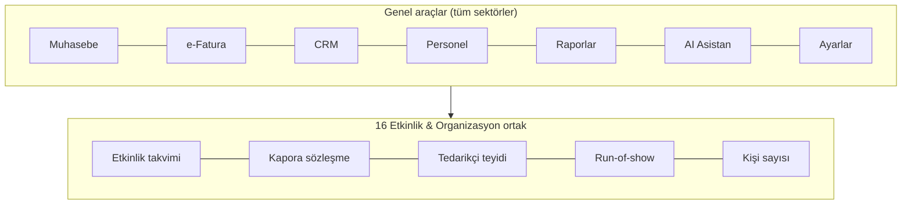

# 16 Etkinlik & Organizasyon

## Özet
- 1–50 çalışanlı etkinlik işletmesi tek bir organizasyon firması değildir. Ticaret Bakanlığı’nın 2021 faaliyet listesinde kongre organizasyonu (82.30.02), özel günlerde dışarıya yemek (56.21.01), sahne ve ses-ışık (90.02.12) ve canlı konserin sahneye konması ayrı satırlardır. YEPUD ve TEODER çatısı alt sektör sınırı olamaz. Sınır, kimin neyi sattığıdır: tarihli oda, özel gün koordinasyonu, kurumsal proje, gösteri, teknik ekip veya etkinliğe giden yemek.
- Tarih sorusu telefon, Excel, WhatsApp ve Instagram DM arasında kalır. Salon programları takvim, opsiyon ve kaporayı merkeze koyar. Çifte satışın gerekçesi ürün metinlerindedir: aynı takvime iki kişi bakması. Kayıp kapora oranı bu taramada yoktur. Salon yazılımlarının dışarıya açık API’si doğrulanmadı.
- Sabit düğün salonu işyeri açma ruhsatına tabidir. ÇŞİDB’nin 29.09.2023 görüşü bu salonları sıhhi müessese sayar; müzik yayını yapan işyeri il müdürlüğünden müzik yayın izni alır. Beyoğlu Belediyesi sayfası düğün salonunu umuma açık listeye koyduğu için yerel uygulama tek cümlede kapanmaz. MSG konser ve etkinlik ücretini mekân veya organizatörden toplar. Merkezî mutfakta yemek üretip götüren işletme gıda kayıt rejimindedir.
- Karar: Fotoğraf, süs ve çiçek tedarikçi olarak dışarıdadır. Stadyum ve uluslararası fuar alanı işletmeciliği kapsama girmez.
- Alt işletme: 8. Modül kartları `04 Modüller/`.
- Ortak çekirdek (tüm sektörler) bu dosyada yoktur → `04 Modüller/` çekirdek araçlar.

<!-- dallar:start -->
## Dallar (ağaç)
> **Sektör → Dal → Alt dal → Fonksiyon.** Görsel: [[Ağaç – 16 Etkinlik & Organizasyon]] · Fonksiyon havuzu: `07 Fonksiyonlar/`

| Dal | Alt dal | Fonksiyon | Durum |
|---|---|---|---|
| [[Düğün, balo ve davet mekânı işletmeciliği]] | 2 | 62 | açık |
| [[Etkinlik ikramı]] | 1 | 31 | açık |
| [[Konser ve küçük festival organizatörlüğü]] | 1 | 31 | açık |
| [[Kurumsal etkinlik ve kongre ajansı]] | 1 | 31 | açık |
| [[Sahne, ses ve ışık teknik hizmeti]] | 1 | 31 | açık |
| [[Özel gün organizatörlüğü]] | 2 | 62 | açık |
<!-- dallar:end -->

## Alt işletme türleri (onay listesi)
> İşaretli = Adım 1 onay listesi.

- [x] [[Düğün ve davet salonu|Düğün ve davet salonu]]
- [x] [[Kendi mutfaklı düğün kompleksi|Kendi mutfaklı düğün kompleksi]]
- [x] [[Etkinlik ikramı|Etkinlik ikramı]]
- [x] [[Konser ve küçük festival organizatörlüğü|Konser ve küçük festival organizatörlüğü]]
- [x] [[Kurumsal etkinlik ve kongre ajansı|Kurumsal etkinlik ve kongre ajansı]]
- [x] [[Sahne, ses ve ışık teknik hizmeti|Sahne, ses ve ışık teknik hizmeti]]
- [x] [[Düğün organizatörü|Düğün organizatörü]]
- [x] [[Özel gün ve kutlama organizatörü|Özel gün ve kutlama organizatörü]]

## Sınırlar ve doğrulanamayan
- Sektör arşiv notundaki sınır ve doğrulanamayan maddeler geçerlidir (`08 Arşiv/eski-docs-sektorel-arastirma/ai-kaynak/16-etkinlik-organizasyon.md`).
- Açık API bulunamayan kurum portalları: panel kayıt + kullanıcı girişi.

## Ortak iş akışı


## Araç mimarisi
> İlke: her araç bir kez yapılır. Bir işletme türü = araçların birleşimi. Tek türe özel ağır resmi entegrasyon yok (API yoksa panel kaydı).



## Araç matrisi (hangi araç kaç alt türe hizmet ediyor)
> ● = kullanıyor. genel = tüm sektörler, ozel = yalnız bu sektör.

| Araç | Tür | Mekân | Özel gün | Kurumsal | Konser | Teknik | İkram | Toplam |
| --- | --- | --- | --- | --- | --- | --- | --- | --- |
| [[Muhasebe ve Gelir-Gider]] | genel | ● | ● | ● | ● | ● | ● | **6** |
| [[e-Fatura ve e-Arşiv]] | genel | ● | ● | ● | ● | ● | ● | **6** |
| [[CRM]] | genel | ● | ● | ● | ● | ● | ● | **6** |
| [[Personel ve Vardiya]] | genel | ● | ● | ● | ● | ● | ● | **6** |
| [[Raporlar]] | genel | ● | ● | ● | ● | ● | ● | **6** |
| [[AI Asistan]] | genel | ● | ● | ● | ● | ● | ● | **6** |
| [[Ayarlar]] | genel | ● | ● | ● | ● | ● | ● | **6** |
| [[Etkinlik takvimi]] | ozel | ● | ● | ● | ● | ● | ● | **6** |
| [[Kapora sözleşme]] | ozel | ● | ● | ● | ● | ● | ● | **6** |
| [[Tedarikçi teyidi]] | ozel | ● | ● | ● | ● | ● | ● | **6** |
| [[Run-of-show]] | ozel | ● | ● | ● | ● | ● | ● | **6** |
| [[Kişi sayısı]] | ozel | ● | ● | ● | ● | ● | ● | **6** |
| [[Salon seans]] | ozel | ● |  |  |  |  |  | **1** |
| [[Paket menü]] | ozel | ● |  |  |  |  |  | **1** |
| [[Mekân lisans]] | ozel | ● |  |  |  |  |  | **1** |
| [[İş brief]] | ozel |  | ● |  |  |  |  | **1** |
| [[Teklif karşılaştır]] | ozel |  | ● |  |  |  |  | **1** |
| [[Gün checklist]] | ozel |  | ● |  |  |  |  | **1** |
| [[Proje bütçe]] | ozel |  |  | ● |  |  |  | **1** |
| [[Kurulum oturum]] | ozel |  |  | ● |  |  |  | **1** |
| [[Hakediş değişiklik]] | ozel |  |  | ● |  |  |  | **1** |
| [[Gösteri dosya]] | ozel |  |  |  | ● |  |  | **1** |
| [[Telif bildirim]] | ozel |  |  |  | ● |  |  | **1** |
| [[Hasılat izin]] | ozel |  |  |  | ● |  |  | **1** |
| [[Ekipman çıkış]] | ozel |  |  |  |  | ● |  | **1** |
| [[Kurulum pencere]] | ozel |  |  |  |  | ● |  | **1** |
| [[Dönüş sayım]] | ozel |  |  |  |  | ● |  | **1** |
| [[Menü maliyet]] | ozel |  |  |  |  |  | ● | **1** |
| [[Üretim sevkiyat]] | ozel |  |  |  |  |  | ● | **1** |
| [[Gıda kayıt]] | ozel |  |  |  |  |  | ● | **1** |

## Ortak ihtiyaçlar (6 alt türde sıklık)
| İhtiyaç | Kategori | Sıklık |
|---|---|---|
| [[Etkinlik takvimi]] | operasyon | 6/6 |
| [[Kapora / sözleşme]] | finans | 6/6 |
| [[Tedarikçi teyidi]] | operasyon | 6/6 |
| [[Run-of-show]] | operasyon | 6/6 |
| [[Kişi sayısı]] | operasyon | 6/6 |
| [[e-Belge]] | yasal | 6/6 |
| [[Salon seans]] | operasyon | 1/6 |
| [[Telif / MSG listesi]] | yasal | 1/6 |
| [[Ekipman çıkış]] | operasyon | 1/6 |
| [[Menü maliyet]] | finans | 1/6 |
| [[Gıda kayıt]] | yasal | 1/6 |
| [[Hasılat]] | finans | 1/6 |

## Öncelik tablosu
> Puanlar tahmindir (1–5). Öncelik = beş puanın ortalaması. Pazar büyüklüğü yalnızca kaynaklı satırlarda nettir.

| # | Alt tür | Pazar | Ödeme | Rekabet | Kolaylık | Aciliyet | Öncelik |
| --- | --- | --- | --- | --- | --- | --- | --- |
| 1 | [[Düğün ve davet salonu]] | 5 | 4 | 3 | 4 | 4 | **4.0** |
| 2 | [[Düğün organizatörü]] | 4 | 4 | 3 | 4 | 4 | **3.8** |
| 3 | [[Kendi mutfaklı düğün kompleksi]] | 4 | 4 | 3 | 3 | 4 | **3.6** |
| 4 | [[Özel gün ve kutlama organizatörü]] | 3 | 4 | 3 | 4 | 3 | **3.4** |
| 5 | [[Kurumsal etkinlik ve kongre ajansı]] | 3 | 4 | 3 | 3 | 3 | **3.2** |
| 6 | [[Sahne, ses ve ışık teknik hizmeti]] | 3 | 3 | 3 | 4 | 3 | **3.2** |
| 7 | [[Etkinlik ikramı]] | 3 | 3 | 3 | 3 | 3 | **3.0** |
| 8 | [[Konser ve küçük festival organizatörlüğü]] | 2 | 3 | 2 | 2 | 3 | **2.4** |

## Yasal çerçeve
| Konu | Kural | Yazılım etkisi | Kaynak |
|---|---|---|---|
| Düğün salonu | ÇŞİDB 29.09.2023: sıhhi müessese; müzik yayın izni | Lisans tarihi | https://webdosya.csb.gov.tr/db/yerelyonetimler/icerikler/dugun-salonlari-20231006135258.pdf |
| MSG | Konser/etkinlik bildirimi formla | Eser listesi taslak; API yok | https://msg.org.tr/dagitim/konser-etkinlik-bildirimi |
| Özel güvenlik | 5188 sayılı Kanun | Hatırlatma; her düğün zorunlu değil | https://www.mevzuat.gov.tr/MevzuatMetin/1.5.5188.pdf |
| Gıda kayıt | e-Devlet işletme kayıt belgesi | 16.06; 16.01 kendi mutfak notu | https://www.turkiye.gov.tr/gida-tarbil-isletme-kayit-belgesi |

## Pazar büyüklüğü
| Alt tür / küme | Sayı | NACE / not |
|---|---|---|
| [[Sektör cirosu / firma sayısı]] | bulunamadı | — |
| [[Kayıp kapora oranı]] | bulunamadı | — |

## Rakip fiyat haritası
| Segment | Aralık | Rakipler |
|---|---|---|
| Salon yazılımı | açık API yok | DüğünAsist, DavetPro, BaloSoft, Ajandam |
| Kapora | iyzico dokümanı açık | iyzico |
| Bilet | API yok | Biletix, Passo |

## Bu sektördeki işletme türleri
```base
filters:
  and:
    - 'tip == "isletme"'
    - file.hasLink(this.file)
formulas:
  oncelik: '((pazar_puani + odeme_puani + rekabet_puani + kolaylik_puani + aciliyet_puani) / 5).toFixed(1)'
properties:
  file.name:
    displayName: İşletme türü
  note.durum:
    displayName: Durum
  formula.oncelik:
    displayName: Öncelik
  note.fiyat_araligi:
    displayName: Fiyat aralığı
  note.is_modeli:
    displayName: İş modeli
views:
  - type: table
    name: İşletme türleri
    order:
      - file.name
      - formula.oncelik
      - note.fiyat_araligi
      - note.is_modeli
      - note.durum
    sort:
      - property: formula.oncelik
        direction: DESC
```

## Kaynaklar
- Ayrıntılı liste: [[16 Etkinlik & Organizasyon – Kaynaklar]]
- Araştırma arşivi: `08 Arşiv/eski-docs-sektorel-arastirma/ai-kaynak/16-etkinlik-organizasyon.md`
