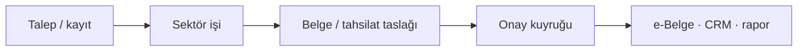
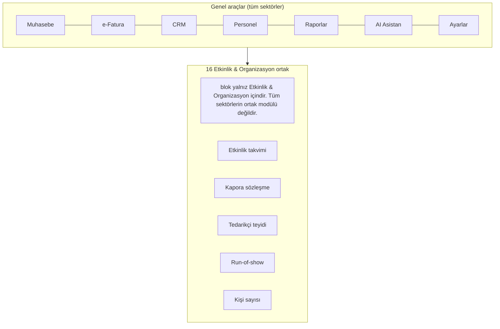

# 16 Etkinlik & Organizasyon

## Özet
- 1–50 çalışanlı etkinlik işletmesi tek bir organizasyon firması değildir.
- Tarih sorusu telefon, Excel, WhatsApp ve Instagram DM arasında kalır.
- Sabit düğün salonu işyeri açma ruhsatına tabidir.
- Karar: Fotoğraf, süs ve çiçek tedarikçi olarak dışarıdadır. Stadyum ve uluslararası fuar alanı işletmeciliği kapsama girmez.
- Modül sayısı: sektör ortak 6; alt sektör 6; toplam 30; MVP 23.
- Ortak çekirdek (tüm sektörler): Muhasebe, e-Fatura/e-Arşiv, CRM, Personel, Raporlar, AI Asistan, Ayarlar → `04 Modüller/00 Ortak Çekirdek.md`.

<!-- dallar:start -->
## Dallar (ağaç)
> **Sektör → Dal → Alt dal → Fonksiyon.** Fonksiyon havuzu: `07 Fonksiyonlar/` · Ortak araçlar: `04 Modüller/`

| Dal | Alt dal | Fonksiyon | Durum |
|---|---|---|---|
| [[Düğün, balo ve davet mekânı işletmeciliği]] | 1 | 4 | açık |
| [[Özel gün organizatörlüğü]] | 1 | 4 | açık |
| [[Kurumsal etkinlik ve kongre ajansı]] | 1 | 4 | açık |
| [[Konser ve küçük festival organizatörlüğü]] | 1 | 4 | açık |
| [[Sahne, ses ve ışık teknik hizmeti]] | 1 | 4 | açık |
| [[Etkinlik ikramı]] | 1 | 4 | açık |
<!-- dallar:end -->

## Alt işletme türleri (onay listesi)
> İşaretli = Adım 1 onay listesi.

- [x] [[Düğün, balo ve davet mekânı işletmeciliği|Düğün, balo ve davet mekânı işletmeciliği]]
- [x] [[Özel gün organizatörlüğü|Özel gün organizatörlüğü]]
- [x] [[Kurumsal etkinlik ve kongre ajansı|Kurumsal etkinlik ve kongre ajansı]]
- [x] [[Konser ve küçük festival organizatörlüğü|Konser ve küçük festival organizatörlüğü]]
- [x] [[Sahne, ses ve ışık teknik hizmeti|Sahne, ses ve ışık teknik hizmeti]]
- [x] [[Etkinlik ikramı|Etkinlik ikramı]]

**Sınırlar**
- Düğün, nişan ve kına ayrı alt sektör değildir. Mekân tarihi 16.01, mekânsız koordinasyon 16.02’dir.
- 16.04 gösteriyi ve hasılatı taşır. 16.05 başkasının gösterisine ekipman koyar. Salon kendi mutfağında kendi düğününe yemek çıkarıyorsa 16.01’de kalır. Başka salonlara yemek üreten 16.06’dadır.
- Etkinlik fotoğrafı ve süsleme tedarikçidir; alt sektör açılmadı. Fuar standı imalatı 13 veya 10’dadır. Etkinliği brief ile yöneten ajans 16.03’tedir. Marka kampanyasının mecra işi 15’tedir.
- 16.02 meslek kodundan değil operasyondan açıldı: oda envanteri yoktur, tedarikçi orkestrasyonu vardır.

**Doğrulanamayan**
- Sektör cirosu, firma sayısı, kayıp kapora ve no-show oranı.
- 2026 MESAM-MSG tarife tutarları bu taramada tarife listesinden satır satır okunmadı.
- Eğlence vergisinin yürürlükteki yüzde oranı.
- Salon yazılımlarının dışarıya açık API’si.
- Her düğün için zorunlu özel güvenlik.

## Ortak iş akışı

## Araç mimarisi
> İlke: her araç bir kez yapılır. Bir işletme türü = araçların birleşimi. Tek türe özel büyük geliştirme yok.

## Araç matrisi (hangi araç kaç alt türe hizmet ediyor)
> ● = kullanıyor. genel = tüm sektörler, ozel = yalnız bu sektör.

| Araç | Tür | Düğün, | Özel | Kurumsal | Konser | Sahne, | Etkinlik ikramı | Toplam |
| --- | --- | --- | --- | --- | --- | --- | --- | --- |
| [[blok yalnız Etkinlik & Organizasyon içindir. Tüm sektörlerin ortak modülü değildir.]] | ozel | ● | ● | ● | ● | ● | ● | **6** |
| [[Etkinlik takvimi]] | ozel | ● | ● | ● | ● | ● | ● | **6** |
| [[Kapora sözleşme]] | ozel | ● | ● | ● | ● | ● | ● | **6** |
| [[Tedarikçi teyidi]] | ozel | ● | ● | ● | ● | ● | ● | **6** |
| [[Run-of-show]] | ozel | ● | ● | ● | ● | ● | ● | **6** |
| [[Kişi sayısı]] | ozel | ● | ● | ● | ● | ● | ● | **6** |
| [[modeli: etkinlik.]] | ozel | ● |  |  |  |  |  | **1** |
| [[Salon seans]] | ozel | ● |  |  |  |  |  | **1** |
| [[Paket menü]] | ozel | ● |  |  |  |  |  | **1** |
| [[Mekân lisans]] | ozel | ● |  |  |  |  |  | **1** |
| [[modeli: etkinlik.]] | ozel |  | ● |  |  |  |  | **1** |
| [[İş brief]] | ozel |  | ● |  |  |  |  | **1** |
| [[Teklif karşılaştır]] | ozel |  | ● |  |  |  |  | **1** |
| [[Gün checklist]] | ozel |  | ● |  |  |  |  | **1** |
| [[modeli: etkinlik.]] | ozel |  |  | ● |  |  |  | **1** |
| [[Proje bütçe]] | ozel |  |  | ● |  |  |  | **1** |
| [[Kurulum oturum]] | ozel |  |  | ● |  |  |  | **1** |
| [[Hakediş değişiklik]] | ozel |  |  | ● |  |  |  | **1** |
| [[modeli: etkinlik.]] | ozel |  |  |  | ● |  |  | **1** |
| [[Gösteri dosya]] | ozel |  |  |  | ● |  |  | **1** |
| [[Telif bildirim]] | ozel |  |  |  | ● |  |  | **1** |
| [[Hasılat izin]] | ozel |  |  |  | ● |  |  | **1** |
| [[modeli: karma.]] | ozel |  |  |  |  | ● |  | **1** |
| [[Ekipman çıkış]] | ozel |  |  |  |  | ● |  | **1** |
| [[Kurulum pencere]] | ozel |  |  |  |  | ● |  | **1** |
| [[Dönüş sayım]] | ozel |  |  |  |  | ● |  | **1** |
| [[modeli: karma.]] | ozel |  |  |  |  |  | ● | **1** |
| [[Menü maliyet]] | ozel |  |  |  |  |  | ● | **1** |
| [[Üretim sevkiyat]] | ozel |  |  |  |  |  | ● | **1** |
| [[Gıda kayıt]] | ozel |  |  |  |  |  | ● | **1** |
| [[Muhasebe ve Gelir-Gider]] | genel | ● | ● | ● | ● | ● | ● | **6** |
| [[e-Fatura ve e-Arşiv]] | genel | ● | ● | ● | ● | ● | ● | **6** |
| [[CRM]] | genel | ● | ● | ● | ● | ● | ● | **6** |
| [[Personel ve Vardiya]] | genel | ● | ● | ● | ● | ● | ● | **6** |
| [[Raporlar]] | genel | ● | ● | ● | ● | ● | ● | **6** |
| [[AI Asistan]] | genel | ● | ● | ● | ● | ● | ● | **6** |
| [[Ayarlar]] | genel | ● | ● | ● | ● | ● | ● | **6** |

## Sektör ortak modüller

### Bu blok yalnız Etkinlik & Organizasyon içindir. Tüm sektörlerin ortak modülü değildir.

- oncelik: 
- durum: 
- aciklama: 
- entegrasyonlar: yok
- ai_komutlari:

### 16.00.01 Etkinlik takvimi

- oncelik: MVP
- durum: zorunlu
- aciklama: Tarih/seans/kaynak doluluğu; opsiyon ve kesin kayıt; çakışma engeli.
- entegrasyonlar: Panel takvimi
- ai_komutlari:
  - 15 Haziran akşam boş mu?
  - Aynı tarihe iki opsiyon var mı?
- ai_otomasyonu: Opsiyon süresi bitince düşürür; kesin+opsiyon çakışmasını işaretler.
- mevzuat_notu: Doğrulama kapanışı: Salon yazılımı geliştirici dokümanı bu turda yok. Takvim panelin kendi kaydıdır, dış sync yok.

### 16.00.02 Kapora sözleşme

- oncelik: MVP
- durum: zorunlu
- aciklama: Opsiyon, kapora, kesinleşme, kalan bakiye ve iade kuralı.
- entegrasyonlar: iyzico
- ai_komutlari:
  - Yılmaz düğününün kaporası geldi mi?
  - Kalan bakiyeyi hatırlat
- ai_otomasyonu: Vade geçen kapora/kalan için hatırlatma; kaporasız kesinleşme engeli.
- mevzuat_notu: Doğrulama kapanışı: https://dev.iyzipay.com/ açıldı. Ödeme çağrısı insan onayı olmadan gitmez.

### 16.00.03 Tedarikçi teyidi

- oncelik: MVP
- durum: zorunlu
- aciklama: Kalem bazlı tedarikçi atama ve yazılı teyit durumu.
- entegrasyonlar: WhatsApp Cloud API
- ai_komutlari:
  - Cumartesi ikram teyit etti mi?
  - Teyitsiz tedarikçiler?
- ai_otomasyonu: Etkinlik −72/−24 saatte teyitsiz kalemleri listeler.
- mevzuat_notu: Doğrulama kapanışı: WhatsApp Cloud API dokümanı açıldı. Şablon ve işletme doğrulama gerekir. Tedarikçi metni taslaktır, gönderim onayla.

### 16.00.04 Run-of-show

- oncelik: MVP
- durum: zorunlu
- aciklama: Etkinlik günü zaman akışı ve bağımlı kalemler.
- entegrasyonlar: yok
- ai_komutlari:
  - Akışta 19:00 sonrası ne var?
  - Kurulum penceresi çakışıyor mu?
- ai_otomasyonu: Brief saat değişiminde etkilenen ROS satırlarını işaretler.

### 16.00.05 Kişi sayısı

- oncelik: MVP
- durum: zorunlu
- aciklama: Sözleşme kişi sayısı ile güncel sayıyı ve etkileri takip eder.
- entegrasyonlar: yok
- ai_komutlari:
  - Kişi 180'den 220'ye çıktı, ne değişir?
  - Son kişi güncellemesi?
- ai_otomasyonu: Δ kişi ile menü/kapasite/ekip uyarıları üretir.

## Alt sektör modülleri

## 16.01 Düğün, balo ve davet mekânı işletmeciliği

- aciklama: Tarihi ve salonu satan işletme. Mekânsız planlayıcı bu satırda değildir.
- gunluk_is: Salon takviminde opsiyon ve kesin tarih, kapora, kişi sayısı, menü ve servis ekibi.
- ai: Telefonda kalmış tarih sözünü kesin ve opsiyon kayıtlarıyla karşılaştırıp ikinci sözü gösterir.

### İş modeli: etkinlik.

- oncelik: 
- durum: 
- aciklama: 
- entegrasyonlar: yok
- ai_komutlari:

### 16.01.01 Salon seans

- oncelik: MVP
- durum: zorunlu
- aciklama: Çoklu salon ve öğle/akşam seans rezervasyonu; sözün kayda bağlanması.
- entegrasyonlar: Panel seansı
- ai_komutlari:
  - Salon B 7 Haziran öğle?
  - Bu hafta kesinleşenler?
- ai_otomasyonu: Kanal notunu takvimle karşılaştırıp çifte söz uyarır.
- mevzuat_notu: Doğrulama kapanışı: DüğünAsist, DavetPro, BaloSoft ve Ajandam için açık API bu turda yok. Seans panelde tutulur.

### 16.01.02 Paket menü

- oncelik: MVP
- durum: zorunlu
- aciklama: Kişi başı paket, ek hizmet ve toplam tutar.
- entegrasyonlar: yok
- ai_komutlari:
  - 250 kişi standart menü tutarı?
  - Kokteyl paketine pasta ekle
- ai_otomasyonu: Kişi değişince paket toplamını yeniler.
- mevzuat_notu: Kendi mutfakta gıda üretimi varsa işletme kayıt belgesi (16.06 ile aynı rejim).

### 16.01.03 Mekân lisans

- oncelik: MVP
- durum: zorunlu
- aciklama: UMK (MSF) + müzik yayın izni + işyeri ruhsatı son tarih takibi.
- entegrasyonlar: yok
- ai_komutlari:
  - Müzik yayın izni bitiş?
  - Bu ay yenilenecek belgeler?
- ai_otomasyonu: İzin −60 gün kala yenileme görevi açar.
- mevzuat_notu: FSEK m.41; MSF UMK; ÇGK Yönetmeliği müzik yayın izni. Yıllık UMK, davetli/biletli etkinliği otomatik kapsamaz.

## 16.02 Özel gün organizatörlüğü

- aciklama: Çift veya aile adına günü planlayan, salonu işletmeyen firma.
- gunluk_is: Brief, tedarikçi teyidi, kapora ve günün akış çizelgesi.
- ai: Gelen teklifleri kalemlere ayırır; teyitsiz veya saati çakışan kalemi gösterir.

### İş modeli: etkinlik.

- oncelik: 
- durum: 
- aciklama: 
- entegrasyonlar: yok
- ai_komutlari:

### 16.02.01 İş brief

- oncelik: MVP
- durum: zorunlu
- aciklama: Mekânsız planlayıcı iş dosyası: brief, bütçe, karar sahibi.
- entegrasyonlar: yok
- ai_komutlari:
  - Kına brief'i özetle
  - Bütçe tavanı aşıldı mı?
- ai_otomasyonu: Brief değişince tedarikçi kalemlerini yeniden etiketler.
- mevzuat_notu: Telif/müzik yayın izni genelde mekânın; sözleşmede sorumluluk satırı tutulur.

### 16.02.02 Teklif karşılaştır

- oncelik: MVP
- durum: zorunlu
- aciklama: Aynı hizmet kalemine gelen teklif ve teyit durumu.
- entegrasyonlar: yok
- ai_komutlari:
  - Üç fotoğraf teklifini karşılaştır
  - En ucuz ama teyitsiz kim?
- ai_otomasyonu: Teslim saati çakışan tedarikçileri gösterir.

### 16.02.03 Gün checklist

- oncelik: MVP
- durum: opsiyonel
- aciklama: Planlayıcı saha kontrol listesi.
- entegrasyonlar: yok
- ai_komutlari:
  - Nikah günü checklist
  - Eksik teslim kalemi?
- ai_otomasyonu: −24 saatte açık maddeleri bildirir.

## 16.03 Kurumsal etkinlik ve kongre ajansı

- aciklama: Şirket veya kurum adına lansman, kongre, gala ve fuar katılımını proje olarak yürüten ajans.
- gunluk_is: Brief, tedarikçi bütçesi, kurulum, oturum akışı, hakediş ve tahsilat.
- ai: Değişen kişi sayısı veya kurulum saatini akış ve sipariş satırlarına bağlar.

### İş modeli: etkinlik.

- oncelik: 
- durum: 
- aciklama: 
- entegrasyonlar: yok
- ai_komutlari:

### 16.03.01 Proje bütçe

- oncelik: MVP
- durum: zorunlu
- aciklama: Kurumsal brief, kalem bütçe ve onay kapıları.
- entegrasyonlar: yok
- ai_komutlari:
  - Lansman bütçe sapması?
  - AV kalemi onaylı mı?
- ai_otomasyonu: Onaysız kaleme sipariş açmayı engeller.
- mevzuat_notu: Müzikli lansman/gala/kongrede MESAM-MSG 4.B/4.C; kimin lisans alacağı sözleşmede.

### 16.03.02 Kurulum oturum

- oncelik: MVP
- durum: zorunlu
- aciklama: Load-in ve oturum/speaker zaman blokları.
- entegrasyonlar: yok
- ai_komutlari:
  - İkinci gün 14:00 oturumu?
  - Kurulum 08:00'e kaydı
- ai_otomasyonu: Saat kayınca bağımlı ROS/tedarik satırlarını günceller.

### 16.03.03 Hakediş değişiklik

- oncelik: MVP
- durum: zorunlu
- aciklama: Change order ve faturalanabilir fark.
- entegrasyonlar: yok
- ai_komutlari:
  - Kişi +40 change order oluştur
  - Bu ay kesilecek hakediş?
- ai_otomasyonu: Brief Δ'sından draft change order üretir (onay ister).

## 16.04 Konser ve küçük festival organizatörlüğü

- aciklama: Yerel konseri veya küçük festivali üreten organizatör. Stadyum işletmeciliği dışarıdadır.
- gunluk_is: Gösteri tarihi, sanatçı, teknik ister, hasılat, eser listesi ve özel güvenlik talebi.
- ai: Eser listesini MSG bildirim taslağına dizer; salon, belediye alanı ve güvenlik kalemlerini ayrı hatırlatır.

### İş modeli: etkinlik.

- oncelik: 
- durum: 
- aciklama: 
- entegrasyonlar: yok
- ai_komutlari:

### 16.04.01 Gösteri dosya

- oncelik: MVP
- durum: zorunlu
- aciklama: Sanatçı, rider, mekân/alan ve çağrı saatleri.
- entegrasyonlar: yok
- ai_komutlari:
  - Cuma teknik rider eksikleri?
  - Sanatçı çağrı saati?
- ai_otomasyonu: Rider maddelerini teknik checklist'e aktarır.
- mevzuat_notu: 5188 sayılı Kanun — geçici konser/sahne için özel güvenlik valilik izni dosya kalemi olabilir.

### 16.04.02 Telif bildirim

- oncelik: MVP
- durum: zorunlu
- aciklama: MESAM-MSG konser/etkinlik lisansı ve eser listesi taslağı.
- entegrasyonlar: MSG bildirim formu
- ai_komutlari:
  - MSG bildirim taslağı hazırla
  - Eser listesi eksik sanatçı?
- ai_otomasyonu: Gösteri −15 gün telif/bildirim hatırlatması.
- mevzuat_notu: FSEK m.41/52; MSG konser-etkinlik bildirimi; 2026 MESAM-MSG ortak tarife 4.A. Doğrulama kapanışı: https://msg.org.tr/dagitim/konser-etkinlik-bildirimi açıldı. Bildirim form ve eser listesiyle. API yok. Taslak panelde, iletim kullanıcıda.

### 16.04.03 Hasılat izin

- oncelik: MVP
- durum: zorunlu
- aciklama: Bilet/hasılat özeti ve izin/güvenlik kalemleri.
- entegrasyonlar: Elle hasılat
- ai_komutlari:
  - Ön satış kaç?
  - Özel güvenlik başvurusu yapıldı mı?
- ai_otomasyonu: Kapasite dilimine göre minimum telif notunu hatırlatır (tarife manuel).
- mevzuat_notu: Biletli etkinlikte hasılat yüzdesi/minimum bedel MESAM-MSG 4.A. Eğlence vergisi oranı bu turda netleşmedi. Doğrulama kapanışı: Biletix ve Passo için açık API bu turda yok. Hasılat elle girilir.

## 16.05 Sahne, ses ve ışık teknik hizmeti

- aciklama: Gösterinin ses, ışık ve sahne tekniğini ekipman ve ekiple kuran firma.
- gunluk_is: Depo çıkışı, kurulum penceresi, ekip çağrısı, söküm ve dönüş sayımı.
- ai: Teknik ister, çıkış fişi ve dönüş sayımını karşılaştırıp eksik dönen ekipmanı gösterir.

### İş modeli: karma.

- oncelik: 
- durum: 
- aciklama: 
- entegrasyonlar: yok
- ai_komutlari:

### 16.05.01 Ekipman çıkış

- oncelik: MVP
- durum: zorunlu
- aciklama: Ekipman parkı, işe çıkış fişi ve rezervasyon kilidi.
- entegrasyonlar: yok
- ai_komutlari:
  - 2x line array müsait mi?
  - Cumartesi çıkış listesi
- ai_otomasyonu: Çifte rezervasyonda ekipmanı kilitler.
- mevzuat_notu: MSG/MESAM ve gıda kaydı uygulanmaz.

### 16.05.02 Kurulum pencere

- oncelik: MVP
- durum: zorunlu
- aciklama: Load-in/out pencereleri ve ekip çağrısı.
- entegrasyonlar: yok
- ai_komutlari:
  - Load-in 14–18 çakışıyor mu?
  - Kaç teknisyen?
- ai_otomasyonu: Örtüşen kurulum pencerelerinde uyarır.

### 16.05.03 Dönüş sayım

- oncelik: MVP
- durum: zorunlu
- aciklama: Çıkış fişi ile dönüş sayımı; eksik/hasar.
- entegrasyonlar: yok
- ai_komutlari:
  - Dönüşte eksik ne?
  - Hasar kaydı aç
- ai_otomasyonu: Fiş farkını kayıp/hasar satırına yazar (onay ister).

## 16.06 Etkinlik ikramı

- aciklama: Müşterinin belirlediği etkinlikte sözleşmeyle yemek üreten işletme. Lokanta ve tabldot burada değildir.
- gunluk_is: Tarih, kişi sayısı, menü maliyeti, üretim, taşıma, servis ekibi ve kap dönüşü.
- ai: Kişi sayısı değişince reçeteden üretim miktarını ve servis ekibi ihtiyacını yeniden hesaplar.

### İş modeli: karma.

- oncelik: 
- durum: 
- aciklama: 
- entegrasyonlar: yok
- ai_komutlari:

### 16.06.01 Menü maliyet

- oncelik: MVP
- durum: zorunlu
- aciklama: Reçete, kişi başı maliyet ve teklif.
- entegrasyonlar: yok
- ai_komutlari:
  - 220 kişilik menü maliyeti?
  - Vejetaryen 30 kişi ekle
- ai_otomasyonu: Kişi Δ → üretim miktarı ve maliyet.

### 16.06.02 Üretim sevkiyat

- oncelik: MVP
- durum: zorunlu
- aciklama: Mutfak planı, taşıma, servis ekibi, kap-kacak dönüşü.
- entegrasyonlar: yok
- ai_komutlari:
  - Cumartesi üretim planı
  - Kap-kacak döndü mü?
- ai_otomasyonu: Sevkiyat −1 gün ekip/araç hatırlatması.

### 16.06.03 Gıda kayıt

- oncelik: MVP
- durum: zorunlu
- aciklama: İşletme kayıt belgesi ve faaliyet konusu dosyası.
- entegrasyonlar: e-Devlet gıda kayıt
- ai_komutlari:
  - Gıda kayıt numarası?
  - Belge adresi değişti mi?
- ai_otomasyonu: Adres/unvan değişiminde yenileme görevi.
- mevzuat_notu: Gıda İşletmelerinin Kayıt ve Onay Yönetmeliği; e-Devlet işletme kayıt belgesi. Gönüllü kermes istisnası ticari catering'e uygulanmaz. MSG/MESAM uygulanmaz. Doğrulama kapanışı: https://www.turkiye.gov.tr/gida-tarbil-isletme-kayit-belgesi açıldı. Hizmet e-Devlet kimliği ister. API yok. Belge tarihi panelde.

## Sayım

- sektor_ortak: 5
- alt_sektor: 6
- modul: 23
- mvp: 23

## Kaynaklar

- ÇŞİDB düğün salonları görüşü: https://webdosya.csb.gov.tr/db/yerelyonetimler/icerikler/dugun-salonlari-20231006135258.pdf
- MSG konser bildirimi: https://msg.org.tr/dagitim/konser-etkinlik-bildirimi
- 5188 sayılı Kanun: https://www.mevzuat.gov.tr/MevzuatMetin/1.5.5188.pdf
- Gıda işletme kayıt: https://www.turkiye.gov.tr/gida-tarbil-isletme-kayit-belgesi
- YEPUD: https://www.yepud.org/hakkimizda/
