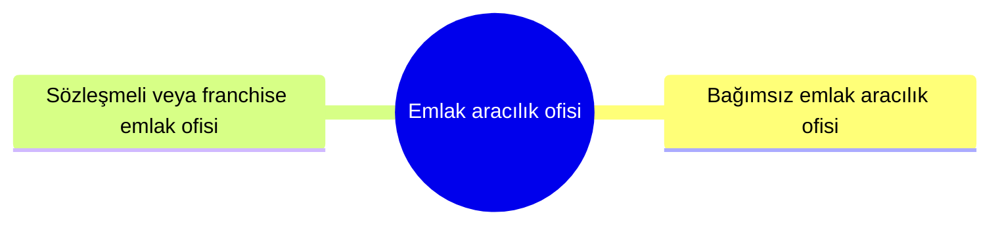

# 09-01 · Emlak aracılık ofisi

> Sektör: [[09 Emlak & Gayrimenkul]] · 2 alt dal
> Görsel: [[Ağaç – 09 – Emlak aracılık ofisi]]

## Özet
- Emlak aracılık ofisi

## Alt dallar
| # | Alt dal | İşletme sayısı | Fonksiyon | Not |
|---|---|---|---|---|
| A1 | [[Bağımsız emlak aracılık ofisi]] | İTO 68.31.01: 14.828 (İstanbul oda; TR geneli yok) | 43 | Öncelik 3.8 (A) |
| A2 | [[Sözleşmeli veya franchise emlak ofisi]] | bulunamadı (franchise kırılımı yok) | 43 | Öncelik 3.4 (B) |



## Bu daldaki alt dallar (canlı)
```base
filters:
  and:
    - 'tip == "isletme"'
    - file.hasLink(this.file)
views:
  - type: table
    name: Alt dallar
```
