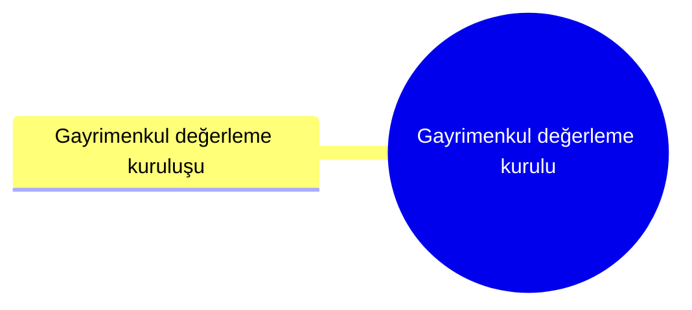

# 09-02 · Gayrimenkul değerleme kuruluşu

> Sektör: [[09 Emlak & Gayrimenkul]] · 1 alt dal
> Görsel: [[Ağaç – 09 – Gayrimenkul değerleme kuruluşu]]

## Özet
- Gayrimenkul değerleme kuruluşu

## Alt dallar
| # | Alt dal | İşletme sayısı | Fonksiyon | Not |
|---|---|---|---|---|
| A1 | [[Gayrimenkul değerleme kuruluşu]] | İTO 68.32.01: 1.174 | 43 | Öncelik 2.4 (C) |



## Bu daldaki alt dallar (canlı)
```base
filters:
  and:
    - 'tip == "isletme"'
    - file.hasLink(this.file)
views:
  - type: table
    name: Alt dallar
```
