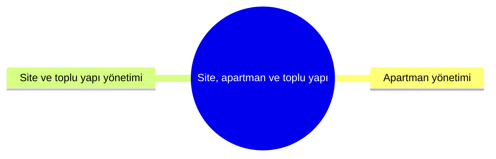

# 09-03 · Site, apartman ve toplu yapı yönetimi

> Sektör: [[09 Emlak & Gayrimenkul]] · 2 alt dal
> Görsel: [[Ağaç – 09 – Site, apartman ve toplu yapı yönetimi]]

## Özet
- Site, apartman ve toplu yapı yönetimi

## Alt dallar
| # | Alt dal | İşletme sayısı | Fonksiyon | Not |
|---|---|---|---|---|
| A1 | [[Apartman yönetimi]] | bulunamadı | 43 | Öncelik 3.2 (B) |
| A2 | [[Site ve toplu yapı yönetimi]] | bulunamadı | 43 | Öncelik 3.2 (B) |



## Bu daldaki alt dallar (canlı)
```base
filters:
  and:
    - 'tip == "isletme"'
    - file.hasLink(this.file)
views:
  - type: table
    name: Alt dallar
```
