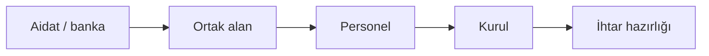

# 09-03-02 · Site ve toplu yapı yönetimi

> Sektör: [[09 Emlak & Gayrimenkul]] · Öncelik: **3.2** / 5 · Öneri: **B**
> Puanlar tahmindir: pazar 3 · ödeme 3 · rekabet boşluğu 3 · kolaylık 3 · aciliyet 4

## 1. Özet
Çok bloklu / toplu yapıda ortak alan, personel, aidat ve kurul süreçleri.

- **İşletme sayısı:** bulunamadı
- **NACE:** 68.32
- **Sayı türü:** tahmin

## 2. Günlük iş akışı
1. Aidat / banka
2. Ortak alan
3. Personel
4. Kurul
5. İhtar hazırlığı

## 3. İhtiyaçlar ve sorunlar
| İhtiyaç | Bugün nasıl çözüyorlar | Etkisi |
|---|---|---|
| [[Yetki belgesi ve sorumlu danışman takibi]] | Excel / WhatsApp / portal (tahmin) | Zaman, hata, uyum riski |
| [[Portföy kartı ve medya]] | Excel / WhatsApp / portal (tahmin) | Zaman, hata, uyum riski |
| [[Gösterim randevusu]] | Excel / WhatsApp / portal (tahmin) | Zaman, hata, uyum riski |
| [[Tahsilat / aidat / komisyon kaydı]] | Excel / WhatsApp / portal (tahmin) | Zaman, hata, uyum riski |
| [[e-Belge]] | Excel / WhatsApp / portal (tahmin) | Zaman, hata, uyum riski |
| [[Sözleşme taslağı]] | Excel / WhatsApp / portal (tahmin) | Zaman, hata, uyum riski |
| [[İlan doğrulama / EİDS checklist]] | Excel / WhatsApp / portal (tahmin) | Zaman, hata, uyum riski |
| [[Kira tahsilat ve dekont]] | Excel / WhatsApp / portal (tahmin) | Zaman, hata, uyum riski |

## 4. Parçalar

43 parça · 28 şart · 3 olmalı · 12 iyi olur

### Şart (28)

| Fonksiyon | Araç | Kullanım |
|---|---|---|
| [[Muhasebe ve Gelir-Gider]] | [[Muhasebe ve Gelir-Gider]] | Gelir, gider, cari, kasa ve banka. Sektör belgesi para kaydını buraya düşürür. |
| [[e-Fatura ve e-Arşiv]] | [[e-Fatura ve e-Arşiv]] | Satış belgesi taslağı; gönderim entegratör + onayla. |
| [[CRM]] | [[CRM]] | Kişi/firma kartı, iletişim, not; sektör alanları karta eklenir. |
| [[Personel ve Vardiya]] | [[Personel ve Vardiya]] | Personel kartı, vardiya, puantaj. Bordro/SGK kesilmez. |
| [[Raporlar]] | [[Raporlar]] | Ciro, tahsilat, açık iş ve personel özeti. |
| [[AI Asistan]] | [[AI Asistan]] | Komut çalıştırır, taslak üretir; yüksek etkili işlem onaysız bitmez. |
| [[Ayarlar]] | [[Ayarlar]] | İşletme, belge, bildirim ve entegrasyon ayarları. |
| [[Portföy Kartı]] | [[Portföy Kartı]] | Satış/kira/işletme için taşınmaz kimliği, özellikler, durum ve medya yönetimi. |
| [[Boşta satılık daireleri listele]] | [[Portföy Kartı]] | Boşta satılık daireleri listele — Satış/kira/işletme için taşınmaz kimliği, özellikler, durum ve medya yönetimi. |
| [[Kadıköy 3+1 portföyleri getir]] | [[Portföy Kartı]] | Kadıköy 3+1 portföyleri getir — Satış/kira/işletme için taşınmaz kimliği, özellikler, durum ve medya yönetimi. |
| [[Gösterim Randevu]] | [[Gösterim Randevu]] | Mülk gösterimi randevu, çakışma kontrolü ve danışman ataması. |
| [[Yarın 14:00 için gösterim aç]] | [[Gösterim Randevu]] | Yarın 14:00 için gösterim aç — Mülk gösterimi randevu, çakışma kontrolü ve danışman ataması. |
| [[Bu hafta müsait slotları göster]] | [[Gösterim Randevu]] | Bu hafta müsait slotları göster — Mülk gösterimi randevu, çakışma kontrolü ve danışman ataması. |
| [[İlan Doğrulama]] | [[İlan Doğrulama]] | İlan öncesi kimlik/yetki doğrulama durumu ve yayın checklist'i; EİDS uyumu. |
| [[Bu ilanın EİDS durumunu kontrol et]] | [[İlan Doğrulama]] | Bu ilanın EİDS durumunu kontrol et — İlan öncesi kimlik/yetki doğrulama durumu ve yayın checklist'i; EİDS uyumu. |
| [[Yetkisiz ilanları işaretle]] | [[İlan Doğrulama]] | Yetkisiz ilanları işaretle — İlan öncesi kimlik/yetki doğrulama durumu ve yayın checklist'i; EİDS uyumu. |
| [[Yetki Takibi]] | [[Yetki Takibi]] | İşletme yetki belgesi, sorumlu emlak danışmanı ve belge vade takibi (TTBS). |
| [[Yetki belgesi vadesi yaklaşanları göster]] | [[Yetki Takibi]] | Yetki belgesi vadesi yaklaşanları göster — İşletme yetki belgesi, sorumlu emlak danışmanı ve belge vade takibi (TTBS). |
| [[Seviye 5 sorumlu listesi]] | [[Yetki Takibi]] | Seviye 5 sorumlu listesi — İşletme yetki belgesi, sorumlu emlak danışmanı ve belge vade takibi (TTBS). |
| [[İşletme Projesi]] | [[İşletme Projesi]] | Yıllık gelir-gider, avans/aidat dağılımı; geçici proje ve genel kurul onayı. |
| [[Geçici işletme projesi taslağı oluştur]] | [[İşletme Projesi]] | Geçici işletme projesi taslağı oluştur — Yıllık gelir-gider, avans/aidat dağılımı; geçici proje ve genel kurul onayı. |
| [[Yeniden değerleme üst sınırını uygula]] | [[İşletme Projesi]] | Yeniden değerleme üst sınırını uygula — Yıllık gelir-gider, avans/aidat dağılımı; geçici proje ve genel kurul onayı. |
| [[Genel Kurul]] | [[Genel Kurul]] | Toplantı çağrısı, gündem, karar ve tutanak arşivi. |
| [[Son kurul kararlarını özetle]] | [[Genel Kurul]] | Son kurul kararlarını özetle — Toplantı çağrısı, gündem, karar ve tutanak arşivi. |
| [[Yönetim planı değişiklik gündemi hazırla]] | [[Genel Kurul]] | Yönetim planı değişiklik gündemi hazırla — Toplantı çağrısı, gündem, karar ve tutanak arşivi. |
| [[Arıza Talep]] | [[Arıza Talep]] | Kat maliki/kiracı talep, teknisyen atama ve SLA. |
| [[Acil arızaları listele]] | [[Arıza Talep]] | Acil arızaları listele — Kat maliki/kiracı talep, teknisyen atama ve SLA. |
| [[Ortalama çözüm süresini göster]] | [[Arıza Talep]] | Ortalama çözüm süresini göster — Kat maliki/kiracı talep, teknisyen atama ve SLA. |

### Olmalı (3)

| Fonksiyon | Araç | Kullanım |
|---|---|---|
| [[Sözleşme Taslağı]] | [[Sözleşme Taslağı]] | Satış/kira/yetkilendirme taslak üretimi; imza ve gönderim insan onayına bağlı. |
| [[Satış yetki sözleşmesi taslağı üret]] | [[Sözleşme Taslağı]] | Satış yetki sözleşmesi taslağı üret — Satış/kira/yetkilendirme taslak üretimi; imza ve gönderim insan onayına bağlı. |
| [[Kira sözleşmesi madde özetini çıkar]] | [[Sözleşme Taslağı]] | Kira sözleşmesi madde özetini çıkar — Satış/kira/yetkilendirme taslak üretimi; imza ve gönderim insan onayına bağlı. |

### İyi olur (12)

| Fonksiyon | Araç | Kullanım |
|---|---|---|
| [[Belge Kasası]] | [[Belge Kasası]] | Tapu, kimlik, yetki ve ekspertiz belgelerinin versiyonlu arşivi. |
| [[Bu portföyün tapu belgelerini listele]] | [[Belge Kasası]] | Bu portföyün tapu belgelerini listele — Tapu, kimlik, yetki ve ekspertiz belgelerinin versiyonlu arşivi. |
| [[Süresi dolan belgeleri bul]] | [[Belge Kasası]] | Süresi dolan belgeleri bul — Tapu, kimlik, yetki ve ekspertiz belgelerinin versiyonlu arşivi. |
| [[Komisyon Hesabı]] | [[Komisyon Hesabı]] | Muhasebe & Gelir-Gider genişlemesi: işlem komisyonu ve ofis/danışman payı önerisi. |
| [[Bu satışta komisyon tutarını hesapla]] | [[Komisyon Hesabı]] | Bu satışta komisyon tutarını hesapla — Muhasebe & Gelir-Gider genişlemesi: işlem komisyonu ve ofis/danışman payı önerisi. |
| [[Danışman payını göster]] | [[Komisyon Hesabı]] | Danışman payını göster — Muhasebe & Gelir-Gider genişlemesi: işlem komisyonu ve ofis/danışman payı önerisi. |
| [[Ortak Alan]] | [[Ortak Alan]] | Ortak alan (salon, misafir otopark vb.) rezervasyon yönetimi. |
| [[Cumartesi salon müsaitliğini göster]] | [[Ortak Alan]] | Cumartesi salon müsaitliğini göster — Ortak alan (salon, misafir otopark vb.) rezervasyon yönetimi. |
| [[Çakışan rezervasyonları bul]] | [[Ortak Alan]] | Çakışan rezervasyonları bul — Ortak alan (salon, misafir otopark vb.) rezervasyon yönetimi. |
| [[Aidat İcra]] | [[Aidat İcra]] | Gecikme tazminatı hesabı ve icra dosya hazırlığı; takip başlatma insan onaylı. |
| [[3+ ay gecikenleri listele]] | [[Aidat İcra]] | 3+ ay gecikenleri listele — Gecikme tazminatı hesabı ve icra dosya hazırlığı; takip başlatma insan onaylı. |
| [[Gecikme tazminatı hesapla]] | [[Aidat İcra]] | Gecikme tazminatı hesapla — Gecikme tazminatı hesabı ve icra dosya hazırlığı; takip başlatma insan onaylı. |

## 5. Teknik detay
- **Entegrasyonlar:** Modül kartlarına bak; açık API yoksa panel kaydı.
- **Ana ekranlar:** İş listesi · Kart · Tahsilat · Rapor
- **Veri yapısı:** `Cari → İşKaydı → Belge/Tahsilat → Hatırlatma (onay)`

## 6. Rakipler
- [[RE-OS]]
- [[selfSite]]
- [[Dijiyon]]
- [[Konsiyon]]
- [[NOKTApp]]
- [[sahibinden]]

## 7. Kaynaklar
- [[09 Emlak & Gayrimenkul – Kaynaklar]]
