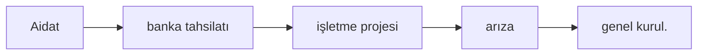

# 09-03-01 · Site, apartman ve toplu yapı yönetimi

> Sektör: [[09 Emlak & Gayrimenkul]] · Öncelik: **3.2** / 5 · Öneri: **B**
> Puanlar tahmindir: pazar 3 · ödeme 3 · rekabet boşluğu 3 · kolaylık 3 · aciliyet 4

## 1. Özet
Profesyonel yönetici, kat mülkiyetli yapının ortak giderini, personelini ve kurullarını yürütür.

- **İşletme sayısı:** İTO 68.32.02: 795 (ücretli yönetim; site yönetim TR geneli bulunamadı)
- **NACE:** 68.32

## 2. Günlük iş akışı
1. Aidat
2. banka tahsilatı
3. işletme projesi
4. arıza
5. genel kurul.

AI destek (onaylı): Dekontu bağımsız bölüme önerir, gecikme tazminatını kanundaki aylık yüzde beşle hesaplar; ihtar ve icra onaya kalır.

## 3. İhtiyaçlar ve sorunlar
| İhtiyaç | Bugün nasıl çözüyorlar | Etkisi |
|---|---|---|
| [[Portföy Kartı]] | Excel / WhatsApp / portal (tahmin) | Zaman kaybı, hata riski |
| [[Gösterim Randevu]] | Excel / WhatsApp / portal (tahmin) | Zaman kaybı, hata riski |
| [[İlan Doğrulama]] | Excel / WhatsApp / portal (tahmin) | Zaman kaybı, hata riski |
| [[İşletme Projesi]] | Excel / WhatsApp / portal (tahmin) | Zaman kaybı, hata riski |
| [[Genel Kurul]] | Excel / WhatsApp / portal (tahmin) | Zaman kaybı, hata riski |
| [[Arıza Talep]] | Excel / WhatsApp / portal (tahmin) | Zaman kaybı, hata riski |
| [[Ortak Alan]] | Excel / WhatsApp / portal (tahmin) | Zaman kaybı, hata riski |
| [[Aidat İcra]] | Excel / WhatsApp / portal (tahmin) | Zaman kaybı, hata riski |

## 4. Çözümümüz: modüller ve özellikler
**Araç tarifi:** [[Muhasebe ve Gelir-Gider]] + [[e-Fatura ve e-Arşiv]] + [[CRM]] + [[Personel ve Vardiya]] + [[Raporlar]] + [[AI Asistan]] + [[Ayarlar]] + [[Portföy Kartı]] + [[Gösterim Randevu]] + [[İlan Doğrulama]] + [[Yetki Takibi]] + [[Sözleşme Taslağı]] + [[Belge Kasası]] + [[Komisyon Hesabı]]…

### Fonksiyonlar
- [[Geçici işletme projesi taslağı oluştur]]
- [[Yeniden değerleme üst sınırını uygula]]
- [[Son kurul kararlarını özetle]]
- [[Yönetim planı değişiklik gündemi hazırla]]
- [[Acil arızaları listele]]
- [[Ortalama çözüm süresini göster]]
- [[Cumartesi salon müsaitliğini göster]]
- [[Çakışan rezervasyonları bul]]
- [[3+ ay gecikenleri listele]]
- [[Gecikme tazminatı hesapla]]

### MVP
- [[Portföy Kartı]]
- [[Gösterim Randevu]]
- [[İlan Doğrulama]]
- [[Yetki Takibi]]
- [[Sözleşme Taslağı]]
- [[İşletme Projesi]]
- [[Genel Kurul]]
- [[Arıza Talep]]

### Sonraki sürüm
- [[Belge Kasası]]
- [[Komisyon Hesabı]]
- [[Ortak Alan]]
- [[Aidat İcra]]

## 5. Teknik detay
- **Entegrasyonlar:** EİDS Taşınmaz API, Google Calendar API, TTBS sorgu ekranı, UYAP vatandaş ve avukat portalı, Web Tapu emlakçı portalı
- **Ana ekranlar:** Kart / iş listesi · Takvim veya pipeline · Tahsilat · Rapor
- **Veri yapısı:** `Cari → İşKaydı → Belge/Tahsilat → Hatırlatma (onay kuyruğu)`

## 6. Fiyat ve paket önerisi
| Paket | İçerik | Fiyat | Not |
|---|---|---|---|
| Başlangıç | Çekirdek + MVP araçlar | bulunamadı — selfSite/Dijiyon bandı | tahmin |
| Plus | V2 araçlar | bulunamadı | tahmin |

Uygun iş modeli: Abonelik (taahhütsüz aylık; yıllık indirim) — tahmin

## 7. Satış argümanı
- **Değer önerisi (tek cümle):** Site, apartman ve toplu yapı yönetimi gününü tek panelde toplar; resmi gönderim ve tahsilat onayda kalır.
- **3 ana mesaj:**
  1. Dağınık Excel/WhatsApp yerine tek iş kaydı
  2. e-Belge ve hatırlatmalar onay kuyruğunda
  3. Sektöre özel alanlar, ortak çekirdek üzerinde
- **İtirazlar ve cevaplar:**

| İtiraz | Cevap |
|---|---|
| Zaten Excel var | Süre/uyum hatırlatması ve belge taslağı Excel’de dağılır |
| Resmi API yok | Panel kaydı + kurum portalı; uydurma entegrasyon yok |
| Pahalı | Taahhütsüz paket; yalnız kullanılan araçlar (tahmin) |

## 8. Rakipler
- [[RE-OS]]
- [[selfSite]]
- [[Dijiyon]]
- [[Konsiyon]]
- [[NOKTApp]]
- [[sahibinden]]

## 9. Kaynaklar
- [[09 Emlak & Gayrimenkul – Kaynaklar]]
- Arşiv: `08 Arşiv/eski-docs-sektorel-arastirma/ai-kaynak/09-emlak-gayrimenkul.md`
