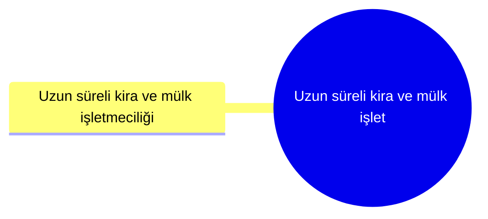

# 09-05 · Uzun süreli kira ve mülk işletmeciliği

> Sektör: [[09 Emlak & Gayrimenkul]] · 1 alt dal · 43 fonksiyon
> Görsel: [[Ağaç – 09 – Uzun süreli kira ve mülk işletmeciliği]]

## Özet
- Uzun süreli kira ve mülk işletmeciliği: onaylı alt işletme tür(ler)i ve bağlanan araç/fonksiyonlar.

## Alt dallar
| # | Alt dal | İşletme sayısı | Fonksiyon | Not |
|---|---|---|---|---|
| A1 | [[Uzun süreli kira ve mülk işletmeciliği]] | İTO 68.20.02: 5.013 (kendi taşınmazını kiralama kümesi) | 43 | Öncelik 3.6 (A) |



## Dalın ortak temeli
- Çekirdek: [[Muhasebe ve Gelir-Gider]], [[e-Fatura ve e-Arşiv]], [[CRM]], [[Personel ve Vardiya]], [[Raporlar]], [[AI Asistan]], [[Ayarlar]]
- Sektör ortak araçlar + bu dalın alt tür araçları

## Fonksiyon matrisi
> ● = kullanıyor.

| Fonksiyon | A1 | Kullanım |
|---|---|---|
| [[Muhasebe ve Gelir-Gider]] | ● | 1/1 |
| [[e-Fatura ve e-Arşiv]] | ● | 1/1 |
| [[CRM]] | ● | 1/1 |
| [[Personel ve Vardiya]] | ● | 1/1 |
| [[Raporlar]] | ● | 1/1 |
| [[AI Asistan]] | ● | 1/1 |
| [[Ayarlar]] | ● | 1/1 |
| [[Portföy Kartı]] | ● | 1/1 |
| [[Boşta satılık daireleri listele]] | ● | 1/1 |
| [[Kadıköy 3+1 portföyleri getir]] | ● | 1/1 |
| [[Gösterim Randevu]] | ● | 1/1 |
| [[Yarın 14:00 için gösterim aç]] | ● | 1/1 |
| [[Bu hafta müsait slotları göster]] | ● | 1/1 |
| [[İlan Doğrulama]] | ● | 1/1 |
| [[Bu ilanın EİDS durumunu kontrol et]] | ● | 1/1 |
| [[Yetkisiz ilanları işaretle]] | ● | 1/1 |
| [[Yetki Takibi]] | ● | 1/1 |
| [[Yetki belgesi vadesi yaklaşanları göster]] | ● | 1/1 |
| [[Seviye 5 sorumlu listesi]] | ● | 1/1 |
| [[Sözleşme Taslağı]] | ● | 1/1 |
| [[Satış yetki sözleşmesi taslağı üret]] | ● | 1/1 |
| [[Kira sözleşmesi madde özetini çıkar]] | ● | 1/1 |
| [[Belge Kasası]] | ● | 1/1 |
| [[Bu portföyün tapu belgelerini listele]] | ● | 1/1 |
| [[Süresi dolan belgeleri bul]] | ● | 1/1 |
| [[Komisyon Hesabı]] | ● | 1/1 |
| [[Bu satışta komisyon tutarını hesapla]] | ● | 1/1 |
| [[Danışman payını göster]] | ● | 1/1 |
| [[Kira Dosyası]] | ● | 1/1 |
| [[Bitimine 60 gün kalan kiraları listele]] | ● | 1/1 |
| [[Bu sözleşmenin artış maddesini özetle]] | ● | 1/1 |
| [[Kira Tahsilat]] | ● | 1/1 |
| [[Bu ay ödenmeyen kiraları getir]] | ● | 1/1 |
| [[Gecikme tutarını hesapla]] | ● | 1/1 |
| [[Bakım İş Emri]] | ● | 1/1 |
| [[Açık arızaları önceliklendir]] | ● | 1/1 |
| [[Bu ay bakım maliyetini özetle]] | ● | 1/1 |
| [[Tahliye Takvimi]] | ● | 1/1 |
| [[Tahliye tarihi yaklaşanları göster]] | ● | 1/1 |
| [[TBK 352 sürelerini kontrol et]] | ● | 1/1 |

## Bu daldaki alt dallar (canlı)
```base
filters:
  and:
    - 'tip == "isletme"'
    - file.hasLink(this.file)
views:
  - type: table
    name: Alt dallar
```
