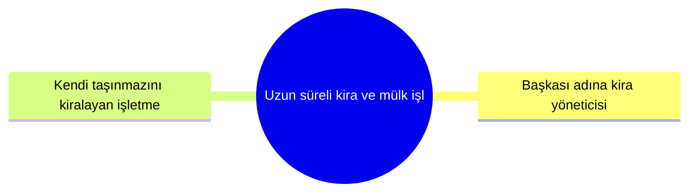

# 09-05 · Uzun süreli kira ve mülk işletmeciliği

> Sektör: [[09 Emlak & Gayrimenkul]] · 2 alt dal
> Görsel: [[Ağaç – 09 – Uzun süreli kira ve mülk işletmeciliği]]

## Özet
- Uzun süreli kira ve mülk işletmeciliği

## Alt dallar
| # | Alt dal | İşletme sayısı | Fonksiyon | Not |
|---|---|---|---|---|
| A1 | [[Başkası adına kira yöneticisi]] | İTO 68.32.02: 795 (ücretli yönetim kümesi; kırılım bulunamadı) | 43 | Öncelik 3.6 (A) |
| A2 | [[Kendi taşınmazını kiralayan işletme]] | İTO 68.20.02: 5.013 (İstanbul oda; TR geneli yok) | 43 | Öncelik 3.6 (A) |



## Bu daldaki alt dallar (canlı)
```base
filters:
  and:
    - 'tip == "isletme"'
    - file.hasLink(this.file)
views:
  - type: table
    name: Alt dallar
```
