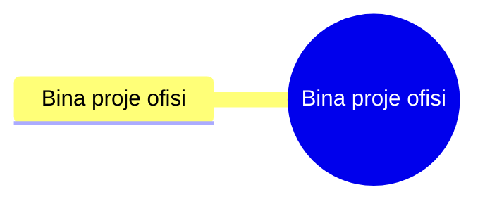

# 10-01 · Bina proje ofisi

> Sektör: [[10 İnşaat & Yapı]] · 1 alt dal
> Görsel: [[Ağaç – 10 – Bina proje ofisi]]

## Özet
- Bina proje ofisi

## Alt dallar
| # | Alt dal | İşletme sayısı | Fonksiyon | Not |
|---|---|---|---|---|
| A1 | [[Bina proje ofisi]] | bulunamadı | 43 | Öncelik 2.8 (C) |



## Bu daldaki alt dallar (canlı)
```base
filters:
  and:
    - 'tip == "isletme"'
    - file.hasLink(this.file)
views:
  - type: table
    name: Alt dallar
```
