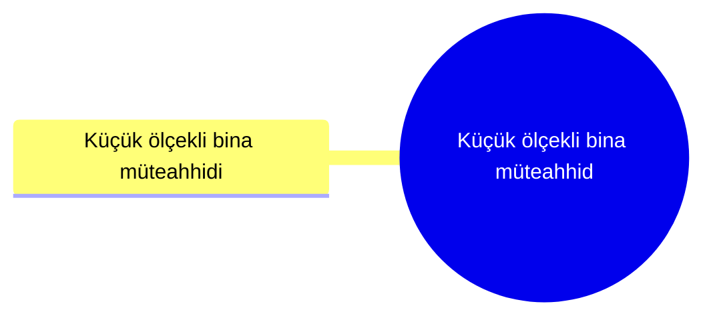

# 10-02 · Küçük ölçekli bina müteahhidi

> Sektör: [[10 İnşaat & Yapı]] · 1 alt dal
> Görsel: [[Ağaç – 10 – Küçük ölçekli bina müteahhidi]]

## Özet
- Küçük ölçekli bina müteahhidi

## Alt dallar
| # | Alt dal | İşletme sayısı | Fonksiyon | Not |
|---|---|---|---|---|
| A1 | [[Küçük ölçekli bina müteahhidi]] | KOSGEB inşaat KOBİ kümesi içinde; alt kırılım bulunamadı | 43 | Öncelik 3.8 (A) |



## Bu daldaki alt dallar (canlı)
```base
filters:
  and:
    - 'tip == "isletme"'
    - file.hasLink(this.file)
views:
  - type: table
    name: Alt dallar
```
