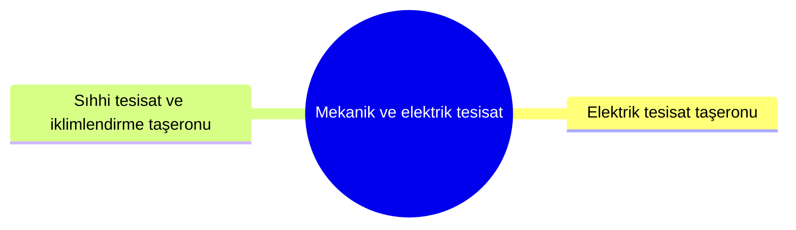

# 10-03 · Mekanik ve elektrik tesisat taşeronu

> Sektör: [[10 İnşaat & Yapı]] · 2 alt dal
> Görsel: [[Ağaç – 10 – Mekanik ve elektrik tesisat taşeronu]]

## Özet
- Mekanik ve elektrik tesisat taşeronu

## Alt dallar
| # | Alt dal | İşletme sayısı | Fonksiyon | Not |
|---|---|---|---|---|
| A1 | [[Elektrik tesisat taşeronu]] | bulunamadı | 43 | Öncelik 3.2 (B) |
| A2 | [[Sıhhi tesisat ve iklimlendirme taşeronu]] | bulunamadı | 43 | Öncelik 3.2 (B) |



## Bu daldaki alt dallar (canlı)
```base
filters:
  and:
    - 'tip == "isletme"'
    - file.hasLink(this.file)
views:
  - type: table
    name: Alt dallar
```
