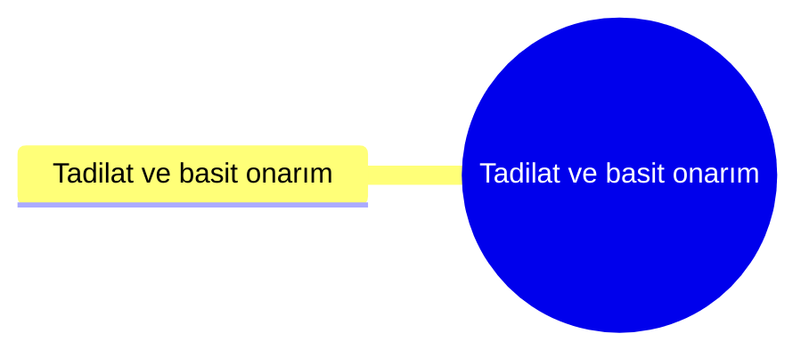

# 10-04 · Tadilat ve basit onarım

> Sektör: [[10 İnşaat & Yapı]] · 1 alt dal
> Görsel: [[Ağaç – 10 – Tadilat ve basit onarım]]

## Özet
- Tadilat ve basit onarım

## Alt dallar
| # | Alt dal | İşletme sayısı | Fonksiyon | Not |
|---|---|---|---|---|
| A1 | [[Tadilat ve basit onarım]] | bulunamadı | 43 | Öncelik 3.8 (A) |



## Bu daldaki alt dallar (canlı)
```base
filters:
  and:
    - 'tip == "isletme"'
    - file.hasLink(this.file)
views:
  - type: table
    name: Alt dallar
```
