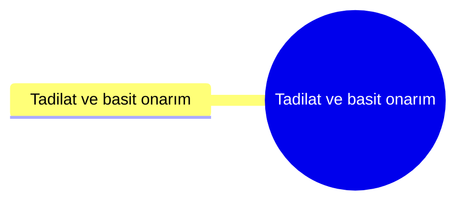

# 10-04 · Tadilat ve basit onarım

> Sektör: [[10 İnşaat & Yapı]] · 1 alt dal · 43 fonksiyon
> Görsel: [[Ağaç – 10 – Tadilat ve basit onarım]]

## Özet
- Tadilat ve basit onarım: onaylı alt işletme tür(ler)i ve bağlanan araç/fonksiyonlar.

## Alt dallar
| # | Alt dal | İşletme sayısı | Fonksiyon | Not |
|---|---|---|---|---|
| A1 | [[Tadilat ve basit onarım]] | bulunamadı | 43 | Öncelik 3.8 (A) |



## Dalın ortak temeli
- Çekirdek: [[Muhasebe ve Gelir-Gider]], [[e-Fatura ve e-Arşiv]], [[CRM]], [[Personel ve Vardiya]], [[Raporlar]], [[AI Asistan]], [[Ayarlar]]
- Sektör ortak araçlar + bu dalın alt tür araçları

## Fonksiyon matrisi
> ● = kullanıyor.

| Fonksiyon | A1 | Kullanım |
|---|---|---|
| [[Muhasebe ve Gelir-Gider]] | ● | 1/1 |
| [[e-Fatura ve e-Arşiv]] | ● | 1/1 |
| [[CRM]] | ● | 1/1 |
| [[Personel ve Vardiya]] | ● | 1/1 |
| [[Raporlar]] | ● | 1/1 |
| [[AI Asistan]] | ● | 1/1 |
| [[Ayarlar]] | ● | 1/1 |
| [[Proje Kartı]] | ● | 1/1 |
| [[Aktif şantiyeleri listele]] | ● | 1/1 |
| [[C blok projesini askıya al]] | ● | 1/1 |
| [[Saha Puantajı]] | ● | 1/1 |
| [[Bugün B blokta kaç kişi var?]] | ● | 1/1 |
| [[Elektrik ekibi puantajını özetle]] | ● | 1/1 |
| [[Metraj Hakediş]] | ● | 1/1 |
| [[Mart hakediş taslağını hazırla]] | ● | 1/1 |
| [[Kalıp m² farkını göster]] | ● | 1/1 |
| [[Şantiye Günlüğü]] | ● | 1/1 |
| [[Bugünkü günlük raporu hazırla]] | ● | 1/1 |
| [[Son 7 gün çalışılmayan günleri göster]] | ● | 1/1 |
| [[Malzeme Takibi]] | ● | 1/1 |
| [[Bugün gelen demiri kaydet]] | ● | 1/1 |
| [[Beton sarfiyatı metrajı aşıyor mu?]] | ● | 1/1 |
| [[İSG Kontrol]] | ● | 1/1 |
| [[Süresi dolan İSG belgelerini listele]] | ● | 1/1 |
| [[Ramak kala aç]] | ● | 1/1 |
| [[Taşeron Sözleşme]] | ● | 1/1 |
| [[Yeni sıva taşeron sözleşmesi oluştur]] | ● | 1/1 |
| [[Ek iş protokollerini göster]] | ● | 1/1 |
| [[Keşif Randevu]] | ● | 1/1 |
| [[Yarın keşif randevusu koy]] | ● | 1/1 |
| [[Bu hafta keşifleri listele]] | ● | 1/1 |
| [[Teklif Onay]] | ● | 1/1 |
| [[Banyo tadilat teklifi gönder]] | ● | 1/1 |
| [[Onaylanan teklifleri göster]] | ● | 1/1 |
| [[İş Takvimi]] | ● | 1/1 |
| [[Mutfak işini perşembeye al]] | ● | 1/1 |
| [[Çakışan işleri bul]] | ● | 1/1 |
| [[Önce Sonra]] | ● | 1/1 |
| [[Önce-sonra albümü oluştur]] | ● | 1/1 |
| [[Eksik foto mahalleri]] | ● | 1/1 |

## Bu daldaki alt dallar (canlı)
```base
filters:
  and:
    - 'tip == "isletme"'
    - file.hasLink(this.file)
views:
  - type: table
    name: Alt dallar
```
