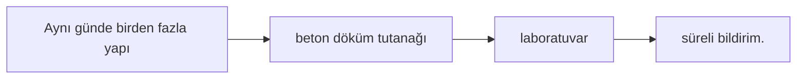

# 10-05-01 · Yapı denetim kuruluşu

> Sektör: [[10 İnşaat & Yapı]] · Öncelik: **2.4** / 5 · Öneri: **C**
> Puanlar tahmindir: pazar 2 · ödeme 3 · rekabet boşluğu 2 · kolaylık 2 · aciliyet 3

## 1. Özet
4708 kapsamında yalnızca denetim yapan, tutanak ve seviye tespiti yürüten kuruluş.

- **İşletme sayısı:** bulunamadı
- **NACE:** 71.12
- **Sayı türü:** tahmin

## 2. Günlük iş akışı
1. Aynı günde birden fazla yapı
2. beton döküm tutanağı
3. laboratuvar
4. süreli bildirim.

## 3. İhtiyaçlar ve sorunlar
| İhtiyaç | Bugün nasıl çözüyorlar | Etkisi |
|---|---|---|
| [[Proje / iş kartı]] | Excel / WhatsApp / portal (tahmin) | Zaman, hata, uyum riski |
| [[Puantaj / yoklama]] | Excel / WhatsApp / portal (tahmin) | Zaman, hata, uyum riski |
| [[Metraj ve hakediş]] | Excel / WhatsApp / portal (tahmin) | Zaman, hata, uyum riski |
| [[Malzeme / stok]] | Excel / WhatsApp / portal (tahmin) | Zaman, hata, uyum riski |
| [[e-Belge]] | Excel / WhatsApp / portal (tahmin) | Zaman, hata, uyum riski |
| [[Şantiye günlüğü]] | Excel / WhatsApp / portal (tahmin) | Zaman, hata, uyum riski |
| [[Ruhsat / evrak paketi]] | Excel / WhatsApp / portal (tahmin) | Zaman, hata, uyum riski |
| [[İSG checklist]] | Excel / WhatsApp / portal (tahmin) | Zaman, hata, uyum riski |

## 4. Parçalar

43 parça · 31 şart · 0 olmalı · 12 iyi olur

### Şart (31)

| Fonksiyon | Araç | Kullanım |
|---|---|---|
| [[Muhasebe ve Gelir-Gider]] | [[Muhasebe ve Gelir-Gider]] | Gelir, gider, cari, kasa ve banka. Sektör belgesi para kaydını buraya düşürür. |
| [[e-Fatura ve e-Arşiv]] | [[e-Fatura ve e-Arşiv]] | Satış belgesi taslağı; gönderim entegratör + onayla. |
| [[CRM]] | [[CRM]] | Kişi/firma kartı, iletişim, not; sektör alanları karta eklenir. |
| [[Personel ve Vardiya]] | [[Personel ve Vardiya]] | Personel kartı, vardiya, puantaj. Bordro/SGK kesilmez. |
| [[Raporlar]] | [[Raporlar]] | Ciro, tahsilat, açık iş ve personel özeti. |
| [[AI Asistan]] | [[AI Asistan]] | Komut çalıştırır, taslak üretir; yüksek etkili işlem onaysız bitmez. |
| [[Ayarlar]] | [[Ayarlar]] | İşletme, belge, bildirim ve entegrasyon ayarları. |
| [[Proje Kartı]] | [[Proje Kartı]] | Şantiye/iş kartı; CRM genişlemesi. |
| [[Aktif şantiyeleri listele]] | [[Proje Kartı]] | Aktif şantiyeleri listele — Şantiye/iş kartı; CRM genişlemesi. |
| [[C blok projesini askıya al]] | [[Proje Kartı]] | C blok projesini askıya al — Şantiye/iş kartı; CRM genişlemesi. |
| [[Saha Puantajı]] | [[Saha Puantajı]] | Firma-ekip-blok puantaj; Personel genişlemesi. Çekirdek genişleme: Personel & Vardiya. |
| [[Bugün B blokta kaç kişi var?]] | [[Saha Puantajı]] | Bugün B blokta kaç kişi var? — Firma-ekip-blok puantaj; Personel genişlemesi. Çekirdek genişleme: Personel & Vardiya. |
| [[Elektrik ekibi puantajını özetle]] | [[Saha Puantajı]] | Elektrik ekibi puantajını özetle — Firma-ekip-blok puantaj; Personel genişlemesi. Çekirdek genişleme: Personel & Vardiya. |
| [[Metraj Hakediş]] | [[Metraj Hakediş]] | Poz/metraj hakediş ve kesintiler; Muhasebe genişlemesi. |
| [[Mart hakediş taslağını hazırla]] | [[Metraj Hakediş]] | Mart hakediş taslağını hazırla — Poz/metraj hakediş ve kesintiler; Muhasebe genişlemesi. |
| [[Kalıp m² farkını göster]] | [[Metraj Hakediş]] | Kalıp m² farkını göster — Poz/metraj hakediş ve kesintiler; Muhasebe genişlemesi. |
| [[Şantiye Günlüğü]] | [[Şantiye Günlüğü]] | Operasyonel günlük; Şantiye-M hazırlık (otomatik API yok). |
| [[Bugünkü günlük raporu hazırla]] | [[Şantiye Günlüğü]] | Bugünkü günlük raporu hazırla — Operasyonel günlük; Şantiye-M hazırlık (otomatik API yok). |
| [[Son 7 gün çalışılmayan günleri göster]] | [[Şantiye Günlüğü]] | Son 7 gün çalışılmayan günleri göster — Operasyonel günlük; Şantiye-M hazırlık (otomatik API yok). |
| [[Malzeme Takibi]] | [[Malzeme Takibi]] | İrsaliye kabul ve şantiye sarfiyatı. Çekirdek genişleme: e-Fatura. |
| [[Bugün gelen demiri kaydet]] | [[Malzeme Takibi]] | Bugün gelen demiri kaydet — İrsaliye kabul ve şantiye sarfiyatı. Çekirdek genişleme: e-Fatura. |
| [[Beton sarfiyatı metrajı aşıyor mu?]] | [[Malzeme Takibi]] | Beton sarfiyatı metrajı aşıyor mu? — İrsaliye kabul ve şantiye sarfiyatı. Çekirdek genişleme: e-Fatura. |
| [[YİBF Takip]] | [[YİBF Takip]] | YİBF ve atama takibi. |
| [[Aktif YİBF listesi]] | [[YİBF Takip]] | Aktif YİBF listesi — YİBF ve atama takibi. |
| [[Şefi istifa eden işler]] | [[YİBF Takip]] | Şefi istifa eden işler — YİBF ve atama takibi. |
| [[Denetim Tutanak]] | [[Denetim Tutanak]] | Saha denetim ve uygunsuzluk. |
| [[Bugünkü denetim tutanağını yaz]] | [[Denetim Tutanak]] | Bugünkü denetim tutanağını yaz — Saha denetim ve uygunsuzluk. |
| [[Açık uygunsuzluklar]] | [[Denetim Tutanak]] | Açık uygunsuzluklar — Saha denetim ve uygunsuzluk. |
| [[Seviye Hakediş]] | [[Seviye Hakediş]] | Form-22 seviye hakedişi. |
| [[Seviye hakedişini hazırla]] | [[Seviye Hakediş]] | Seviye hakedişini hazırla — Form-22 seviye hakedişi. |
| [[Ödeme bekleyenler]] | [[Seviye Hakediş]] | Ödeme bekleyenler — Form-22 seviye hakedişi. |

### Olmalı (0)

_Yok._

### İyi olur (12)

| Fonksiyon | Araç | Kullanım |
|---|---|---|
| [[İSG Kontrol]] | [[İSG Kontrol]] | SGP, KKD, ramak kala, belge süresi. Çekirdek genişleme: Personel & Vardiya. |
| [[Süresi dolan İSG belgelerini listele]] | [[İSG Kontrol]] | Süresi dolan İSG belgelerini listele — SGP, KKD, ramak kala, belge süresi. Çekirdek genişleme: Personel & Vardiya. |
| [[Ramak kala aç]] | [[İSG Kontrol]] | Ramak kala aç — SGP, KKD, ramak kala, belge süresi. Çekirdek genişleme: Personel & Vardiya. |
| [[Taşeron Sözleşme]] | [[Taşeron Sözleşme]] | Kapsam, birim fiyat, ölçüm, teminat, ek iş. Çekirdek genişleme: CRM. |
| [[Yeni sıva taşeron sözleşmesi oluştur]] | [[Taşeron Sözleşme]] | Yeni sıva taşeron sözleşmesi oluştur — Kapsam, birim fiyat, ölçüm, teminat, ek iş. Çekirdek genişleme: CRM. |
| [[Ek iş protokollerini göster]] | [[Taşeron Sözleşme]] | Ek iş protokollerini göster — Kapsam, birim fiyat, ölçüm, teminat, ek iş. Çekirdek genişleme: CRM. |
| [[Laboratuvar Numune]] | [[Laboratuvar Numune]] | Numune ve sonuç. |
| [[Beton numune sonuçlarını getir]] | [[Laboratuvar Numune]] | Beton numune sonuçlarını getir — Numune ve sonuç. |
| [[Ret edilen numuneler]] | [[Laboratuvar Numune]] | Ret edilen numuneler — Numune ve sonuç. |
| [[UYDS Hazırlık]] | [[UYDS Hazırlık]] | Resmî giriş için veri paketleme; API iddiasız. |
| [[Aylık seviye paketini hazırla]] | [[UYDS Hazırlık]] | Aylık seviye paketini hazırla — Resmî giriş için veri paketleme; API iddiasız. |
| [[Eksik UYDS alanları]] | [[UYDS Hazırlık]] | Eksik UYDS alanları — Resmî giriş için veri paketleme; API iddiasız. |

## 5. Teknik detay
- **Entegrasyonlar:** Modül kartlarındaki entegrasyon notlarına bak; açık API yoksa panel kaydı + kullanıcı girişi.
- **Ana ekranlar:** İş listesi / kart · Takvim veya pipeline · Tahsilat · Rapor
- **Veri yapısı:** `Cari → İşKaydı → Belge/Tahsilat → Hatırlatma (onay kuyruğu)`

## 6. Rakipler
- [[SantiyePro]]
- [[Hakedra]]
- [[ESSantiye]]
- [[Mikro]]

## 7. Kaynaklar
- [[10 İnşaat & Yapı – Kaynaklar]]
- Araştırma arşivi: `08 Arşiv/eski-docs-sektorel-arastirma/`
