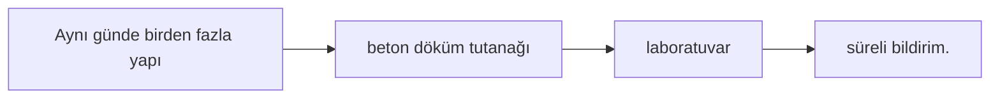

# 10-07-01 · Yapı denetim kuruluşu

> Sektör: [[10 İnşaat & Yapı]] · Öncelik: **2.4** / 5 · Öneri: **C**
> Puanlar tahmindir: pazar 2 · ödeme 3 · rekabet boşluğu 2 · kolaylık 2 · aciliyet 3

## 1. Özet
4708 kapsamında yalnızca denetim yapan, tutanak ve seviye tespiti yürüten kuruluş.

- **İşletme sayısı:** bulunamadı
- **NACE:** 71.12

## 2. Günlük iş akışı
1. Aynı günde birden fazla yapı
2. beton döküm tutanağı
3. laboratuvar
4. süreli bildirim.

AI destek (onaylı): Saha notundan tutanak taslağı üretir ve bildirim sürelerini onay kuyruğuna düşürür.

## 3. İhtiyaçlar ve sorunlar
| İhtiyaç | Bugün nasıl çözüyorlar | Etkisi |
|---|---|---|
| [[Proje Kartı]] | Excel / WhatsApp / portal (tahmin) | Zaman kaybı, hata riski |
| [[Saha Puantajı]] | Excel / WhatsApp / portal (tahmin) | Zaman kaybı, hata riski |
| [[Metraj Hakediş]] | Excel / WhatsApp / portal (tahmin) | Zaman kaybı, hata riski |
| [[YİBF Takip]] | Excel / WhatsApp / portal (tahmin) | Zaman kaybı, hata riski |
| [[Denetim Tutanak]] | Excel / WhatsApp / portal (tahmin) | Zaman kaybı, hata riski |
| [[Seviye Hakediş]] | Excel / WhatsApp / portal (tahmin) | Zaman kaybı, hata riski |
| [[Laboratuvar Numune]] | Excel / WhatsApp / portal (tahmin) | Zaman kaybı, hata riski |
| [[UYDS Hazırlık]] | Excel / WhatsApp / portal (tahmin) | Zaman kaybı, hata riski |

## 4. Çözümümüz: modüller ve özellikler
**Araç tarifi:** [[Muhasebe ve Gelir-Gider]] + [[e-Fatura ve e-Arşiv]] + [[CRM]] + [[Personel ve Vardiya]] + [[Raporlar]] + [[AI Asistan]] + [[Ayarlar]] + [[Proje Kartı]] + [[Saha Puantajı]] + [[Metraj Hakediş]] + [[Şantiye Günlüğü]] + [[Malzeme Takibi]] + [[İSG Kontrol]] + [[Taşeron Sözleşme]]…

### Fonksiyonlar
- [[Aktif YİBF listesi]]
- [[Şefi istifa eden işler]]
- [[Bugünkü denetim tutanağını yaz]]
- [[Açık uygunsuzluklar]]
- [[Seviye hakedişini hazırla]]
- [[Ödeme bekleyenler]]
- [[Beton numune sonuçlarını getir]]
- [[Ret edilen numuneler]]
- [[Aylık seviye paketini hazırla]]
- [[Eksik UYDS alanları]]

### MVP
- [[Proje Kartı]]
- [[Saha Puantajı]]
- [[Metraj Hakediş]]
- [[Şantiye Günlüğü]]
- [[Malzeme Takibi]]
- [[YİBF Takip]]
- [[Denetim Tutanak]]
- [[Seviye Hakediş]]

### Sonraki sürüm
- [[İSG Kontrol]]
- [[Taşeron Sözleşme]]
- [[Laboratuvar Numune]]
- [[UYDS Hazırlık]]

## 5. Teknik detay
- **Entegrasyonlar:** GİB e-İrsaliye, Laboratuvar kaydı, Mobil yoklama, UYDS, e-Fatura, İSG-KATİP ekranı, ŞANTİYE-M
- **Ana ekranlar:** Kart / iş listesi · Takvim veya pipeline · Tahsilat · Rapor
- **Veri yapısı:** `Cari → İşKaydı → Belge/Tahsilat → Hatırlatma (onay kuyruğu)`

## 6. Fiyat ve paket önerisi
| Paket | İçerik | Fiyat | Not |
|---|---|---|---|
| Başlangıç | Çekirdek + MVP araçlar | bulunamadı | tahmin |
| Plus | V2 araçlar | bulunamadı | tahmin |

Uygun iş modeli: Abonelik (taahhütsüz aylık; yıllık indirim) — tahmin

## 7. Satış argümanı
- **Değer önerisi (tek cümle):** Yapı denetim kuruluşu gününü tek panelde toplar; resmi gönderim ve tahsilat onayda kalır.
- **3 ana mesaj:**
  1. Dağınık Excel/WhatsApp yerine tek iş kaydı
  2. e-Belge ve hatırlatmalar onay kuyruğunda
  3. Sektöre özel alanlar, ortak çekirdek üzerinde
- **İtirazlar ve cevaplar:**

| İtiraz | Cevap |
|---|---|
| Zaten Excel var | Süre/uyum hatırlatması ve belge taslağı Excel’de dağılır |
| Resmi API yok | Panel kaydı + kurum portalı; uydurma entegrasyon yok |
| Pahalı | Taahhütsüz paket; yalnız kullanılan araçlar (tahmin) |

## 8. Rakipler
- [[SantiyePro]]
- [[Hakedra]]
- [[ESSantiye]]
- [[Mikro]]

## 9. Kaynaklar
- [[10 İnşaat & Yapı – Kaynaklar]]
- Arşiv: `08 Arşiv/eski-docs-sektorel-arastirma/ai-kaynak/10-insaat-yapi.md`
