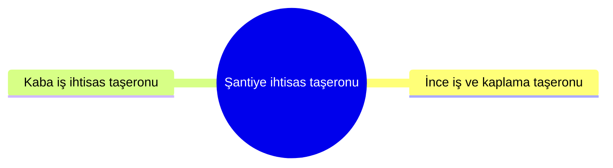

# 10-07 · Şantiye ihtisas taşeronu

> Sektör: [[10 İnşaat & Yapı]] · 2 alt dal
> Görsel: [[Ağaç – 10 – Şantiye ihtisas taşeronu]]

## Özet
- Şantiye ihtisas taşeronu

## Alt dallar
| # | Alt dal | İşletme sayısı | Fonksiyon | Not |
|---|---|---|---|---|
| A1 | [[İnce iş ve kaplama taşeronu]] | bulunamadı | 43 | Öncelik 3.4 (B) |
| A2 | [[Kaba iş ihtisas taşeronu]] | bulunamadı | 43 | Öncelik 3.6 (A) |



## Bu daldaki alt dallar (canlı)
```base
filters:
  and:
    - 'tip == "isletme"'
    - file.hasLink(this.file)
views:
  - type: table
    name: Alt dallar
```
