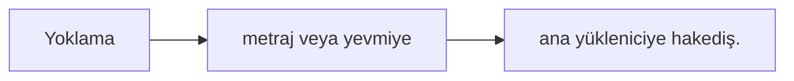

# 10-02-01 · Şantiye ihtisas taşeronu

> Sektör: [[10 İnşaat & Yapı]] · Öncelik: **3.6** / 5 · Öneri: **A**
> Puanlar tahmindir: pazar 4 · ödeme 3 · rekabet boşluğu 3 · kolaylık 4 · aciliyet 4

## 1. Özet
Başka müteahhidin şantiyesinde duvar, kalıp, sıva, boya, kaplama, çatı veya yalıtım yapan ekip.

- **İşletme sayısı:** bulunamadı
- **NACE:** 43

## 2. Günlük iş akışı
1. Yoklama
2. metraj veya yevmiye
3. ana yükleniciye hakediş.

AI destek (onaylı): Günlük yoklama ve ölçülen imalattan birim fiyatlı hakediş kalemini doldurur.

## 3. İhtiyaçlar ve sorunlar
| İhtiyaç | Bugün nasıl çözüyorlar | Etkisi |
|---|---|---|
| [[Proje Kartı]] | Excel / WhatsApp / portal (tahmin) | Zaman kaybı, hata riski |
| [[Saha Puantajı]] | Excel / WhatsApp / portal (tahmin) | Zaman kaybı, hata riski |
| [[Metraj Hakediş]] | Excel / WhatsApp / portal (tahmin) | Zaman kaybı, hata riski |
| [[İş Emri]] | Excel / WhatsApp / portal (tahmin) | Zaman kaybı, hata riski |
| [[Yevmiye Hakediş]] | Excel / WhatsApp / portal (tahmin) | Zaman kaybı, hata riski |
| [[Ekip Dağılımı]] | Excel / WhatsApp / portal (tahmin) | Zaman kaybı, hata riski |
| [[Ek İş Kaydı]] | Excel / WhatsApp / portal (tahmin) | Zaman kaybı, hata riski |
| [[Fotoğraf Delil]] | Excel / WhatsApp / portal (tahmin) | Zaman kaybı, hata riski |

## 4. Çözümümüz: modüller ve özellikler
**Araç tarifi:** [[Muhasebe ve Gelir-Gider]] + [[e-Fatura ve e-Arşiv]] + [[CRM]] + [[Personel ve Vardiya]] + [[Raporlar]] + [[AI Asistan]] + [[Ayarlar]] + [[Proje Kartı]] + [[Saha Puantajı]] + [[Metraj Hakediş]] + [[Şantiye Günlüğü]] + [[Malzeme Takibi]] + [[İSG Kontrol]] + [[Taşeron Sözleşme]]…

### Fonksiyonlar
- [[Bugünkü iş emirlerini aç]]
- [[C blok sıva emrini tamamla]]
- [[Bu ay hakedişimi hazırla]]
- [[Kesinti sonrası neti hesapla]]
- [[Yarın 4 ustayı D şantiyesine kaydır]]
- [[Boşta kalan ekibi bul]]
- [[Ek iş kaydı aç]]
- [[Onaysız ek işleri listele]]
- [[Bugünkü imalat fotoğraflarını ekle]]
- [[Fotosuz metraj kalemleri]]

### MVP
- [[Proje Kartı]]
- [[Saha Puantajı]]
- [[Metraj Hakediş]]
- [[Şantiye Günlüğü]]
- [[Malzeme Takibi]]
- [[İş Emri]]
- [[Yevmiye Hakediş]]
- [[Ekip Dağılımı]]

### Sonraki sürüm
- [[İSG Kontrol]]
- [[Taşeron Sözleşme]]
- [[Ek İş Kaydı]]
- [[Fotoğraf Delil]]

## 5. Teknik detay
- **Entegrasyonlar:** GİB e-İrsaliye, Mobil yoklama, Panel kaydı, e-Fatura, İSG-KATİP ekranı, ŞANTİYE-M
- **Ana ekranlar:** Kart / iş listesi · Takvim veya pipeline · Tahsilat · Rapor
- **Veri yapısı:** `Cari → İşKaydı → Belge/Tahsilat → Hatırlatma (onay kuyruğu)`

## 6. Fiyat ve paket önerisi
| Paket | İçerik | Fiyat | Not |
|---|---|---|---|
| Başlangıç | Çekirdek + MVP araçlar | bulunamadı | tahmin |
| Plus | V2 araçlar | bulunamadı | tahmin |

Uygun iş modeli: Abonelik (taahhütsüz aylık; yıllık indirim) — tahmin

## 7. Satış argümanı
- **Değer önerisi (tek cümle):** Şantiye ihtisas taşeronu gününü tek panelde toplar; resmi gönderim ve tahsilat onayda kalır.
- **3 ana mesaj:**
  1. Dağınık Excel/WhatsApp yerine tek iş kaydı
  2. e-Belge ve hatırlatmalar onay kuyruğunda
  3. Sektöre özel alanlar, ortak çekirdek üzerinde
- **İtirazlar ve cevaplar:**

| İtiraz | Cevap |
|---|---|
| Zaten Excel var | Süre/uyum hatırlatması ve belge taslağı Excel’de dağılır |
| Resmi API yok | Panel kaydı + kurum portalı; uydurma entegrasyon yok |
| Pahalı | Taahhütsüz paket; yalnız kullanılan araçlar (tahmin) |

## 8. Rakipler
- [[SantiyePro]]
- [[Hakedra]]
- [[ESSantiye]]
- [[Mikro]]

## 9. Kaynaklar
- [[10 İnşaat & Yapı – Kaynaklar]]
- Arşiv: `08 Arşiv/eski-docs-sektorel-arastirma/ai-kaynak/10-insaat-yapi.md`
