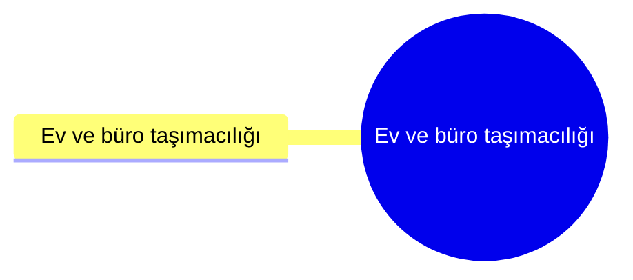

# 12-02 · Ev ve büro taşımacılığı

> Sektör: [[12 Lojistik & Taşımacılık]] · 1 alt dal · 41 fonksiyon
> Görsel: [[Ağaç – 12 – Ev ve büro taşımacılığı]]

## Özet
- Ev ve büro taşımacılığı: onaylı alt işletme tür(ler)i ve bağlanan araç/fonksiyonlar.

## Alt dallar
| # | Alt dal | İşletme sayısı | Fonksiyon | Not |
|---|---|---|---|---|
| A1 | [[Ev ve büro taşımacılığı]] | bulunamadı | 41 | Öncelik 3.8 (A) |



## Dalın ortak temeli
- Çekirdek: [[Muhasebe ve Gelir-Gider]], [[e-Fatura ve e-Arşiv]], [[CRM]], [[Personel ve Vardiya]], [[Raporlar]], [[AI Asistan]], [[Ayarlar]]
- Sektör ortak araçlar + bu dalın alt tür araçları

## Fonksiyon matrisi
> ● = kullanıyor.

| Fonksiyon | A1 | Kullanım |
|---|---|---|
| [[Muhasebe ve Gelir-Gider]] | ● | 1/1 |
| [[e-Fatura ve e-Arşiv]] | ● | 1/1 |
| [[CRM]] | ● | 1/1 |
| [[Personel ve Vardiya]] | ● | 1/1 |
| [[Raporlar]] | ● | 1/1 |
| [[AI Asistan]] | ● | 1/1 |
| [[Ayarlar]] | ● | 1/1 |
| [[Sevkiyat Kartı]] | ● | 1/1 |
| [[Bugün yüklenen 3 sevkiyatı listele]] | ● | 1/1 |
| [[ABC Ltd sevkiyatını yolda yap]] | ● | 1/1 |
| [[Navlun Teklifi]] | ● | 1/1 |
| [[İstanbul Ankara 12 ton navlun taslağı çıkar]] | ● | 1/1 |
| [[Geçen ayki ABC fiyatını bu işe kopyala]] | ● | 1/1 |
| [[U-ETDS Köprüsü]] | ● | 1/1 |
| [[34 ABC 123 seferini U-ETDS için hazırla]] | ● | 1/1 |
| [[Bugün bildirilmemiş seferleri göster]] | ● | 1/1 |
| [[Teslim Kanıtı]] | ● | 1/1 |
| [[Sevkiyat 34-882 teslim kanıtını aç]] | ● | 1/1 |
| [[Dün reddedilen teslimleri listele]] | ● | 1/1 |
| [[Araç Şoför]] | ● | 1/1 |
| [[SRC si 30 günde bitecek şoförleri göster]] | ● | 1/1 |
| [[34 XYZ 45 plakasını Mehmet e ata]] | ● | 1/1 |
| [[Hasar Dosyası]] | ● | 1/1 |
| [[Sevkiyat 441 için hasar dosyası aç]] | ● | 1/1 |
| [[Açık hasar dosyalarını özetle]] | ● | 1/1 |
| [[Araç Takip]] | ● | 1/1 |
| [[34 ABC 123 son bilinen konum]] | ● | 1/1 |
| [[ETA sı geciken araçları göster]] | ● | 1/1 |
| [[Keşif Randevu (Lojistik)]] | ● | 1/1 |
| [[Cumartesi keşiflerini listele]] | ● | 1/1 |
| [[Bu keşfi tamamlandı yap]] | ● | 1/1 |
| [[Eşya Envanter]] | ● | 1/1 |
| [[Salon envanterine piyano ekle]] | ● | 1/1 |
| [[Fotoğrafı eksik odaları göster]] | ● | 1/1 |
| [[Ekip Atama]] | ● | 1/1 |
| [[15 Mayıs taşınmasına 3 kişi ata]] | ● | 1/1 |
| [[Paketleme malzemesi eksiği var mı]] | ● | 1/1 |
| [[K3 C3 Belge]] | ● | 1/1 |
| [[Bu iş için K3 mü C3 mü gerekir]] | ● | 1/1 |
| [[Sigorta Teklif]] | ● | 1/1 |

## Bu daldaki alt dallar (canlı)
```base
filters:
  and:
    - 'tip == "isletme"'
    - file.hasLink(this.file)
views:
  - type: table
    name: Alt dallar
```
