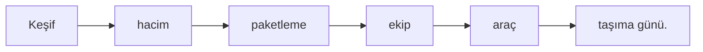

# 12-05-01 · Ev ve büro taşımacılığı

> Sektör: [[12 Lojistik & Taşımacılık]] · Öncelik: **3.8** / 5 · Öneri: **A**
> Puanlar tahmindir: pazar 4 · ödeme 4 · rekabet boşluğu 3 · kolaylık 4 · aciliyet 4

## 1. Özet
Ev veya büronun ticari taşınması; yurt içi K3, uluslararası kapsam C3.

- **İşletme sayısı:** bulunamadı
- **NACE:** 49.42

## 2. Günlük iş akışı
1. Keşif
2. hacim
3. paketleme
4. ekip
5. araç
6. taşıma günü.

AI destek (onaylı): Keşif notundan hacim, ekip süresi ve teklif taslağı üretir; fiyat onaya kalır.

## 3. İhtiyaçlar ve sorunlar
| İhtiyaç | Bugün nasıl çözüyorlar | Etkisi |
|---|---|---|
| [[Sevkiyat Kartı]] | Excel / WhatsApp / portal (tahmin) | Zaman kaybı, hata riski |
| [[Navlun Teklifi]] | Excel / WhatsApp / portal (tahmin) | Zaman kaybı, hata riski |
| [[U-ETDS Köprüsü]] | Excel / WhatsApp / portal (tahmin) | Zaman kaybı, hata riski |
| [[Keşif Randevu (Lojistik)]] | Excel / WhatsApp / portal (tahmin) | Zaman kaybı, hata riski |
| [[Eşya Envanter]] | Excel / WhatsApp / portal (tahmin) | Zaman kaybı, hata riski |
| [[Ekip Atama]] | Excel / WhatsApp / portal (tahmin) | Zaman kaybı, hata riski |
| [[K3 C3 Belge]] | Excel / WhatsApp / portal (tahmin) | Zaman kaybı, hata riski |
| [[Sigorta Teklif]] | Excel / WhatsApp / portal (tahmin) | Zaman kaybı, hata riski |

## 4. Çözümümüz: modüller ve özellikler
**Araç tarifi:** [[Muhasebe ve Gelir-Gider]] + [[e-Fatura ve e-Arşiv]] + [[CRM]] + [[Personel ve Vardiya]] + [[Raporlar]] + [[AI Asistan]] + [[Ayarlar]] + [[Sevkiyat Kartı]] + [[Navlun Teklifi]] + [[U-ETDS Köprüsü]] + [[Teslim Kanıtı]] + [[Araç Şoför]] + [[Hasar Dosyası]] + [[Araç Takip]]…

### Fonksiyonlar
- [[Cumartesi keşiflerini listele]]
- [[Bu keşfi tamamlandı yap]]
- [[Salon envanterine piyano ekle]]
- [[Fotoğrafı eksik odaları göster]]
- [[15 Mayıs taşınmasına 3 kişi ata]]
- [[Paketleme malzemesi eksiği var mı]]
- [[Bu iş için K3 mü C3 mü gerekir]]
- [[Bu taşınma için sigorta tutarı öner]]

### MVP
- [[Sevkiyat Kartı]]
- [[Navlun Teklifi]]
- [[U-ETDS Köprüsü]]
- [[Teslim Kanıtı]]
- [[Araç Şoför]]
- [[Keşif Randevu (Lojistik)]]
- [[Eşya Envanter]]
- [[Ekip Atama]]

### Sonraki sürüm
- [[Hasar Dosyası]]
- [[Araç Takip]]
- [[K3 C3 Belge]]
- [[Sigorta Teklif]]

## 5. Teknik detay
- **Entegrasyonlar:** Elle veya CSV konum, Sigorta kaydı, U-ETDS eşya SOAP WSDL (servis.turkiye.gov.tr .../uetdsesya)
- **Ana ekranlar:** Kart / iş listesi · Takvim veya pipeline · Tahsilat · Rapor
- **Veri yapısı:** `Cari → İşKaydı → Belge/Tahsilat → Hatırlatma (onay kuyruğu)`

## 6. Fiyat ve paket önerisi
| Paket | İçerik | Fiyat | Not |
|---|---|---|---|
| Başlangıç | Çekirdek + MVP araçlar | bulunamadı | tahmin |
| Plus | V2 araçlar | bulunamadı | tahmin |

Uygun iş modeli: Abonelik (taahhütsüz aylık; yıllık indirim) — tahmin

## 7. Satış argümanı
- **Değer önerisi (tek cümle):** Ev ve büro taşımacılığı gününü tek panelde toplar; resmi gönderim ve tahsilat onayda kalır.
- **3 ana mesaj:**
  1. Dağınık Excel/WhatsApp yerine tek iş kaydı
  2. e-Belge ve hatırlatmalar onay kuyruğunda
  3. Sektöre özel alanlar, ortak çekirdek üzerinde
- **İtirazlar ve cevaplar:**

| İtiraz | Cevap |
|---|---|
| Zaten Excel var | Süre/uyum hatırlatması ve belge taslağı Excel’de dağılır |
| Resmi API yok | Panel kaydı + kurum portalı; uydurma entegrasyon yok |
| Pahalı | Taahhütsüz paket; yalnız kullanılan araçlar (tahmin) |

## 8. Rakipler
- [[U-ETDS]]
- [[Filo / TMS paketleri]]

## 9. Kaynaklar
- [[12 Lojistik & Taşımacılık – Kaynaklar]]
- Arşiv: `08 Arşiv/eski-docs-sektorel-arastirma/ai-kaynak/12-lojistik-tasimacilik.md`
