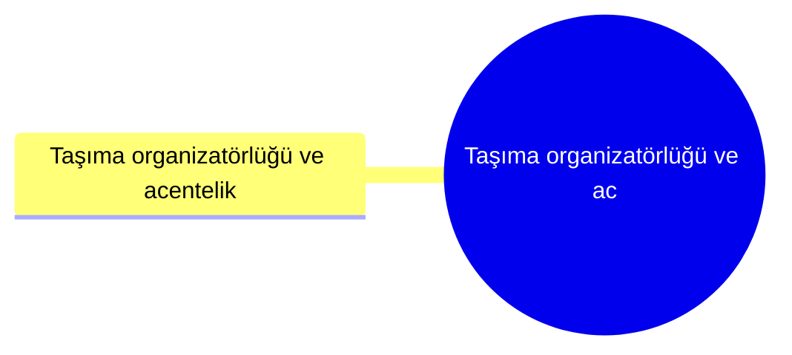

# 12-04 · Taşıma organizatörlüğü ve acentelik

> Sektör: [[12 Lojistik & Taşımacılık]] · 1 alt dal
> Görsel: [[Ağaç – 12 – Taşıma organizatörlüğü ve acentelik]]

## Özet
- Taşıma organizatörlüğü ve acentelik

## Alt dallar
| # | Alt dal | İşletme sayısı | Fonksiyon | Not |
|---|---|---|---|---|
| A1 | [[Taşıma organizatörlüğü ve acentelik]] | bulunamadı | 41 | Öncelik 2.8 (C) |



## Bu daldaki alt dallar (canlı)
```base
filters:
  and:
    - 'tip == "isletme"'
    - file.hasLink(this.file)
views:
  - type: table
    name: Alt dallar
```
