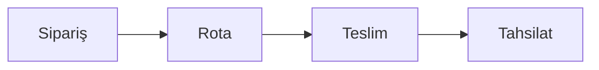

# 12-07-01 · Aynı gün kurye

> Sektör: [[12 Lojistik & Taşımacılık]] · Öncelik: **3.8** / 5 · Öneri: **A**
> Puanlar tahmindir: pazar 4 · ödeme 4 · rekabet boşluğu 3 · kolaylık 4 · aciliyet 4

## 1. Özet
Tasnifsiz şehir içi aynı gün teslimat; rota ve alıcı bildirimi.

- **İşletme sayısı:** bulunamadı
- **NACE:** 53.20
- **Sayı türü:** tahmin

## 2. Günlük iş akışı
1. Sipariş
2. Rota
3. Teslim
4. Tahsilat

## 3. İhtiyaçlar ve sorunlar
| İhtiyaç | Bugün nasıl çözüyorlar | Etkisi |
|---|---|---|
| [[Sevkiyat kartı]] | Excel / WhatsApp / portal (tahmin) | Zaman, hata, uyum riski |
| [[Navlun teklifi]] | Excel / WhatsApp / portal (tahmin) | Zaman, hata, uyum riski |
| [[Araç / şoför]] | Excel / WhatsApp / portal (tahmin) | Zaman, hata, uyum riski |
| [[Teslim kanıtı]] | Excel / WhatsApp / portal (tahmin) | Zaman, hata, uyum riski |
| [[e-Belge]] | Excel / WhatsApp / portal (tahmin) | Zaman, hata, uyum riski |
| [[U-ETDS köprüsü]] | Excel / WhatsApp / portal (tahmin) | Zaman, hata, uyum riski |
| [[Belge / yetki takibi]] | Excel / WhatsApp / portal (tahmin) | Zaman, hata, uyum riski |
| [[Kurye / durak rotası]] | Excel / WhatsApp / portal (tahmin) | Zaman, hata, uyum riski |

## 4. Parçalar

41 parça · 25 şart · 6 olmalı · 10 iyi olur

### Şart (25)

| Fonksiyon | Araç | Kullanım |
|---|---|---|
| [[Muhasebe ve Gelir-Gider]] | [[Muhasebe ve Gelir-Gider]] | Gelir, gider, cari, kasa ve banka. Sektör belgesi para kaydını buraya düşürür. |
| [[e-Fatura ve e-Arşiv]] | [[e-Fatura ve e-Arşiv]] | Satış belgesi taslağı; gönderim entegratör + onayla. |
| [[CRM]] | [[CRM]] | Kişi/firma kartı, iletişim, not; sektör alanları karta eklenir. |
| [[Personel ve Vardiya]] | [[Personel ve Vardiya]] | Personel kartı, vardiya, puantaj. Bordro/SGK kesilmez. |
| [[Raporlar]] | [[Raporlar]] | Ciro, tahsilat, açık iş ve personel özeti. |
| [[AI Asistan]] | [[AI Asistan]] | Komut çalıştırır, taslak üretir; yüksek etkili işlem onaysız bitmez. |
| [[Ayarlar]] | [[Ayarlar]] | İşletme, belge, bildirim ve entegrasyon ayarları. |
| [[Sevkiyat Kartı]] | [[Sevkiyat Kartı]] | Yük/sevkiyat yaşam döngüsü: talep, yükleme, yolda, teslim; gönderici/alıcı, tonaj ve adres tek kartta. |
| [[Bugün yüklenen 3 sevkiyatı listele]] | [[Sevkiyat Kartı]] | Bugün yüklenen 3 sevkiyatı listele — Yük/sevkiyat yaşam döngüsü: talep, yükleme, yolda, teslim; gönderici/alıcı, tonaj ve adres tek kartta. |
| [[ABC Ltd sevkiyatını yolda yap]] | [[Sevkiyat Kartı]] | ABC Ltd sevkiyatını yolda yap — Yük/sevkiyat yaşam döngüsü: talep, yükleme, yolda, teslim; gönderici/alıcı, tonaj ve adres tek kartta. |
| [[Navlun Teklifi]] | [[Navlun Teklifi]] | Tonaj, güzergâh ve bekleme ile navlun taslağı; müşteriye göndermeden önce insan onayı. |
| [[İstanbul Ankara 12 ton navlun taslağı çıkar]] | [[Navlun Teklifi]] | İstanbul Ankara 12 ton navlun taslağı çıkar — Tonaj, güzergâh ve bekleme ile navlun taslağı; müşteriye göndermeden önce insan onayı. |
| [[Geçen ayki ABC fiyatını bu işe kopyala]] | [[Navlun Teklifi]] | Geçen ayki ABC fiyatını bu işe kopyala — Tonaj, güzergâh ve bekleme ile navlun taslağı; müşteriye göndermeden önce insan onayı. |
| [[Teslim Kanıtı]] | [[Teslim Kanıtı]] | Alıcı imza/foto/red ve hasar notu; faturalama için çekirdek e-Fatura sürecine veri bırakır. |
| [[Sevkiyat 34-882 teslim kanıtını aç]] | [[Teslim Kanıtı]] | Sevkiyat 34-882 teslim kanıtını aç — Alıcı imza/foto/red ve hasar notu; faturalama için çekirdek e-Fatura sürecine veri bırakır. |
| [[Dün reddedilen teslimleri listele]] | [[Teslim Kanıtı]] | Dün reddedilen teslimleri listele — Alıcı imza/foto/red ve hasar notu; faturalama için çekirdek e-Fatura sürecine veri bırakır. |
| [[Durak Rotası]] | [[Durak Rotası]] | Çok duraklı teslim sırası; kurye gönderisi boyutu notu. |
| [[Bugünkü 18 durağı sırala]] | [[Durak Rotası]] | Bugünkü 18 durağı sırala — Çok duraklı teslim sırası; kurye gönderisi boyutu notu. |
| [[Öğleden sonra rotayı yeniden kur]] | [[Durak Rotası]] | Öğleden sonra rotayı yeniden kur — Çok duraklı teslim sırası; kurye gönderisi boyutu notu. |
| [[Kurye Atama]] | [[Kurye Atama]] | Bölge ve kapasiteye göre kurye/araç ataması. Personel çekirdeği genişlemesi. |
| [[Kadıköy bölgesine 2 kurye ata]] | [[Kurye Atama]] | Kadıköy bölgesine 2 kurye ata — Bölge ve kapasiteye göre kurye/araç ataması. Personel çekirdeği genişlemesi. |
| [[En az yüklü kuryeyi öner]] | [[Kurye Atama]] | En az yüklü kuryeyi öner — Bölge ve kapasiteye göre kurye/araç ataması. Personel çekirdeği genişlemesi. |
| [[Canlı Teslim]] | [[Canlı Teslim]] | Teslim kodu/link, red ve iade akışı. |
| [[8841 için teslim kodu gönder]] | [[Canlı Teslim]] | 8841 için teslim kodu gönder — Teslim kodu/link, red ve iade akışı. |
| [[Bugünkü iade kuyruğunu aç]] | [[Canlı Teslim]] | Bugünkü iade kuyruğunu aç — Teslim kodu/link, red ve iade akışı. |

### Olmalı (6)

| Fonksiyon | Araç | Kullanım |
|---|---|---|
| [[U-ETDS Köprüsü]] | [[U-ETDS Köprüsü]] | Sefer, yük, şoför bildirimi için SOAP alanlarını doldurur; gönderim onaylıdır. K1/K3/C3/L1/L2/N1/N2 (TM’de C1/K2) için. |
| [[34 ABC 123 seferini U-ETDS için hazırla]] | [[U-ETDS Köprüsü]] | 34 ABC 123 seferini U-ETDS için hazırla — Sefer, yük, şoför bildirimi için SOAP alanlarını doldurur; gönderim onaylıdır. K1/K3/C3/L1/L2/N1/N2 (TM’de C1/K2) için. |
| [[Bugün bildirilmemiş seferleri göster]] | [[U-ETDS Köprüsü]] | Bugün bildirilmemiş seferleri göster — Sefer, yük, şoför bildirimi için SOAP alanlarını doldurur; gönderim onaylıdır. K1/K3/C3/L1/L2/N1/N2 (TM’de C1/K2) için. |
| [[Araç Şoför]] | [[Araç Şoför]] | Plaka, taşıt kartı, SRC/psikoteknik bitiş ve şoför-araç eşlemesi. Personel çekirdeğinin filo genişlemesi. |
| [[SRC si 30 günde bitecek şoförleri göster]] | [[Araç Şoför]] | SRC si 30 günde bitecek şoförleri göster — Plaka, taşıt kartı, SRC/psikoteknik bitiş ve şoför-araç eşlemesi. Personel çekirdeğinin filo genişlemesi. |
| [[34 XYZ 45 plakasını Mehmet e ata]] | [[Araç Şoför]] | 34 XYZ 45 plakasını Mehmet e ata — Plaka, taşıt kartı, SRC/psikoteknik bitiş ve şoför-araç eşlemesi. Personel çekirdeğinin filo genişlemesi. |

### İyi olur (10)

| Fonksiyon | Araç | Kullanım |
|---|---|---|
| [[Hasar Dosyası]] | [[Hasar Dosyası]] | Hasar/kayıp dosyası, tutanak ve sigorta iletim checklisti; tazminat ödemesi AI onayı olmadan yok. |
| [[Sevkiyat 441 için hasar dosyası aç]] | [[Hasar Dosyası]] | Sevkiyat 441 için hasar dosyası aç — Hasar/kayıp dosyası, tutanak ve sigorta iletim checklisti; tazminat ödemesi AI onayı olmadan yok. |
| [[Açık hasar dosyalarını özetle]] | [[Hasar Dosyası]] | Açık hasar dosyalarını özetle — Hasar/kayıp dosyası, tutanak ve sigorta iletim checklisti; tazminat ödemesi AI onayı olmadan yok. |
| [[Araç Takip]] | [[Araç Takip]] | Harici filo takip konumunu sevkiyata bağlar; marka API iddiası doğrulanmadan bağlanır. |
| [[34 ABC 123 son bilinen konum]] | [[Araç Takip]] | 34 ABC 123 son bilinen konum — Harici filo takip konumunu sevkiyata bağlar; marka API iddiası doğrulanmadan bağlanır. |
| [[ETA sı geciken araçları göster]] | [[Araç Takip]] | ETA sı geciken araçları göster — Harici filo takip konumunu sevkiyata bağlar; marka API iddiası doğrulanmadan bağlanır. |
| [[P Belge]] | [[P Belge]] | P1/P2 geçerlilik ve özmal taşıt sayısı kontrolü. |
| [[P1 taşıt sayısı eksiği var mı]] | [[P Belge]] | P1 taşıt sayısı eksiği var mı — P1/P2 geçerlilik ve özmal taşıt sayısı kontrolü. |
| [[Yoğunluk Paneli]] | [[Yoğunluk Paneli]] | Saat dilimine göre başarısız teslim ve neden özeti. |
| [[Dün başarısız teslim nedenlerini özetle]] | [[Yoğunluk Paneli]] | Dün başarısız teslim nedenlerini özetle — Saat dilimine göre başarısız teslim ve neden özeti. |

## 5. Teknik detay
- **Entegrasyonlar:** Modül kartlarına bak; açık API yoksa panel kaydı.
- **Ana ekranlar:** İş listesi · Kart · Tahsilat · Rapor
- **Veri yapısı:** `Cari → İşKaydı → Belge/Tahsilat → Hatırlatma (onay)`

## 6. Rakipler
- [[U-ETDS]]
- [[Filo / TMS paketleri]]

## 7. Kaynaklar
- [[12 Lojistik & Taşımacılık – Kaynaklar]]
