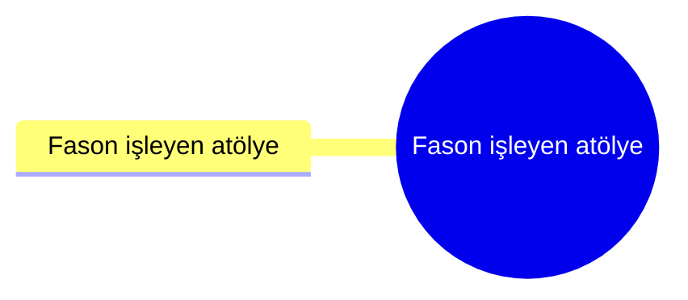

# 13-01 · Fason işleyen atölye

> Sektör: [[13 Üretim & İmalat]] · 1 alt dal
> Görsel: [[Ağaç – 13 – Fason işleyen atölye]]

## Özet
- Fason işleyen atölye

## Alt dallar
| # | Alt dal | İşletme sayısı | Fonksiyon | Not |
|---|---|---|---|---|
| A1 | [[Fason işleyen atölye]] | bulunamadı | 35 | Öncelik 3.6 (A) |



## Bu daldaki alt dallar (canlı)
```base
filters:
  and:
    - 'tip == "isletme"'
    - file.hasLink(this.file)
views:
  - type: table
    name: Alt dallar
```
