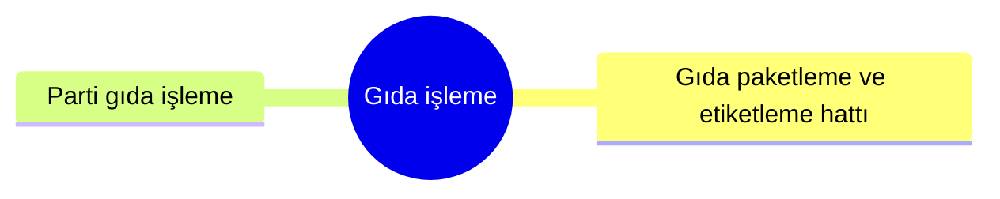

# 13-02 · Gıda işleme

> Sektör: [[13 Üretim & İmalat]] · 2 alt dal
> Görsel: [[Ağaç – 13 – Gıda işleme]]

## Özet
- Gıda işleme

## Alt dallar
| # | Alt dal | İşletme sayısı | Fonksiyon | Not |
|---|---|---|---|---|
| A1 | [[Gıda paketleme ve etiketleme hattı]] | bulunamadı | 35 | Öncelik 2.8 (C) |
| A2 | [[Parti gıda işleme]] | bulunamadı | 35 | Öncelik 2.8 (C) |



## Bu daldaki alt dallar (canlı)
```base
filters:
  and:
    - 'tip == "isletme"'
    - file.hasLink(this.file)
views:
  - type: table
    name: Alt dallar
```
