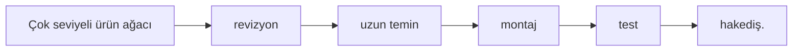

# 13-04-01 · Proje tipi makine ve ekipman imalatı

> Sektör: [[13 Üretim & İmalat]] · Öncelik: **2.6** / 5 · Öneri: **C**
> Puanlar tahmindir: pazar 3 · ödeme 3 · rekabet boşluğu 2 · kolaylık 2 · aciliyet 3

## 1. Özet
Tek teslimi olan makine veya ekipmanı tasarlayıp toplayan 1–50 kişilik imalatçı.

- **İşletme sayısı:** bulunamadı
- **NACE:** 28

## 2. Günlük iş akışı
1. Çok seviyeli ürün ağacı
2. revizyon
3. uzun temin
4. montaj
5. test
6. hakediş.

AI destek (onaylı): Son revizyon ile takılmış parçaları karşılaştırıp eksik parça listesini açar.

## 3. İhtiyaçlar ve sorunlar
| İhtiyaç | Bugün nasıl çözüyorlar | Etkisi |
|---|---|---|
| [[İş Emri (Üretim)]] | Excel / WhatsApp / portal (tahmin) | Zaman kaybı, hata riski |
| [[Reçete BOM]] | Excel / WhatsApp / portal (tahmin) | Zaman kaybı, hata riski |
| [[Fire Kayıt]] | Excel / WhatsApp / portal (tahmin) | Zaman kaybı, hata riski |
| [[Proje BOM]] | Excel / WhatsApp / portal (tahmin) | Zaman kaybı, hata riski |
| [[Montaj Aşama]] | Excel / WhatsApp / portal (tahmin) | Zaman kaybı, hata riski |
| [[Milestone Ödeme]] | Excel / WhatsApp / portal (tahmin) | Zaman kaybı, hata riski |
| [[Teknik Revizyon]] | Excel / WhatsApp / portal (tahmin) | Zaman kaybı, hata riski |
| [[Saha Sevk]] | Excel / WhatsApp / portal (tahmin) | Zaman kaybı, hata riski |

## 4. Çözümümüz: modüller ve özellikler
**Araç tarifi:** [[Muhasebe ve Gelir-Gider]] + [[e-Fatura ve e-Arşiv]] + [[CRM]] + [[Personel ve Vardiya]] + [[Raporlar]] + [[AI Asistan]] + [[Ayarlar]] + [[İş Emri (Üretim)]] + [[Reçete BOM]] + [[Fire Kayıt]] + [[Depo Sevk]] + [[Fason Mutabakat]] + [[Proje BOM]] + [[Montaj Aşama]]…

### Fonksiyonlar
- [[Proje P-12 BOM v3]]
- [[Revizyon farkını göster]]
- [[P-12 hangi aşamada]]
- [[Test aşamasına geç]]
- [[P-12 yüzde 40 faturasını hazırla]]
- [[Revizyon R2 ekle]]
- [[Sevkiyat checklist]]

### MVP
- [[İş Emri (Üretim)]]
- [[Reçete BOM]]
- [[Fire Kayıt]]
- [[Depo Sevk]]
- [[Fason Mutabakat]]
- [[Proje BOM]]
- [[Montaj Aşama]]
- [[Milestone Ödeme]]

### Sonraki sürüm
- [[Teknik Revizyon]]
- [[Saha Sevk]]

## 5. Teknik detay
- **Entegrasyonlar:** 13.00.01, 13.00.02, CRM, Mikro API, Mikro API (doğrulandı), Logo/Nebim (dogrulanmali), Mikro e-İrsaliye API, e-Fatura, Mikro cari, e-Fatura, Muhasebe
- **Ana ekranlar:** Kart / iş listesi · Takvim veya pipeline · Tahsilat · Rapor
- **Veri yapısı:** `Cari → İşKaydı → Belge/Tahsilat → Hatırlatma (onay kuyruğu)`

## 6. Fiyat ve paket önerisi
| Paket | İçerik | Fiyat | Not |
|---|---|---|---|
| Başlangıç | Çekirdek + MVP araçlar | bulunamadı | tahmin |
| Plus | V2 araçlar | bulunamadı | tahmin |

Uygun iş modeli: Abonelik (taahhütsüz aylık; yıllık indirim) — tahmin

## 7. Satış argümanı
- **Değer önerisi (tek cümle):** Proje tipi makine ve ekipman imalatı gününü tek panelde toplar; resmi gönderim ve tahsilat onayda kalır.
- **3 ana mesaj:**
  1. Dağınık Excel/WhatsApp yerine tek iş kaydı
  2. e-Belge ve hatırlatmalar onay kuyruğunda
  3. Sektöre özel alanlar, ortak çekirdek üzerinde
- **İtirazlar ve cevaplar:**

| İtiraz | Cevap |
|---|---|
| Zaten Excel var | Süre/uyum hatırlatması ve belge taslağı Excel’de dağılır |
| Resmi API yok | Panel kaydı + kurum portalı; uydurma entegrasyon yok |
| Pahalı | Taahhütsüz paket; yalnız kullanılan araçlar (tahmin) |

## 8. Rakipler
- [[Mikro]]

## 9. Kaynaklar
- [[13 Üretim & İmalat – Kaynaklar]]
- Arşiv: `08 Arşiv/eski-docs-sektorel-arastirma/ai-kaynak/13-uretim-imalat.md`
