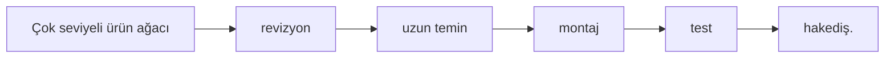

# 13-03-01 · Proje tipi makine ve ekipman imalatı

> Sektör: [[13 Üretim & İmalat]] · Öncelik: **2.6** / 5 · Öneri: **C**
> Puanlar tahmindir: pazar 3 · ödeme 3 · rekabet boşluğu 2 · kolaylık 2 · aciliyet 3

## 1. Özet
Tek teslimi olan makine veya ekipmanı tasarlayıp toplayan 1–50 kişilik imalatçı.

- **İşletme sayısı:** bulunamadı
- **NACE:** 28
- **Sayı türü:** tahmin

## 2. Günlük iş akışı
1. Çok seviyeli ürün ağacı
2. revizyon
3. uzun temin
4. montaj
5. test
6. hakediş.

## 3. İhtiyaçlar ve sorunlar
| İhtiyaç | Bugün nasıl çözüyorlar | Etkisi |
|---|---|---|
| [[İş emri]] | Excel / WhatsApp / portal (tahmin) | Zaman, hata, uyum riski |
| [[Reçete / BOM]] | Excel / WhatsApp / portal (tahmin) | Zaman, hata, uyum riski |
| [[Fire kaydı]] | Excel / WhatsApp / portal (tahmin) | Zaman, hata, uyum riski |
| [[Depo sevk]] | Excel / WhatsApp / portal (tahmin) | Zaman, hata, uyum riski |
| [[e-Belge / e-İrsaliye]] | Excel / WhatsApp / portal (tahmin) | Zaman, hata, uyum riski |
| [[Fason mutabakat]] | Excel / WhatsApp / portal (tahmin) | Zaman, hata, uyum riski |
| [[Lot / SKT]] | Excel / WhatsApp / portal (tahmin) | Zaman, hata, uyum riski |
| [[Gıda kayıt]] | Excel / WhatsApp / portal (tahmin) | Zaman, hata, uyum riski |

## 4. Parçalar

34 parça · 30 şart · 0 olmalı · 4 iyi olur

### Şart (30)

| Fonksiyon | Araç | Kullanım |
|---|---|---|
| [[Muhasebe ve Gelir-Gider]] | [[Muhasebe ve Gelir-Gider]] | Gelir, gider, cari, kasa ve banka. Sektör belgesi para kaydını buraya düşürür. |
| [[e-Fatura ve e-Arşiv]] | [[e-Fatura ve e-Arşiv]] | Satış belgesi taslağı; gönderim entegratör + onayla. |
| [[CRM]] | [[CRM]] | Kişi/firma kartı, iletişim, not; sektör alanları karta eklenir. |
| [[Personel ve Vardiya]] | [[Personel ve Vardiya]] | Personel kartı, vardiya, puantaj. Bordro/SGK kesilmez. |
| [[Raporlar]] | [[Raporlar]] | Ciro, tahsilat, açık iş ve personel özeti. |
| [[AI Asistan]] | [[AI Asistan]] | Komut çalıştırır, taslak üretir; yüksek etkili işlem onaysız bitmez. |
| [[Ayarlar]] | [[Ayarlar]] | İşletme, belge, bildirim ve entegrasyon ayarları. |
| [[İş Emri (Üretim)]] | [[İş Emri (Üretim)]] | Sipariş veya stok ihtiyacından iş emri; durum akışı; tam MES değil |
| [[Sipariş 452 için iş emri aç]] | [[İş Emri (Üretim)]] | Sipariş 452 için iş emri aç — Sipariş veya stok ihtiyacından iş emri; durum akışı; tam MES değil |
| [[Geciken iş emirlerini listele]] | [[İş Emri (Üretim)]] | Geciken iş emirlerini listele — Sipariş veya stok ihtiyacından iş emri; durum akışı; tam MES değil |
| [[Reçete BOM]] | [[Reçete BOM]] | Hammadde, birim, beklenen fire oranı; iş emrine bağlanır |
| [[Gömlek reçetesini göster]] | [[Reçete BOM]] | Gömlek reçetesini göster — Hammadde, birim, beklenen fire oranı; iş emrine bağlanır |
| [[Fire oranını yüzde 5 yap]] | [[Reçete BOM]] | Fire oranını yüzde 5 yap — Hammadde, birim, beklenen fire oranı; iş emrine bağlanır |
| [[Fire Kayıt]] | [[Fire Kayıt]] | İş emri bazlı fire; reçete toleransı ile gerçekleşen karşılaştırma |
| [[İş emri 88 fire kaydet 12 adet]] | [[Fire Kayıt]] | İş emri 88 fire kaydet 12 adet — İş emri bazlı fire; reçete toleransı ile gerçekleşen karşılaştırma |
| [[Bu hafta fire aşımı]] | [[Fire Kayıt]] | Bu hafta fire aşımı — İş emri bazlı fire; reçete toleransı ile gerçekleşen karşılaştırma |
| [[Depo Sevk]] | [[Depo Sevk]] | İş emrine bağlı malzeme çıkış/iade ve fason depo bakiyesi. Çekirdek genişleme: e-Fatura/e-Arşiv (e-irsaliye köprüsü). |
| [[İş emri 90 için sac çıkar]] | [[Depo Sevk]] | İş emri 90 için sac çıkar — İş emrine bağlı malzeme çıkış/iade ve fason depo bakiyesi. Çekirdek genişleme: e-Fatura/e-Arşiv (e-irsaliye köprüsü). |
| [[Fasoncuda kalan bakiyeyi göster]] | [[Depo Sevk]] | Fasoncuda kalan bakiyeyi göster — İş emrine bağlı malzeme çıkış/iade ve fason depo bakiyesi. Çekirdek genişleme: e-Fatura/e-Arşiv (e-irsaliye köprüsü). |
| [[Fason Mutabakat]] | [[Fason Mutabakat]] | Sevk, dönüş, kalite, fire, hakediş ve fatura eşleştirme zinciri. Çekirdek genişleme: Muhasebe & Gelir-Gider. |
| [[ABC Fason mutabakatını çıkar]] | [[Fason Mutabakat]] | ABC Fason mutabakatını çıkar — Sevk, dönüş, kalite, fire, hakediş ve fatura eşleştirme zinciri. Çekirdek genişleme: Muhasebe & Gelir-Gider. |
| [[Fire aşımını hakedişten kes]] | [[Fason Mutabakat]] | Fire aşımını hakedişten kes — Sevk, dönüş, kalite, fire, hakediş ve fatura eşleştirme zinciri. Çekirdek genişleme: Muhasebe & Gelir-Gider. |
| [[Proje BOM]] | [[Proje BOM]] | Projeye özel reçete revizyonları |
| [[Proje P-12 BOM v3]] | [[Proje BOM]] | Proje P-12 BOM v3 — Projeye özel reçete revizyonları |
| [[Revizyon farkını göster]] | [[Proje BOM]] | Revizyon farkını göster — Projeye özel reçete revizyonları |
| [[Montaj Aşama]] | [[Montaj Aşama]] | Kesim-kaynak-montaj-test kapıları |
| [[P-12 hangi aşamada]] | [[Montaj Aşama]] | P-12 hangi aşamada — Kesim-kaynak-montaj-test kapıları |
| [[Test aşamasına geç]] | [[Montaj Aşama]] | Test aşamasına geç — Kesim-kaynak-montaj-test kapıları |
| [[Milestone Ödeme]] | [[Milestone Ödeme]] | Proje hakediş basamakları. Çekirdek genişleme: Muhasebe & Gelir-Gider. |
| [[P-12 yüzde 40 faturasını hazırla]] | [[Milestone Ödeme]] | P-12 yüzde 40 faturasını hazırla — Proje hakediş basamakları. Çekirdek genişleme: Muhasebe & Gelir-Gider. |

### Olmalı (0)

_Yok._

### İyi olur (4)

| Fonksiyon | Araç | Kullanım |
|---|---|---|
| [[Teknik Revizyon]] | [[Teknik Revizyon]] | Müşteri çizim değişikliği kaydı. Çekirdek genişleme: CRM. |
| [[Revizyon R2 ekle]] | [[Teknik Revizyon]] | Revizyon R2 ekle — Müşteri çizim değişikliği kaydı. Çekirdek genişleme: CRM. |
| [[Saha Sevk]] | [[Saha Sevk]] | Makine sevkiyat checklist |
| [[Sevkiyat checklist]] | [[Saha Sevk]] | Sevkiyat checklist — Makine sevkiyat checklist |

## 5. Teknik detay
- **Entegrasyonlar:** Modül kartlarındaki entegrasyon notlarına bak; açık API yoksa panel kaydı + kullanıcı girişi.
- **Ana ekranlar:** İş listesi / kart · Takvim veya pipeline · Tahsilat · Rapor
- **Veri yapısı:** `Cari → İşKaydı → Belge/Tahsilat → Hatırlatma (onay kuyruğu)`

## 6. Rakipler
- [[Mikro]]

## 7. Kaynaklar
- [[13 Üretim & İmalat – Kaynaklar]]
- Araştırma arşivi: `08 Arşiv/eski-docs-sektorel-arastirma/`
