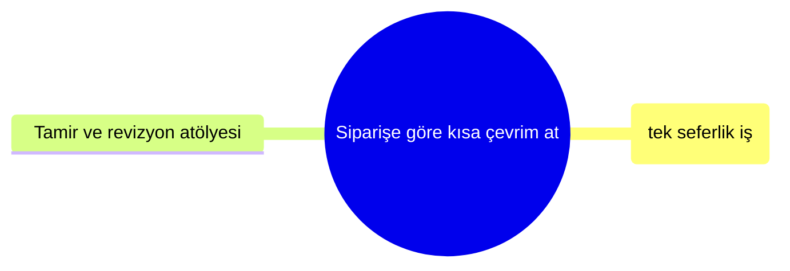

# 13-04 · Siparişe göre kısa çevrim atölye

> Sektör: [[13 Üretim & İmalat]] · 2 alt dal
> Görsel: [[Ağaç – 13 – Siparişe göre kısa çevrim atölye]]

## Özet
- Siparişe göre kısa çevrim atölye

## Alt dallar
| # | Alt dal | İşletme sayısı | Fonksiyon | Not |
|---|---|---|---|---|
| A1 | [[Sipariş atölyesi (tek seferlik iş)]] | bulunamadı | 35 | Öncelik 4.0 (A) |
| A2 | [[Tamir ve revizyon atölyesi]] | bulunamadı | 35 | Öncelik 3.2 (B) |



## Bu daldaki alt dallar (canlı)
```base
filters:
  and:
    - 'tip == "isletme"'
    - file.hasLink(this.file)
views:
  - type: table
    name: Alt dallar
```
