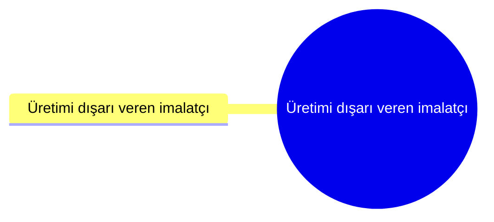

# 13-06 · Üretimi dışarı veren imalatçı

> Sektör: [[13 Üretim & İmalat]] · 1 alt dal · 34 fonksiyon
> Görsel: [[Ağaç – 13 – Üretimi dışarı veren imalatçı]]

## Özet
- Üretimi dışarı veren imalatçı: onaylı alt işletme tür(ler)i ve bağlanan araç/fonksiyonlar.

## Alt dallar
| # | Alt dal | İşletme sayısı | Fonksiyon | Not |
|---|---|---|---|---|
| A1 | [[Üretimi dışarı veren imalatçı]] | bulunamadı | 34 | Öncelik 3.0 (B) |



## Dalın ortak temeli
- Çekirdek: [[Muhasebe ve Gelir-Gider]], [[e-Fatura ve e-Arşiv]], [[CRM]], [[Personel ve Vardiya]], [[Raporlar]], [[AI Asistan]], [[Ayarlar]]
- Sektör ortak araçlar + bu dalın alt tür araçları

## Fonksiyon matrisi
> ● = kullanıyor.

| Fonksiyon | A1 | Kullanım |
|---|---|---|
| [[Muhasebe ve Gelir-Gider]] | ● | 1/1 |
| [[e-Fatura ve e-Arşiv]] | ● | 1/1 |
| [[CRM]] | ● | 1/1 |
| [[Personel ve Vardiya]] | ● | 1/1 |
| [[Raporlar]] | ● | 1/1 |
| [[AI Asistan]] | ● | 1/1 |
| [[Ayarlar]] | ● | 1/1 |
| [[İş Emri (Üretim)]] | ● | 1/1 |
| [[Sipariş 452 için iş emri aç]] | ● | 1/1 |
| [[Geciken iş emirlerini listele]] | ● | 1/1 |
| [[Reçete BOM]] | ● | 1/1 |
| [[Gömlek reçetesini göster]] | ● | 1/1 |
| [[Fire oranını yüzde 5 yap]] | ● | 1/1 |
| [[Fire Kayıt]] | ● | 1/1 |
| [[İş emri 88 fire kaydet 12 adet]] | ● | 1/1 |
| [[Bu hafta fire aşımı]] | ● | 1/1 |
| [[Depo Sevk]] | ● | 1/1 |
| [[İş emri 90 için sac çıkar]] | ● | 1/1 |
| [[Fasoncuda kalan bakiyeyi göster]] | ● | 1/1 |
| [[Fason Mutabakat]] | ● | 1/1 |
| [[ABC Fason mutabakatını çıkar]] | ● | 1/1 |
| [[Fire aşımını hakedişten kes]] | ● | 1/1 |
| [[Fasoncu Sevk]] | ● | 1/1 |
| [[ABC'ye 405 kg kumaş sevk et]] | ● | 1/1 |
| [[Açık sevkler]] | ● | 1/1 |
| [[Dönüş Kabul]] | ● | 1/1 |
| [[ABC dönüşünü kaydet 960 adet]] | ● | 1/1 |
| [[Ret 40]] | ● | 1/1 |
| [[Hakediş Kesinti]] | ● | 1/1 |
| [[ABC hakedişini kesintili hesapla]] | ● | 1/1 |
| [[Fasoncu Bakiye]] | ● | 1/1 |
| [[Kimde ne malzeme var]] | ● | 1/1 |
| [[Çok Fasoncu]] | ● | 1/1 |
| [[Kesim ABC, dikim DEF]] | ● | 1/1 |

## Bu daldaki alt dallar (canlı)
```base
filters:
  and:
    - 'tip == "isletme"'
    - file.hasLink(this.file)
views:
  - type: table
    name: Alt dallar
```
