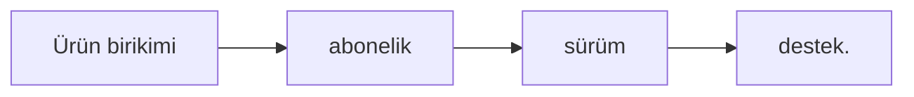

# 15-08-01 · Abonelikli yazılım ürünü işletmesi

> Sektör: [[15 Teknoloji Medya & Ajans]] · Öncelik: **3.2** / 5 · Öneri: **B**
> Puanlar tahmindir: pazar 3 · ödeme 4 · rekabet boşluğu 2 · kolaylık 3 · aciliyet 4

## 1. Özet
Kendi yazılımını yayımlayıp çok sayıda müşteriye abonelik, sürüm ve destek yürüten şirket.

- **İşletme sayısı:** bulunamadı
- **NACE:** 62.01
- **Sayı türü:** tahmin

## 2. Günlük iş akışı
1. Ürün birikimi
2. abonelik
3. sürüm
4. destek.

## 3. İhtiyaçlar ve sorunlar
| İhtiyaç | Bugün nasıl çözüyorlar | Etkisi |
|---|---|---|
| [[Proje kapsamı]] | Excel / WhatsApp / portal (tahmin) | Zaman, hata, uyum riski |
| [[Saat kullanımı]] | Excel / WhatsApp / portal (tahmin) | Zaman, hata, uyum riski |
| [[Brief / onay]] | Excel / WhatsApp / portal (tahmin) | Zaman, hata, uyum riski |
| [[Teslim takvimi]] | Excel / WhatsApp / portal (tahmin) | Zaman, hata, uyum riski |
| [[Sözleşme / retainer]] | Excel / WhatsApp / portal (tahmin) | Zaman, hata, uyum riski |
| [[e-Belge]] | Excel / WhatsApp / portal (tahmin) | Zaman, hata, uyum riski |
| [[Reklam hesabı erişimi]] | Excel / WhatsApp / portal (tahmin) | Zaman, hata, uyum riski |
| [[Yayın takvimi]] | Excel / WhatsApp / portal (tahmin) | Zaman, hata, uyum riski |

## 4. Parçalar

43 parça · 31 şart · 0 olmalı · 12 iyi olur

### Şart (31)

| Fonksiyon | Araç | Kullanım |
|---|---|---|
| [[Muhasebe ve Gelir-Gider]] | [[Muhasebe ve Gelir-Gider]] | Gelir, gider, cari, kasa ve banka. Sektör belgesi para kaydını buraya düşürür. |
| [[e-Fatura ve e-Arşiv]] | [[e-Fatura ve e-Arşiv]] | Satış belgesi taslağı; gönderim entegratör + onayla. |
| [[CRM]] | [[CRM]] | Kişi/firma kartı, iletişim, not; sektör alanları karta eklenir. |
| [[Personel ve Vardiya]] | [[Personel ve Vardiya]] | Personel kartı, vardiya, puantaj. Bordro/SGK kesilmez. |
| [[Raporlar]] | [[Raporlar]] | Ciro, tahsilat, açık iş ve personel özeti. |
| [[AI Asistan]] | [[AI Asistan]] | Komut çalıştırır, taslak üretir; yüksek etkili işlem onaysız bitmez. |
| [[Ayarlar]] | [[Ayarlar]] | İşletme, belge, bildirim ve entegrasyon ayarları. |
| [[Proje Kapsamı]] | [[Proje Kapsamı]] | Sözleşme ve teklif maddeleri, kabul kriteri, kapsam dışı iş talebi kaydı; kapsam sapmasını görünür kılar. |
| [[Bu yazışmayı kapsam maddesine çevir]] | [[Proje Kapsamı]] | Bu yazışmayı kapsam maddesine çevir — Sözleşme ve teklif maddeleri, kabul kriteri, kapsam dışı iş talebi kaydı; kapsam sapmasını görünür kılar. |
| [[Kapsam dışı satırları listele]] | [[Proje Kapsamı]] | Kapsam dışı satırları listele — Sözleşme ve teklif maddeleri, kabul kriteri, kapsam dışı iş talebi kaydı; kapsam sapmasını görünür kılar. |
| [[Saat Kullanımı]] | [[Saat Kullanımı]] | Faturalanabilir ve faturalanamayan saat kaydı; proje veya retainer ile eşleme. |
| [[Bu haftanın faturalanamayan saatini özetle]] | [[Saat Kullanımı]] | Bu haftanın faturalanamayan saatini özetle — Faturalanabilir ve faturalanamayan saat kaydı; proje veya retainer ile eşleme. |
| [[Müşteri X için faturalanabilir saati göster]] | [[Saat Kullanımı]] | Müşteri X için faturalanabilir saati göster — Faturalanabilir ve faturalanamayan saat kaydı; proje veya retainer ile eşleme. |
| [[Brief Onayı]] | [[Brief Onayı]] | Brief, sürüm ve revizyon turu; müşteri onayı kuyruğu. |
| [[Brief'ten iş listesi çıkar]] | [[Brief Onayı]] | Brief'ten iş listesi çıkar — Brief, sürüm ve revizyon turu; müşteri onayı kuyruğu. |
| [[Açık revizyon turlarını say]] | [[Brief Onayı]] | Açık revizyon turlarını say — Brief, sürüm ve revizyon turu; müşteri onayı kuyruğu. |
| [[Teslim Takvimi]] | [[Teslim Takvimi]] | Teslim tarihleri, bağımlılıklar ve gecikme riski. |
| [[Bu hafta gecikecek teslimleri listele]] | [[Teslim Takvimi]] | Bu hafta gecikecek teslimleri listele — Teslim tarihleri, bağımlılıklar ve gecikme riski. |
| [[Müşteri Y için teslim takvimini özetle]] | [[Teslim Takvimi]] | Müşteri Y için teslim takvimini özetle — Teslim tarihleri, bağımlılıklar ve gecikme riski. |
| [[Sözleşme Takibi]] | [[Sözleşme Takibi]] | Proje ve retainer bitiş tarihleri; yenileme hatırlatması (ürün aboneliği 15.08'de). |
| [[30 gün içinde biten retainer'ları göster]] | [[Sözleşme Takibi]] | 30 gün içinde biten retainer'ları göster — Proje ve retainer bitiş tarihleri; yenileme hatırlatması (ürün aboneliği 15.08'de). |
| [[Sözleşme yenileme taslağı hazırla]] | [[Sözleşme Takibi]] | Sözleşme yenileme taslağı hazırla — Proje ve retainer bitiş tarihleri; yenileme hatırlatması (ürün aboneliği 15.08'de). |
| [[Abonelik Yenileme]] | [[Abonelik Yenileme]] | Abonelik dönemi, yenileme ve churn riski. |
| [[14 gün içinde yenilenecekleri göster]] | [[Abonelik Yenileme]] | 14 gün içinde yenilenecekleri göster — Abonelik dönemi, yenileme ve churn riski. |
| [[Ödemesi geciken abonelikleri listele]] | [[Abonelik Yenileme]] | Ödemesi geciken abonelikleri listele — Abonelik dönemi, yenileme ve churn riski. |
| [[Ürün Birikimi]] | [[Ürün Birikimi]] | Ürün backlog ve sürüm hedefi. |
| [[Bir sonraki sürüme aday işleri seç]] | [[Ürün Birikimi]] | Bir sonraki sürüme aday işleri seç — Ürün backlog ve sürüm hedefi. |
| [[Destekten ürüne çevrilecekleri bul]] | [[Ürün Birikimi]] | Destekten ürüne çevrilecekleri bul — Ürün backlog ve sürüm hedefi. |
| [[Destek Kuyruğu]] | [[Destek Kuyruğu]] | Ürün destek ticket'ı; proje kabul döngüsü değildir. |
| [[Açık destekleri önceliklendir]] | [[Destek Kuyruğu]] | Açık destekleri önceliklendir — Ürün destek ticket'ı; proje kabul döngüsü değildir. |
| [[Tekrarlayan hataları grupla]] | [[Destek Kuyruğu]] | Tekrarlayan hataları grupla — Ürün destek ticket'ı; proje kabul döngüsü değildir. |

### Olmalı (0)

_Yok._

### İyi olur (12)

| Fonksiyon | Araç | Kullanım |
|---|---|---|
| [[Kaynak Planı]] | [[Kaynak Planı]] | Kişi-hafta kapasite ve aşırı yük görünümü. |
| [[Kim aşırı yüklü?]] | [[Kaynak Planı]] | Kim aşırı yüklü? — Kişi-hafta kapasite ve aşırı yük görünümü. |
| [[Sprint için boş kapasiteyi bul]] | [[Kaynak Planı]] | Sprint için boş kapasiteyi bul — Kişi-hafta kapasite ve aşırı yük görünümü. |
| [[Teklif Paketi]] | [[Teklif Paketi]] | Teklif şablonu, kalem ve süre varsayımları. |
| [[Benzer tekliften taslak üret]] | [[Teklif Paketi]] | Benzer tekliften taslak üret — Teklif şablonu, kalem ve süre varsayımları. |
| [[Kapsam maddelerini numaralandır]] | [[Teklif Paketi]] | Kapsam maddelerini numaralandır — Teklif şablonu, kalem ve süre varsayımları. |
| [[Sürüm Notu]] | [[Sürüm Notu]] | Sürüm notu taslağı. |
| [[Bu sürümün notunu yaz]] | [[Sürüm Notu]] | Bu sürümün notunu yaz — Sürüm notu taslağı. |
| [[Kırıcı değişiklikleri işaretle]] | [[Sürüm Notu]] | Kırıcı değişiklikleri işaretle — Sürüm notu taslağı. |
| [[Kullanım Ölçümü]] | [[Kullanım Ölçümü]] | Ürün kullanım ve aktif hesap özeti. |
| [[Pasif hesapları listele]] | [[Kullanım Ölçümü]] | Pasif hesapları listele — Ürün kullanım ve aktif hesap özeti. |
| [[Kullanım düşen planları göster]] | [[Kullanım Ölçümü]] | Kullanım düşen planları göster — Ürün kullanım ve aktif hesap özeti. |

## 5. Teknik detay
- **Entegrasyonlar:** Modül kartlarındaki entegrasyon notlarına bak; açık API yoksa panel kaydı + kullanıcı girişi.
- **Ana ekranlar:** İş listesi / kart · Takvim veya pipeline · Tahsilat · Rapor
- **Veri yapısı:** `Cari → İşKaydı → Belge/Tahsilat → Hatırlatma (onay kuyruğu)`

## 6. Rakipler
- [[Meta Ads]]
- [[Google Ads]]
- [[GitHub / GitLab]]

## 7. Kaynaklar
- [[15 Teknoloji Medya & Ajans – Kaynaklar]]
- Araştırma arşivi: `08 Arşiv/eski-docs-sektorel-arastirma/`
