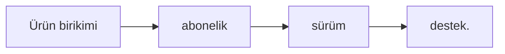

# 15-08-01 · Abonelikli yazılım ürünü işletmesi

> Sektör: [[15 Teknoloji Medya & Ajans]] · Öncelik: **3.2** / 5 · Öneri: **B**
> Puanlar tahmindir: pazar 3 · ödeme 4 · rekabet boşluğu 2 · kolaylık 3 · aciliyet 4

## 1. Özet
Kendi yazılımını yayımlayıp çok sayıda müşteriye abonelik, sürüm ve destek yürüten şirket.

- **İşletme sayısı:** bulunamadı
- **NACE:** 62.01

## 2. Günlük iş akışı
1. Ürün birikimi
2. abonelik
3. sürüm
4. destek.

AI destek (onaylı): Destek yazışmasını ürün işi taslağına çevirir; yenilemesi yaklaşan hesapları özetler.

## 3. İhtiyaçlar ve sorunlar
| İhtiyaç | Bugün nasıl çözüyorlar | Etkisi |
|---|---|---|
| [[Proje Kapsamı]] | Excel / WhatsApp / portal (tahmin) | Zaman kaybı, hata riski |
| [[Saat Kullanımı]] | Excel / WhatsApp / portal (tahmin) | Zaman kaybı, hata riski |
| [[Brief Onayı]] | Excel / WhatsApp / portal (tahmin) | Zaman kaybı, hata riski |
| [[Abonelik Yenileme]] | Excel / WhatsApp / portal (tahmin) | Zaman kaybı, hata riski |
| [[Ürün Birikimi]] | Excel / WhatsApp / portal (tahmin) | Zaman kaybı, hata riski |
| [[Destek Kuyruğu]] | Excel / WhatsApp / portal (tahmin) | Zaman kaybı, hata riski |
| [[Sürüm Notu]] | Excel / WhatsApp / portal (tahmin) | Zaman kaybı, hata riski |
| [[Kullanım Ölçümü]] | Excel / WhatsApp / portal (tahmin) | Zaman kaybı, hata riski |

## 4. Çözümümüz: modüller ve özellikler
**Araç tarifi:** [[Muhasebe ve Gelir-Gider]] + [[e-Fatura ve e-Arşiv]] + [[CRM]] + [[Personel ve Vardiya]] + [[Raporlar]] + [[AI Asistan]] + [[Ayarlar]] + [[Proje Kapsamı]] + [[Saat Kullanımı]] + [[Brief Onayı]] + [[Teslim Takvimi]] + [[Sözleşme Takibi]] + [[Kaynak Planı]] + [[Teklif Paketi]]…

### Fonksiyonlar
- [[14 gün içinde yenilenecekleri göster]]
- [[Ödemesi geciken abonelikleri listele]]
- [[Bir sonraki sürüme aday işleri seç]]
- [[Destekten ürüne çevrilecekleri bul]]
- [[Açık destekleri önceliklendir]]
- [[Tekrarlayan hataları grupla]]
- [[Bu sürümün notunu yaz]]
- [[Kırıcı değişiklikleri işaretle]]
- [[Pasif hesapları listele]]
- [[Kullanım düşen planları göster]]

### MVP
- [[Proje Kapsamı]]
- [[Saat Kullanımı]]
- [[Brief Onayı]]
- [[Teslim Takvimi]]
- [[Sözleşme Takibi]]
- [[Abonelik Yenileme]]
- [[Ürün Birikimi]]
- [[Destek Kuyruğu]]

### Sonraki sürüm
- [[Kaynak Planı]]
- [[Teklif Paketi]]
- [[Sürüm Notu]]
- [[Kullanım Ölçümü]]

## 5. Teknik detay
- **Entegrasyonlar:** Panel kaydı
- **Ana ekranlar:** Kart / iş listesi · Takvim veya pipeline · Tahsilat · Rapor
- **Veri yapısı:** `Cari → İşKaydı → Belge/Tahsilat → Hatırlatma (onay kuyruğu)`

## 6. Fiyat ve paket önerisi
| Paket | İçerik | Fiyat | Not |
|---|---|---|---|
| Başlangıç | Çekirdek + MVP araçlar | bulunamadı | tahmin |
| Plus | V2 araçlar | bulunamadı | tahmin |

Uygun iş modeli: Abonelik (taahhütsüz aylık; yıllık indirim) — tahmin

## 7. Satış argümanı
- **Değer önerisi (tek cümle):** Abonelikli yazılım ürünü işletmesi gününü tek panelde toplar; resmi gönderim ve tahsilat onayda kalır.
- **3 ana mesaj:**
  1. Dağınık Excel/WhatsApp yerine tek iş kaydı
  2. e-Belge ve hatırlatmalar onay kuyruğunda
  3. Sektöre özel alanlar, ortak çekirdek üzerinde
- **İtirazlar ve cevaplar:**

| İtiraz | Cevap |
|---|---|
| Zaten Excel var | Süre/uyum hatırlatması ve belge taslağı Excel’de dağılır |
| Resmi API yok | Panel kaydı + kurum portalı; uydurma entegrasyon yok |
| Pahalı | Taahhütsüz paket; yalnız kullanılan araçlar (tahmin) |

## 8. Rakipler
- [[Meta Ads]]
- [[Google Ads]]
- [[GitHub / GitLab]]

## 9. Kaynaklar
- [[15 Teknoloji Medya & Ajans – Kaynaklar]]
- Arşiv: `08 Arşiv/eski-docs-sektorel-arastirma/ai-kaynak/15-teknoloji-medya-ajans.md`
