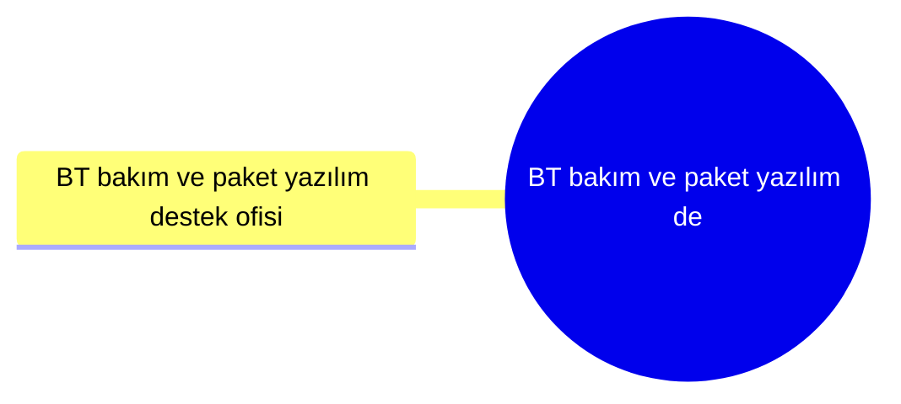

# 15-02 · BT bakım ve paket yazılım destek ofisi

> Sektör: [[15 Teknoloji Medya & Ajans]] · 1 alt dal
> Görsel: [[Ağaç – 15 – BT bakım ve paket yazılım destek ofisi]]

## Özet
- BT bakım ve paket yazılım destek ofisi

## Alt dallar
| # | Alt dal | İşletme sayısı | Fonksiyon | Not |
|---|---|---|---|---|
| A1 | [[BT bakım ve paket yazılım destek ofisi]] | bulunamadı | 43 | Öncelik 3.4 (B) |



## Bu daldaki alt dallar (canlı)
```base
filters:
  and:
    - 'tip == "isletme"'
    - file.hasLink(this.file)
views:
  - type: table
    name: Alt dallar
```
