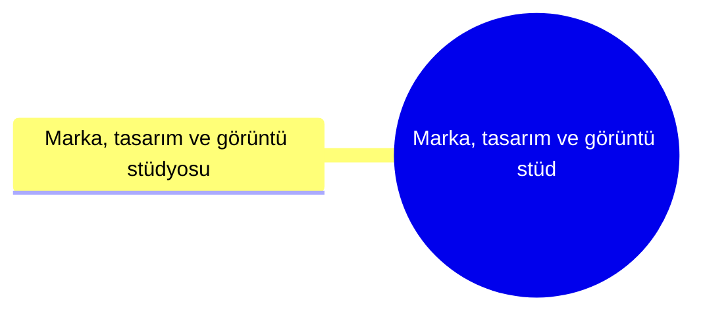

# 15-04 · Marka, tasarım ve görüntü stüdyosu

> Sektör: [[15 Teknoloji Medya & Ajans]] · 1 alt dal · 43 fonksiyon
> Görsel: [[Ağaç – 15 – Marka, tasarım ve görüntü stüdyosu]]

## Özet
- Marka, tasarım ve görüntü stüdyosu: onaylı alt işletme tür(ler)i ve bağlanan araç/fonksiyonlar.

## Alt dallar
| # | Alt dal | İşletme sayısı | Fonksiyon | Not |
|---|---|---|---|---|
| A1 | [[Marka, tasarım ve görüntü stüdyosu]] | bulunamadı | 43 | Öncelik 3.4 (B) |



## Dalın ortak temeli
- Çekirdek: [[Muhasebe ve Gelir-Gider]], [[e-Fatura ve e-Arşiv]], [[CRM]], [[Personel ve Vardiya]], [[Raporlar]], [[AI Asistan]], [[Ayarlar]]
- Sektör ortak araçlar + bu dalın alt tür araçları

## Fonksiyon matrisi
> ● = kullanıyor.

| Fonksiyon | A1 | Kullanım |
|---|---|---|
| [[Muhasebe ve Gelir-Gider]] | ● | 1/1 |
| [[e-Fatura ve e-Arşiv]] | ● | 1/1 |
| [[CRM]] | ● | 1/1 |
| [[Personel ve Vardiya]] | ● | 1/1 |
| [[Raporlar]] | ● | 1/1 |
| [[AI Asistan]] | ● | 1/1 |
| [[Ayarlar]] | ● | 1/1 |
| [[Proje Kapsamı]] | ● | 1/1 |
| [[Bu yazışmayı kapsam maddesine çevir]] | ● | 1/1 |
| [[Kapsam dışı satırları listele]] | ● | 1/1 |
| [[Saat Kullanımı]] | ● | 1/1 |
| [[Bu haftanın faturalanamayan saatini özetle]] | ● | 1/1 |
| [[Müşteri X için faturalanabilir saati göster]] | ● | 1/1 |
| [[Brief Onayı]] | ● | 1/1 |
| [[Brief'ten iş listesi çıkar]] | ● | 1/1 |
| [[Açık revizyon turlarını say]] | ● | 1/1 |
| [[Teslim Takvimi]] | ● | 1/1 |
| [[Bu hafta gecikecek teslimleri listele]] | ● | 1/1 |
| [[Müşteri Y için teslim takvimini özetle]] | ● | 1/1 |
| [[Sözleşme Takibi]] | ● | 1/1 |
| [[30 gün içinde biten retainer'ları göster]] | ● | 1/1 |
| [[Sözleşme yenileme taslağı hazırla]] | ● | 1/1 |
| [[Kaynak Planı]] | ● | 1/1 |
| [[Kim aşırı yüklü?]] | ● | 1/1 |
| [[Sprint için boş kapasiteyi bul]] | ● | 1/1 |
| [[Teklif Paketi]] | ● | 1/1 |
| [[Benzer tekliften taslak üret]] | ● | 1/1 |
| [[Kapsam maddelerini numaralandır]] | ● | 1/1 |
| [[Varlık Sürümü]] | ● | 1/1 |
| [[Final sürümü bul]] | ● | 1/1 |
| [[Eski sürümleri arşiv öner]] | ● | 1/1 |
| [[Revizyon Turu]] | ● | 1/1 |
| [[Revizyon notlarını maddele]] | ● | 1/1 |
| [[Sözleşmedeki tur aşıldı mı?]] | ● | 1/1 |
| [[Hak Listesi]] | ● | 1/1 |
| [[Hak listesi eksik mi?]] | ● | 1/1 |
| [[5846 hak maddelerini doldur]] | ● | 1/1 |
| [[Çekim Planı]] | ● | 1/1 |
| [[Yarınki çekim checklist'i]] | ● | 1/1 |
| [[Eksik ekipmanı listele]] | ● | 1/1 |

## Bu daldaki alt dallar (canlı)
```base
filters:
  and:
    - 'tip == "isletme"'
    - file.hasLink(this.file)
views:
  - type: table
    name: Alt dallar
```
