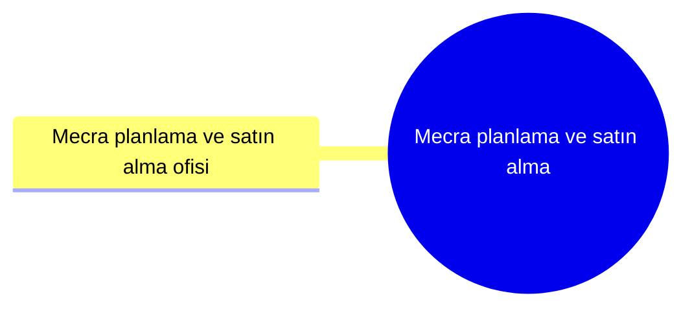

# 15-05 · Mecra planlama ve satın alma ofisi

> Sektör: [[15 Teknoloji Medya & Ajans]] · 1 alt dal
> Görsel: [[Ağaç – 15 – Mecra planlama ve satın alma ofisi]]

## Özet
- Mecra planlama ve satın alma ofisi

## Alt dallar
| # | Alt dal | İşletme sayısı | Fonksiyon | Not |
|---|---|---|---|---|
| A1 | [[Mecra planlama ve satın alma ofisi]] | bulunamadı | 40 | Öncelik 2.4 (C) |



## Bu daldaki alt dallar (canlı)
```base
filters:
  and:
    - 'tip == "isletme"'
    - file.hasLink(this.file)
views:
  - type: table
    name: Alt dallar
```
