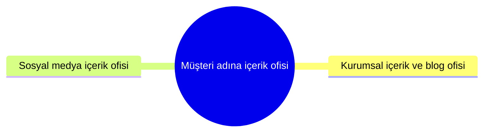

# 15-06 · Müşteri adına içerik ofisi

> Sektör: [[15 Teknoloji Medya & Ajans]] · 2 alt dal
> Görsel: [[Ağaç – 15 – Müşteri adına içerik ofisi]]

## Özet
- Müşteri adına içerik ofisi

## Alt dallar
| # | Alt dal | İşletme sayısı | Fonksiyon | Not |
|---|---|---|---|---|
| A1 | [[Kurumsal içerik ve blog ofisi]] | bulunamadı | 43 | Öncelik 3.2 (B) |
| A2 | [[Sosyal medya içerik ofisi]] | bulunamadı | 43 | Öncelik 3.6 (A) |



## Bu daldaki alt dallar (canlı)
```base
filters:
  and:
    - 'tip == "isletme"'
    - file.hasLink(this.file)
views:
  - type: table
    name: Alt dallar
```
