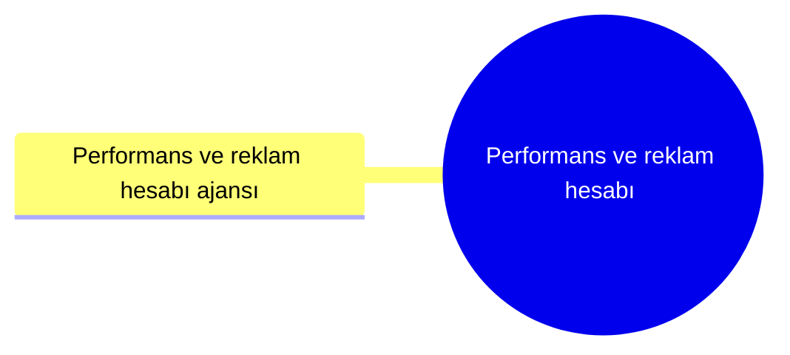

# 15-07 · Performans ve reklam hesabı ajansı

> Sektör: [[15 Teknoloji Medya & Ajans]] · 1 alt dal
> Görsel: [[Ağaç – 15 – Performans ve reklam hesabı ajansı]]

## Özet
- Performans ve reklam hesabı ajansı

## Alt dallar
| # | Alt dal | İşletme sayısı | Fonksiyon | Not |
|---|---|---|---|---|
| A1 | [[Performans ve reklam hesabı ajansı]] | bulunamadı | 43 | Öncelik 3.6 (A) |



## Bu daldaki alt dallar (canlı)
```base
filters:
  and:
    - 'tip == "isletme"'
    - file.hasLink(this.file)
views:
  - type: table
    name: Alt dallar
```
