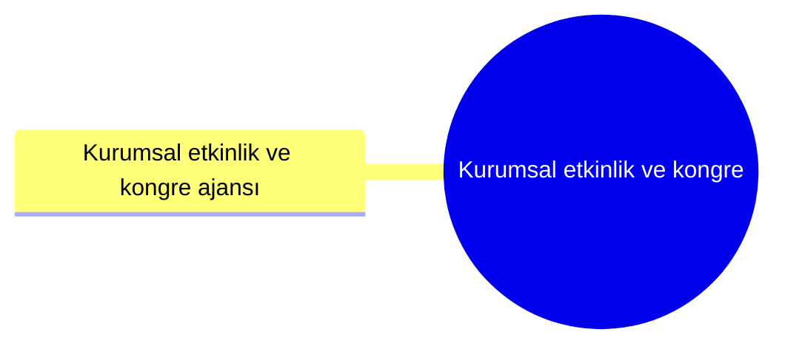

# 16-04 · Kurumsal etkinlik ve kongre ajansı

> Sektör: [[16 Etkinlik & Organizasyon]] · 1 alt dal
> Görsel: [[Ağaç – 16 – Kurumsal etkinlik ve kongre ajansı]]

## Özet
- Kurumsal etkinlik ve kongre ajansı

## Alt dallar
| # | Alt dal | İşletme sayısı | Fonksiyon | Not |
|---|---|---|---|---|
| A1 | [[Kurumsal etkinlik ve kongre ajansı]] | bulunamadı | 31 | Öncelik 3.2 (B) |



## Bu daldaki alt dallar (canlı)
```base
filters:
  and:
    - 'tip == "isletme"'
    - file.hasLink(this.file)
views:
  - type: table
    name: Alt dallar
```
