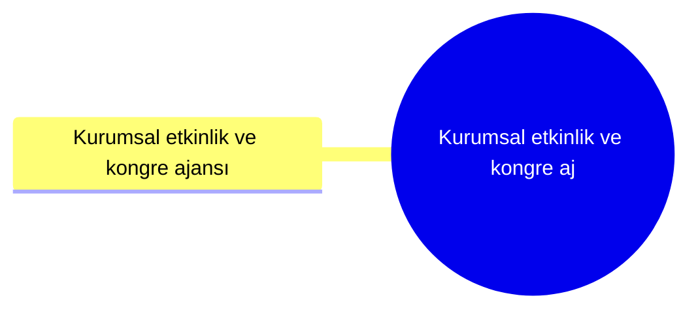

# 16-04 · Kurumsal etkinlik ve kongre ajansı

> Sektör: [[16 Etkinlik & Organizasyon]] · 1 alt dal · 31 fonksiyon
> Görsel: [[Ağaç – 16 – Kurumsal etkinlik ve kongre ajansı]]

## Özet
- Kurumsal etkinlik ve kongre ajansı: onaylı alt işletme tür(ler)i ve bağlanan araç/fonksiyonlar.

## Alt dallar
| # | Alt dal | İşletme sayısı | Fonksiyon | Not |
|---|---|---|---|---|
| A1 | [[Kurumsal etkinlik ve kongre ajansı]] | bulunamadı | 31 | Öncelik 3.2 (B) |



## Dalın ortak temeli
- Çekirdek: [[Muhasebe ve Gelir-Gider]], [[e-Fatura ve e-Arşiv]], [[CRM]], [[Personel ve Vardiya]], [[Raporlar]], [[AI Asistan]], [[Ayarlar]]
- Sektör ortak araçlar + bu dalın alt tür araçları

## Fonksiyon matrisi
> ● = kullanıyor.

| Fonksiyon | A1 | Kullanım |
|---|---|---|
| [[Muhasebe ve Gelir-Gider]] | ● | 1/1 |
| [[e-Fatura ve e-Arşiv]] | ● | 1/1 |
| [[CRM]] | ● | 1/1 |
| [[Personel ve Vardiya]] | ● | 1/1 |
| [[Raporlar]] | ● | 1/1 |
| [[AI Asistan]] | ● | 1/1 |
| [[Ayarlar]] | ● | 1/1 |
| [[Etkinlik takvimi]] | ● | 1/1 |
| [[15 Haziran akşam boş mu?]] | ● | 1/1 |
| [[Aynı tarihe iki opsiyon var mı?]] | ● | 1/1 |
| [[Kapora sözleşme]] | ● | 1/1 |
| [[Yılmaz düğününün kaporası geldi mi?]] | ● | 1/1 |
| [[Kalan bakiyeyi hatırlat]] | ● | 1/1 |
| [[Tedarikçi teyidi]] | ● | 1/1 |
| [[Cumartesi ikram teyit etti mi?]] | ● | 1/1 |
| [[Teyitsiz tedarikçiler?]] | ● | 1/1 |
| [[Run-of-show]] | ● | 1/1 |
| [[Akışta 19:00 sonrası ne var?]] | ● | 1/1 |
| [[Kurulum penceresi çakışıyor mu?]] | ● | 1/1 |
| [[Kişi sayısı]] | ● | 1/1 |
| [[Kişi 180'den 220'ye çıktı, ne değişir?]] | ● | 1/1 |
| [[Son kişi güncellemesi?]] | ● | 1/1 |
| [[Proje bütçe]] | ● | 1/1 |
| [[Lansman bütçe sapması?]] | ● | 1/1 |
| [[AV kalemi onaylı mı?]] | ● | 1/1 |
| [[Kurulum oturum]] | ● | 1/1 |
| [[İkinci gün 14:00 oturumu?]] | ● | 1/1 |
| [[Kurulum 08:00'e kaydı]] | ● | 1/1 |
| [[Hakediş değişiklik]] | ● | 1/1 |
| [[Kişi +40 change order oluştur]] | ● | 1/1 |
| [[Bu ay kesilecek hakediş?]] | ● | 1/1 |

## Bu daldaki alt dallar (canlı)
```base
filters:
  and:
    - 'tip == "isletme"'
    - file.hasLink(this.file)
views:
  - type: table
    name: Alt dallar
```
