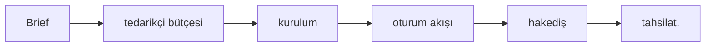

# 16-03-01 · Kurumsal etkinlik ve kongre ajansı

> Sektör: [[16 Etkinlik & Organizasyon]] · Öncelik: **3.2** / 5 · Öneri: **B**
> Puanlar tahmindir: pazar 3 · ödeme 4 · rekabet boşluğu 3 · kolaylık 3 · aciliyet 3

## 1. Özet
Şirket veya kurum adına lansman, kongre, gala ve fuar katılımını proje olarak yürüten ajans.

- **İşletme sayısı:** bulunamadı
- **NACE:** 82.30
- **Sayı türü:** tahmin

## 2. Günlük iş akışı
1. Brief
2. tedarikçi bütçesi
3. kurulum
4. oturum akışı
5. hakediş
6. tahsilat.

## 3. İhtiyaçlar ve sorunlar
| İhtiyaç | Bugün nasıl çözüyorlar | Etkisi |
|---|---|---|
| [[Etkinlik takvimi]] | Excel / WhatsApp / portal (tahmin) | Zaman, hata, uyum riski |
| [[Kapora / sözleşme]] | Excel / WhatsApp / portal (tahmin) | Zaman, hata, uyum riski |
| [[Tedarikçi teyidi]] | Excel / WhatsApp / portal (tahmin) | Zaman, hata, uyum riski |
| [[Run-of-show]] | Excel / WhatsApp / portal (tahmin) | Zaman, hata, uyum riski |
| [[Kişi sayısı]] | Excel / WhatsApp / portal (tahmin) | Zaman, hata, uyum riski |
| [[e-Belge]] | Excel / WhatsApp / portal (tahmin) | Zaman, hata, uyum riski |
| [[Salon seans]] | Excel / WhatsApp / portal (tahmin) | Zaman, hata, uyum riski |
| [[Telif / MSG listesi]] | Excel / WhatsApp / portal (tahmin) | Zaman, hata, uyum riski |

## 4. Parçalar

31 parça · 31 şart · 0 olmalı · 0 iyi olur

### Şart (31)

| Fonksiyon | Araç | Kullanım |
|---|---|---|
| [[Muhasebe ve Gelir-Gider]] | [[Muhasebe ve Gelir-Gider]] | Gelir, gider, cari, kasa ve banka. Sektör belgesi para kaydını buraya düşürür. |
| [[e-Fatura ve e-Arşiv]] | [[e-Fatura ve e-Arşiv]] | Satış belgesi taslağı; gönderim entegratör + onayla. |
| [[CRM]] | [[CRM]] | Kişi/firma kartı, iletişim, not; sektör alanları karta eklenir. |
| [[Personel ve Vardiya]] | [[Personel ve Vardiya]] | Personel kartı, vardiya, puantaj. Bordro/SGK kesilmez. |
| [[Raporlar]] | [[Raporlar]] | Ciro, tahsilat, açık iş ve personel özeti. |
| [[AI Asistan]] | [[AI Asistan]] | Komut çalıştırır, taslak üretir; yüksek etkili işlem onaysız bitmez. |
| [[Ayarlar]] | [[Ayarlar]] | İşletme, belge, bildirim ve entegrasyon ayarları. |
| [[Etkinlik takvimi]] | [[Etkinlik takvimi]] | Tarih/seans/kaynak doluluğu; opsiyon ve kesin kayıt; çakışma engeli. |
| [[15 Haziran akşam boş mu?]] | [[Etkinlik takvimi]] | 15 Haziran akşam boş mu? — Tarih/seans/kaynak doluluğu; opsiyon ve kesin kayıt; çakışma engeli. |
| [[Aynı tarihe iki opsiyon var mı?]] | [[Etkinlik takvimi]] | Aynı tarihe iki opsiyon var mı? — Tarih/seans/kaynak doluluğu; opsiyon ve kesin kayıt; çakışma engeli. |
| [[Kapora sözleşme]] | [[Kapora sözleşme]] | Opsiyon, kapora, kesinleşme, kalan bakiye ve iade kuralı. |
| [[Yılmaz düğününün kaporası geldi mi?]] | [[Kapora sözleşme]] | Yılmaz düğününün kaporası geldi mi? — Opsiyon, kapora, kesinleşme, kalan bakiye ve iade kuralı. |
| [[Kalan bakiyeyi hatırlat]] | [[Kapora sözleşme]] | Kalan bakiyeyi hatırlat — Opsiyon, kapora, kesinleşme, kalan bakiye ve iade kuralı. |
| [[Tedarikçi teyidi]] | [[Tedarikçi teyidi]] | Kalem bazlı tedarikçi atama ve yazılı teyit durumu. |
| [[Cumartesi ikram teyit etti mi?]] | [[Tedarikçi teyidi]] | Cumartesi ikram teyit etti mi? — Kalem bazlı tedarikçi atama ve yazılı teyit durumu. |
| [[Teyitsiz tedarikçiler?]] | [[Tedarikçi teyidi]] | Teyitsiz tedarikçiler? — Kalem bazlı tedarikçi atama ve yazılı teyit durumu. |
| [[Run-of-show]] | [[Run-of-show]] | Etkinlik günü zaman akışı ve bağımlı kalemler. |
| [[Akışta 19:00 sonrası ne var?]] | [[Run-of-show]] | Akışta 19:00 sonrası ne var? — Etkinlik günü zaman akışı ve bağımlı kalemler. |
| [[Kurulum penceresi çakışıyor mu?]] | [[Run-of-show]] | Kurulum penceresi çakışıyor mu? — Etkinlik günü zaman akışı ve bağımlı kalemler. |
| [[Kişi sayısı]] | [[Kişi sayısı]] | Sözleşme kişi sayısı ile güncel sayıyı ve etkileri takip eder. |
| [[Kişi 180'den 220'ye çıktı, ne değişir?]] | [[Kişi sayısı]] | Kişi 180'den 220'ye çıktı, ne değişir? — Sözleşme kişi sayısı ile güncel sayıyı ve etkileri takip eder. |
| [[Son kişi güncellemesi?]] | [[Kişi sayısı]] | Son kişi güncellemesi? — Sözleşme kişi sayısı ile güncel sayıyı ve etkileri takip eder. |
| [[Proje bütçe]] | [[Proje bütçe]] | Kurumsal brief, kalem bütçe ve onay kapıları. |
| [[Lansman bütçe sapması?]] | [[Proje bütçe]] | Lansman bütçe sapması? — Kurumsal brief, kalem bütçe ve onay kapıları. |
| [[AV kalemi onaylı mı?]] | [[Proje bütçe]] | AV kalemi onaylı mı? — Kurumsal brief, kalem bütçe ve onay kapıları. |
| [[Kurulum oturum]] | [[Kurulum oturum]] | Load-in ve oturum/speaker zaman blokları. |
| [[İkinci gün 14:00 oturumu?]] | [[Kurulum oturum]] | İkinci gün 14:00 oturumu? — Load-in ve oturum/speaker zaman blokları. |
| [[Kurulum 08:00'e kaydı]] | [[Kurulum oturum]] | Kurulum 08:00'e kaydı — Load-in ve oturum/speaker zaman blokları. |
| [[Hakediş değişiklik]] | [[Hakediş değişiklik]] | Change order ve faturalanabilir fark. |
| [[Kişi +40 change order oluştur]] | [[Hakediş değişiklik]] | Kişi +40 change order oluştur — Change order ve faturalanabilir fark. |
| [[Bu ay kesilecek hakediş?]] | [[Hakediş değişiklik]] | Bu ay kesilecek hakediş? — Change order ve faturalanabilir fark. |

### Olmalı (0)

_Yok._

### İyi olur (0)

_Yok._

## 5. Teknik detay
- **Entegrasyonlar:** Modül kartlarındaki entegrasyon notlarına bak; açık API yoksa panel kaydı + kullanıcı girişi.
- **Ana ekranlar:** İş listesi / kart · Takvim veya pipeline · Tahsilat · Rapor
- **Veri yapısı:** `Cari → İşKaydı → Belge/Tahsilat → Hatırlatma (onay kuyruğu)`

## 6. Rakipler
- [[iyzico]]
- [[Biletix / Passo]]

## 7. Kaynaklar
- [[16 Etkinlik & Organizasyon – Kaynaklar]]
- Araştırma arşivi: `08 Arşiv/eski-docs-sektorel-arastirma/`
