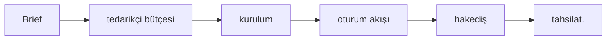

# 16-03-01 · Kurumsal etkinlik ve kongre ajansı

> Sektör: [[16 Etkinlik & Organizasyon]] · Öncelik: **3.2** / 5 · Öneri: **B**
> Puanlar tahmindir: pazar 3 · ödeme 4 · rekabet boşluğu 3 · kolaylık 3 · aciliyet 3

## 1. Özet
Şirket veya kurum adına lansman, kongre, gala ve fuar katılımını proje olarak yürüten ajans.

- **İşletme sayısı:** bulunamadı
- **NACE:** 82.30

## 2. Günlük iş akışı
1. Brief
2. tedarikçi bütçesi
3. kurulum
4. oturum akışı
5. hakediş
6. tahsilat.

AI destek (onaylı): Değişen kişi sayısı veya kurulum saatini akış ve sipariş satırlarına bağlar.

## 3. İhtiyaçlar ve sorunlar
| İhtiyaç | Bugün nasıl çözüyorlar | Etkisi |
|---|---|---|
| [[Etkinlik takvimi]] | Excel / WhatsApp / portal (tahmin) | Zaman kaybı, hata riski |
| [[Kapora sözleşme]] | Excel / WhatsApp / portal (tahmin) | Zaman kaybı, hata riski |
| [[Tedarikçi teyidi]] | Excel / WhatsApp / portal (tahmin) | Zaman kaybı, hata riski |
| [[Proje bütçe]] | Excel / WhatsApp / portal (tahmin) | Zaman kaybı, hata riski |
| [[Kurulum oturum]] | Excel / WhatsApp / portal (tahmin) | Zaman kaybı, hata riski |
| [[Hakediş değişiklik]] | Excel / WhatsApp / portal (tahmin) | Zaman kaybı, hata riski |

## 4. Çözümümüz: modüller ve özellikler
**Araç tarifi:** [[Muhasebe ve Gelir-Gider]] + [[e-Fatura ve e-Arşiv]] + [[CRM]] + [[Personel ve Vardiya]] + [[Raporlar]] + [[AI Asistan]] + [[Ayarlar]] + [[Etkinlik takvimi]] + [[Kapora sözleşme]] + [[Tedarikçi teyidi]] + [[Run-of-show]] + [[Kişi sayısı]] + [[Proje bütçe]] + [[Kurulum oturum]]…

### Fonksiyonlar
- [[Lansman bütçe sapması?]]
- [[AV kalemi onaylı mı?]]
- [[İkinci gün 14:00 oturumu?]]
- [[Kişi +40 change order oluştur]]
- [[Bu ay kesilecek hakediş?]]

### MVP
- [[Etkinlik takvimi]]
- [[Kapora sözleşme]]
- [[Tedarikçi teyidi]]
- [[Run-of-show]]
- [[Kişi sayısı]]
- [[Proje bütçe]]
- [[Kurulum oturum]]
- [[Hakediş değişiklik]]

### Sonraki sürüm
- V2 opsiyonel araçlar

## 5. Teknik detay
- **Entegrasyonlar:** Panel takvimi, WhatsApp Cloud API, iyzico
- **Ana ekranlar:** Kart / iş listesi · Takvim veya pipeline · Tahsilat · Rapor
- **Veri yapısı:** `Cari → İşKaydı → Belge/Tahsilat → Hatırlatma (onay kuyruğu)`

## 6. Fiyat ve paket önerisi
| Paket | İçerik | Fiyat | Not |
|---|---|---|---|
| Başlangıç | Çekirdek + MVP araçlar | bulunamadı | tahmin |
| Plus | V2 araçlar | bulunamadı | tahmin |

Uygun iş modeli: Abonelik (taahhütsüz aylık; yıllık indirim) — tahmin

## 7. Satış argümanı
- **Değer önerisi (tek cümle):** Kurumsal etkinlik ve kongre ajansı gününü tek panelde toplar; resmi gönderim ve tahsilat onayda kalır.
- **3 ana mesaj:**
  1. Dağınık Excel/WhatsApp yerine tek iş kaydı
  2. e-Belge ve hatırlatmalar onay kuyruğunda
  3. Sektöre özel alanlar, ortak çekirdek üzerinde
- **İtirazlar ve cevaplar:**

| İtiraz | Cevap |
|---|---|
| Zaten Excel var | Süre/uyum hatırlatması ve belge taslağı Excel’de dağılır |
| Resmi API yok | Panel kaydı + kurum portalı; uydurma entegrasyon yok |
| Pahalı | Taahhütsüz paket; yalnız kullanılan araçlar (tahmin) |

## 8. Rakipler
- [[iyzico]]
- [[Biletix / Passo]]

## 9. Kaynaklar
- [[16 Etkinlik & Organizasyon – Kaynaklar]]
- Arşiv: `08 Arşiv/eski-docs-sektorel-arastirma/ai-kaynak/16-etkinlik-organizasyon.md`
